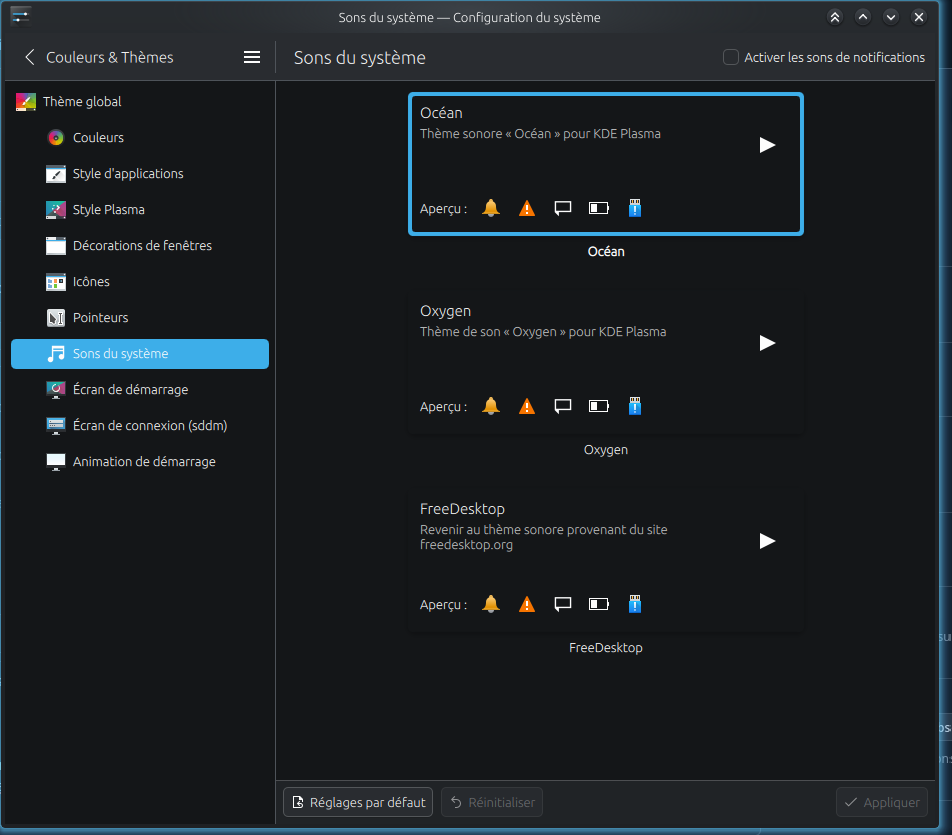
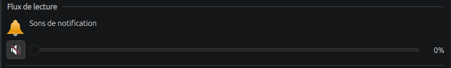

# Installing MachinCast

*[Version française](INSTALL.fr.md)*

This document describes how to install MachinCast on a playout machine, check it, update it and add other accounts. It is meant for the machine's administrator: it does not require knowing the code. How to use the programs once installed is described in the [administration guide](doc/en/administration/README.md), and how to use the graphical interface in the [on-air guide](doc/en/utilisateur/README.md). The development machine is described in the [development guide](doc/fr/developpement/poste.md) (French).

The `install.sh` script does all the work. The [Installing by hand](#installing-by-hand) section details each of its steps, for those who want to do them themselves or understand what it does.

> **Project status**: MachinCast 0.9.1 is its second published version, ahead of 1.0 ([RELEASE.md](RELEASE.md)). The indexing checks the sounds, `Machin player` broadcasts the schedule, from a terminal or as a service, and the graphical interface (`Machin interface`) programs it and follows it. What is still missing is in the [open tickets](https://github.com/dascritch/machincast/issues).

## Contents

- [In short](#in-short)
- [Requirements](#requirements)
- [Getting MachinCast](#getting-machincast)
- [Installing with install.sh](#installing-with-installsh)
- [Adapting the configuration](#adapting-the-configuration)
- [Choosing the language](#choosing-the-language)
- [Preparing the on-air machine](#preparing-the-on-air-machine)
- [Checking the installation](#checking-the-installation)
- [Playout service](#playout-service)
- [Adding another account](#adding-another-account)
- [Updating](#updating)
- [Reimporting a backup](#reimporting-a-backup)
- [Installing by hand](#installing-by-hand)
- [Uninstalling](#uninstalling)
- [When something goes wrong](#when-something-goes-wrong)

## In short

```bash
git clone https://github.com/dascritch/machincast.git ~/machincast
cd ~/machincast
./install.sh --simulation   # shows what will be done, without changing anything
./install.sh
```

Then: adapt `machincast.toml` ([see below](#adapting-the-configuration)), then restart the machine to read the service journal.

## Requirements

- **Ubuntu 26.04 LTS**. Other LTS versions (24.04…) are accepted, with a warning; non-LTS versions are refused. MachinCast is checked with the GStreamer version of Ubuntu 26.04, 1.28: with an older version, like 1.24 in Ubuntu 24.04, the installation warns, and nothing is guaranteed ([#284](https://github.com/dascritch/machincast/issues/284)).
- **The account that will use MachinCast, with `sudo` rights**. The installation is single-user: a single Unix account uses MachinCast, the one that installs it. The script is run with that account, never with `sudo`: it asks for the password only for the steps that need it.
- **A dedicated machine**, with a processor of 1 GHz at least, 2 GB of RAM and 50 GB of disk space for the sounds ([#338](https://github.com/dascritch/machincast/issues/338)). In production, the [playout service](#playout-service) is installed on it.
- **Internet access**, for apt and pip.
- **PostgreSQL 16 or newer**, installed by the script if missing. Ubuntu 26.04 provides a suitable version.

Packages installed by apt: only what pip cannot provide. All Python libraries come from pip, in an isolated environment ([#51](https://github.com/dascritch/machincast/issues/51)).

| Package | Role |
| --- | --- |
| `python3-venv` | Creating the Python virtual environment. |
| `python3-dev` | Python headers, to compile PyGObject during `pip install`. |
| `build-essential` | C compiler, for PyGObject. |
| `pkg-config` | Finding the libraries during the compilation. |
| `libgirepository-2.0-dev` | GObject introspection, which PyGObject needs to reach GStreamer. |
| `libcairo2-dev` | Cairo, a build dependency of PyGObject. |
| `gir1.2-gstreamer-1.0` | Description of GStreamer for PyGObject. |
| `gstreamer1.0-plugins-base` | Ogg Vorbis decoding, audio conversion and resampling. |
| `gstreamer1.0-plugins-good` | MP3, FLAC and WAV decoding; parsing of raw AAC files (`.aac`); reading HTTP and HTTPS streams. |
| `gstreamer1.0-plugins-bad` | AAC decoding (`.m4a` and `.aac` files). |
| `gstreamer1.0-alsa` | `alsa` audio output. |
| `gstreamer1.0-pulseaudio` | `pulseaudio` audio output. |
| `gstreamer1.0-pipewire` | `pipewire` audio output. |
| `pipewire-bin` | `pw-link`, which links the air to the pre-listen to listen to it under PipeWire ([#24](https://github.com/dascritch/machincast/issues/24)). Already present with PipeWire on a desktop Ubuntu. |
| `libmagic1t64` | Recognising the real type of the sound files, without trusting their extension ([#121](https://github.com/dascritch/machincast/issues/121)). |
| `postgresql` | Database server. |
| `bash-completion` | Loading the completion of `Machin`. Already present on a standard Ubuntu, missing from a minimal installation. |
| `acl` | `setfacl`, which lets the playout service read MachinCast and the banks, without changing their owner or their mode ([#381](https://github.com/dascritch/machincast/issues/381)). |
| `wireplumber` | Session manager of the playout service's own PipeWire ([#381](https://github.com/dascritch/machincast/issues/381)). Already present with PipeWire on a desktop Ubuntu. |

## Getting MachinCast

MachinCast is installed **in place**: the directory where it is becomes the installation directory, and `/opt/machincast` points to it. It must therefore no longer be moved after the installation.

The installation is single-user: MachinCast goes in the home directory of the account that uses it, for instance `~/machincast`. Only the installation of the [playout service](#playout-service) moves it, with agreement, to `/opt/machincast`, which the service can read ([#381](https://github.com/dascritch/machincast/issues/381)).

```bash
git clone https://github.com/dascritch/machincast.git ~/machincast
cd ~/machincast
```

Each published version also has its archive, `machincast-<version>.tar.gz`, in the [releases of the repository](https://github.com/dascritch/machincast/releases) ([#41](https://github.com/dascritch/machincast/issues/41)). It is used the same way: unpack it in the chosen directory, then run `./install.sh` from that directory. Its notes are in [RELEASE.md](RELEASE.md).

```bash
tar -xzf machincast-0.9.1.tar.gz -C ~
mv ~/machincast-0.9.1 ~/machincast
cd ~/machincast
```

Outside a git repository, **Help → Version** gives the version and its publication date; an update is then done by unpacking the next archive in its place, keeping `machincast.toml`.

## Installing with install.sh

From the MachinCast directory, with your own account:

```bash
./install.sh --simulation   # shows the commands without running anything
./install.sh                # installs
./install.sh --dev          # installs, with the development machine's tools
./install.sh --service      # installs, with the playout service: computer dedicated to the air only
./install.sh --desktop       # installs, and puts the interface shortcut on the desktop without asking
./install.sh --no-desktop  # installs, without a desktop shortcut or question
./install.sh --stop-programs  # stops the running MachinCast programs without asking
./install.sh --leave-programs  # leaves them running, without asking
./install.sh --no-restore   # does not offer to reimport a backup; --restore FILE reimports it without asking
./install.sh --help         # help
```

`--dev` can be combined with `--simulation`. See the [development machine](doc/fr/developpement/poste.md) (French).

**Can be run again**: each step already done is left as it is. On failure, fix what the message says, then run the script again. When run again, PostgreSQL reports with `NOTICE:  role … has already been granted membership …` lines that the account was already authorised: this is not an error.

**What it asks for**: the `sudo` password, for apt, for the commands run as the `postgres` user, for adding the account to the `systemd-journal` group, for the links in `/opt`, `/usr/local/bin` and `/usr/share`, and, with `--service`, for the service account, its directories, its systemd units and the polkit rule. At most two questions, without `--service`; those of the service are described with it ([Playout service](#playout-service)). If MachinCast programs are running: « Stop them during the installation, then relaunch them? [y/N] »; Enter answers no. `--stop-programs` and `--leave-programs` answer it in advance; without a terminal, it is not asked, and they keep running. On the first installation: « Also put the MachinCast shortcut on the desktop? [Y/n] »; Enter answers yes. `--desktop` and `--no-desktop` answer it in advance; without a terminal, for instance in a script, it is not asked, and the shortcut does not go on the desktop. If the playout service is already installed, without `--service` or `--remove-service`, the installation updates it too, as `--service`, without asking again to dedicate the computer, its timers as they were ([#557](https://github.com/dascritch/machincast/issues/557)): an update of the computer does not forget the service. When it has just created the production database: « You seem to be making a new installation of MachinCast. Had you already run it on this computer or on another one? Should its database be recovered? » ([Reimporting a backup](#reimporting-a-backup)).

**What it does**, in order:

| Step | What happens | What changes on the machine |
| --- | --- | --- |
| System | Checks that it is run without `sudo`, on an Ubuntu LTS. | Nothing. |
| Network access | Checks that the machine reaches the Internet ([#376](https://github.com/dascritch/machincast/issues/376)): a single one of these addresses answering is enough, `https://dascritch.net/machincast_test_its_connection`, `https://cpu.pm/machincast_test_its_connection`, `https://google.com`, with `curl --head`, or the system's `python3` without `curl`. Without a network, a **first installation** stops: apt and pip need it. An **update** goes on, without updating the system packages or the Python dependencies: run it again once the network is back. | Nothing. |
| Running MachinCast programs | Lists those running, under all the accounts of the machine: `Machin player` (the playout service, a trial broadcast, a simulation), `Machin indexer`, `Machin interface`. An update, and its database migrations, must not be done under them: according to the answer to the question, it stops them, the service with `systemctl stop`, the others with a signal, with `sudo` for those of another account ([#254](https://github.com/dascritch/machincast/issues/254)). **Stopped, the broadcast goes silent until the end of the installation**; the interface loses the cards that were not saved. | Nothing, or programs stopped. |
| System packages | Installs the packages of the [requirements table](#requirements). | apt packages. |
| Python virtual environment | Creates `.venv` in the MachinCast directory, without access to the system's Python packages, and installs MachinCast and its dependencies in it. | `.venv` in the MachinCast directory. |
| Configuration | Copies `machincast.exemple.toml` to `machincast.toml` if it does not exist. An existing `machincast.toml` is never changed. | `machincast.toml`. |
| PostgreSQL | As the `postgres` user: creates the account's PostgreSQL role, **without any particular right** on the server; creates the production and test databases named in `machincast.toml`, which the account owns; creates MachinCast's three group roles. A production database it has just created can take back a backup of a previous installation ([Reimporting a backup](#reimporting-a-backup)). Then, with the account: applies the schema to both databases. | PostgreSQL server. |
| Roles | As the `postgres` user: authorises the account to assume MachinCast's three roles, without inheriting their rights. | PostgreSQL server. |
| System journal | Adds the account to the `systemd-journal` group, to read the service journal. Effective after the machine restarts. | Groups of the account. |
| Links | `/opt/machincast` to the MachinCast directory; `/usr/local/bin/Machin` to the wrapper; the bash completion in `/usr/share/bash-completion/completions/Machin`. | Three symbolic links. |
| GStreamer version and plugins, audio output | Warns if GStreamer or its plugins are older than version 1.28, with which MachinCast is checked, naming the package to update ([#284](https://github.com/dascritch/machincast/issues/284)). Checks that GStreamer can decode MP3, M4A, AAC, Ogg, FLAC and WAV, read HTTP and HTTPS streams, and create the audio output of `machincast.toml`, without playing any sound. | Nothing. |
| Interface shortcut | Installs the **MachinCast** shortcut, with its icon, in the account's applications menu, under Multimedia. Also puts on the Desktop the editable document **« Your MachinCast installation.md »** (« Votre installation MachinCast.md » in French), from its template, if it is not there: the team fills it in, and **Help → Your installation…** opens it ([#451](https://github.com/dascritch/machincast/issues/451), `python -m machincast.notes create`); it is never replaced. Depending on the answer to the question, or `--desktop`, also puts the shortcut on the account's desktop (the folder given by `xdg-user-dir DESKTOP`, « Desktop » in English), executable so that Plasma launches it without a warning. A shortcut already on the desktop is updated without a question; `--no-desktop` leaves it as it is ([#62](https://github.com/dascritch/machincast/issues/62)). | `~/.local/share/applications/machincast.desktop`, and `machincast.desktop` on the desktop; the MachinCast icon in the account's icon theme, `~/.local/share/icons/hicolor/512x512/apps/machincast.png`, which the sound settings show in front of the MachinCast programs ([#296](https://github.com/dascritch/machincast/issues/296)). |

**Relaunching the MachinCast programs**: before showing `Installation finished`, and even after a failure, it relaunches those it stopped: the playout service (except with `--remove-service`), and, for its account, the trial broadcast in a terminal and the interface in the graphical session, with their arguments. It says what remains to be reopened: an interrupted indexing, the simulation of the interface, and the programs of the other accounts, which their account relaunches.

At the end, it shows `Installation finished`. The playout service is only installed on request: see [Playout service](#playout-service).

**PostgreSQL roles.** Each MachinCast program acts with its own rights: `machincast_player` for the broadcast, `machincast_indexer` for the indexing, `machincast_interface` for the graphical interface, `machincast_intranet` for the intranet server ([#537](https://github.com/dascritch/machincast/issues/537)). An account of the station connects with its own PostgreSQL role, which gives access to nothing by itself: each program assumes its role from the connection. The details are in the [specification, § 3.2](doc/fr/spec.md#32-rôles-et-droits) (French).

## Adapting the configuration

The configuration is the `machincast.toml` file, in the MachinCast directory. It is never versioned by git. The `machincast.exemple.toml` template comments each key, and the [table of keys of the specification](doc/fr/spec.md#9-configuration) (French) gives their type and role.

To adapt at least:

- `audio.output`: `pipewire` (value of the template), `pulseaudio`, `alsa`, or `dummy`, the dummy output, for a trial without any sound; with `alsa`, the VU meter of the interface is unavailable, for lack of a monitoring port ([#24](https://github.com/dascritch/machincast/issues/24));
- `audio.device`: the on-air device, **mandatory to broadcast** (except with `dummy`); `"dummy"`, the « dummy output » entry, makes the air play without any sound, for an installation without a playout service ([#339](https://github.com/dascritch/machincast/issues/339)). Without it, `Machin player` refuses to start. It can also be chosen in the interface, **File → Broadcast service settings…**, **Audio** page, which writes it to `machincast.toml`. `.venv/bin/python -m machincast.installation devices` lists the devices of the configured output, with their identifier to copy; if it finds none, it says everything GStreamer sees, and `gst-device-monitor-1.0 Audio/Sink` gives the details;
- `audio.preview`: the pre-listen device of the interface, different from the on-air one; it can also be chosen later in the pre-listen window of the interface; `"dummy"`, the « dummy output » entry, disables the pre-listen ([#339](https://github.com/dascritch/machincast/issues/339));
- `metadata.public_text`: the name shown on the public page instead of a hidden title;
- `player.state_socket`: optional, the state socket read by the interface; by default in the runtime directory of the playout service (`/run/machincast/lecture.sock`) when it is installed, otherwise in that of the account (`$XDG_RUNTIME_DIR/machincast/lecture.sock`);
- `[outputs]`: the paths of the CSV airplay (one file per day), of the playlist and of the public HTML page, in the `sorties` folder of the MachinCast directory by default. To publish the page on the station's website, copy it or serve it from this path.

The names of the databases (`database.production` and `database.test`) are chosen **before** running `install.sh`, which creates the databases under these names. The test database must have another name than the production database: MachinCast otherwise refuses the configuration.

Any unknown key is refused, to detect typing errors. After a change, running `./install.sh` again checks the configuration and the audio output.

Without the `--config` option, the programs always read the `machincast.toml` of the MachinCast directory, whatever the directory they are launched from ([#76](https://github.com/dascritch/machincast/issues/76)). `Machin --help` gives its full path. Another configuration, also placed in the MachinCast directory, is designated with `--config`:

```bash
Machin indexer                                         # reads ~/machincast/machincast.toml
Machin indexer --config ~/machincast/essai.toml        # reads essai.toml
```

## Choosing the language

MachinCast speaks French or English, following the language of the session ([#360](https://github.com/dascritch/machincast/issues/360)): `LANGUAGE`, `LC_ALL`, `LC_MESSAGES` then `LANG`, the first one set, as for other programs. The interface, the messages of the programs, their help, `Machin` and `install.sh` follow it; a language MachinCast does not speak gives English. On an English machine, there is nothing to do. To launch a program in another language:

```bash
LANGUAGE=en Machin interface      # interface in English, on a French machine
LANGUAGE=fr Machin indexer        # messages in French, on an English machine
```

The playout service speaks the language of the system (`localectl status`, `sudo localectl set-locale LANG=en_GB.UTF-8`). The database log is written in English and translated when shown: the incidents screen shows it in the language of the interface, whatever the language of the service.

## Preparing the on-air machine

The machine that plays out is also a desktop computer: everything it plays on the on-air device goes on air. Two desktop settings prevent this ([#250](https://github.com/dascritch/machincast/issues/250)). Once the [playout service](#playout-service) is installed, they are no longer needed: the on-air card is reserved for it, hidden from the sessions of the machine, and no desktop program can play on it any more ([#381](https://github.com/dascritch/machincast/issues/381)). They apply to playout without the service, such as a trial broadcast. The paths below are those of the KDE Plasma system settings, the desktop of Ubuntu 26.04 LTS used on air; their names may vary from one version or desktop to another.

**1. The on-air device is not the desktop's default output.** The default output is that of every program that does not choose one: the browser, a video call, a video player, the system sounds. On the on-air device, they would go on air. MachinCast does not need it: `Machin player` always plays on `audio.device`, and the pre-listen on `audio.preview`, whether or not they are the default output.

- In **System Settings → Sound**, playback devices page, choose as default output another device than the on-air one: the control room headphones, or the machine's speakers.
- To check, on the command line: `wpctl status`, under PipeWire, marks the default output with a `*` among the « Sinks »; `pactl get-default-sink` gives its identifier, to compare with `audio.device`. `wpctl set-default <number>` chooses another, by the numbers of `wpctl status`.

**2. Notification sounds are muted.** A notification, a received message, a plugged-in USB key, the volume set from the keyboard make a sound, on the default output, or on air if it still is. With the playout service, they are no longer active on air; without it:

- in **Colours & Themes → Global Theme → System Sounds**, uncheck, top right, **Enable notification sounds**;

  

- in **Sound**, **Playback Streams** part, on the **Notification Sounds** line, mute the sound with its button, left of the slider, which goes to 0 %.

  

**The screen saver and the session lock can stay on.** The [VU meter](doc/en/utilisateur/prise-en-main.md#on-air-vu-meter) pauses during sleep, and resumes on return ([#346](https://github.com/dascritch/machincast/issues/346)); the broadcast itself goes on. Suspending the machine, which would cut the air, asks for an administrator's password once the service is installed ([protection of the machine](#playout-service), [#448](https://github.com/dascritch/machincast/issues/448)): it must not be scheduled in **System Settings → Power Management**.

## Checking the installation

First restart the machine, so that the `systemd-journal` group is taken into account. Under Ubuntu Desktop, logging out then in again is not always enough: new terminals may keep the session's old groups. Then:

```bash
id -nG                                     # must cite systemd-journal
Machin --help                              # help of the wrapper, list of the programs
Machin indexer --help                   # help of the indexing
Machin indexer                          # quick indexing
```

`Machin indexer` shows a summary, for instance `2026-10-15T08:15:00+02:00 quick indexing: 0 new sounds, 0 attachments, 0 removals; 0 sounds checked; 0 corrupt, 0 unsupported, 0 missing, 0 reinstated, 0 out of preview`, and ends with code 0. On a new machine, no bank exists yet, so no directory to browse: banks are created in the interface ([#31](https://github.com/dascritch/machincast/issues/31), [on-air guide](doc/en/utilisateur/sonores.md#card-of-a-bank)).

**First indexing.** The quick indexing, by default, only decodes the newly found sounds (« preview » state) and only checks the presence of the other files. The full audit decodes all the sounds, which can be long on a large library:

```bash
Machin indexer                   # quick
Machin indexer --full-audit   # full, to launch once after the first indexing
```

Anomalies (damaged, unreadable or missing file) are shown on the error output with the path of the file; they do not block the indexing.

**Service journal.** `Machin logs` follows the journal of the playout service. As long as the service is not installed ([#22](https://github.com/dascritch/machincast/issues/22)), it shows nothing, which is normal.

## Playout service

**For a computer dedicated to the air only** ([#22](https://github.com/dascritch/machincast/issues/22)). Without the service, `Machin player` is launched by hand, and stops with its terminal: this is what suits trying MachinCast. With the service, `machincast.service`, the broadcast starts with the machine, without anyone logging in, and restarts on its own after a crash.

```bash
./install.sh --service            # installs the service, or updates it
./install.sh --service --no-timers   # without the timers of the tasks, run by another tool
./install.sh --remove-service    # removes it
```

`--service` can be combined with `--simulation`. `--no-timers` does not install the timers of the tasks, and removes those of a previous installation: for a machine whose tasks are already run by a deployment tool, such as Ansible ([#455](https://github.com/dascritch/machincast/issues/455)). **What it does**, after the usual steps:

| Step | What happens | What changes on the machine |
| --- | --- | --- |
| Dedicated machine | First of all, says that the installation changes the machine, which becomes dedicated to the air: an account of its own, the on-air sound card reserved — no other application will be able to use it —, the home directories closed to the service, their rights never changed. Asks to accept it; refused, or without a terminal, nothing is installed (`--dedicated` accepts without asking). | Nothing. |
| Location of MachinCast | If MachinCast is in a home directory (`/home`, `/root`, that of the account), offers to move it to `/opt/machincast`, a symbolic link taking its place; install.sh then resumes from there, with the same options, and redoes the virtual environment. Refused, nothing is installed: the service never reads a home directory. | MachinCast moved, a link. |
| On-air output | Checks, with `python -m machincast.installation on-air`, that the air plays on a sound card ([#339](https://github.com/dascritch/machincast/issues/339)): on the dummy output (`audio.output = "dummy"`, or the « Dummy output » entry, `audio.device = "dummy"`), or on the PulseAudio output, which the service does not have ([#381](https://github.com/dascritch/machincast/issues/381)), install.sh stops, without installing anything of the service, and recommends another output. An on-air device still to be set is only reported: the service will refuse to start without it. | Nothing. |
| Service account | Creates the system account and group `machincast` (without password or shell, directory `/var/lib/machincast`), and adds the installing account to the group: it reads the logs of the service and pre-listens to the air. The group applies at the next login. | An account and a group. |
| Database | Creates the PostgreSQL role `machincast`, which connects by peer authentication and only assumes `machincast_player`, without inheriting its rights. | A PostgreSQL role. |
| Sound files directory | Creates `/home/machincast`, owned by the installing account, group `machincast`, mode `2750`: the sounds are put there; the service reads them without any right changing. | A directory. |
| Sounds in a home directory | Lists the bank directories and added files of the database that are in a home directory, and that the service does not read; those it already reads stay in place. As chosen: **moves** them to `/home/machincast` (a bank directory keeps its name, an added file goes into `fichiers`, a taken name gets `-2`…), and the database follows, in one transaction, the files going back to their place if it fails — the only exception to [#96](https://github.com/dascritch/machincast/issues/96), accepted each time; **removes** them from the database, without touching any file; or **leaves** them, without going on air. Without a terminal, they are left. | Files moved, or rows of the database. |
| Directories | Installs `/etc/tmpfiles.d/machincast.conf` (`python -m machincast.installation tmpfiles`) and creates, at each start of the machine, `/run/machincast`, `/var/log/machincast` and `/var/log/machincast/crash-dump`, owned by `machincast`, mode `2770`; and `/etc/logrotate.d/machincast` (`logrotate`): the logs rotate every week, 8 weeks kept. | Two configuration files, three directories. |
| PipeWire of the service | Installs `/etc/systemd/system/machincast-pipewire.service` and `machincast-wireplumber.service` (`pipewire-unit`, `wireplumber-unit`): a PipeWire and a WirePlumber of its own, under `machincast`, without any session; the PipeWire socket is `/run/machincast/pipewire-0`. WirePlumber only reads `/etc/machincast/wireplumber` (`wireplumber-service`: the sound cards only) and the configuration of the package. | Two systemd units, a WirePlumber fragment. |
| On-air card | Installs `/etc/wireplumber/wireplumber.conf.d/50-machincast.conf` (`wireplumber-desktop`): the PipeWire sessions of the machine no longer see the on-air card, which belongs to the service — two PipeWire do not open the same card at the same time; the WirePlumber of the current session is restarted. After a change of on-air card, run `./install.sh --service` again. | A WirePlumber fragment. |
| systemd unit | Installs `/etc/systemd/system/machincast.service`, written by `python -m machincast.installation unit`, then reloads systemd. | A systemd unit. |
| polkit rule | Installs `/etc/polkit-1/rules.d/50-machincast.rules`, written by `python -m machincast.installation rule`. | A polkit rule. |
| Protection of the machine | Installs `/etc/systemd/logind.conf.d/50-machincast.conf` (`python -m machincast.installation logind`) and reloads it with `systemctl reload systemd-logind`, without closing the sessions; installs `/etc/systemd/system.conf.d/50-machincast.conf` (`system-conf`) and reloads it with `systemctl daemon-reexec`; masks `ctrl-alt-del.target` ([#448](https://github.com/dascritch/machincast/issues/448)). | Two systemd fragments, a masked target. |
| Activation | Enables the PipeWire of the service, its WirePlumber and the service at the machine's start, and starts them; a changed unit or configuration restarts them. | Services enabled. |
| Service already installed, without `--service` | Updates it, as `--service` ([#557](https://github.com/dascritch/machincast/issues/557)), without asking again to dedicate the computer: the timers of the tasks stay installed, or absent, as before. It first names what is no longer up to date for this version ([#376](https://github.com/dascritch/machincast/issues/376)). | The service up to date. |
| Tasks | Unless `--no-timers`, installs `/etc/systemd/system/machincast-indexing.service` and its timer `machincast-indexing.timer` (`python -m machincast.installation indexing-unit` and `indexing-timer`), and `machincast-tasks.service` and its timer `machincast-tasks.timer` (`tasks-unit` and `tasks-timer`), which runs `bin/Machin tasks` every quarter of an hour, then enables both timers ([#455](https://github.com/dascritch/machincast/issues/455)). The former noon purge timer, `machincast-purge.timer`, is removed with its unit: the purge moves to 10:00 by default, followed by the full audit. | Two systemd units and two timers, a state directory. |

**The service** runs under its own system account, `machincast` ([#381](https://github.com/dascritch/machincast/issues/381)): it needs no open session, and restarts at the machine's start without anyone logging in. It plays through its own PipeWire, its role in the database is `machincast_player` alone, and it only reads MachinCast and the banks. It runs `bin/Machin player`, with the `machincast.toml` of the MachinCast directory, and restarts it 5 seconds after a crash. Stopping it sends `SIGTERM`, which ends the current play cleanly. Its messages go to the system journal, which `Machin logs` follows, and to `/var/log/machincast/Machin_player.log`; its crash reports to `/var/log/machincast/crash-dump`. The installing account reads them, as a member of the `machincast` group.

**The intranet server**, when switched on, runs under another system account, `machincast-intranet` ([#549](https://github.com/dascritch/machincast/issues/549)), outside the `machincast` group: its role in the database is `machincast_intranet` alone, it reads neither the sound files nor the PipeWire of the service nor its logs, and it can write only in its state directory, `/var/lib/machincast-intranet`. It follows the on-air output through a socket that Machin player keeps for it. Its messages go to the system journal: `journalctl -u machincast-intranet`.

**Reading the sound files.** The service never reads a home directory, and MachinCast never changes the rights of a home directory, nor of the system trees (`/etc`, `/usr`, `/media`, `/mnt`…). The sounds go in `/home/machincast`; a library can also be below `/home/machincast`, `/opt`, `/srv` or `/var`, whose root must already be crossable, never changed, and outside the system directories of `/var` (`lib`, `log`…): `Machin grant-read` gives the reading there. On a disk mounted elsewhere, a bank is accepted if the service already reads it; outside these trees, `Machin grant-read` gives it read access, through ACLs, without changing anything else ([Commands](doc/en/administration/commandes.md#reading-by-the-playout-service-machin-grant-read)). What the service already reads is always accepted, even below `/home` (a directory such as `/home/musiques`, opened to `machincast` by the administrator); the interface of the service refuses a sound of a home directory that it does not read, and elsewhere offers to grant the reading. A file it does not read is not played, and the log says so (`unreadable file`).

**The tasks** ([#455](https://github.com/dascritch/machincast/issues/455)) run under the installing account, owner of the database:

- **the quick indexing**, `bin/Machin indexer`, every hour; an hour missed, machine off, runs at its start;
- **the daily task**, once a day from the hour of `schedule.daily`, 10:00 by default, when someone is probably at the studio to see a problem: `bin/Machin purge`, which erases from the database what is past the expiry duration, `database.retention`, 60 days by default, and never a file ([Database purge](doc/en/administration/commandes.md#database-purge-machin-purge)); then the full audit, `bin/Machin indexer --full-audit`. It replaces the noon purge. The `machincast-tasks.timer` timer runs `bin/Machin tasks` every quarter of an hour, which does what is due ([Commands](doc/en/administration/commandes.md#regular-tasks-machin-tasks)): `python -m machincast.schedule claim` only lets the daily task through when due, and notes its run in `/var/lib/machincast-tasks`. A missed task, machine off, runs at the quarter of an hour after its start; a failed task is not retried before the next day, and its failure is in the journal and in the database log.

By hand:

```bash
python -m machincast.installation indexing-unit --config machincast.toml | sudo install -D --mode=644 /dev/stdin /etc/systemd/system/machincast-indexing.service
python -m machincast.installation indexing-timer --config machincast.toml | sudo install -D --mode=644 /dev/stdin /etc/systemd/system/machincast-indexing.timer
python -m machincast.installation tasks-unit --config machincast.toml | sudo install -D --mode=644 /dev/stdin /etc/systemd/system/machincast-tasks.service
python -m machincast.installation tasks-timer --config machincast.toml | sudo install -D --mode=644 /dev/stdin /etc/systemd/system/machincast-tasks.timer
sudo systemctl daemon-reload
sudo systemctl enable --now machincast-indexing.timer machincast-tasks.timer
```

The hour is set in `machincast.toml`, section `[schedule]`, or in the interface, **File → Broadcast service settings…**, **Tasks** page, without administrator rights: the timers do not change, and the new hour applies the same day. An indexing of the same mode already running, launched from the interface, makes the task exit with code 3, which is not a failure. `systemctl list-timers 'machincast-*'` gives the next runs; `journalctl --unit=machincast-indexing.service --unit=machincast-tasks.service`, what they did.

**Watching the bank directories** with systemd (`.path` units), to launch the indexing again as soon as a file arrives, was ruled out ([#455](https://github.com/dascritch/machincast/issues/455)): they rely on inotify, which follows neither subdirectories nor network disks (NFS, SMB), and their list would have to be rewritten, as administrator, at each bank. The hourly indexing and the **Maintenance** menu of the interface are enough.

**The polkit rule** only allows three actions on `machincast.service`, to the MachinCast account only: starting, stopping and restarting it, with the password, or the fingerprint, of an administrator of the machine. It allows nothing else, nor on another unit. Never `sudo` to control the broadcast:

```bash
systemctl start machincast.service
systemctl stop machincast.service
systemctl restart machincast.service
systemctl status machincast.service machincast-pipewire.service machincast-wireplumber.service
```

**The protection of the machine** ([#448](https://github.com/dascritch/machincast/issues/448)): on an on-air machine, turning off, restarting or suspending by mistake cuts the air. Ubuntu allows them without a password to any open session, and to the login screen. The same polkit rule submits them to the password, or the fingerprint, of an administrator, for any account: turning off, restarting, halting, suspending or hibernating the machine (the `power-off`, `reboot`, `halt`, `suspend` and `hibernate` actions of `org.freedesktop.login1`, and their `-multiple-sessions` and `-ignore-inhibit` variants). The login screen, which has no agent to ask for a password, can no longer turn the machine off: open a session first, or `sudo poweroff` on the console. logind would still turn off, without polkit, on the press of a key or when the lid closes: its fragment ignores them all (`HandlePowerKey`, `HandleRebootKey`, `HandleSuspendKey`, `HandleHibernateKey`, their long press, and `HandleLidSwitch` on AC power, on battery and docked). In a session, the desktop keeps control of the key, and goes through logind, hence through the rule. A long press on the power button, which the hardware handles on its own, always turns off, as a last resort. On the console, Ctrl+Alt+Delete no longer restarts: `ctrl-alt-del.target` is masked, and the systemd fragment cancels the burst of seven presses (`CtrlAltDelBurstAction=none`). By hand:

```bash
python -m machincast.installation logind --config machincast.toml | sudo install -D --mode=644 /dev/stdin /etc/systemd/logind.conf.d/50-machincast.conf
sudo systemctl reload systemd-logind
python -m machincast.installation system-conf --config machincast.toml | sudo install -D --mode=644 /dev/stdin /etc/systemd/system.conf.d/50-machincast.conf
sudo systemctl daemon-reexec
sudo systemctl mask ctrl-alt-del.target
```

**From the interface**, the **Broadcast** menu does the same, with the same authentication ([on-air guide](doc/en/utilisateur/antenne.md#controlling-the-broadcast), [#25](https://github.com/dascritch/machincast/issues/25)). As long as the service is not installed, the status bar of the interface shows `Non-final installation: broadcast without a service`, and the **Broadcast** menu controls a trial broadcast: `Machin player` in a terminal window, which the interface can stop and restart.

**Before installing the service**, stop any `Machin player` launched by hand: a second Machin player is refused while the state socket is in use, and the service would restart endlessly.

**Updating a service installed before [#381](https://github.com/dascritch/machincast/issues/381)**: it ran under the installing account, whose session stayed active at the start. `./install.sh --service` moves it under the `machincast` account; `sudo loginctl disable-linger "$(id -un)"` then gives the session back its usual behaviour.

`--remove-service` stops and disables the service, its PipeWire, its WirePlumber and the timers of the tasks, removes their units, the rule and the configuration files, gives the on-air card back to the sessions of the machine, removes the logind and systemd fragments, unmasks `ctrl-alt-del.target` and reloads logind and systemd: the machine turns off, restarts and suspends again as Ubuntu wants ([#448](https://github.com/dascritch/machincast/issues/448)), removes the PostgreSQL role `machincast`, then the `machincast` account and group. The logs stay in `/var/log/machincast`, the sounds in `/home/machincast`, and MachinCast in `/opt/machincast`. **No directory that contains a sound file is ever removed**, nor `/home/machincast`, even empty ([#430](https://github.com/dascritch/machincast/issues/430)): install.sh only removes the directories it created, once checked that they contain no sound file (any extension of the [indexed formats](doc/fr/spec.md#62-indexation-des-répertoires-de-banques), whatever its case), and says those it keeps. The purge is then launched by hand, with `Machin purge`.

## Adding another account

MachinCast is meant for a single Unix account, the one that installs it, and `install.sh` only authorises that one. If another account must exceptionally access it, an administrator (an account with `sudo`) runs, replacing `programmation` with the name of the account:

```bash
COMPTE=programmation
# PostgreSQL role of the account, without any particular right on the server
sudo -u postgres createuser "${COMPTE}"
# Authorisation to assume the three MachinCast roles, without inheriting their rights
sudo -u postgres psql -c "GRANT machincast_player, machincast_indexer, machincast_interface, machincast_intranet TO \"${COMPTE}\" WITH INHERIT FALSE, SET TRUE"
# Reading the service journal, effective after the machine restarts
sudo usermod --append --groups systemd-journal "${COMPTE}"
```

To give it only part of the rights, only name the wanted roles in the `GRANT`: for instance `machincast_indexer` alone for an account that only indexes.

The account must also be able to read the MachinCast directory. Under Ubuntu, a home directory is only readable by its owner: an installation in `~/machincast` therefore stays inaccessible to the other accounts as long as these rights are not changed.

To remove the access of an account:

```bash
COMPTE=programmation
sudo -u postgres psql -c "REVOKE machincast_player, machincast_indexer, machincast_interface, machincast_intranet FROM \"${COMPTE}\""
```

## Updating

From the MachinCast directory:

```bash
git pull
./install.sh
```

`install.sh` updates the Python dependencies and applies the new schema migrations to both databases. **With the playout service**, it updates the installed service too, even without `--service` ([#557](https://github.com/dascritch/machincast/issues/557)), and names what was no longer that of this version ([#376](https://github.com/dascritch/machincast/issues/376)): a former service can call a program that no longer exists, such as `Machin lecture`, which became `Machin player`; it then no longer starts, and stops with code 2, which the interface says. If MachinCast programs are running, it first offers to stop them, then relaunches them at the end ([Installing with install.sh](#installing-with-installsh)): so as not to silence the air at the wrong moment, run the update outside a show. `machincast.toml` is not changed: compare it with `machincast.exemple.toml` to add the new keys, which MachinCast otherwise reports as missing.

By hand, without running `install.sh` again:

```bash
git pull
.venv/bin/pip install --constraint constraints.txt --editable .
.venv/bin/python -m machincast.installation migrate --config machincast.toml
```

`migrate` applies the schema to the production and test databases of the configuration. For a single database, the same with yoyo:

```bash
.venv/bin/yoyo apply --batch --database "postgresql+psycopg:///machincast?host=/var/run/postgresql" src/machincast/migrations/
```

**Maintaining the database.** `Machin maintenance-db` ([#127](https://github.com/dascritch/machincast/issues/127)) backs up the production database with `pg_dump`, in the backup directory (the account's home directory by default, [#347](https://github.com/dascritch/machincast/issues/347)), applies the missing migrations, checks the roles, then optimises it (`VACUUM ANALYZE`). The interface also launches it, after confirmation, **Maintenance → Database maintenance…** menu. Details and restoring: [Database maintenance](doc/en/administration/commandes.md#database-maintenance-machin-maintenance-db).

**Purging the database.** `Machin purge` ([#268](https://github.com/dascritch/machincast/issues/268)) erases from the production database the airplay and the log older than the expiry duration (`database.retention`, 60 days by default), and the elements deleted for longer; never a file. The playout service installs it with a timer, every day at the hour of `schedule.daily`, 10:00 by default, followed by the full audit; the quick indexing runs every hour ([#455](https://github.com/dascritch/machincast/issues/455)): an installation that already has the service gets them by running `./install.sh` again, which offers to update it and replaces the former noon timer. Details: [Database purge](doc/en/administration/commandes.md#database-purge-machin-purge).

**Configuration in English** ([#357](https://github.com/dascritch/machincast/issues/357)). The sections, keys and values of `machincast.toml` are in English: `[database]`, `[outputs]`, `[metadata]`, `[player]`, `[dead_air]`, `audio.output`, `audio.device`, `audio.preview`, `dummy` for the dummy output… An old `machincast.toml` is refused, naming the new section: redo it from `machincast.exemple.toml`.

**English names of the commands** ([#356](https://github.com/dascritch/machincast/issues/356)). `Machin lecture` is now called `Machin player`, `Machin indexation` `Machin indexer`, `Machin dev-captures` `Machin dev-screenshots`, and their options are in English (`--full-audit`, `--sound`, `--window`, `--force`, `--seed`, `--name`, `--directory`, `--backups`, `--keep-open`), like those of `install.sh` (`--desktop`, `--no-desktop`, `--stop-programs`, `--leave-programs`, `--remove-service`) and the steps of `python -m machincast.installation`. The old names are no longer recognised: an existing installation is redone from scratch, `./install.sh --service` included to rewrite the unit of the service, which runs `bin/Machin player`.

**Schema in English** ([#358](https://github.com/dascritch/machincast/issues/358)). The tables, columns, types, values and roles of the database are in English: `sounds`, `banks`, `events`, `event_items`, `airplay`, `log`…, roles `machincast_player`, `machincast_indexer` and `machincast_interface`. A database created with the old schema, with French names, does not update, and MachinCast no longer recognises it ([#384](https://github.com/dascritch/machincast/issues/384)): back it up if it contains something useful, then recreate it, test database included. **This erases its content**: it is only possible as long as MachinCast is not in production. The commands of this document use the database names of the template, `machincast` and `machincast_test`: replace them with those of `database.production` and `database.test` in `machincast.toml`.

```bash
sudo -u postgres dropdb machincast
sudo -u postgres dropdb machincast_test
./install.sh
```

`install.sh` creates the new roles. The old ones, `machincast_lecture` and `machincast_indexation`, are no longer used: once both databases are recreated, they can be removed with `sudo -u postgres psql -c "DROP ROLE machincast_lecture, machincast_indexation"`. A hand-written query using the old names must be rewritten.

## Reimporting a backup

To start again quickly after a failure, or when changing machines ([#347](https://github.com/dascritch/machincast/issues/347)), a new installation takes back the database of a previous installation: that of a backup made by `Machin backup-db`, the **Maintenance → Export the database…** entry of the interface, or `Machin maintenance-db` ([Database export and reimport](doc/en/administration/commandes.md#database-export-and-reimport-machin-backup-db-machin-restore-db)). The backups go in the account's home directory, or in the one set in **File → Broadcast service settings…**, **Backup** page, which also copies `machincast.toml` elsewhere, such as on a USB key.

On the new machine, copy the sound files to the same paths, and the copied `machincast.toml`, renamed `machincast.toml`, into the MachinCast directory; then run `./install.sh`. **When it has just created the production database**, and only then, it asks whether a database should be recovered:

- **on a graphical desktop**, with a kdialog window: **Yes, restore a backup** opens the file selector, from the home directory, on the `.dump` backups; **No, start from scratch** moves on;
- **without a graphical display**, such as over ssh, in the terminal: `[y/N]`, then the path of the file, `~` included;
- **without a terminal or display**, nothing is asked, and nothing is reimported: `./install.sh --restore FILE` reimports one without asking anything, and `--no-restore` does not offer it.

It reimports it with `Machin restore-db`, which checks it: a MachinCast backup, of a version that is not newer than the installed one. A refused backup asks the question again: choose another, or start from scratch. Then it applies to the database the migrations it lacks, and goes on. With `--restore`, a refused backup stops `./install.sh`, before the schema: the database stays empty; fix it, then reimport by hand with `Machin restore-db FILE` before running `./install.sh` again.

A production database that already exists is never overwritten: the question is not asked, and `Machin restore-db` refuses a database that is not empty.

## Installing by hand

The commands below are those that `install.sh` runs in sequence. They are run from the MachinCast directory, with your own account. The database names are those of the configuration template: `machincast` and `machincast_test`.

**1. System packages.**

```bash
sudo apt install python3-venv python3-dev build-essential pkg-config libgirepository-2.0-dev libcairo2-dev \
	gir1.2-gstreamer-1.0 gstreamer1.0-plugins-base gstreamer1.0-plugins-good gstreamer1.0-plugins-bad \
	gstreamer1.0-alsa gstreamer1.0-pulseaudio gstreamer1.0-pipewire pipewire-bin libmagic1t64 postgresql bash-completion acl wireplumber
```

**2. Python virtual environment.** Never `--system-site-packages`: MachinCast must not depend on the versions of the distribution's Python packages.

```bash
python3 -m venv .venv
.venv/bin/pip install --upgrade pip
.venv/bin/pip install --constraint constraints.txt --editable .
```

`constraints.txt` pins the exact version of each Python dependency, development ones included ([#438](https://github.com/dascritch/machincast/issues/438)): `pyproject.toml` only gives minimums, and without it two machines installed on different dates would not have the same versions. `install.sh` always passes it to pip.

**3. Configuration.**

```bash
cp machincast.exemple.toml machincast.toml
```

Then adapt it (see [Adapting the configuration](#adapting-the-configuration)).

**4. PostgreSQL.** Everything that needs rights on the server goes through the `postgres` user: the account gets neither `CREATEDB` nor `CREATEROLE`. It only becomes the owner of both databases, which lets it apply the schema to them.

```bash
sudo -u postgres createuser "$(id -un)"
sudo -u postgres createdb --owner="$(id -un)" machincast
sudo -u postgres createdb --owner="$(id -un)" machincast_test
sudo -u postgres psql -c "CREATE ROLE machincast_player NOLOGIN" -c "CREATE ROLE machincast_indexer NOLOGIN" \
	-c "CREATE ROLE machincast_interface NOLOGIN" -c "CREATE ROLE machincast_intranet NOLOGIN"
.venv/bin/python -m machincast.installation migrate --config machincast.toml
```

The three group roles belong to the server, not to a database: they serve both databases, and are created only once. A `role … already exists` error means they already exist.

**5. Roles of the account.**

```bash
sudo -u postgres psql -c "GRANT machincast_player, machincast_indexer, machincast_interface, machincast_intranet TO \"$(id -un)\" WITH INHERIT FALSE, SET TRUE"
```

**6. System journal.**

```bash
sudo usermod --append --groups systemd-journal "$(id -un)"
```

**7. Links.**

```bash
sudo ln --symbolic --force --no-dereference "$(pwd)" /opt/machincast
sudo ln --symbolic --force --no-dereference /opt/machincast/bin/Machin /usr/local/bin/Machin
sudo ln --symbolic --force --no-dereference /opt/machincast/bash-completion/Machin /usr/share/bash-completion/completions/Machin
```

Without these links, the wrapper is called with `bin/Machin` from the MachinCast directory, and the completion is loaded into the current shell with `source bash-completion/Machin`.

**Interface shortcut.** In the applications menu, then, if wanted, on the desktop, executable:

```bash
.venv/bin/python -m machincast.installation shortcut --config machincast.toml >machincast.desktop
install -D --mode=644 machincast.desktop ~/.local/share/applications/machincast.desktop
install -D --mode=755 machincast.desktop "$(xdg-user-dir DESKTOP)/machincast.desktop"
rm machincast.desktop
install -D --mode=644 src/machincast/interface/machincast.png ~/.local/share/icons/hicolor/512x512/apps/machincast.png
```

The shortcut launches `bin/Machin interface` from the MachinCast directory, with the icon `src/machincast/interface/machincast.png`, the logo of the station's technical crews ([#213](https://github.com/dascritch/machincast/issues/213)), or the image of `interface.icon` when it exists ([#111](https://github.com/dascritch/machincast/issues/111)); an icon chosen in the preferences of the interface rewrites the installed shortcuts at once. Moving the MachinCast directory requires redoing it. The last command installs the MachinCast icon in the account's icon theme: the Plasma sound settings show it in front of « MachinCast lecteur », « MachinCast interface » and « MachinCast installation », the names under which the programs present themselves to PipeWire ([#296](https://github.com/dascritch/machincast/issues/296)).

**8. Checking the GStreamer plugins and the audio output.**

```bash
.venv/bin/python -m machincast.installation check --config machincast.toml
```

For each missing plugin, the command names the apt package to install.

## Uninstalling

```bash
./install.sh --remove-service   # if the playout service is installed
sudo rm /opt/machincast /usr/local/bin/Machin /usr/share/bash-completion/completions/Machin   # /opt/machincast: the link only
rm --force ~/.local/share/applications/machincast.desktop "$(xdg-user-dir DESKTOP)/machincast.desktop"
sudo -u postgres dropdb machincast
sudo -u postgres dropdb machincast_test
```

The database names are those of the template: use those of `database.production` and `database.test` in `machincast.toml`. On a development machine, the test database can serve other copies of MachinCast: only delete it if it is no longer used.

**The two `dropdb` commands erase the programming and the broadcast history.** The sound files are never modified or deleted by MachinCast ([#96](https://github.com/dascritch/machincast/issues/96)): they stay in place, neither the uninstallation nor the deletion of the databases touches them. The MachinCast directory can then be deleted. If the installation of the service moved it to `/opt/machincast`, it is no longer a link but the directory itself: `rm` refuses it without `--recursive`, and it is this directory that remains to be deleted. The PostgreSQL roles and the apt packages stay in place: they can serve other software.

## When something goes wrong

| Message | Cause and solution |
| --- | --- |
| `install.sh: run install.sh with your own account, without sudo` | The script was launched with `sudo` or as `root`. Run it again with your account. |
| `install.sh: Ubuntu LTS required (target: 26.04 LTS)` | The system is not an Ubuntu LTS. `./install.sh --simulation` still shows the commands. |
| `install.sh: configuration … to correct, then run install.sh again` | `machincast.toml` is invalid: the previous message names the key at fault. |
| `on air on the dummy output: the broadcast service would play no sound; …`, then `install.sh: broadcast service not installed: the on-air output does not suit it` | `./install.sh --service` on a configuration whose air plays no sound ([#339](https://github.com/dascritch/machincast/issues/339)). Choose the on-air sound card in the interface, **File → Broadcast service settings…**, **Audio** page (the dummy output is then greyed out there if the service is already installed), or in `audio.output` and `audio.device` of `machincast.toml`, then run `./install.sh --service` again. |
| `on air on the PulseAudio output: the broadcast service plays through its own PipeWire; …`, then `install.sh: broadcast service not installed: the on-air output does not suit it` | `./install.sh --service` on a configuration whose air is on the PulseAudio output ([#381](https://github.com/dascritch/machincast/issues/381)): the service has no PulseAudio server. Choose the PipeWire output in the interface, **File → Broadcast service settings…**, **Audio** page, or in `audio.output` of `machincast.toml`, then run `./install.sh --service` again. |
| `on-air device not set: …` | `audio.device` is missing: give it in `machincast.toml`, or in the interface, **File → Broadcast service settings…**, **Audio** page. Then restart the broadcast. |
| `audio output unavailable: …` | The output of `audio.output` cannot be created: install the named plugin, or check `audio.device`. Running `install.sh` again checks the output. |
| `indexing refused: another quick indexing is running on this database`, or `another full audit` (code 3) | An indexing of the same mode is already running on the database, launched from a terminal, the interface or another machine. Wait for its end, then run it again. Its window, if it comes from the interface, can stop it. |
| `--window needs a graphical display …` | `--window` was given without a graphical session, for instance over SSH: launch `Machin indexer` without `--window`, its log is shown in the terminal. |
| `database unreachable` | PostgreSQL is not started (`sudo systemctl start postgresql`), or `database.socket` does not designate its socket. |
| `insufficient rights to apply the schema in the database …` | The database already existed and belongs to another account, or its tables were created by another account. As long as it contains nothing useful, delete it (`sudo -u postgres dropdb …`) then run `install.sh` again, which recreates it. |
| `…: GStreamer plugin missing, install …` | A sound format or the configured audio output cannot work. Install the named package, then run `install.sh` again. |
| `GStreamer 1.24.2: MachinCast is checked with version 1.28 (Ubuntu 26.04 LTS); update libgstreamer1.0-0` | Warning: GStreamer, or one of its plugins, is older than the checked version. The installation goes on, but the installed version has not been checked. Move the machine to Ubuntu 26.04 LTS, or update the named package. |
| `install.sh: … exists and is not a symbolic link` | A file or a directory already takes the place of a link, for instance an old installation in `/opt/machincast`. Move it, then run `install.sh` again. |
| `invalid configuration: …` (code 2) | The message names the file and the key at fault. `configuration file not found`: the `machincast.toml` of the MachinCast directory does not exist; copy it from `machincast.exemple.toml`, or run `install.sh` again. |
| `install.sh`: `warning: … is a PostgreSQL superuser` | The account can do everything on the PostgreSQL server, and assumes the MachinCast roles without authorisation, which MachinCast does not require. If it serves nothing else, remove this right with the given command. As long as it is a superuser, the scenario of `roles.feature` that checks the authorisations of the test account fails, giving the commands to run. |
| `database error: … permission denied to set role …` | The account is not authorised to assume the role: see [Adding another account](#adding-another-account). |
| « MachinCast: database unreachable » window, when launching `Machin interface` | The interface does not reach the database of `database.production`. The « Open INSTALL.md » button opens this document, and the details of the window give the PostgreSQL error. `connection … failed` or `No such file or directory`: PostgreSQL is not started (`sudo systemctl start postgresql`), or `database.socket` does not designate its socket. `database … does not exist`: run `install.sh` again, which creates the database. `permission denied to set role`: see [Adding another account](#adding-another-account). |
| `backup impossible: pg_dump not found, install postgresql-client` | `pg_dump` is missing: `sudo apt install postgresql-client`, then run it again. Nothing was changed. |
| `backup impossible: …; maintenance stopped, nothing was changed` | The backup directory cannot be written, the disk is full, or `pg_dump` failed: its error follows. Fix it, or give another directory with `--backups`. |
| `role …: missing from the server, or not assumable by the account` | Run, with an administrator account, the two commands given by the message, then launch the maintenance again. See also [Adding another account](#adding-another-account). |
| `Machin logs` asks for the `adm` or `systemd-journal` group, or only shows messages of its own account | The group is not yet taken into account by the session. If `id -nG "$(id -un)"` cites `systemd-journal` but `id -nG` does not, the addition is done: restart the machine. Otherwise, run `install.sh` again. |

Information messages are shown on the standard output; anomalies and errors on the error output. Each line starts with its time, in ISO 8601, with the machine's time offset, for instance `2026-10-23T07:55:19+02:00 audio output unavailable: …` ([#253](https://github.com/dascritch/machincast/issues/253)); the table above leaves it out. Those of `install.sh` start with `install.sh:`.
