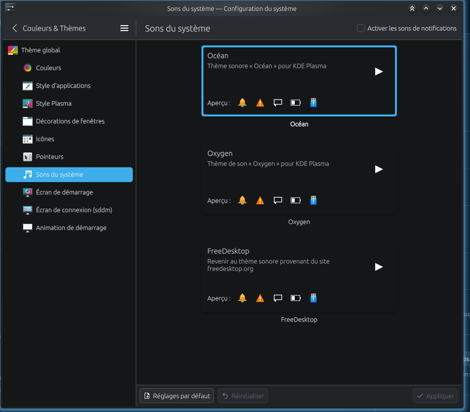
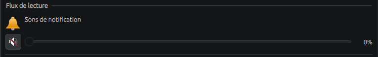

# Installing MachinCast

*[Version française](INSTALL.fr.md)*

This document describes how to install MachinCast on a playout machine, check it, update it and add other accounts. It is meant for the machine's administrator: it does not require knowing the code. How to use the programs once installed is described in the [administration guide](doc/fr/administration/README.md), and how to use the graphical interface in the [on-air guide](doc/fr/utilisateur/README.md); the development machine is described in the [development guide](doc/fr/developpement/poste.md). These guides are in French for now.

The `install.sh` script does all the work. The [Installing by hand](#installing-by-hand) section details each of its steps, for those who want to do them themselves or understand what it does.

MachinCast's programs and messages are in French for now: messages are quoted here as they appear, followed by their meaning when it helps.

> **Project status**: MachinCast 0.9.0 is its first published version, ahead of 1.0 ([RELEASE.md](RELEASE.md)). Indexing checks the sounds, `Machin player` plays out the schedule, from a terminal or as a service, and the graphical interface (`Machin interface`) schedules and follows it. What is still missing is in the [open issues](https://github.com/dascritch/machincast/issues).

## Contents

- [In short](#in-short)
- [Requirements](#requirements)
- [Getting MachinCast](#getting-machincast)
- [Installing with install.sh](#installing-with-installsh)
- [Adapting the configuration](#adapting-the-configuration)
- [Choosing the language](#choosing-the-language)
- [Preparing the on-air machine](#preparing-the-on-air-machine)
- [Checking the installation](#checking-the-installation)
- [Playout service](#playout-service)
- [Adding another account](#adding-another-account)
- [Updating](#updating)
- [Installing by hand](#installing-by-hand)
- [Uninstalling](#uninstalling)
- [When something goes wrong](#when-something-goes-wrong)

## In short

```bash
git clone https://github.com/dascritch/machincast.git ~/machincast
cd ~/machincast
./install.sh --simulation   # shows what will be done, without changing anything
./install.sh
```

Then: adapt `machincast.toml` ([see below](#adapting-the-configuration)), then restart the machine to read the service log.

## Requirements

- **Ubuntu 26.04 LTS**. Other LTS versions (24.04…) are accepted, with a warning; non-LTS versions are refused. MachinCast is checked with the GStreamer version of Ubuntu 26.04, 1.28: with an older version, like 1.24 in Ubuntu 24.04, the installation warns, and nothing is guaranteed ([#284](https://github.com/dascritch/machincast/issues/284)).
- **The account that will use MachinCast, with `sudo` rights**. The installation is single-user: a single Unix account uses MachinCast, the one that installs it. The script is run with that account, never with `sudo`: it asks for the password only for the steps that need it.
- **Internet access**, for apt and pip.
- **PostgreSQL 16 or newer**, installed by the script if missing. Ubuntu 26.04 provides a suitable version.

Packages installed by apt: only what pip cannot provide. All Python libraries come from pip, in an isolated environment ([#51](https://github.com/dascritch/machincast/issues/51)).

| Package | Role |
| --- | --- |
| `python3-venv` | Creating the Python virtual environment. |
| `python3-dev` | Python headers, to compile PyGObject during `pip install`. |
| `build-essential` | C compiler, for PyGObject. |
| `pkg-config` | Finding libraries during compilation. |
| `libgirepository-2.0-dev` | GObject introspection, which PyGObject needs to reach GStreamer. |
| `libcairo2-dev` | Cairo, a build dependency of PyGObject. |
| `gir1.2-gstreamer-1.0` | Description of GStreamer for PyGObject. |
| `gstreamer1.0-plugins-base` | Ogg Vorbis decoding, audio conversion and resampling. |
| `gstreamer1.0-plugins-good` | MP3, FLAC and WAV decoding; parsing raw AAC files (`.aac`); reading HTTP and HTTPS streams. |
| `gstreamer1.0-plugins-bad` | AAC decoding (`.m4a` and `.aac` files). |
| `gstreamer1.0-alsa` | `alsa` audio output. |
| `gstreamer1.0-pulseaudio` | `pulseaudio` audio output. |
| `gstreamer1.0-pipewire` | `pipewire` audio output. |
| `pipewire-bin` | `pw-link`, which links the on-air output to the preview output to listen to it under PipeWire ([#24](https://github.com/dascritch/machincast/issues/24)). Already there with PipeWire on an Ubuntu desktop. |
| `libmagic1t64` | Recognising the real type of sound files, without relying on their extension ([#121](https://github.com/dascritch/machincast/issues/121)). |
| `postgresql` | Database server. |
| `bash-completion` | Loading the completion of `Machin`. Already there on a standard Ubuntu, missing from a minimal installation. |
| `acl` | `setfacl`, which lets the playout service read MachinCast and the sound banks, without changing their owner or mode ([#381](https://github.com/dascritch/machincast/issues/381)). |
| `wireplumber` | Session manager of the playout service's own PipeWire ([#381](https://github.com/dascritch/machincast/issues/381)). Already there with PipeWire on an Ubuntu desktop. |

## Getting MachinCast

MachinCast is installed **in place**: the directory it is in becomes the installation directory, and `/opt/machincast` points to it. It must therefore not be moved after the installation.

The installation is single-user: MachinCast goes in the home directory of the account that uses it, for instance `~/machincast`.

```bash
git clone https://github.com/dascritch/machincast.git ~/machincast
cd ~/machincast
```

Each published version also has its archive, `machincast-<version>.tar.gz`, in the [repository's releases](https://github.com/dascritch/machincast/releases) ([#41](https://github.com/dascritch/machincast/issues/41)). It is used the same way: extract it into the chosen directory, then run `./install.sh` from that directory. Its notes are in [RELEASE.md](RELEASE.md).

```bash
tar -xzf machincast-0.9.0.tar.gz -C ~
mv ~/machincast-0.9.0 ~/machincast
cd ~/machincast
```

Outside a git repository, **Aide → Version** (Help → Version) gives the version and its release date; an update is then done by extracting the next archive in its place, keeping `machincast.toml`.

## Installing with install.sh

From the MachinCast directory, with your own account:

```bash
./install.sh --simulation   # shows the commands without running anything
./install.sh                # installs
./install.sh --dev          # installs, with the development machine's tools
./install.sh --service      # installs, with the playout service: computer dedicated to the station only
./install.sh --desktop       # installs, and puts the interface shortcut on the desktop without asking
./install.sh --no-desktop  # installs, without a desktop shortcut or question
./install.sh --stop-programs  # stops the running MachinCast programs without asking
./install.sh --leave-programs  # leaves them running, without asking
./install.sh --help         # help
```

`--dev` can be combined with `--simulation`. See the [development machine](doc/fr/developpement/poste.md) (French).

**Can be run again**: each step already done is left as it is. On failure, fix what the message says, then run the script again. When run again, PostgreSQL reports with `NOTICE:  role … has already been granted membership …` lines that the account was already authorised: this is not an error.

**What it asks for**: the `sudo` password, for apt, for the commands run as the `postgres` user, for adding the account to the `systemd-journal` group, for the links in `/opt`, `/usr/local/bin` and `/usr/share`, and, with `--service`, for the account's session, the systemd unit and the polkit rule. At most two questions. If MachinCast programs are running: « Les arrêter pendant l'installation, puis les relancer ? [o/N] » (stop them during the installation, then restart them?); Enter answers no. `--stop-programs` and `--leave-programs` answer it in advance; without a terminal, it is not asked, and they keep running. On the first installation: « Déposer aussi le raccourci de MachinCast sur le bureau ? [O/n] » (also put the MachinCast shortcut on the desktop?); Enter answers yes. `--desktop` and `--no-desktop` answer it in advance; without a terminal, for instance in a script, it is not asked, and the shortcut does not go on the desktop.

**What it does**, in order:

| Step | What happens | What changes on the machine |
| --- | --- | --- |
| System | Checks that it runs without `sudo`, on an Ubuntu LTS. | Nothing. |
| Running MachinCast programs | Lists those running, under every account of the machine: `Machin player` (the playout service, a test playout, a simulation), `Machin indexer`, `Machin interface`. An update, and its database migrations, must not happen under them: depending on the answer to the question, it stops them, the service with `systemctl stop`, the others with a signal, with `sudo` for those of another account ([#254](https://github.com/dascritch/machincast/issues/254)). **Once stopped, playout is silent until the end of the installation**; the interface loses the detail screens that were not saved. | Nothing, or programs stopped. |
| System packages | Installs the packages of the [requirements table](#requirements). | apt packages. |
| Python virtual environment | Creates `.venv` in the MachinCast directory, without access to the system's Python packages, and installs MachinCast and its dependencies in it. | `.venv` in the MachinCast directory. |
| Configuration | Copies `machincast.exemple.toml` to `machincast.toml` if it does not exist. An existing `machincast.toml` is never changed. | `machincast.toml`. |
| PostgreSQL | As the `postgres` user: creates the account's PostgreSQL role, **without any particular right** on the server; creates the production and test databases named in `machincast.toml`, which the account owns; creates MachinCast's three group roles. Then, with the account: applies the schema to both databases. | PostgreSQL server. |
| Roles | As the `postgres` user: allows the account to take on MachinCast's three roles, without inheriting their rights. | PostgreSQL server. |
| System log | Adds the account to the `systemd-journal` group, to read the service log. Effective after the machine restarts. | The account's groups. |
| Links | `/opt/machincast` to the MachinCast directory; `/usr/local/bin/Machin` to the wrapper; bash completion in `/usr/share/bash-completion/completions/Machin`. | Three symbolic links. |
| GStreamer version and plugins, audio output | Warns if GStreamer or its plugins are older than version 1.28, with which MachinCast is checked, naming the package to update ([#284](https://github.com/dascritch/machincast/issues/284)). Checks that GStreamer can decode MP3, M4A, AAC, Ogg, FLAC and WAV, read HTTP and HTTPS streams, and create the audio output of `machincast.toml`, without playing any sound. | Nothing. |
| Interface shortcut | Installs the **MachinCast** shortcut, with its icon, in the account's applications menu, under Multimedia. Depending on the answer to the question, or `--desktop`, also puts it on the account's desktop (the folder given by `xdg-user-dir DESKTOP`, « Bureau » in French), executable so that Plasma launches it without a warning. A shortcut already on the desktop is updated without a question; `--no-desktop` leaves it as it is ([#62](https://github.com/dascritch/machincast/issues/62)). | `~/.local/share/applications/machincast.desktop`, and `machincast.desktop` on the desktop; the MachinCast icon in the account's icon theme, `~/.local/share/icons/hicolor/512x512/apps/machincast.png`, which the sound settings show in front of MachinCast's programs ([#296](https://github.com/dascritch/machincast/issues/296)). |

**Restarting MachinCast programs**: before showing `Installation terminée` (installation complete), and even after a failure, it restarts those it stopped: the playout service (except with `--remove-service`), and, for its own account, the test playout in a terminal and the interface in the graphical session, with their arguments. It says what remains to be reopened: an interrupted indexing, the interface's simulation, and the programs of other accounts, which their account restarts.

At the end, it shows `Installation terminée`. The playout service is only installed on request: see [Playout service](#playout-service).

**PostgreSQL roles.** Each MachinCast program acts with its own rights: `machincast_player` for playout, `machincast_indexer` for indexing, `machincast_interface` for the graphical interface. A station account connects with its own PostgreSQL role, which gives access to nothing by itself: each program takes on its role as soon as it connects. The details are in the [specification, § 3.2](doc/fr/spec.md#32-rôles-et-droits) (French).

## Adapting the configuration

The configuration is the `machincast.toml` file, in the MachinCast directory. It is never versioned by git. The template `machincast.exemple.toml` comments each key, and the [table of keys in the specification](doc/fr/spec.md#9-configuration) (French) gives their type and role.

Adapt at least:

- `audio.output`: `pipewire` (the template's value), `pulseaudio`, `alsa`, or `dummy` for a trial without any sound; with `alsa`, the interface's VU meter is unavailable, for lack of a monitoring port ([#24](https://github.com/dascritch/machincast/issues/24));
- `audio.device`: the on-air device, **required for playout** (except with `dummy`); `"dummy"`, the « sortie factice » (dummy output) entry, makes the station play on no sound card, for an installation without the playout service ([#339](https://github.com/dascritch/machincast/issues/339)). With PipeWire or PulseAudio, `Machin player` then plays on air, while it runs, on a virtual card, « MachinCast antenne factice », which the interface's VU meter and on-air preview listen to like a real card: handy on a development computer with a single sound card ([#400](https://github.com/dascritch/machincast/issues/400)). Without it, `Machin player` refuses to start. It can also be chosen in the interface, **Fichier → Préférences…** (File → Preferences…), **Audio** page, which writes it into `machincast.toml`. `.venv/bin/python -m machincast.installation devices` lists the devices of the configured output, with their identifier to copy; if it finds none, it says everything GStreamer sees, and `gst-device-monitor-1.0 Audio/Sink` gives the details;
- `audio.preview`: the interface's preview device, different from the on-air one; it can also be chosen later in the interface's preview window; `"dummy"`, the « sortie factice » entry, disables the preview ([#339](https://github.com/dascritch/machincast/issues/339));
- `metadata.public_text`: the name shown on the public page instead of a hidden title;
- `player.state_socket`: optional, the state socket read by the interface; by default in the account's runtime directory (`$XDG_RUNTIME_DIR/machincast/lecture.sock`);
- `[outputs]`: the paths of the CSV airplay (one file per day), the playlist and the public HTML page, in the `sorties` folder of the MachinCast directory by default. To publish the page on the station's website, copy it or serve it from that path.

The database names (`database.production` and `database.test`) are chosen **before** running `install.sh`, which creates the databases under those names. The test database must have another name than the production database: otherwise MachinCast refuses the configuration.

Any unknown key is refused, to catch typos. After a change, running `./install.sh` again checks the configuration and the audio output.

Without the `--config` option, the programs always read the `machincast.toml` of the MachinCast directory, whatever directory they are started from ([#76](https://github.com/dascritch/machincast/issues/76)). `Machin --help` gives its full path. Another configuration, also placed in the MachinCast directory, is given with `--config`:

```bash
Machin indexer                                         # reads ~/machincast/machincast.toml
Machin indexer --config ~/machincast/essai.toml        # reads essai.toml
```

## Choosing the language

MachinCast speaks English or French, following the language of the session ([#360](https://github.com/dascritch/machincast/issues/360)): `LANGUAGE`, `LC_ALL`, `LC_MESSAGES` then `LANG`, the first one set, as for other programs. The interface, the messages of the binaries, their help, `Machin` and `install.sh` follow it; a language that MachinCast does not speak gives English. To run a program in another language:

```bash
LANGUAGE=fr Machin interface      # French interface, on an English computer
LANGUAGE=en Machin indexer        # English messages, on a French computer
```

The playout service speaks the language of the system (`localectl status`, `sudo localectl set-locale LANG=en_GB.UTF-8`). The database log is written in English and translated when shown: the incidents screen shows it in the language of the interface, whatever the language of the service.

## Preparing the on-air machine

The machine that plays out is also a desktop computer: everything it plays on the on-air device goes on air. Three desktop settings prevent this ([#250](https://github.com/dascritch/machincast/issues/250)). The paths below are those of the KDE Plasma system settings, the desktop of Ubuntu 26.04 LTS used on air; their names may vary from one version or desktop to another.

**1. The on-air device is not the desktop's default output.** The default output is that of every program that does not choose one: the browser, a video call, a video player, the system sounds. On the on-air device, they would go on air. MachinCast does not need it: `Machin player` always plays on `audio.device`, and the preview on `audio.preview`, whether or not they are the default output.

- In **System Settings → Sound**, playback devices page, choose as default output another device than the on-air one: the control room headphones, or the machine's speakers.
- To check, on the command line: `wpctl status`, under PipeWire, marks the default output with a `*` among the « Sinks »; `pactl get-default-sink` gives its identifier, to compare with `audio.device`. `wpctl set-default <number>` chooses another, by the numbers of `wpctl status`.

**2. Notification sounds are muted.** A notification, a received message, a plugged-in USB key, the volume set from the keyboard make a sound, on the default output, or on air if it still is:

- in **Colours & Themes → Global Theme → System Sounds**, uncheck, top right, **Enable notification sounds**;

  

- in **Sound**, **Playback Streams** part, on the **Notification Sounds** line, mute the sound with its button, left of the slider, which goes to 0 %.

  

**3. No screen sleep.** When a screen turns back on, the machine's sound server can interrupt the preview for a while, and the station's [VU meter](doc/fr/utilisateur/prise-en-main.md#vu-mètre-de-lantenne) reopens ([#259](https://github.com/dascritch/machincast/issues/259), [#311](https://github.com/dascritch/machincast/issues/311)). Playout itself goes on. In **System Settings → Power Management**, on AC power, set **Turn off screen** to **Never**. Suspending the machine (**Suspend session**) must not be scheduled either: asleep, the machine no longer plays out.

## Checking the installation

First restart the machine, so that the `systemd-journal` group is taken into account. Under Ubuntu Desktop, logging out then in again is not always enough: new terminals may keep the session's old groups. Then:

```bash
id -nG                                     # must list systemd-journal
Machin --help                              # wrapper help, list of programs
Machin indexer --help                   # indexing help
Machin indexer                          # quick indexing
```

`Machin indexer` shows a summary, for instance `2026-10-15T08:15:00+02:00 indexation rapide : 0 nouveau sonore, 0 rattachement, 0 retrait ; 0 sonore vérifié ; 0 erroné, 0 non supporté, 0 supprimé, 0 rétabli, 0 sorti d'aperçu` (quick indexing: 0 new sound, 0 attached, 0 removed; 0 sound checked; 0 faulty, 0 unsupported, 0 deleted, 0 restored, 0 out of preview), and ends with code 0. On a new machine, no bank exists yet, so there is no directory to go through: banks are created in the interface ([#31](https://github.com/dascritch/machincast/issues/31)).

**First indexing.** Quick indexing, the default, only decodes newly found sounds (« aperçu », preview state) and only checks that the other files are there. The full audit decodes every sound, which can take long on a large music library:

```bash
Machin indexer                   # quick
Machin indexer --full-audit   # full, to run once after the first indexing
```

Anomalies (damaged, unreadable or missing file) are shown on the error output with the file's path; they do not block indexing.

**Service log.** `Machin logs` follows the playout service's log. As long as the service is not installed ([#22](https://github.com/dascritch/machincast/issues/22)), it shows nothing, which is normal.

## Playout service

**For a computer dedicated to the station only** ([#22](https://github.com/dascritch/machincast/issues/22)). Without the service, `Machin player` is started by hand, and stops with its terminal: this is what suits a trial of MachinCast. With the service, `machincast.service`, playout starts with the machine, without anyone logging in, and restarts by itself after a crash.

```bash
./install.sh --service            # installs the service, or updates it
./install.sh --remove-service    # removes it
```

`--service` can be combined with `--simulation`. **What it does**, after the usual steps:

| Step | What happens | What changes on the machine |
| --- | --- | --- |
| On-air output | Checks, with `python -m machincast.installation on-air`, that the station plays on a sound card ([#339](https://github.com/dascritch/machincast/issues/339)): on the dummy output (`audio.output = "dummy"`, or the « sortie factice » entry, `audio.device = "dummy"`), or on the PulseAudio output, which the service does not have ([#381](https://github.com/dascritch/machincast/issues/381)), install.sh stops, without installing anything of the service, and recommends another output. An on-air device still to be set is only reported: the service will refuse to start without it. | Nothing. |
| Service account | Creates the system account and group `machincast` (no password, no shell, home `/var/lib/machincast`), and adds the installing account to the group: it reads the service's logs and pre-listens to the station. The group takes effect at the next login. | An account and a group. |
| Database | Creates the PostgreSQL role `machincast`, which connects by peer authentication and can only assume `machincast_player`, without inheriting its rights. | A PostgreSQL role. |
| Reading MachinCast | Gives `machincast` the right to read the MachinCast directory (program, virtual environment, `machincast.toml`), by ACL (`setfacl`), and to cross the installing account's parent directories, its home included. Nothing else changes. | ACLs. |
| Directories | Installs `/etc/tmpfiles.d/machincast.conf` (`python -m machincast.installation tmpfiles`) and creates, at each start of the machine, `/run/machincast`, `/var/log/machincast` and `/var/log/machincast/crash-dump`, owned by `machincast`, mode `2770`; and `/etc/logrotate.d/machincast` (`logrotate`): the logs rotate every week, 8 weeks kept. | Two configuration files, three directories. |
| PipeWire of the service | Installs `/etc/systemd/system/machincast-pipewire.service` and `machincast-wireplumber.service` (`pipewire-unit`, `wireplumber-unit`): a PipeWire and a WirePlumber of their own, under `machincast`, without any session; the PipeWire socket is `/run/machincast/pipewire-0`. WirePlumber reads only `/etc/machincast/wireplumber` (`wireplumber-service`: sound cards only) and the package's configuration. | Two systemd units, a WirePlumber fragment. |
| On-air card | Installs `/etc/wireplumber/wireplumber.conf.d/50-machincast.conf` (`wireplumber-desktop`): the PipeWire sessions of the machine no longer see the on-air card, which belongs to the service — two PipeWire cannot open the same card at the same time; the WirePlumber of the running session is restarted. After changing the on-air card, run `./install.sh --service` again. | A WirePlumber fragment. |
| systemd unit | Installs `/etc/systemd/system/machincast.service`, written by `python -m machincast.installation unit`, then reloads systemd. | A systemd unit. |
| polkit rule | Installs `/etc/polkit-1/rules.d/50-machincast.rules`, written by `python -m machincast.installation rule`. | A polkit rule. |
| Activation | Enables the PipeWire of the service, its WirePlumber and the service at the machine's start, and starts them; a changed unit or configuration restarts them. | Services enabled. |
| Service already installed, without `--service` | Compares the units, the configurations, the rule, the purge unit and timer with those of this version ([#376](https://github.com/dascritch/machincast/issues/376)): up to date, nothing to do; otherwise, it names them, and offers to update the service, like `--service`. | Nothing, or the service updated. |
| Daily purge | Installs `/etc/systemd/system/machincast-purge.service` and its timer `machincast-purge.timer`, written by `python -m machincast.installation purge-unit` and `purge-timer`, and enables the timer ([#268](https://github.com/dascritch/machincast/issues/268)). | A systemd unit and timer. |

**The service** runs under its own system account, `machincast` ([#381](https://github.com/dascritch/machincast/issues/381)): it needs no open session, and restarts at the machine's start without anyone logging in. It plays through its own PipeWire, its role in the database is `machincast_player` alone, and it only reads MachinCast and the sound banks. It runs `bin/Machin player`, with the `machincast.toml` of the MachinCast directory, and restarts it 5 seconds after a crash. Stopping it sends `SIGTERM`, which ends the current play cleanly. Its messages go to the system log, which `Machin logs` follows, and to `/var/log/machincast/Machin_player.log`; its crash reports to `/var/log/machincast/crash-dump`. The installing account reads them as a member of the `machincast` group.

**The daily purge** runs `bin/Machin purge` every day at noon, under the installing account, owner of the database: it deletes from the database what is past the retention period, `database.retention`, 60 days by default, and never a file ([Purge de la base](doc/fr/administration/commandes.md#purge-de-la-base--machin-purge), French). A missed purge, machine off at noon, happens at its start. `systemctl list-timers machincast-purge.timer` gives the next one; `journalctl --unit=machincast-purge.service`, what the previous ones deleted.

**The polkit rule** only allows three actions on `machincast.service`, to MachinCast's account only: starting, stopping and restarting it, with the password, or the fingerprint, of an administrator of the machine. It allows nothing else, nor on another unit. Never `sudo` to control playout:

```bash
systemctl start machincast.service
systemctl stop machincast.service
systemctl restart machincast.service
systemctl status machincast.service machincast-pipewire.service machincast-wireplumber.service
```

**From the interface**, the **Diffusion** (playout) menu does the same, with the same authentication ([on-air guide](doc/fr/utilisateur/antenne.md#piloter-la-diffusion), French, [#25](https://github.com/dascritch/machincast/issues/25)). As long as the service is not installed, the interface's status bar shows `Installation non définitive : diffusion sans service` (provisional installation: playout without service), and the **Diffusion** menu controls a test playout: `Machin player` in a terminal window, which the interface can stop and restart.

**Before installing the service**, stop any `Machin player` started by hand: a second Machin player is refused while the state socket is in use, and the service would restart endlessly.

**Updating from a service installed before #381**: it ran under the installing account, whose session stayed active at start-up. `./install.sh --service` moves it to the `machincast` account; `sudo loginctl disable-linger "$(id -un)"` then gives the session back its usual behaviour.

`--remove-service` stops and disables the service, its PipeWire, its WirePlumber and the purge timer, removes their units, the rule and the configuration files, gives the on-air card back to the sessions of the machine, removes the ACLs of the MachinCast directory, the PostgreSQL role `machincast`, then the account and group `machincast`. The logs stay in `/var/log/machincast`. The purge is then run by hand, with `Machin purge`.

## Adding another account

MachinCast is meant for a single Unix account, the one that installs it, and `install.sh` only authorises that one. If another account must exceptionally access it, an administrator (an account with `sudo`) runs, replacing `programmation` with the account's name:

```bash
COMPTE=programmation
# PostgreSQL role of the account, without any particular right on the server
sudo -u postgres createuser "${COMPTE}"
# Permission to take on MachinCast's three roles, without inheriting their rights
sudo -u postgres psql -c "GRANT machincast_player, machincast_indexer, machincast_interface TO \"${COMPTE}\" WITH INHERIT FALSE, SET TRUE"
# Reading the service log, effective after the machine restarts
sudo usermod --append --groups systemd-journal "${COMPTE}"
```

To give it only part of the rights, name only the wanted roles in the `GRANT`: for instance `machincast_indexer` alone for an account that only indexes.

The account must also be able to read the MachinCast directory. Under Ubuntu, a home directory is only readable by its owner: an installation in `~/machincast` therefore stays inaccessible to other accounts until those rights are changed.

To remove an account's access:

```bash
COMPTE=programmation
sudo -u postgres psql -c "REVOKE machincast_player, machincast_indexer, machincast_interface FROM \"${COMPTE}\""
```

## Updating

From the MachinCast directory:

```bash
git pull
./install.sh
```

`install.sh` updates the Python dependencies and applies the new schema migrations to both databases. If MachinCast programs are running, it first offers to stop them, then restarts them at the end ([Installing with install.sh](#installing-with-installsh)): so as not to silence the station at the wrong time, run the update outside a show. `machincast.toml` is not changed: compare it with `machincast.exemple.toml` to add the new keys, which MachinCast otherwise reports as missing.

By hand, without running `install.sh` again:

```bash
git pull
.venv/bin/pip install --editable .
.venv/bin/python -m machincast.installation migrate --config machincast.toml
```

`migrer` applies the schema to the production and test databases of the configuration. For a single database, the same with yoyo:

```bash
.venv/bin/yoyo apply --batch --database "postgresql+psycopg:///machincast?host=/var/run/postgresql" src/machincast/migrations/
```

**Maintaining the database.** `Machin maintenance-db` ([#127](https://github.com/dascritch/machincast/issues/127)) backs up the production database with `pg_dump`, into the `sauvegardes` directory of MachinCast, applies the missing migrations, checks the roles, then optimises it (`VACUUM ANALYZE`). The interface also runs it, after confirmation, from the **Maintenance → Maintenance de la base de données…** menu. Details and restoring: [Maintenance de la base](doc/fr/administration/commandes.md#maintenance-de-la-base--machin-maintenance-db) (French).

**Purging the database.** `Machin purge` ([#268](https://github.com/dascritch/machincast/issues/268)) deletes from the production database the airplay and the log older than the retention period (`database.retention`, 60 days by default), and the items deleted longer ago than that; never a file. The playout service installs it with a timer, every day at noon: an installation that already has the service gets it by running `./install.sh --service` again. Details: [Purge de la base](doc/fr/administration/commandes.md#purge-de-la-base--machin-purge) (French).

**Configuration in English** ([#357](https://github.com/dascritch/machincast/issues/357)). The sections, keys and values of `machincast.toml` are in English: `[database]`, `[outputs]`, `[metadata]`, `[player]`, `[dead_air]`, `audio.output`, `audio.device`, `audio.preview`, `dummy` for the dummy output… An old `machincast.toml` is refused, naming the new section: redo it from `machincast.exemple.toml`.

**English command names** ([#356](https://github.com/dascritch/machincast/issues/356)). `Machin lecture` is now `Machin player`, `Machin indexation` `Machin indexer`, `Machin dev-captures` `Machin dev-screenshots`, and their options are in English (`--full-audit`, `--sound`, `--window`, `--force`, `--seed`, `--name`, `--directory`, `--backups`, `--keep-open`), like those of `install.sh` (`--desktop`, `--no-desktop`, `--stop-programs`, `--leave-programs`, `--remove-service`) and the steps of `python -m machincast.installation`. The old names are no longer recognised: an existing installation is redone from scratch, including `./install.sh --service` to rewrite the service unit, which runs `bin/Machin player`.

**English schema** ([#358](https://github.com/dascritch/machincast/issues/358)). The tables, columns, types, values and roles of the database are in English: `sounds`, `banks`, `events`, `event_items`, `airplay`, `log`…, roles `machincast_player`, `machincast_indexer` and `machincast_interface`. A database created with the old schema, with French names (migration `0001.schema-initial`, or one of the migrations before it), cannot be updated: `install.sh` and `Machin maintenance-db` refuse it without changing anything, `schéma impossible à mettre à jour : base … : ancien schéma, aux noms français (migration …) ; la recréer` (schema cannot be updated: old schema, with French names; recreate it). Back it up if it holds anything useful, then recreate it, test database included. **This deletes its content**: it is only possible as long as MachinCast is not in production. The commands of this document use the template's database names, `machincast` and `machincast_test`: replace them with those of `database.production` and `database.test` in `machincast.toml`.

```bash
sudo -u postgres dropdb machincast
sudo -u postgres dropdb machincast_test
./install.sh
```

`install.sh` creates the new roles. The old ones, `machincast_lecture` and `machincast_indexation`, are no longer used: once both databases are recreated, they can be removed with `sudo -u postgres psql -c "DROP ROLE machincast_lecture, machincast_indexation"`. A hand-written query using the old names must be rewritten.

## Installing by hand

The commands below are those that `install.sh` runs in sequence. They are run from the MachinCast directory, with your own account. The database names are those of the configuration template: `machincast` and `machincast_test`.

**1. System packages.**

```bash
sudo apt install python3-venv python3-dev build-essential pkg-config libgirepository-2.0-dev libcairo2-dev \
	gir1.2-gstreamer-1.0 gstreamer1.0-plugins-base gstreamer1.0-plugins-good gstreamer1.0-plugins-bad \
	gstreamer1.0-alsa gstreamer1.0-pulseaudio gstreamer1.0-pipewire pipewire-bin libmagic1t64 postgresql bash-completion acl wireplumber
```

**2. Python virtual environment.** Never `--system-site-packages`: MachinCast must not depend on the versions of the distribution's Python packages.

```bash
python3 -m venv .venv
.venv/bin/pip install --upgrade pip
.venv/bin/pip install --editable .
```

**3. Configuration.**

```bash
cp machincast.exemple.toml machincast.toml
```

Then adapt it (see [Adapting the configuration](#adapting-the-configuration)).

**4. PostgreSQL.** Everything that needs rights on the server goes through the `postgres` user: the account gets neither `CREATEDB` nor `CREATEROLE`. It only becomes the owner of both databases, which lets it apply the schema to them.

```bash
sudo -u postgres createuser "$(id -un)"
sudo -u postgres createdb --owner="$(id -un)" machincast
sudo -u postgres createdb --owner="$(id -un)" machincast_test
sudo -u postgres psql -c "CREATE ROLE machincast_player NOLOGIN" -c "CREATE ROLE machincast_indexer NOLOGIN" \
	-c "CREATE ROLE machincast_interface NOLOGIN"
.venv/bin/python -m machincast.installation migrate --config machincast.toml
```

The three group roles belong to the server, not to a database: they serve both databases, and are created only once. A `role … already exists` error means that they already exist.

**5. The account's roles.**

```bash
sudo -u postgres psql -c "GRANT machincast_player, machincast_indexer, machincast_interface TO \"$(id -un)\" WITH INHERIT FALSE, SET TRUE"
```

**6. System log.**

```bash
sudo usermod --append --groups systemd-journal "$(id -un)"
```

**7. Links.**

```bash
sudo ln --symbolic --force --no-dereference "$(pwd)" /opt/machincast
sudo ln --symbolic --force --no-dereference /opt/machincast/bin/Machin /usr/local/bin/Machin
sudo ln --symbolic --force --no-dereference /opt/machincast/bash-completion/Machin /usr/share/bash-completion/completions/Machin
```

Without these links, the wrapper is called with `bin/Machin` from the MachinCast directory, and completion is loaded in the current shell with `source bash-completion/Machin`.

**Interface shortcut.** In the applications menu, then, if wanted, on the desktop, executable:

```bash
.venv/bin/python -m machincast.installation shortcut --config machincast.toml >machincast.desktop
install -D --mode=644 machincast.desktop ~/.local/share/applications/machincast.desktop
install -D --mode=755 machincast.desktop "$(xdg-user-dir DESKTOP)/machincast.desktop"
rm machincast.desktop
install -D --mode=644 src/machincast/interface/machincast.png ~/.local/share/icons/hicolor/512x512/apps/machincast.png
```

The shortcut runs `bin/Machin interface` from the MachinCast directory, with the icon `src/machincast/interface/machincast.png`, the logo of the station's technical teams ([#213](https://github.com/dascritch/machincast/issues/213)), or the image of `interface.icon` when it exists ([#111](https://github.com/dascritch/machincast/issues/111)); an icon chosen in the interface's preferences rewrites the installed shortcuts at once. Moving the MachinCast directory requires doing it again. The last command installs the MachinCast icon in the account's icon theme: Plasma's sound settings show it in front of « MachinCast lecteur », « MachinCast interface » and « MachinCast installation », the names under which the programs present themselves to PipeWire ([#296](https://github.com/dascritch/machincast/issues/296)).

**8. Checking the GStreamer plugins and the audio output.**

```bash
.venv/bin/python -m machincast.installation check --config machincast.toml
```

For each missing plugin, the command names the apt package to install.

## Uninstalling

```bash
./install.sh --remove-service   # if the playout service is installed
sudo rm /opt/machincast /usr/local/bin/Machin /usr/share/bash-completion/completions/Machin
rm --force ~/.local/share/applications/machincast.desktop "$(xdg-user-dir DESKTOP)/machincast.desktop"
sudo -u postgres dropdb machincast
sudo -u postgres dropdb machincast_test
```

The database names are those of the template: use those of `database.production` and `database.test` in `machincast.toml`. On a development machine, the test database may serve other copies of MachinCast: only delete it if it is no longer used.

**The two `dropdb` commands delete the schedule and the playout history.** Sound files, for their part, are never changed or deleted by MachinCast ([#96](https://github.com/dascritch/machincast/issues/96)): they stay in place, neither the uninstallation nor the deletion of the databases touches them. The MachinCast directory can then be deleted. The PostgreSQL roles and the apt packages stay in place: they may serve other software.

## When something goes wrong

| Message | Cause and solution |
| --- | --- |
| `install.sh : lancer install.sh avec son propre compte, sans sudo` | The script was run with `sudo` or as `root`. Run it again with your own account. |
| `install.sh : Ubuntu LTS requis (cible : 26.04 LTS)` | The system is not an Ubuntu LTS. `./install.sh --simulation` still shows the commands. |
| `install.sh : configuration … à corriger, puis relancer install.sh` | `machincast.toml` is invalid: the previous message names the key at fault. |
| `antenne sur la sortie factice : le service de diffusion ne jouerait aucun son ; …`, then `install.sh : service de diffusion non installé : l'antenne ne lui convient pas` | `./install.sh --service` on a configuration whose on-air output plays no sound ([#339](https://github.com/dascritch/machincast/issues/339)). Choose the on-air sound card in the interface, **Fichier → Préférences…**, **Audio** page (the dummy output is then greyed out if the service is already installed), or in `audio.output` and `audio.device` of `machincast.toml`, then run `./install.sh --service` again. |
| `antenne sur la sortie PulseAudio : le service de diffusion joue par son propre PipeWire ; …`, then `install.sh : service de diffusion non installé : l'antenne ne lui convient pas` | `./install.sh --service` on a configuration whose on-air output is PulseAudio ([#381](https://github.com/dascritch/machincast/issues/381)): the service has no PulseAudio server. Choose the PipeWire output in the interface, **Fichier → Préférences…**, **Audio** page, or in `audio.output` of `machincast.toml`, then run `./install.sh --service` again. |
| `périphérique de l'antenne non renseigné : …` | `audio.device` is missing: give it in `machincast.toml`, or in the interface, **Fichier → Préférences…**, **Audio** page. Then restart playout. |
| `sortie audio indisponible : …` | The output of `audio.output` cannot be created: install the named plugin, or check `audio.device`. Running `install.sh` again checks the output. |
| `indexation refusée : une autre indexation est en cours sur cette base` | An indexing is already running on the database, started from a terminal, the interface or another machine. Wait for it to end, then run it again. Its window, if it comes from the interface, can stop it. |
| `--window demande un affichage graphique …` | `--window` was given without a graphical session, for instance over SSH: run `Machin indexer` without `--window`, its log is shown in the terminal. |
| `base de données injoignable` | PostgreSQL is not started (`sudo systemctl start postgresql`), or `database.socket` does not point to its socket. |
| `droits insuffisants pour appliquer le schéma dans la base …` | The database already existed and belongs to another account, or its tables were created by another account. As long as it holds nothing useful, delete it (`sudo -u postgres dropdb …`) then run `install.sh` again, which recreates it. |
| `… : greffon GStreamer absent, installer …` | A sound format or the configured audio output cannot work. Install the named package, then run `install.sh` again. |
| `GStreamer 1.24.2 : MachinCast est vérifié avec la version 1.28 (Ubuntu 26.04 LTS) ; mettre à jour libgstreamer1.0-0` | Warning: GStreamer, or one of its plugins, is older than the checked version. The installation goes on, but the installed version has not been checked. Move the machine to Ubuntu 26.04 LTS, or update the named package. |
| `install.sh : … existe et n'est pas un lien symbolique` | A file or a directory already takes the place of a link, for instance an old installation in `/opt/machincast`. Move it, then run `install.sh` again. |
| `configuration invalide : …` (code 2) | The message names the file and the key at fault. `fichier de configuration introuvable` (configuration file not found): the `machincast.toml` of the MachinCast directory does not exist; copy it from `machincast.exemple.toml`, or run `install.sh` again. |
| `install.sh` : `attention : … est superutilisateur de PostgreSQL` | The account can do anything on the PostgreSQL server, and takes on MachinCast's roles without permission, which MachinCast does not ask for. If it is not used for anything else, remove that right with the given command. As long as it is a superuser, the scenario of `roles.feature` that checks the test account's permissions fails, giving the commands to run. |
| `erreur de base de données : … permission denied to set role …` | The account is not allowed to take on the role: see [Adding another account](#adding-another-account). |
| « MachinCast : base de données injoignable » window (database unreachable), when starting `Machin interface` | The interface cannot reach the `database.production` database. The « Ouvrir INSTALL.md » button opens this document, and the window's details give PostgreSQL's error. `connection … failed` or `No such file or directory`: PostgreSQL is not started (`sudo systemctl start postgresql`), or `database.socket` does not point to its socket. `database … does not exist`: run `install.sh` again, which creates the database. `permission denied to set role`: see [Adding another account](#adding-another-account). |
| `sauvegarde impossible : pg_dump introuvable, installer postgresql-client` | `pg_dump` is missing: `sudo apt install postgresql-client`, then run it again. Nothing was changed. |
| `sauvegarde impossible : … ; maintenance arrêtée, rien n'a été modifié` | The backup directory cannot be written, the disk is full, or `pg_dump` failed: its error follows. Fix it, or give another directory with `--backups`. |
| `schéma impossible à mettre à jour : base … : ancien schéma, aux noms français (migration …) ; la recréer` | The database was created before the English schema ([#358](https://github.com/dascritch/machincast/issues/358)): nothing was changed. See **English schema**, in [Updating](#updating). |
| `rôle … : absent du serveur, ou non endossable par le compte` | Run, with an administrator account, the two commands given by the message, then run the maintenance again. See also [Adding another account](#adding-another-account). |
| `Machin logs` asks for the `adm` or `systemd-journal` group, or only shows messages from its own account | The group is not yet taken into account by the session. If `id -nG "$(id -un)"` lists `systemd-journal` but `id -nG` does not, it has been added: restart the machine. Otherwise, run `install.sh` again. |

Information messages are shown on the standard output; anomalies and errors on the error output. Each line starts with its time, in ISO 8601, with the machine's time zone offset, for instance `2026-10-23T07:55:19+02:00 sortie audio indisponible : …` ([#253](https://github.com/dascritch/machincast/issues/253)); the table above leaves it out. Those of `install.sh` start with `install.sh :`.
