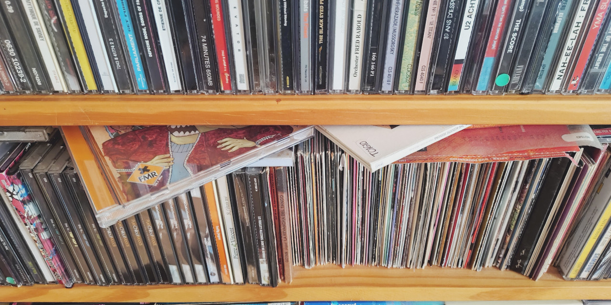
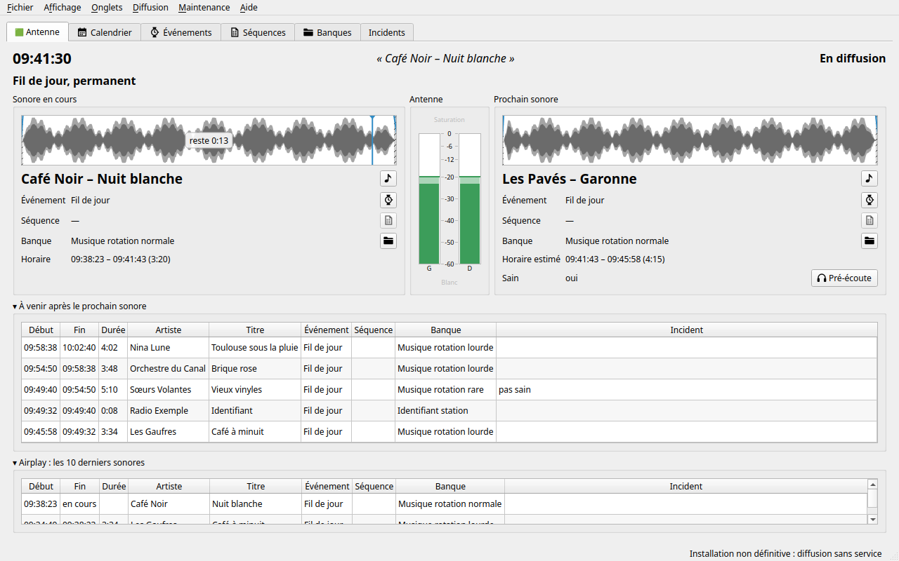
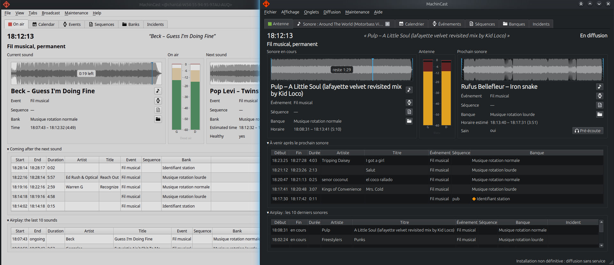

# MachinCast

*[English version](README.md)*

**Version 0.9.1**, publiée le 2026-11-17, avant la 1.0 : [ce qu'elle apporte](RELEASE.fr.md), et [son archive](https://github.com/dascritch/machincast/releases/tag/v0.9.1).

Système automatisé de diffusion sonore pour continuité d'antenne radio, sous Linux : il fournit un fil antenne en dehors des émissions en direct, à partir de banques de sonores, de *feeds* externes et d'événements horaires. Le service a des tolérances de sources, des scénarios de secours et sépare les services métiers. Les fichiers sonores sont immuables, les traitements sont faits sans les modifier.

MachinCast parle français et anglais, selon la langue de la session : son interface, ses messages et son aide ([INSTALL.md](INSTALL.fr.md#choisir-la-langue), [#360](https://github.com/dascritch/machincast/issues/360)).

- **Équipe de l'antenne** : le [guide de l'antenne](doc/fr/utilisateur/README.md), pour programmer et suivre l'antenne depuis l'interface graphique
- **Administrateur du poste** : [INSTALL.md](INSTALL.fr.md) pour l'installation, puis le [guide d'administration](doc/fr/administration/README.md)
- **Développeur** : le [guide du développement](doc/fr/developpement/README.md), avec la [spécification fonctionnelle](doc/fr/spec.md), [l'architecture](doc/fr/architecture.md), et les [règles du projet](doc/fr/regles/developpement.md) ; [CONTRIBUTING.md](CONTRIBUTING.fr.md) pour les écrans et les traductions
- **En cas de panne** : [TROUBLESHOOTING.md](TROUBLESHOOTING.fr.md), les pannes connues, leurs causes et ce qu'il faut vérifier

## Cas d'usage

- Continuité d'antenne en régie finale
- Alimentation de l'entrée audio d'un émetteur à partir d'un flux, avec secours
- Production d'une radio streamée événementielle
- Insertion de programmes locaux et d'espaces publicitaires sur un réseau syndiqué
- Sonorisation d'un espace recevant du public

[Ce que ne fait pas MachinCast : Voir ce chapitre sur sa conception](doc/fr/architecture.md#91-ce-que-nest-pas-machincast)

## Fonctionnalités

- Gestion d'une grille horaire
- Gestion d'éditions spéciales et priorisation des émissions
- Gestion du nombre de rotations et des périodes de diffusion des sonores
- Reprise d'un flux externe, avec scénarios d'incident et de reprise du direct
- Détection du début et de la fin d'un sonore
- Crossfade paramétrable globalement et par sonore
- Banques de sonores à lecture séquentielle ou aléatoire équitable, avec option de non-accolement
- Pré-écoute du direct, des programmes et des sonores
- Interface graphique indépendante du service de diffusion de l'antenne
- Audit des sonores
- Gestion du blanc d'antenne, avec repli sur un programme de secours
- Fichiers audio immuables, traitements en temps réel

## Configuration recommandée

Système Linux graphique, avec le moteur audio PipeWire, idéalement Debian ou Ubuntu LTS, et deux sorties sons distinctes, dont une <q>de qualité</q> pour la sortie vers la régie finale de la station ou son nodal.

Caractéristiques techniques demandées :

- un poste dédié, avec le service de diffusion installé en mode production ([INSTALL.md](INSTALL.fr.md#service-de-diffusion)) ;
- un processeur à 1 GHz au minimum ;
- 2 Go de mémoire vive ;
- 50 Go d'espace disque pour les sonores.

## Contexte

Je suis animateur bénévole sur [Radio &lt;FMR&gt;](https://radio-fmr.net), radio associative de Toulouse, France. \
J'ai été chargé une époque de la maintenance technique et de la formation des bénévoles de cette radio. Je produis actuellement [l'émission CPU Carré Petit Utile sur les technologies](https://cpu.pm), en plus d'être [architecte en solutions logicielles](https://dascritch.com). J'ai récemment été chargé de revoir la chaîne de production de la radio, qui tourne avec des moyens financiers très contraints.

Notre radio utilise un logiciel d'automatisation d'antenne minimal pour gérer son fil musical continu et les émissions en extérieur. Mais ce logiciel est vieux, n'est plus maintenu, est sous licence propriétaire, est bourré de bugs, n'est pas ergonomique et manque cruellement de certaines fonctions.

Cela fait plus de 15 années que nous avons successivement tenté de migrer vers différents outils. Soit ils étaient trop compliqués, soit les outils supposés libres se sont refermés et sont devenus des solutions en SaaS.

J'ai estimé qu'il était plus simple de recoder de zéro un tel outil, en connaissant parfaitement nos usages, nos équipements, les fonctions manquantes et les erreurs de manipulation les plus classiques de ceux qui le gèrent. L'outil ne sert pas à produire une diffusion en stream directement, la sortie sonore d'une carte son professionnelle (XLR analogique symétrique, SPDIF ou AES3) est envoyée vers une régie finale, et des outils techniques pour les affichages DAB+ et RDS.

Si en tant que radio, autre organisation ou particulier, vous avez décidé d'installer ce logiciel, n'hésitez absolument pas à prendre contact pour parler de votre expérience, parler de votre cas d'usage et dans quelle installation vous l'avez inséré.

## Auteurs

- [Xavier Mouton-Dubosc aka `dascritch`](https://dascritch.com)
- Claude.AI

La construction de code avec et par une IA est [dans le cadre d'une future émission de CPU et sera documenté en tant que tel](https://cpu.pm). Le code a été écrit par Claude.AI avec des contraintes fortes de qualité de code (TDD, BDD, E2E, tolérances d'échecs, reprise d'incidents, formatage).

## Licence

[GPLv3](LICENSE)

© [Xavier Mouton-Dubosc aka DaScritch](https://dascritch.com) pour [Radio &lt;FMR&gt;](https://radio-fmr.net)

## Hommage

À ceux qui ont définitivement raccroché le micro et ont participé à la création de notre couleur d'antenne :

 - Patrick Chabouté "Docteur rock"
 - Pascal Bouche "Raskal"
 - Fabrice Serin "DJ Tro"

Aux animateurs, bénévoles, soutiens et aux artistes passés et à venir qui ont fait vivre l'antenne de Radio &lt;FMR&gt;

Cultivé avec ♡ depuis Toulouse, France.
