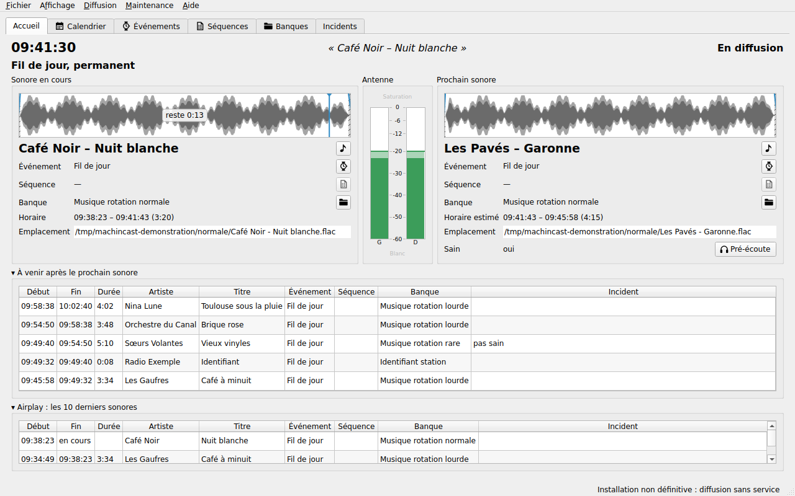

# MachinCast

*[Version française](README.fr.md)*

**Version 0.9.0**, released on 2026-10-28, first published version, ahead of 1.0: [what it brings](RELEASE.md), and [its archive](https://github.com/dascritch/machincast/releases/tag/v0.9.0).

Automated audio playout system for radio continuity, on Linux: it keeps the station on air outside live shows, from banks of sounds, external *feeds* and scheduled events. The service tolerates failing sources, has fallback scenarios, and keeps its business services apart.

MachinCast speaks English and French, following the language of the session: its interface, messages and help ([INSTALL.md](INSTALL.md#choosing-the-language), [#360](https://github.com/dascritch/machincast/issues/360)). The detailed guides are in French for now.

- **On-air team**: the [on-air guide](doc/fr/utilisateur/README.md) (French), to schedule and follow the station from the graphical interface
- **Station administrator**: [INSTALL.md](INSTALL.md) for the installation, then the [administration guide](doc/fr/administration/README.md) (French)
- **Developer**: the [development guide](doc/fr/developpement/README.md) (French), with the [functional specification](doc/fr/spec.md) and the [project rules](doc/fr/regles/developpement.md); [CONTRIBUTION.md](CONTRIBUTION.md) for the screens and the translations
- **When something fails**: [TROUBLESHOOTING.md](TROUBLESHOOTING.md), the known failures, their causes and what to check

## Recommended setup

A graphical Linux system, with the PipeWire sound server, ideally Debian or Ubuntu LTS, and two separate sound outputs, one of them a <q>good quality</q> one, for the feed to the station's final control room or its master control.

## Background

I am a volunteer host at [Radio &lt;FMR&gt;](https://radio-fmr.net), a community radio station in Toulouse, France. \
At one time I was in charge of the station's technical maintenance and of training its volunteers. I currently produce [CPU Carré Petit Utile, a show about technology](https://cpu.pm), besides being a [software solutions architect](https://dascritch.com). I was recently asked to review the station's production chain, which runs on a very tight budget.

Our station uses minimal radio automation software to run its continuous music feed and its outside broadcasts. But this software is old, no longer maintained, proprietary, riddled with bugs, unergonomic, and badly lacks some features.

For more than 15 years we have tried to move to one tool after another. Either they were too complicated, or the supposedly free tools closed up and became SaaS offerings.

I thought it simpler to write such a tool from scratch, knowing our practices, our equipment, the missing features and the most common handling mistakes of the people who run it perfectly well. The tool does not produce a stream directly: the audio output of a professional sound card (balanced analog XLR, SPDIF or AES3) goes to a final control room, and to technical tools for the DAB+ and RDS displays.

If, as a radio station, another organization or an individual, you have decided to install this software, please do get in touch to talk about your experience, your use case, and the setup you fitted it into.

## Authors

- [Xavier Mouton-Dubosc aka `dascritch`](https://dascritch.com)
- Claude.AI

Building code with and by an AI is [part of a future episode of CPU, and will be documented as such](https://cpu.pm). The code was written by Claude.AI under strong code quality constraints (TDD, BDD, E2E, failure tolerance, incident recovery, formatting).

## License

[GPLv3](LICENSE)

© [Xavier Mouton-Dubosc aka DaScritch](https://dascritch.com) for [Radio &lt;FMR&gt;](https://radio-fmr.net)

## Tribute

To those who have hung up the microphone for good, and who helped create our station's sound:

 - Patrick Chabouté "Docteur rock"
 - Pascal Bouche "Raskal"
 - Fabrice Serin "DJ Tro"

To the hosts, volunteers, supporters, and to the artists past and future who have kept Radio &lt;FMR&gt; on air.

Grown with ♡ in Toulouse, France.
