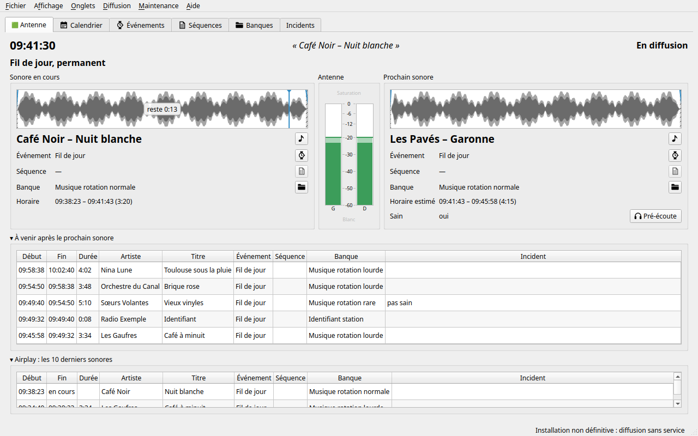

# On-air guide

*[Version française](../../fr/utilisateur/README.md)*

This guide is for the on-air team: programmers, presenters, station managers. It explains what MachinCast puts on air, and how to use it from its graphical interface, **Machin interface**. It needs neither a terminal nor technical knowledge.

Installing the machine, the commands and the configuration are in the [administration guide](../administration/README.md).

The screenshots show the interface in French, the language of the demonstration station; in an English session, the interface shows the English names used in this guide.

## The air in a few words

MachinCast runs the station on its own, outside live shows, from four kinds of elements:

- a **sound** is an audio file (a song, a jingle, an advert) or a **stream**, an audio feed received over the Internet, such as an outside broadcast;
- a **bank** is a pool of sounds, for instance « Musique rotation lourde » (heavy rotation): each time it is called, it provides **a single one**, in order or at random;
- a **sequence** is a series of sounds and banks played in one block, like an advertising break;
- an **event** is a slot of the schedule, with its list: a **background programming**, which holds the air when nothing else is planned, a **show** or a **special**, which take over at their time.

At any moment, a single event is on air; it plays its list, element after element. The details are in [What goes on air](antenne.md).

## Contents

1. [Getting to know the interface](prise-en-main.md): the window, the On air tab, the tabs, the menus, the preferences, the search.
2. [What goes on air](antenne.md): which event, which sound, the transitions, the streams, controlling and interrupting the broadcast, the history and the incidents.
3. [Programming the schedule](grille.md): the events, the sequences, the calendar and the simulation.
4. [Sounds, banks and feeds](sonores.md): adding sounds, their states, their cards, the pre-listen, the banks and their indexing.
5. [Lists and actions](listes.md): the lists, acting on several elements, duplicating, deleting.

## One rule to remember: files are never touched

MachinCast only **reads** the sound files. It never deletes, renames, moves or replaces them, nor writes to them, whatever is done in the interface:

- disabling a sound, deleting it from the database, removing it from a bank leaves its file in place, intact;
- deleting a bank leaves its directories and their files;
- a file dropped into the interface is only referenced, where it is, without a copy.

Deleting or moving a file remains a human decision, taken outside MachinCast, for instance in the machine's file manager.

## What does not exist yet

This guide is that of MachinCast 0.9.1, ahead of 1.0; **Help → Version** gives what is new. What is still missing for the air:

| Missing | Ticket |
| --- | --- |
| Extending a stream whose live show overruns | [#47](https://github.com/dascritch/machincast/issues/47) |
| Analysis screen of the audio output, « Output monitor… » in the Maintenance menu | [#85](https://github.com/dascritch/machincast/issues/85) |

An idea, a problem? **Help → Report a problem…** opens the MachinCast tickets.
