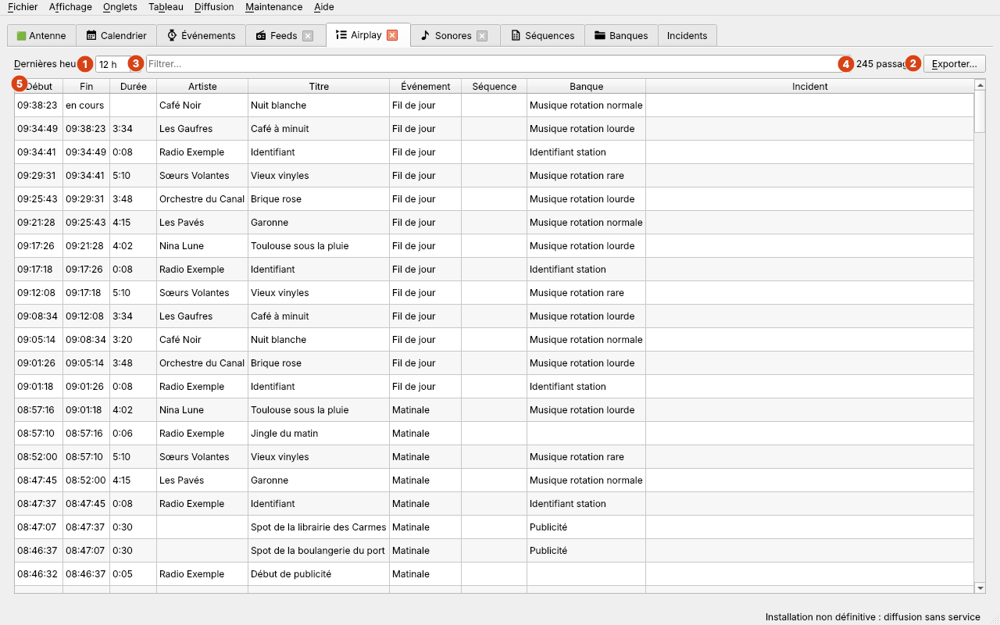

# Help on the Airplay tab

The Airplay tab gives the broadcast history of the last hours, to filter, sort and export.
The numbers refer to the picture; **Help → Contextual help**, or <kbd>F1</kbd>, gives each of these helps as a tooltip, on the element itself.

1. **Last hours** (`hours`) : how many hours to go back, 12 by default, up to a month; the setting is kept.
2. **Export…** (`export`) : saves what the tab shows as a CSV spreadsheet, an HTML page or an M3U playlist, public text included.
3. **Filter…** (`filter_`) : keeps only the plays that contain the typed text, ignoring case and accents.
4. **Count** (`count`) : how many plays are shown, out of how many.
5. **Plays** (`table`) : a click on a column title sorts; double-click towards the cards, right-click for the pre-listen and the location.

To go further: [Airplay tab](../prise-en-main.md#airplay-tab).
