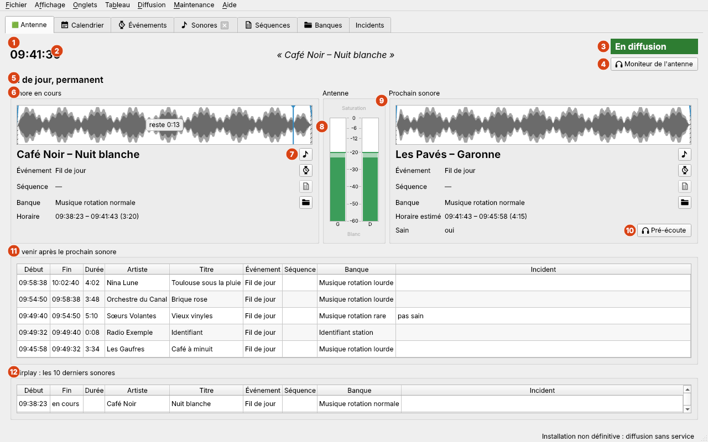

# Help on the On air tab

The On air tab shows what is playing and what will play, live.
The numbers refer to the picture; **Help → Contextual help**, or <kbd>F1</kbd>, gives each of these helps as a tooltip, on the element itself.

1. **Time** (`hour`) : the time of the workstation, to the second; its tooltip gives the date.
2. **Public text** (`public_text`) : the text of the current sound, as the public page of the radio shows it; `—` without text, for instance for a hidden sound.
3. **Broadcast state** (`playback_state`) : `On air`, `Dead air` or `Stopped`; its outline is red when the broadcast service is installed, green on a trial workstation.
4. **On-air monitor** (`monitor`) : the headphones, in the box of the broadcast state, only while it runs; listens to what goes on air, in the monitor window; while listening, it becomes **Stop the on-air monitor**.
5. **Event on air** (`on_air_event`) : its name and hours, or “permanent” for a background programming.
6. **Current sound** (`ongoing_frame`) : the artist, the title, the event, the sequence and the bank it comes from, its schedule and its timeline; the right-click offers to go back to its start, to restart the sequence or the event, and to copy its location.
7. **Card of the current sound** (`open_ongoing_sound`) : opens its card; the buttons next to it open those of its event, its sequence and its bank.
8. **VU meter** (`vu_meter`) : the real level on air, channel by channel, with its **Clipping** and **Dead air** lights; a click opens the on-air monitor.
9. **Next sound** (`next_frame`) : the one that will play next, even drawn at random, and **Healthy** if it is ready; the right-click offers its pre-listen, to jump to it at once, or to bring the next event forward.
10. **Pre-listen of the next sound** (`preview_next`) : listening on headphones, without touching the air.
11. **Coming after the next sound** (`upcoming_frame`) : the 5 following sounds, the closest at the bottom; a click on the title folds the box.
12. **Airplay** (`airplay_frame`) : the last 10 plays, from the most recent to the oldest; double-click towards the cards, right-click for the pre-listen and the location.

To go further: [On air](../prise-en-main.md#on-air), [Controlling the broadcast](../antenne.md#controlling-the-broadcast) and [Interrupting the air](../antenne.md#interrupting-the-air).
