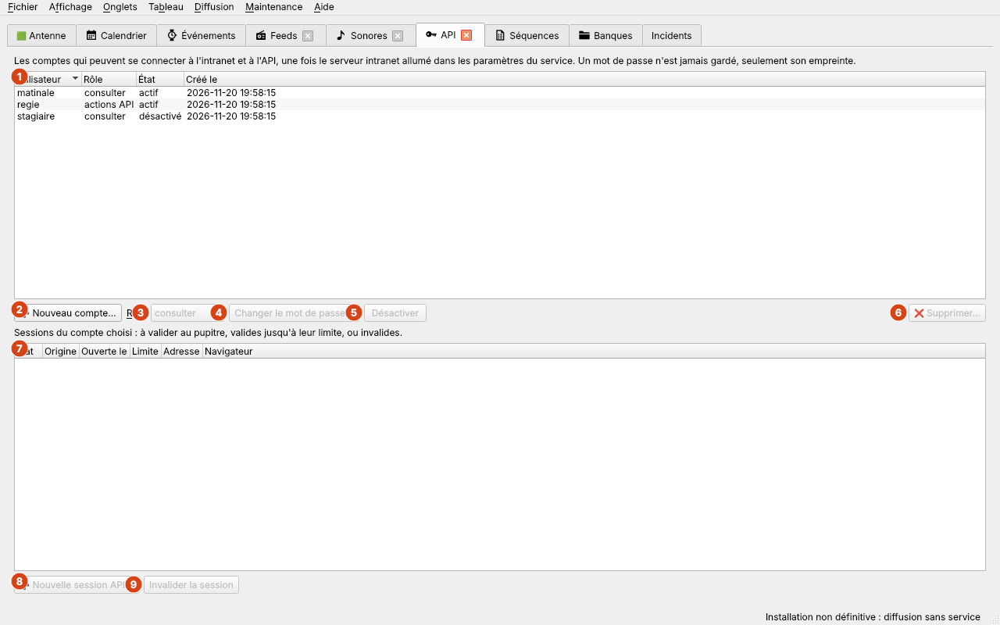

# Help on the API tab

The API tab manages the accounts that can connect to the intranet and to the API ([#537](https://github.com/dascritch/machincast/issues/537)).
The numbers refer to the picture; **Help → Contextual help**, or <kbd>F1</kbd>, gives each of these helps as a tooltip, on the element itself.

1. **Accounts** (`users`) : each account, its role, its state, `active` or `disabled`, and its creation date; the actions that follow act on the chosen account.
2. **➕ New user…** (`new_user`) : asks for a name, a password of at least 12 characters, its confirmation and a role; the name only takes letters without accents, digits, dot, hyphen and underscore.
3. **Role** (`role`) : `consult` gives the intranet and the API in reading; `API actions` the same, and the actions to come; the change applies at once.
4. **Change the password…** (`change_password`) : a new password, confirmed; the old one is not asked, and there is no other recovery.
5. **Disable** (`disable`) : the account no longer connects; the button becomes **Enable**.
6. **❌ Delete…** (`delete`) : deletes the account, after confirmation; its sessions end.
7. **Sessions** (`sessions`) : those of the chosen account, the most recent first: `to validate` at the desk, `valid` until its limit, or `invalid`; opened by the `intranet` login page, or generated at the `desk`; with the address and the browser of the remote computer ([#539](https://github.com/dascritch/machincast/issues/539)).
8. **➕ New API session…** (`new_session`) : a session valid at once, for a tool that reads the API; its token is shown only once.
9. **Invalidate the session** (`invalidate_session`) : the chosen session no longer serves.

A remote connection to validate shows above the tabs, in an orange banner: the account, the address, the browser, the time limit and the 6-digit code to give; **Refuse** closes it.

To go further: [Rights of each program in the database](../../administration/configuration.md#rights-of-each-program-in-the-database).
