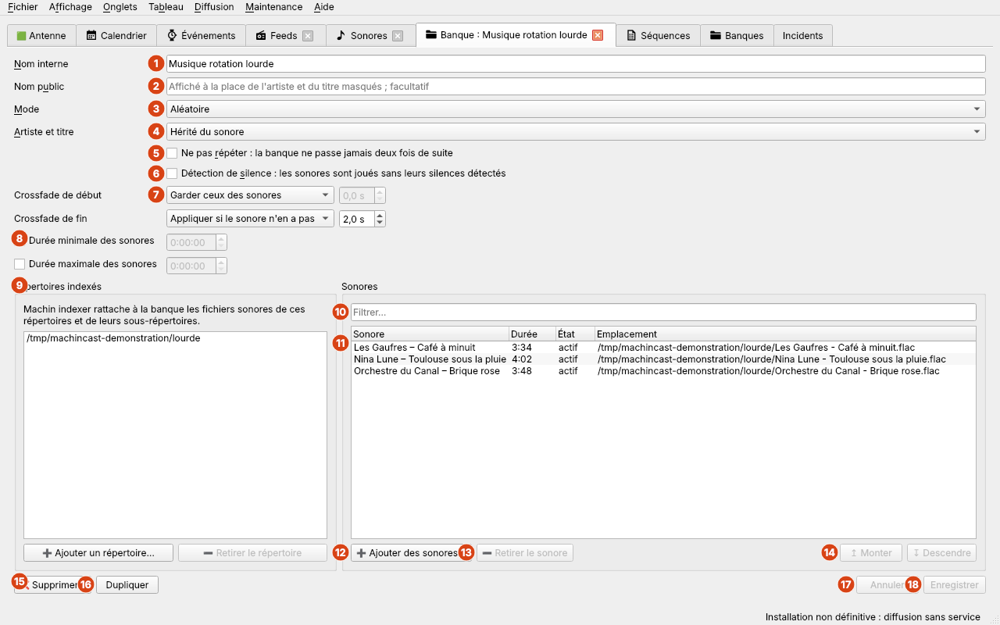

# Help on the card of a bank

A bank provides a sound at each call, according to its mode, among its active sounds.
The numbers refer to the picture; **Help → Contextual help**, or <kbd>F1</kbd>, gives each of these helps as a tooltip, on the element itself.

1. **Internal name** (`internal_name`) : required, and unique to the bank.
2. **Public name** (`public_name`) : optional; shown on the public page instead of the hidden artist and title.
3. **Mode** (`mode`) : the order in which the bank provides its sounds: that of the list, that of the file names, or at random.
4. **Artist and title** (`hiding`) : hidden by the public name of the bank, shown, or left to the choice of the sound.
5. **Do not repeat** (`no_repeat`) : the bank never plays twice in a row.
6. **Silence detection** (`detection_silences`) : the sounds played by the bank are played without their silences at the start and at the end.
7. **Start crossfade** (`start_crossfade_rule`) : keep those of the sounds, apply them to those that have none, or impose them on all; likewise for the end crossfade.
8. **Minimum duration** (`has_min_duration`) : optional, like the maximum duration; a sound outside them is marked, and the next indexing removes it from the bank.
9. **Indexed directories** (`directory_group`) : the files of these directories, and of their subdirectories, join the bank at each indexing.
10. **Filter…** (`sound_filter`) : shows only the sounds that contain the typed text.
11. **Sounds** (`sounds`) : each sound, with its duration, state and location; double-click for its card, right-click for the pre-listen, enable, disable, cut, copy, paste and select all.
12. **➕ Add sounds…** (`add_sounds`) : chooses sounds in the database; files can also be dropped on the list.
13. **➖ Remove the sound** (`remove_sound`) : removes the chosen sounds from the bank, without touching their file.
14. **↥ Move up** (`raise_`) : moves the chosen sounds up one rank; **↧ Move down** moves them down.
15. **❌ Delete…** (`delete`) : deletes the element, after confirmation; it can be restored until it is erased from the database.
16. **Duplicate** (`duplicate`) : opens the copy of the element in a new card, to save.
17. **Cancel** (`cancel`) : goes back to what is in the database; <kbd>Ctrl</kbd>+<kbd>Esc</kbd> cancels and closes the tab.
18. **Save** (`save`) : saves the card to the database, <kbd>Ctrl</kbd>+<kbd>S</kbd>; <kbd>Ctrl</kbd>+<kbd>Enter</kbd> saves and closes the tab. A green outline marks it while the card has changes to save.

To go further: [Card of a bank](../sonores.md#card-of-a-bank) and [Feeding a bank from its directories](../sonores.md#feeding-a-bank-from-its-directories).
