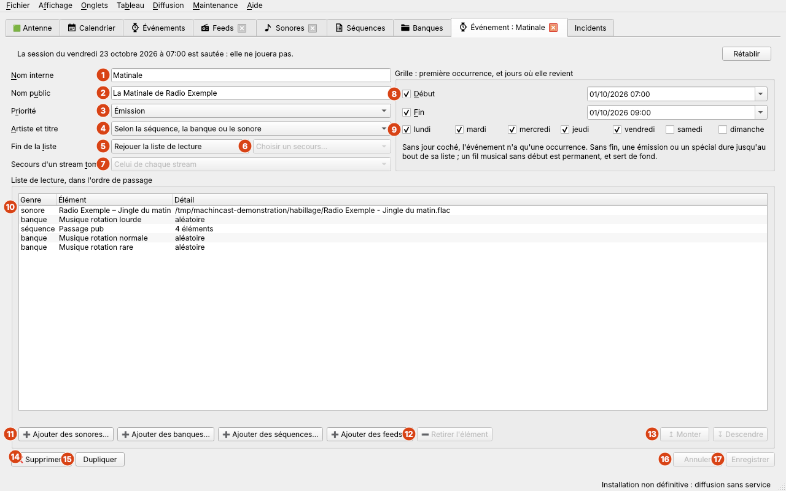

# Help on the card of an event

An event places a playlist in the schedule: a special, a show, a background programming, or a fallback.
The numbers refer to the picture; **Help → Contextual help**, or <kbd>F1</kbd>, gives each of these helps as a tooltip, on the element itself.

1. **Internal name** (`internal_name`) : required, and unique to the event.
2. **Public name** (`public_name`) : optional; shown on the public page instead of the hidden artist and title.
3. **Priority** (`priority`) : unforeseen, special, show, background programming or fallback; the highest takes the air.
4. **Artist and title** (`hiding`) : hidden by the public name of the event, shown, or left to the choice of the elements.
5. **End of the list** (`end_of_list`) : what a show or a special that has an end does when its list ends before it: replay the list, switch to the background programming, switch to a fallback, or lend its name to the background programming.
6. **Fallback** (`end_fallback`) : the fallback that takes over, when the end of the list switches to a fallback.
7. **Fallback of a dropped stream** (`stream_fallback`) : the fallback that plays when a stream of the list drops; **The fallback of each stream** keeps that of each stream.
8. **Start** (`has_start`) : to tick, the moment the event starts; likewise for **End**.
9. **Days** (`monday`) : the days of the week when the event comes back, from Monday to Sunday.
10. **Elements** (`items`) : the sounds, banks, sequences and feeds played, in order; drag and drop, cut, copy and paste reorder them.
11. **➕ Add sounds…** (`add_sounds`) : adds sounds; the buttons next to it add banks, sequences and feeds.
12. **➖ Remove the element** (`remove_item`) : removes the chosen elements.
13. **↥ Move up** (`raise_`) : moves the chosen elements up one rank; **↧ Move down** moves them down.
14. **❌ Delete…** (`delete`) : deletes the element, after confirmation; it can be restored until it is erased from the database.
15. **Duplicate** (`duplicate`) : opens the copy of the element in a new card, to save.
16. **Cancel** (`cancel`) : goes back to what is in the database; <kbd>Ctrl</kbd>+<kbd>Esc</kbd> cancels and closes the tab.
17. **Save** (`save`) : saves the card to the database, <kbd>Ctrl</kbd>+<kbd>S</kbd>; <kbd>Ctrl</kbd>+<kbd>Enter</kbd> saves and closes the tab. A green outline marks it while the card has changes to save.

To go further: [Card of an event](../grille.md#card-of-an-event) and [Which event is on air](../antenne.md#which-event-is-on-air).
