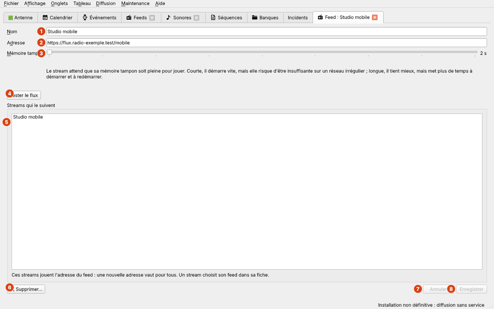

# Help on the card of a feed

A feed is a reusable stream address, that several streams can follow.
The numbers refer to the picture; **Help → Contextual help**, or <kbd>F1</kbd>, gives each of these helps as a tooltip, on the element itself.

1. **Name** (`name`) : required.
2. **Address** (`url`) : required; a new address applies at once to all the streams that follow the feed.
3. **Buffer** (`buffer`) : from 2 to 10 seconds; short, the stream starts quickly, long, it holds an irregular network better.
4. **Test the stream** (`test`) : says whether sound arrives at the entered address, of which type and at which bitrate, without playing anything on air.
5. **Streams that follow it** (`streams`) : a double-click opens their card.
6. **❌ Delete…** (`delete`) : a feed that a stream follows is not deleted; the card names these streams.
7. **Cancel** (`cancel`) : goes back to what is in the database; <kbd>Ctrl</kbd>+<kbd>Esc</kbd> cancels and closes the tab.
8. **Save** (`save`) : saves the card to the database, <kbd>Ctrl</kbd>+<kbd>S</kbd>; <kbd>Ctrl</kbd>+<kbd>Enter</kbd> saves and closes the tab. A green outline marks it while the card has changes to save.

To go further: [Feeds](../sonores.md#feeds) and [Streams](../antenne.md#streams).
