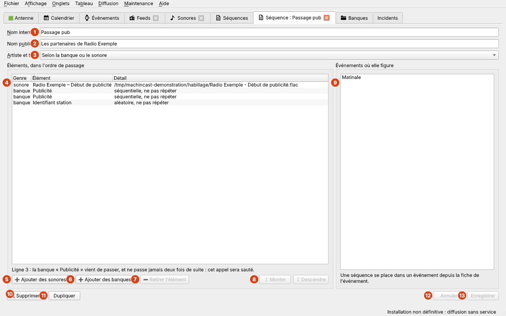

# Help on the card of a sequence

A sequence is a run of elements played in one block, such as an advertising break, that an event calls.
The numbers refer to the picture; **Help → Contextual help**, or <kbd>F1</kbd>, gives each of these helps as a tooltip, on the element itself.

1. **Internal name** (`internal_name`) : required, and unique to the sequence.
2. **Public name** (`public_name`) : optional; shown on the public page instead of the hidden artist and title.
3. **Artist and title** (`hiding`) : hidden by the public name of the sequence, shown, or left to the choice of the bank or the sound.
4. **Elements** (`items`) : the sounds and banks played, in order; drag and drop, cut, copy and paste reorder them.
5. **➕ Add sounds…** (`add_sounds`) : adds sounds at the end of the list.
6. **➕ Add banks…** (`add_banks`) : adds banks, each of which will provide a sound.
7. **➖ Remove the element** (`remove_item`) : removes the chosen elements.
8. **↥ Move up** (`raise_`) : moves the chosen elements up one rank; **↧ Move down** moves them down.
9. **Events** (`events`) : the events that call the sequence; a double-click opens their card.
10. **❌ Delete…** (`delete`) : deletes the element, after confirmation; it can be restored until it is erased from the database.
11. **Duplicate** (`duplicate`) : opens the copy of the element in a new card, to save.
12. **Cancel** (`cancel`) : goes back to what is in the database; <kbd>Ctrl</kbd>+<kbd>Esc</kbd> cancels and closes the tab.
13. **Save** (`save`) : saves the card to the database, <kbd>Ctrl</kbd>+<kbd>S</kbd>; <kbd>Ctrl</kbd>+<kbd>Enter</kbd> saves and closes the tab. A green outline marks it while the card has changes to save.

To go further: [Card of a sequence](../grille.md#card-of-a-sequence) and [Sequences](../antenne.md#sequences).
