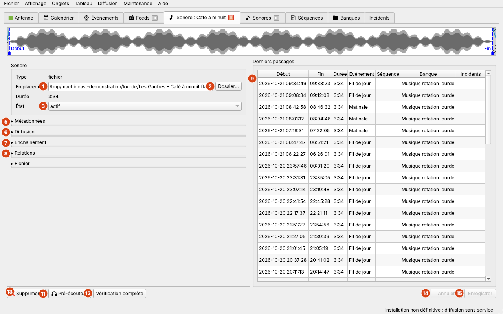

# Help on the card of a sound

The card of a sound shows a file or a stream, its metadata, its broadcast and its last plays; a click on the title of a box unfolds it.
The numbers refer to the picture; **Help → Contextual help**, or <kbd>F1</kbd>, gives each of these helps as a tooltip, on the element itself.

1. **Location** (`location`) : the file, or the address of the stream, which is not changed here.
2. **Folder…** (`open_folder`) : opens the folder of the file in the file browser of the workstation.
3. **State** (`state`) : `active` or `disabled`; an `expired`, `erroneous` or `deleted` sound can go back to `active`.
4. **Stream** (`stream_group`) : the direct address or a feed, the fallback event, and **Test the stream**.
5. **Metadata** (`metadata_group`) : artist, title and other tags; a changed field is noted as entered by hand, and the tags no longer overwrite it.
6. **Broadcast** (`broadcast_group`) : hiding of the artist and title, broadcast period and maximum of plays.
7. **Transition** (`silence_group`) : play without the detected silences, the start and the end, and the crossfades of the sound.
8. **Relations** (`relation_group`) : the sequences, banks and events that cite it; double-click for their card, right-click to remove the sound from them.
9. **Last plays** (`plays`) : its last 50 plays on air, with their warnings and incidents.
10. **Back to the values of the file…** (`back_to_file`) : gives back to the values entered by hand those of the file, after confirmation.
11. **Pre-listen…** (`preview`) : listening on headphones, with its timeline, without touching the air.
12. **Full check** (`check`) : checks the whole file and measures its silences, without waiting for the next indexing.
13. **❌ Delete…** (`delete`) : deletes the element, after confirmation; it can be restored until it is erased from the database.
14. **Cancel** (`cancel`) : goes back to what is in the database; <kbd>Ctrl</kbd>+<kbd>Esc</kbd> cancels and closes the tab.
15. **Save** (`save`) : saves the card to the database, <kbd>Ctrl</kbd>+<kbd>S</kbd>; <kbd>Ctrl</kbd>+<kbd>Enter</kbd> saves and closes the tab. A green outline marks it while the card has changes to save.

To go further: [Card of a sound](../sonores.md#card-of-a-sound), [Pre-listen](../sonores.md#pre-listen) and [Tags and metadata](../sonores.md#tags-and-metadata).
