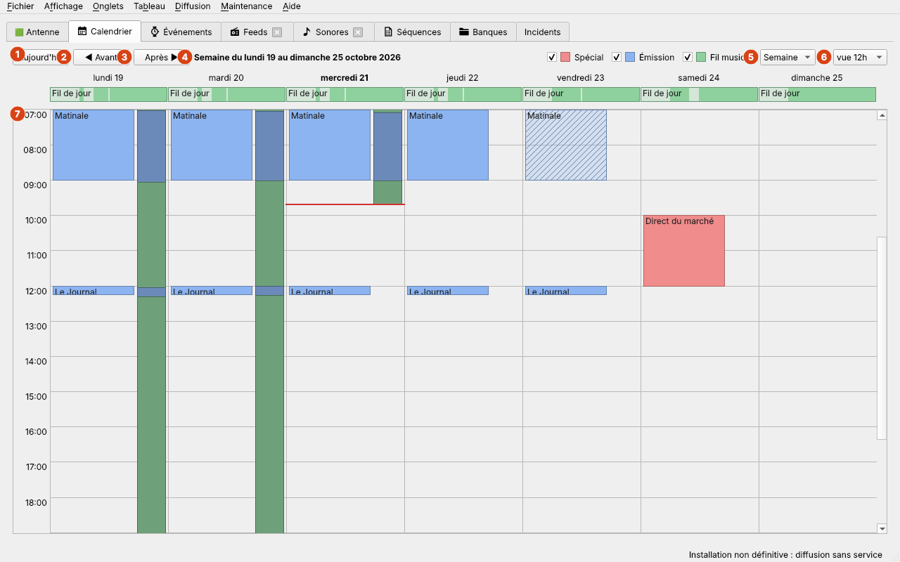

# Help on the schedule

The calendar shows what is planned, and, to the right of each past day, what was broadcast.
The numbers refer to the picture; **Help → Contextual help**, or <kbd>F1</kbd>, gives each of these helps as a tooltip, on the element itself.

1. **Today** (`today`) : goes back to the week, or the day, of today.
2. **◀ Before** (`previous`) : the week, or the day, before, up to the expiry period.
3. **After ▶** (`following`) : the week, or the day, after, up to 28 days after today.
4. **Period** (`title`) : the week or the day shown; the boxes that follow show or hide the specials, the shows and the background programmings.
5. **View** (`view`) : a single day, or the week.
6. **Zoom** (`zoom`) : 4, 8, 12 or 24 hours in the height of the grid; <kbd>Shift</kbd> and the wheel go to the next zoom.
7. **Grid** (`scrolling`) : a block per occurrence of an event, in the colour of its priority; double-click for its card, click on a free hour to create an event, right-click to skip a session.

To go further: [Calendar](../grille.md#calendar) and [Skipping a session](../grille.md#skipping-a-session).
