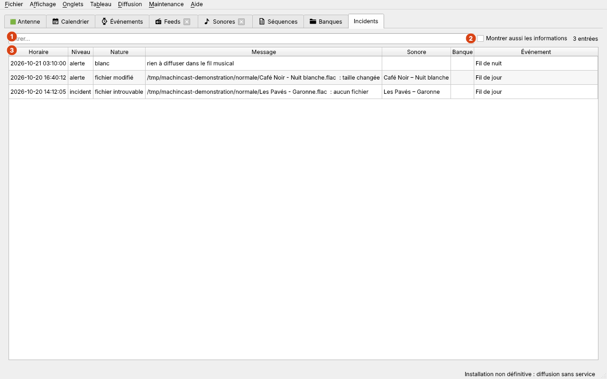

# Help on the Incidents tab

The Incidents tab shows the warnings and incidents noted by the broadcast, the indexing and the maintenance, from the most recent to the oldest.
The numbers refer to the picture; **Help → Contextual help**, or <kbd>F1</kbd>, gives each of these helps as a tooltip, on the element itself.

1. **Filter…** (`filter_`) : keeps only the rows that contain the typed text, ignoring case and accents.
2. **Also show the information entries** (`information`) : adds the normal operations, such as starts, beginnings and ends of events, and manual interruptions.
3. **Log** (`table`) : time, level, kind, message, and the sound, bank and event concerned; a double-click on one of them opens its card.

To go further: [History and incidents](../antenne.md#history-and-incidents).
