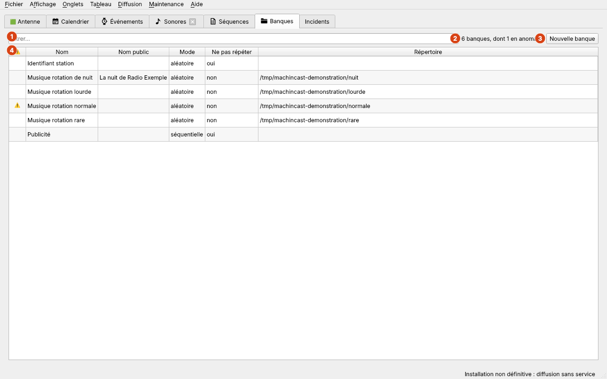

# Help on the list of banks

The Banks tab gives all the banks, by name.
The numbers refer to the picture; **Help → Contextual help**, or <kbd>F1</kbd>, gives each of these helps as a tooltip, on the element itself.

1. **Filter…** (`filter_`) : keeps only the rows where a column contains the typed text, ignoring case and accents.
2. **Count** (`count`) : how many rows remain, out of how many.
3. **New bank** (`new`) : opens an empty card; nothing is in the database before **Save**.
4. **List** (`table`) : ⚠️, name, public name, mode, “do not repeat” and first directory. The right-click offers **Duplicate**, and actions on the chosen banks. A click on a column title sorts, a double-click or <kbd>Enter</kbd> opens the card, a right-click on the titles chooses the columns.

To go further: [Lists and actions](../listes.md#lists) and [Table columns](../listes.md#table-columns).
