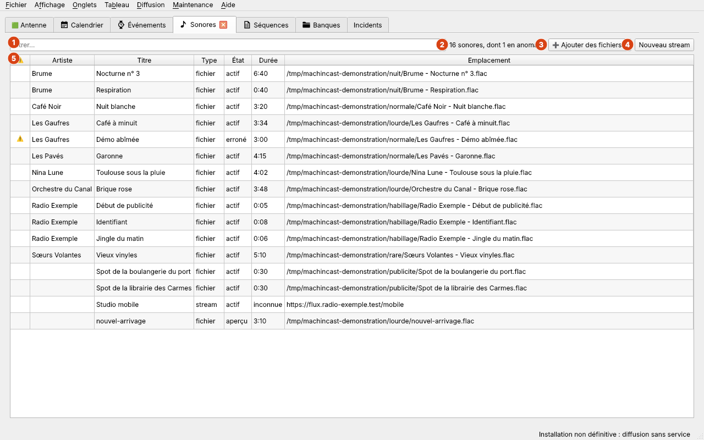

# Help on the list of sounds

The Sounds tab gives all the sounds in the database, files and streams, by artist then by title.
The numbers refer to the picture; **Help → Contextual help**, or <kbd>F1</kbd>, gives each of these helps as a tooltip, on the element itself.

1. **Filter…** (`filter_`) : keeps only the rows where a column contains the typed text, ignoring case and accents.
2. **Count** (`count`) : how many rows remain, out of how many.
3. **➕ Add files…** (`add_files`) : adds sound files as new sounds in `preview`, checked at the next indexing; they can also be dropped on the list.
4. **New stream** (`new`) : opens an empty card; nothing is in the database before **Save**.
5. **List** (`table`) : ⚠️, artist, title, type, state, duration and location; a large list loads the rest while scrolling down. The right-click offers the pre-listen, and actions on the chosen sounds. A click on a column title sorts, a double-click or <kbd>Enter</kbd> opens the card, a right-click on the titles chooses the columns.

To go further: [Lists and actions](../listes.md#lists) and [Table columns](../listes.md#table-columns).
