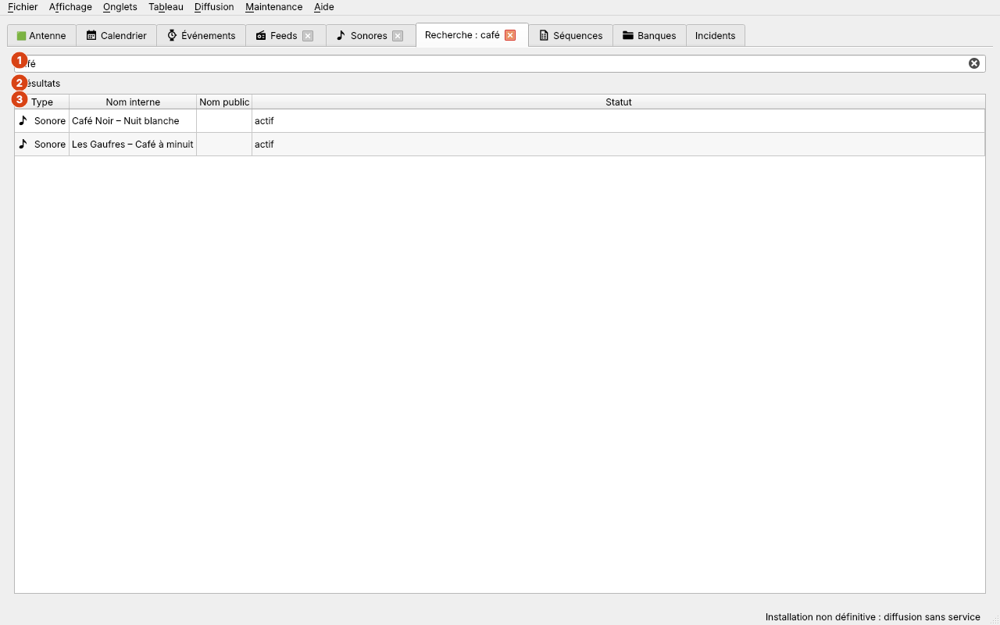

# Help on the search

The search finds the events, sequences, banks and sounds whose name, artist or title contains the typed text.
The numbers refer to the picture; **Help → Contextual help**, or <kbd>F1</kbd>, gives each of these helps as a tooltip, on the element itself.

1. **Search field** (`field`) : from 2 characters, ignoring case and accents; the text becomes the title of the tab.
2. **Count** (`count`) : how many results there are, or only the first 500, when there are more.
3. **Results** (`table`) : their type, internal name, public name and status; a double-click or <kbd>Enter</kbd> opens the card, <kbd>Ctrl</kbd>+<kbd>C</kbd> copies the chosen results, to paste into a bank, an event or a sequence.

To go further: [Searching](../prise-en-main.md#searching).
