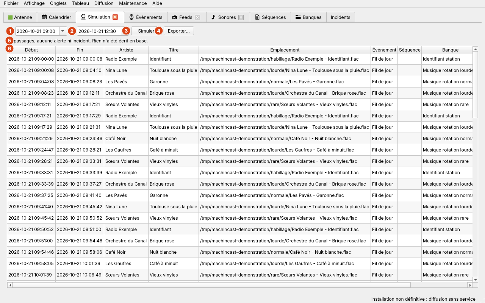

# Help on the simulation

The simulation shows what the broadcast would play over a period, without playing anything and without writing to the database.
The numbers refer to the picture; **Help → Contextual help**, or <kbd>F1</kbd>, gives each of these helps as a tooltip, on the element itself.

1. **Start** (`start`) : the start of the period, to the minute.
2. **End** (`end`) : the end of the period, after its start.
3. **Simulate** (`simulate`) : replays the period according to the rules of the broadcast, from the real history; each simulation draws at random.
4. **Export…** (`export`) : saves the result as a CSV spreadsheet, a PLS playlist or an HTML page.
5. **Report** (`count`) : the number of plays, and that of the simulated warnings and incidents.
6. **Simulated plays** (`table`) : each with its start, end, artist, title, file, event, sequence and bank.
7. **Warnings and incidents** (`anomalies`) : what the broadcast would have noted, such as a dead air.

To go further: [Simulation](../grille.md#simulation).
