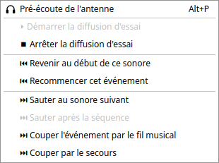
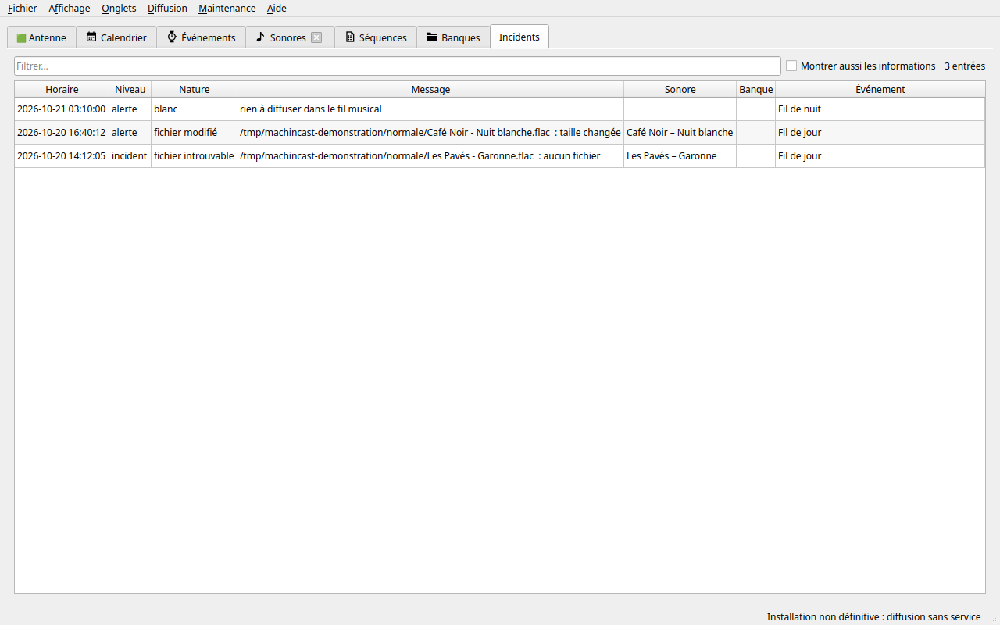

# What goes on air

[On-air guide](README.md) › What goes on air

- [Which event is on air](#which-event-is-on-air)
- [How a list plays](#how-a-list-plays)
- [Sequences](#sequences)
- [Which sound a bank provides](#which-sound-a-bank-provides)
- [Expiry of sounds](#expiry-of-sounds)
- [Transitions](#transitions)
- [Dead air in a sound](#dead-air-in-a-sound)
- [Silences at the start and the end](#silences-at-the-start-and-the-end)
- [Streams](#streams)
- [Public page and hiding](#public-page-and-hiding)
- [Controlling the broadcast](#controlling-the-broadcast)
- [Interrupting the air](#interrupting-the-air)
- [History and incidents](#history-and-incidents)

## Which event is on air

At any moment, the air follows **a single event**, chosen this way:

- **Priority**: a `breaking` event ([#402](https://github.com/dascritch/machincast/issues/402)), such as a civil-protection alert, prevails over everything; a `special` prevails over a `show`, which prevails over a `background programming`. When the priority event ends, the one below resumes.
- **Permanent background programming**: a background programming without a start or end date serves as a background; it covers all the time when nothing else is scheduled, not even another background programming.
- **Background programmings by the hour**: several background programmings can take turns, for instance a night one from 00:00 to 06:00, every day, over a permanent day one.
- **Always a background programming**: if none exists, the interface creates one, « Fil musical », permanent and empty ([Getting started](prise-en-main.md#getting-started)). Empty, it leaves dead air, with a warning.
- **Hours**: an event is on air from its start, included, to its end, excluded: a show from 20:00 to 22:00 gives way at 22:00 sharp. All hours are those of Paris, the machine's local time.
- **Recurrence**: an event that repeats comes back on each of the checked days, at the same hour, from its first broadcast, without an end date. For holidays or a bank holiday, its sessions are skipped from the calendar ([Skipping a session](grille.md#skipping-a-session)).
- **Past midnight**: an event can end the next day, for instance from 23:00 to 01:00; for a recurring event, the day of the start counts.
- **Show or special without an end**: it stays on air until the end of its list, which does not loop; the event below then resumes. An event of the same priority that starts after it takes the air; it then resumes where it was, if its list is not exhausted.
- **Overlap**: two events of the same priority do not overlap: the [card of an event](grille.md#card-of-an-event) refuses it.
- **Change of time**: an event keeps its hour. A show at 21:00 stays at 21:00 after the change to summer or winter time; the hour skipped or repeated, the night of the change, falls into the night background programming. A show scheduled during that hour ([#566](https://github.com/dascritch/machincast/issues/566)): at the change to summer time, a show at 02:30 starts at 03:00, when the clock jumps; at the change to winter time, a show from 02:30 to 03:30 plays from 02:30 to 03:00, gives way to the background programming during the first half of the repeated hour, then resumes from 02:30 to 03:30.

The [calendar](grille.md#calendar) shows the resulting schedule, week by week.

## How a list plays

- **Order**: the elements play in the order of the list. The same element can come back, for instance a jingle between each song. A bank plays a single one of its sounds; a [sequence](#sequences), all its elements.
- **Skipped elements**: a bank where no sound is playable, or a sound that is not, is skipped: the list moves on to the next element.
- **Loop**: having reached the end before the end of the event, the list starts again from the beginning. A show or a special **without an end** does not loop: once its list is played, the event below resumes.
- **Start of an event**: it cuts the current sound **short**, whatever it is. A show at 20:00 starts at 20:00 sharp.
- **End of an event**: if no other starts, the last sound is played to its end, then the background programming resumes. If another starts right after, it cuts this last sound.
- **Back to the background programming**: it resumes at the element that follows the last one it played, not at the start of its list.
- **Each occurrence** of a recurring show starts its list again from the beginning.
- **Nothing to broadcast**: dead air, and a `dead air` warning. The dead air ends as soon as a sound becomes playable again or a show starts.

The broadcast reads its position in its history: after a restart, it resumes where it was.

## Sequences

A **sequence** is a series of sounds and banks, played in order, placed as a single element in the list of one or several events. For instance, « Passage pub » plays the sound « Début de publicité » (start of adverts), the bank « Publicité » twice, then the bank « Identifiant station ».

- **Order**: the elements play in the order of the sequence; each bank plays a single sound. A sequence never contains another sequence.
- **Skipped elements**: an element that is not playable is ignored. A sequence where nothing is playable is skipped, like an empty bank.
- **Like a single sound**: at the end of its event, the sequence goes to its end. An event that starts cuts it short, with its current sound: its remaining elements are not played.
- **Then**: the list of the event resumes at the element that follows the sequence.

Sequences are created in their [card](grille.md#card-of-a-sequence).

## Which sound a bank provides

A bank called by a list plays **a single one** of its sounds, according to its mode:

- **Sequential**: the sound that follows, in the order of the bank, the last one it played; after the last, it starts again from the beginning.
- **A→Z of the file name**, **Z→A of the file name** ([#454](https://github.com/dascritch/machincast/issues/454)): like a sequential bank, but in the alphabetical order of the file names, or in reverse order, whatever their folder. The rotation is prepared by naming the files: a number of the same length first, such as `01-winter.mp3`, `02-spring.mp3`, `03-summer.mp3`, and not `1-…` and `10-…`, which would come before `2-…`. A file added or renamed takes its place from the next sound.
- **Random**: a sound drawn at random among those it has not yet played in its cycle. As long as they have not all played, none comes back, and a new cycle never starts with the last one played. A sound added enters the current cycle.
- **Bank by bank**: only the plays provided by the bank itself count. A sound present in two banks follows the cycle of each separately.
- **Playable sounds**: only a sound in the `active` state is chosen, within its broadcast period when it is set, and under its maximum of plays ([States of a sound](sonores.md#states-of-a-sound)).
- **Nothing playable**: the bank provides nothing, and the list moves on to the next element.

**« Do not repeat » bank.** A bank marked « do not repeat », such as a jingle bank, never plays twice in a row:

- if the last sound broadcast comes from it, the next element that calls it is skipped: a list « jingle, jingle, song » gives a jingle then the song;
- the rule holds from one event to the next, after a clean cut and after a restart;
- if, the bank skipped, a show or a special has nothing playable left, it ends (`event ended earlier` warning) and the event below resumes; a background programming, for its part, goes silent (`dead air` warning);
- the cards of a [sequence](grille.md#card-of-a-sequence) and of an [event](grille.md#card-of-an-event) warn when a marked bank is called right after itself: this second call will always be skipped.

## Expiry of sounds

The broadcast moves an `active` sound to the `expired` state:

- **Maximum of plays**: from the play that reaches it, counted over the whole broadcast. The sound finishes playing this play.
- **Broadcast period**: as soon as its end date is reached.

An expired sound keeps its file, its banks and its lists; only its state changes. To put it back on air, its [card](sonores.md#card-of-a-sound) moves it back to `active`, after raising its maximum or pushing back its period; otherwise it expires again.

## Transitions

Sounds follow each other according to their **crossfades**:

- the **start crossfade** of a sound: it rises, from silent to full volume, during this time;
- the **end crossfade**: the next sound starts that much before the end, and this one fades out during this time. The two overlap;
- **both are needed**: two sounds only overlap if the first has an end crossfade **and** the second a start crossfade. Otherwise, the first plays to its end, then the second starts at once, at full volume;
- **where crossfades come from**: those imposed by the bank that provided the sound; otherwise those of the sound's card, if set there (0 second is one); otherwise those the bank applies by default; otherwise those of the [preferences](prise-en-main.md#preferences); otherwise none;
- **clean cut**: at the start of an event, the current sound stops at once, without a fade.

A file that has disappeared when it is time to play it is not played: the `file not found` incident is noted, the broadcast moves on to the next sound, and does not offer it again for an hour.

A file whose playback does not start, without sound after 10 seconds, is replaced by the next sound: the `blocked playback` incident is noted ([#281](https://github.com/dascritch/machincast/issues/281)). It is rare and random, and has only been seen with AIFF files, which are no longer supported: the sound plays normally at its next turn.

## Dead air in a sound

A sound that no longer gives sound while it plays, 10 seconds under -90 dB, has **dead air** ([#122](https://github.com/dascritch/machincast/issues/122)): a badly edited file, or a stream whose studio only sends emptiness. The `dead air in a sound` incident is noted in the [log](#history-and-incidents), with the place in the file where the dead air starts and its average level, to find the defect in an audio editor. The fades of a sound are not dead air.

By default, the dead air is only noted, and the sound goes on. With **Move on to the next sound, or to the fallback of a stream**, in the [preferences](prise-en-main.md#preferences), « Audio » page:

- a file gives the air at once to the next sound;
- a stream gives it to its fallback event, or to the event below, like a dropped stream; it keeps listening, and takes back the air with a fade as soon as its sound comes back.

The duration and the level of dead air are set on the same page. It is not a [silence at the start or the end](#silences-at-the-start-and-the-end) of a file, which the broadcast can remove.

## Silences at the start and the end

A file can start or end with silence: a passage under the threshold, a breath, the end of a reverb. Not to hear them, the broadcast can play a sound **without its silences**. The file is not modified: only the duration of its silences is noted.

- **Measure**: the **full audit** measures the silences of each file ([Indexing from the interface](sonores.md#indexing-from-the-interface)), under the threshold of the [preferences](prise-en-main.md#preferences), -40 dB by default. The quick indexing does not measure them.
- **When**: never by default. A sound is played without its silences if its [card](sonores.md#card-of-a-sound) asks for it, or if the [bank](sonores.md#card-of-a-bank) that provided it asks for it.
- **Playing**: its fades are placed around its detected start and end ([#234](https://github.com/dascritch/machincast/issues/234)). By default, the **fade-in ends** at the detected start: the sound arrives at full volume; the **fade-out starts** at the detected end: the sound goes at full volume to its end, and fades out over the silence that follows. Each one can also « start » or « be under way » at its bound. Playback extends into the silences as far as the fades overflow into them, without ever leaving the file: a fade longer than the silence starts, or ends, part-way.
- **Setting**: in the [preferences](prise-en-main.md#preferences), **Crossfades** page, for all sounds; a [bank](sonores.md#card-of-a-bank) only sets whether they have crossfades and their duration. The [timeline](sonores.md#file-timeline) of the pre-listen and of the On air tab shows them.
- **Never audited**: a sound whose silences have not been measured is played in full. After adding sounds or enabling the detection, request a full audit.
- **Correction**: the detected start and end can be corrected by hand in the card of the sound; the audit no longer changes them afterwards.

## Streams

A **stream** relays an audio feed over the Internet, an outside broadcast for instance, at its address or at that of a [feed](sonores.md#feeds):

- **Start of an event** of equal or higher priority: it cuts the stream short, like a file.
- **End of its event**: the stream fades out during its end crossfade, and the next sound follows.
- **Dropped stream**: a stream that does not answer, that stops before the end of its event, or that gives no sound for 10 seconds, has dropped ([#278](https://github.com/dascritch/machincast/issues/278)). The `dropped stream` incident is noted, and the **fallback event** of the stream plays its list instead, in a loop. Without a fallback event, the event below resumes, most often the background programming.
- **Reconnection**: as long as its event is on air, the broadcast tries the connection again every 5 seconds, without anything heard. As soon as the stream comes back, it takes back the air, and the `stream resumption` incident gives the duration of the failure.
- **End of the event during the failure**: the reconnection is abandoned, and the broadcast goes on normally.
- **Metadata**: the history notes the artist and the title of the stream in the database, never those the stream announces.
- **Audio input** ([#623](https://github.com/dascritch/machincast/issues/623), [#625](https://github.com/dascritch/machincast/issues/625)): the stream of an audio input plays what arrives on the input, a studio for instance, until the end of its event; an unplugged input is a dropped stream. The On air tab shows its VU meter, on air or next.

A **fallback event** is an event of `fallback` priority: it has no start, no end and no days, and only goes on air instead of a dropped stream, or at the end of the list of a show that switches to it ([Card of an event](grille.md#card-of-an-event), [#350](https://github.com/dascritch/machincast/issues/350)). Each stream designates its own in [its card](sonores.md#card-of-a-sound); the event that plays the stream can choose another, **Fallback of a dropped stream**, which prevails.

## Public page and hiding

The broadcast publishes a **public page**, for the station's website: the sound on air and the 20 previous ones, with the time. The artist and the title of a play can be **hidden** there, for instance for an advert or a station imaging element:

- the choice is made at five levels, in this order: the event, the sequence, the bank, the sound, then the station's general setting. The first level set decides: an event that says « show » prevails over a sound that says « hide »;
- hidden, the artist and the title give way to the first **public name** set: that of the event, then of the sequence, then of the bank; if there is none, to the station's public text;
- the interface, reserved for the team, always shows everything.

The On air tab shows the public text of the current sound, as the public page shows it.

## Controlling the broadcast

The **Broadcast** menu starts and stops the broadcast, without a terminal. To restart it, stop it then start it ([#223](https://github.com/dascritch/machincast/issues/223)). Only the **Broadcast service settings…** restart it on their own, when validated ([Preferences](prise-en-main.md#preferences), [#389](https://github.com/dascritch/machincast/issues/389)). Its entries follow the state of the broadcast, read again at each opening of the menu. In this menu as in the right-clicks of the On air tab, ⏵ marks what starts the broadcast, ⏹ what stops it, and ⏭ what skips the current sound or event ([#322](https://github.com/dascritch/machincast/issues/322)). As long as the broadcast is not running, the last line of the window shows **🔇 Broadcast stopped**.

**On a machine installed for the air**, the broadcast runs as a service of the machine:

| State of the broadcast | Active entries |
| --- | --- |
| Stopped | ⏵ Start the broadcast |
| Running | ⏹ Stop the broadcast |
| Failed (it crashed too often) | ⏵ Start the broadcast |

Each entry asks for the password of an administrator of the machine. The status bar then says how it went: `Broadcast started.`, `Broadcast stopped.`, or the failure and its reason, for instance when the password is refused.

**The on-air machine does not get turned off by mistake** ([#448](https://github.com/dascritch/machincast/issues/448)): turning it off, restarting it or putting it to sleep, from the desktop menu as from the login screen, also asks for an administrator's password. From the login screen, which cannot ask for it, it is not possible: open a session first. A short press on the power button, a sleep key, closing the lid or Ctrl+Alt+Delete no longer cut the air; only a long press on the power button turns the computer off, by force, in case it hangs.

After **⏵ Start the broadcast**, the status bar says `Broadcast starting…` for a few seconds, the time to see whether the broadcast holds ([#376](https://github.com/dascritch/machincast/issues/376)). If it stops at once, a **Broadcast not started** alert says so, with its code and what it means, and, in the details, the last lines of the broadcast's log. Code 2, an invalid configuration or call, is mostly seen after an update of MachinCast: the machine's administrator runs `./install.sh` again, which updates the service. Code 1: database unreachable, audio output unavailable, or another broadcast already running. In all cases, `Machin logs`, in a terminal, says more.

**On a test machine**, without this service, the status bar permanently shows `Non-final installation: broadcast without a service`, the tab is called **🟩 On air** instead of **🟥 On air**, and the menu controls a **trial broadcast**, which does play on air:

| Entry | What it does |
| --- | --- |
| ⏵ Start the trial broadcast | Opens the broadcast in a terminal window, which shows its log. Closing the interface does not stop it. |
| ⏹ Stop the trial broadcast | Stops it cleanly: the current play ends. The status bar announces `Trial broadcast stopped.` |

## Interrupting the air

The **Broadcast** menu also offers, after a line, to correct what is playing, without waiting ([#228](https://github.com/dascritch/machincast/issues/228)): first going back to the start ([#366](https://github.com/dascritch/machincast/issues/366)), then, after another line, skipping or cutting. **Right-clicking the current sound**, on the On air tab, also offers to go back to the start:

| Entry | Effect |
| --- | --- |
| ⏮ Back to the start of this sound | For a failed start ([#366](https://github.com/dascritch/machincast/issues/366)): the current sound starts again from its beginning, in a new play; the sequence and the upcoming sounds go on after it. Inactive on a stream, which has no start. |
| ⏮ Restart this event | The event on air starts again from the first element of its list, even the background programming; a show that lends its name to the background programming takes it back, plays its list again, then lends it again. A current sequence is abandoned. |
| ⏭ Skip to the next sound | The current sound is cut, and the next sound announced on the On air tab plays at once; the upcoming sounds move one step. |
| ⏭ Skip after the sequence | The current sound is cut, and the rest of its sequence is not played: the sound planned after the sequence plays at once, and the upcoming sounds that follow it are kept. |
| ⏭ Cut the event by the background programming | The current sound is cut, and the background programming takes the air at once, until the planned end of the cut event: a special and the show it covers both give way. Inactive in the background programming, except when it plays in the name of a show ([#399](https://github.com/dascritch/machincast/issues/399)): it then cuts this show, and the background programming resumes under its own name. |
| ⏭ Cut by the fallback | Like the cut by the background programming, but a **fallback event** plays its list, until the planned end of the cut event; in the background programming, until the start of the next event ([#323](https://github.com/dascritch/machincast/issues/323)). Inactive without a fallback event. With several fallbacks, a submenu names them. If the fallback has nothing left to play, the background programming resumes. |

- Each entry is only active if its element is on air; its tooltip names it, or says why it is inactive (« Nothing on air », « No sequence on air », « The background programming is already on air »).
- The request leaves **at once, without a question**: the air does not wait. The status bar announces it, for instance `Skip to the next sound requested.`
- The cut sound fades out during the default end crossfade of the [preferences](prise-en-main.md#preferences), and the next one rises during the default start crossfade; without a default crossfade, the cut is clean, whatever the crossfades of the sound. Its play ends without an incident, and the log notes `manual interruption`.
- An event cut by the background programming, by the fallback or by a feed does not come back before its next broadcast, unless the broadcast restarts in the meantime.
- **Cutting by a feed**: in the **Feeds** tab, right-clicking a feed offers **Pre-listen…** of its stream, and **⏭ Cut the event by this feed**, or, in the background programming, **⏭ Cut the background programming by this feed** ([#323](https://github.com/dascritch/machincast/issues/323)). The stream that follows the feed plays at once, until the planned end of the cut event, or until the start of the next event; if it drops, the background programming takes over, without trying the feed again. The entry is inactive without an active stream that follows the feed. The status bar announces it: `Cut by the feed “Studio mobile” requested.`
- Each cut is noted in the log, like the other interruptions: `manual interruption`, `of the event “Matinale” by the fallback “Attente”`.
- If the announced sound is no longer playable, the broadcast chooses another, and recomputes the upcoming sounds.

### From the next sound

On the On air tab, **right-clicking the frame of the next sound** offers ([#257](https://github.com/dascritch/machincast/issues/257)):

| Entry | Effect |
| --- | --- |
| Pre-listen… | Opens the next sound in the [pre-listen](sonores.md#pre-listen), on headphones. |
| ⏭ Skip to this sound | Like « ⏭ Skip to the next sound »: the current sound stops, and the next sound plays at once. |
| ⏭ Skip after the sequence, ⏭ Cut the event by the background programming, ⏭ Cut by the fallback | The same cuts as in the **Broadcast** menu, active according to what is on air ([#323](https://github.com/dascritch/machincast/issues/323)). |
| ⏭ Advance “Journal”, planned on Wednesday 21 October at 12:00 | The next event of the schedule starts at once, before its time, and plays until its planned end, as if it had started earlier: the current sound stops, and its list starts. At its planned time, nothing changes. |

- The next event is the next one that will take the air according to the schedule, within seven days: a show, a special, or a dated background programming. It goes above everything, even a current special. A show that has an end starts its list again from the beginning when it has played it all, until its end.
- Without a next event within seven days, the entry is inactive. During dead air, the next event is advanced all the same; there is then nothing to skip.
- As for the other interruptions, the request leaves at once, without a question, and the status bar announces it: `Advance of the event “Journal” requested.` If the schedule has changed in the meantime and another event has become the next one, the broadcast ignores the request: nothing changes on air.
- An advance is only remembered by the running broadcast: if it restarts, the schedule resumes as planned.

## History and incidents

Each play on air is noted in the **history**, the airplay: its start, its end, the duration broadcast, the artist and the title **as they were at the time of the play**, the event, the sequence and the bank, and whether it went without an incident. A sound cut short by an event, or interrupted by hand, is not an incident. The On air tab shows its last 10 plays, under the coming sounds and the one on air, the [Airplay tab](prise-en-main.md#airplay-tab) the last hours, adjustable and exportable, and the card of a sound its last 50 plays.

The broadcast also keeps a **log** of what it does. The **Incidents** tab shows its warnings and incidents, from the most recent to the oldest: time, level, nature, message, and the sound, bank and event concerned. The indexing, the maintenance and the purge of the database also note there an end in error, and a `probable crash` when their previous launch did not go to its end ([#341](https://github.com/dascritch/machincast/issues/341)): this is to be reported to the machine's administrator.

- **Also show the information entries** adds the normal operations: starts, starts and ends of events, manual interruptions…
- **Filter**: as in the lists, regardless of case and accents.
- **Double-click** on the sound, the bank or the event of a row: its card.
- The screen is read again when its tab opens; only the 500 most recent entries are read.

| Nature | Level | When |
| --- | --- | --- |
| `start`, `stop` | info | The broadcast starts, or stops. |
| `event start`, `event end` | info | An event takes the air, or leaves it: « “Journal”, show, from 20:00 to 20:30 ». |
| `sequence start`, `sequence end` | info | Likewise for a sequence: « “Pub”, in “Continue” ». |
| `clean cut` | info | An event starts and cuts the current sound. |
| `manual interruption` | info | The sound, the sequence or the event was interrupted from the interface. |
| `advanced event` | info | The next event was advanced from the interface: « of the event “Journal”, planned on 21/10/2026 at 12:00 ». |
| `skipped element` | info | An element calls again the « do not repeat » bank that has just played. |
| `expired sound` | info | A sound has reached its maximum of plays or the end of its period. |
| `analysis of the next sound` | info | The next sound has never been checked in full: it is, in the background, before it plays. |
| `reconnection abandoned` | info | The event of a dropped stream is no longer on air, or another stream, such as its fallback, dropped in turn ([#565](https://github.com/dascritch/machincast/issues/565)). |
| `dead air` | warning | Nothing to broadcast: dead air; older warnings, noted `silence`, are renamed ([#291](https://github.com/dascritch/machincast/issues/291)). |
| `event ended earlier` | warning | A show has nothing playable left once the « do not repeat » bank is skipped. |
| `modified file` | warning | The file has changed since its last check; it is played all the same, and will be checked again. |
| `analysis impossible` | warning | The check of the next sound could not be started; it is played all the same. |
| `inaccessible output` | warning | The public page, the playlist or the history file cannot be written. |
| `state socket unavailable` | warning | The On air tab cannot follow the broadcast, which goes on without it. |
| `unreadable file` | warning | On the on-air computer, the playout service is not allowed to read the file; it is not played ([Adding a sound](sonores.md#adding-a-sound), [#381](https://github.com/dascritch/machincast/issues/381)). |
| `file not found` | incident | The file has disappeared; it is not played. |
| `blocked playback` | incident | The playback of a file has not started after 10 seconds; the next sound replaces it ([Transitions](#transitions)). |
| `interrupted playback` | incident | The playback of a file stopped on an error. |
| `dead air in a sound` | incident | The current sound gives no more sound ([Dead air in a sound](#dead-air-in-a-sound)); the message says where, in the file, and at which level. |
| `dropped stream` | incident | The feed of a stream no longer answers. |
| `stream resumption` | incident | The stream, dropped or in dead air, has come back; the message gives the duration of the failure. |

The history and the log are never modified: the broadcast can only add rows to them. Only the daily purge erases from them what is past the expiry duration, 60 days by default ([Preferences](prise-en-main.md#preferences), **Database** page).
