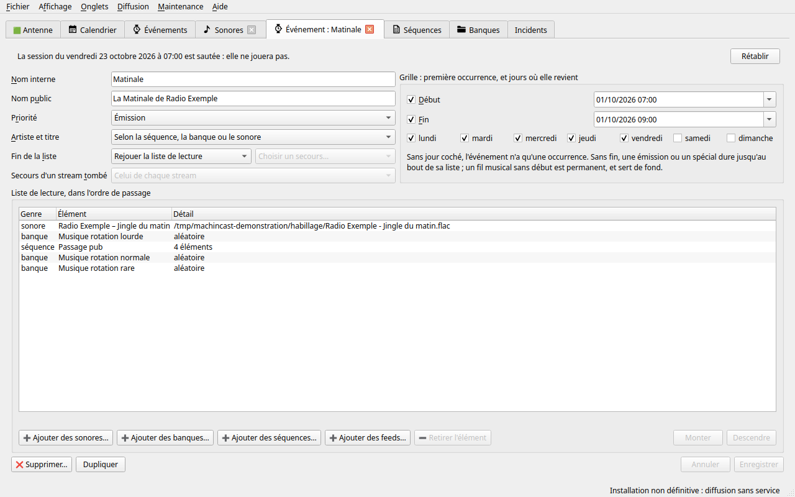
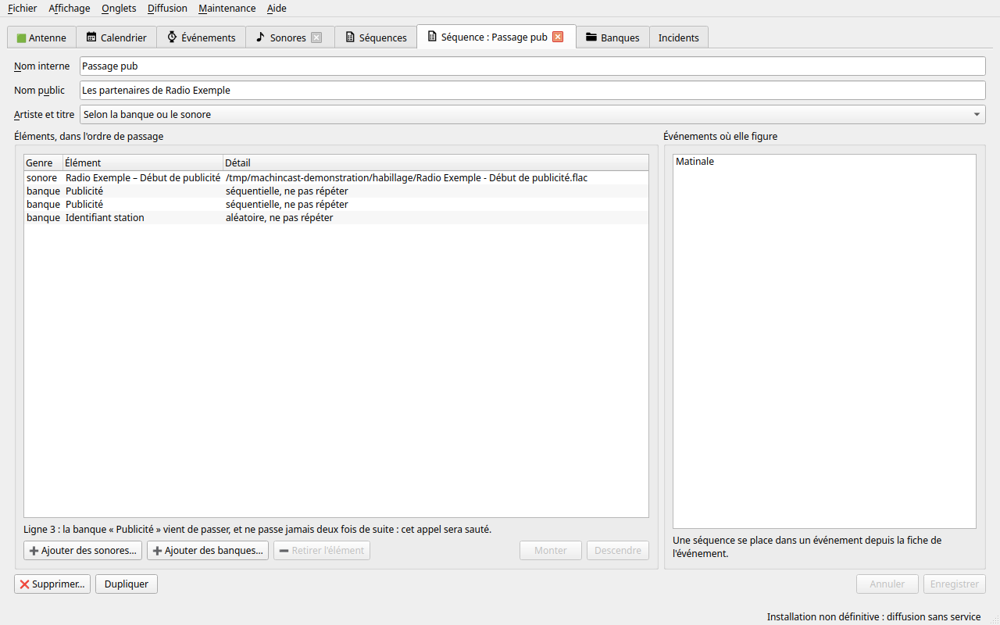
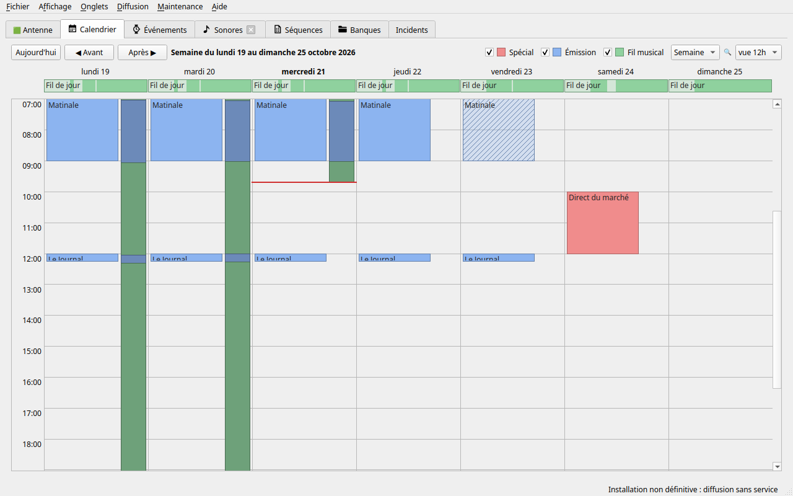
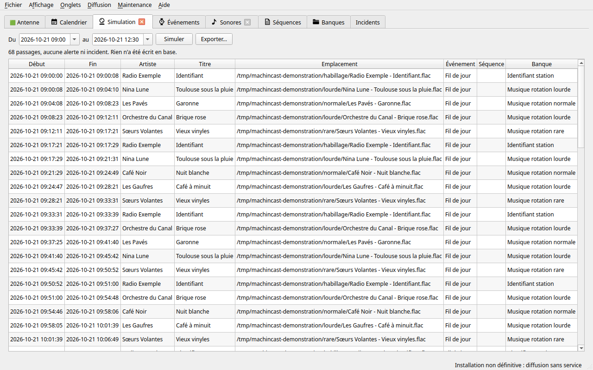

# Programming the schedule

[On-air guide](README.md) › Programming the schedule

- [Card of an event](#card-of-an-event)
- [Card of a sequence](#card-of-a-sequence)
- [Calendar](#calendar)
	- [Skipping a session](#skipping-a-session)
- [Simulation](#simulation)

Cards open in their tab, from the lists ([Lists and actions](listes.md)), the On air tab, the calendar or the search. They all behave the same way: see [Save, cancel, close](listes.md#save-cancel-close).

## Card of an event

The card of an event opens in a tab named « Event: » followed by its name; **New event**, in the list of events, opens an empty card, with the `Show` priority.

| Field | Role |
| --- | --- |
| Internal name | Mandatory, and unique to the event: its name in the lists, the history and the log. |
| Public name | Optional. Shown on the public page instead of the hidden artist and title ([Public page and hiding](antenne.md#public-page-and-hiding)). |
| Priority | From the lowest to the highest: `Fallback`, which only plays instead of a dropped stream ([Streams](antenne.md#streams)), then `Background programming`, `Show` and `Special` ([Which event is on air](antenne.md#which-event-is-on-air)). Above, `Breaking`, for a situation that is not scheduled, such as a civil-protection alert ([#402](https://github.com/dascritch/machincast/issues/402)), cannot be chosen: the card of a breaking event shows it greyed out, and refuses a checked day, since it does not repeat. |
| Artist and title | `Hidden by the public name of the event` or `Shown` on the public page, for everything the event plays; `According to the sequence, the bank or the sound` lets these decide. |

**Schedule**: the **Start** and the **End** of the first occurrence, each to be checked, then the **days** when it comes back every week, at the same hour. No day checked: a single occurrence.

- A checked start begins at the current time, to the minute; a checked end, one hour after the start.
- A background programming without a start is permanent, and serves as a background. Unchecking the start also unchecks the end and the days.
- A fallback event has no start, no end and no days: choosing `Fallback` unchecks them.
- A show or a special has a start; without an end, it lasts until the end of its list.

**End of the list** ([#350](https://github.com/dascritch/machincast/issues/350)): what a show or a special that has an end does when its list finishes before it.

- **Replay the list**, the default choice: the list starts again from the beginning.
- **Switch to the background programming**: the show stops there, and the background programming takes back the air until the end time.
- **Switch to a fallback**: the fallback chosen beside it plays its list, in a loop, until the end time. If it has nothing playable, the background programming resumes.
- **Lend its name to the background programming** ([#399](https://github.com/dascritch/machincast/issues/399)): the background programming plays until the end time, but **in the name of the show**: its public name is shown on the public page, and the artist and the title are hidden there if the show hides them. With an **empty list**, it is so from the start time, without cutting the current song: useful when the show is announced, but the team cannot take the air on time. With only a theme tune in the list, it plays first, then the background programming goes on in the name of the show. If another show is below, it is that one that plays its list, in the name of this one. **Broadcast → Cut the event by the background programming** ends the loan. An empty list is then not an anomaly.

The choice is greyed out, on **Replay the list**, without a checked end, and for a background programming or a fallback, which always replay their list.

**Fallback of a dropped stream**: the fallback that plays when a stream of the list drops ([Streams](antenne.md#streams)). It prevails over the one the stream's card gives; **The fallback of each stream** keeps the fallback of each stream. Greyed out as long as the list has no stream.

**Nothing is saved**, and the card says why, at the top, on a red border, with ⚠️ before each field at fault ([Save, cancel, close](listes.md#save-cancel-close)), for:

- an empty internal name, or that of another event;
- a show or a special without a start, or an end that does not follow the start;
- an **overlap** with another event of the same priority, recurring occurrences included: « Overlaps the event “Journal”, of the same priority, on 21/10/2026 at 09:00. ». Only what overlaps from now on counts: what the schedule has already broadcast blocks nothing, and a current overlap is dated at the present moment;
- a priority changed for a fallback event that a stream or an event designates;
- **Switch to a fallback** without a fallback chosen.

**Skipped session** ([#295](https://github.com/dascritch/machincast/issues/295)): when the next session of the event is [skipped](#skipping-a-session), current or upcoming, the card says so at the top, on an orange border: « The session of Thursday 22 October 2026 at 07:00 is skipped: it will not play. ». It is only a warning: the card saves.

- The skip holds to the **day** of the session, not to its hour: changing the hour of the event does not reinstate it, and the card announces the session at its new hour.
- **Reinstate** reinstates the session, like the right-click of the calendar, without saving the card or touching its fields. The status bar announces it, and the broadcast takes it into account at once.
- The button is greyed out, and its tooltip says why, for a session that has already started, or whose place a show of the same priority has taken.

**Empty event**: an event without an element saves, to be completed later. The card warns of what the broadcast will do with it, at the top, on an orange border ([#328](https://github.com/dascritch/machincast/issues/328)): an empty show lets the event below take over, without cutting the current sound, and the On air tab announces no cut at its time; an empty background programming leaves dead air, with a warning. The list of events shows it as an anomaly.

**Fallback not local** ([#403](https://github.com/dascritch/machincast/issues/403)): a fallback serves when a stream drops, often on a network loss. If it calls on an external feed, a stream, directly, through a bank or through a sequence, it would drop with it: the card warns at the top, « A fallback that calls on an external stream is not recommended: a network loss would silence it, like the stream it backs up. », and the list of events shows it as an anomaly, « fallback not local ». Prefer files of the machine.

**On air, at once** ([#266](https://github.com/dascritch/machincast/issues/266)): an event saved, deleted or restored applies right away, if the broadcast is running. A show moved earlier cuts the current sound at its new time; a show moved, shortened or removed changes the upcoming sounds of the On air tab. A name, a public name or a hiding changed do not remove the sounds already announced: they will play as planned.

**List**: the sounds, banks and sequences the event plays, in order.

- **Order**: an element moves by drag and drop, or with **Move up** and **Move down**. The same element can come back.
- **➕ Add sounds…**, **➕ Add banks…**, **➕ Add sequences…** open the list of those already in the database, with its filter; several are chosen with <kbd>Ctrl</kbd> or <kbd>Shift</kbd>, then **➕ Add**.
- **➕ Add feeds…** adds a stream from a [feed](sonores.md#feeds), to relay a show from outside: the stream that already follows this feed, otherwise a new stream, created on saving (the row says so: « new stream »).
- **Dropping files** dragged from the file manager adds them at the end of the list ([Adding a sound](sonores.md#adding-a-sound)).
- **➖ Remove the element** removes the chosen row, without asking anything: the sound, the bank or the sequence stays in the database.
- **« Do not repeat » bank**: the card points out each call of a marked bank right after itself, which will always be skipped. It is only a warning.
- **Opening an element**: a double-click, or <kbd>Enter</kbd>, opens its card in another tab.
- **Long list** ([#383](https://github.com/dascritch/machincast/issues/383)): the card first shows only its first 1,000 elements; reaching the bottom of the list loads the next ones, and the title of the list says so as long as not all are shown: « Elements: 1000 shown out of 3000, the rest loads when scrolling down ». This number is set in the [preferences](prise-en-main.md#preferences), **Interface** page. Additions first load the whole list, since they go at its end; the warning of a « do not repeat » bank only covers the elements shown. Saving a card whose list was not touched does not rewrite it.

## Card of a sequence

The card of a [sequence](antenne.md#sequences) opens in a tab named « Sequence: » followed by its name; **New sequence** opens an empty card.

| Field | Role |
| --- | --- |
| Internal name | Mandatory, and unique to the sequence. |
| Public name | Optional. Shown on the public page instead of the hidden artist and title, if the event has none. |
| Artist and title | `Hidden by the public name of the sequence` or `Shown` on the public page, for the sounds the sequence plays, unless the event decides; `According to the bank or the sound` lets these decide. |

**Elements**: the ordered list of the sounds and banks the sequence plays, with a detail: the location of a sound, the mode of a bank and « do not repeat » if it is so. It is managed like the list of an event: drag and drop, **Move up** and **Move down**, **➕ Add sounds…**, **➕ Add banks…**, dropping files, **➖ Remove the element**, and a long list loads while scrolling down. The same sound or bank can come back; a sequence never contains another sequence. The card points out the calls that will be skipped because of a « do not repeat » bank.

**Empty sequence**: it saves, to be completed later; the card warns at the top, on an orange border, that it plays nothing, and the broadcast skips it ([#328](https://github.com/dascritch/machincast/issues/328)).

**Events**: the list of the events where the sequence appears; a double-click opens their card.

## Calendar

The **Calendar**, second tab, always open right after the On air tab, without a cross to close it ([#307](https://github.com/dascritch/machincast/issues/307)), shows what is planned, and what has been broadcast; **View → Open the Time grid tab**, or <kbd>Shift</kbd>+<kbd>F2</kbd>, brings it to the front. It opens on the week of the day, from Monday to Sunday; a red line marks the current time.

- **Navigating** ([#326](https://github.com/dascritch/machincast/issues/326)): at the start of the line, « Today » comes back to the week, or the day, of today; « ◀ Before » and « After ▶ » move to the week, or the day, before or after, up to 28 days after today. Towards the past, the calendar stops at the expiry duration, 60 days by default, set in the [preferences](prise-en-main.md#preferences), **Database** page: the database has nothing older ([#269](https://github.com/dascritch/machincast/issues/269)). In the week of this limit, the earlier days are greyed out and empty. The drop-down list at the end of the line chooses the view: « Day » shows a single day; « Week » goes back to the week.
- **Zooming on the hours**: the **🔍** list, at the end of the line, shows 4, 8, 12 or 24 hours in the height of the grid (« 4h view » … « 24h view », 12 hours when opened). <kbd>Shift</kbd> + wheel, in the grid, moves to the neighbouring zoom: upwards, closer; downwards, further. The wheel alone scrolls the hours. The zoom keeps the hour at the top of the grid.
- **What is planned**: each occurrence of an event is a block, in the colour of its priority. The block is **solid** where the event would go on air, **faded** where another, of higher priority, hides it. Permanent background programmings and occurrences of 24 hours or more are in the **all-day band**, under the name of the day. A show without an end is drawn until the next event of the same priority, at the latest until midnight. Fallback events are not shown. A [deleted](listes.md#deleting-an-element) event keeps its blocks from before its deletion, until it is erased from the database; its tooltip says when it was deleted.
- **What has been broadcast**: to the right of each past day, a narrow band per event really played. A gap between the block and the band shows a gap between the schedule and the air. A fallback event, played instead of a dropped stream, has its band in orange; it is always shown, since it has no box ([#413](https://github.com/dascritch/machincast/issues/413)).
- **Special, Show, Background programming**: each box shows or hides the blocks of its priority. A square before its name gives their colour: red for the specials, blue for the shows, green for the background programmings ([#293](https://github.com/dascritch/machincast/issues/293)). A breaking event ([#402](https://github.com/dascritch/machincast/issues/402)) has no box: its blocks and its band, in purple, are always shown.
- **Hovering** a block gives the event, its hours, its recurrence and what it plays; a band, its hours and its number of plays.
- **Double-clicking** a block or a band opens the card of the event.
- **Clicking a free hour**, not yet past, offers to create an event over the whole hour: « Create an event on Sunday 25 October 2026 from 13:00 to 14:00? ». **Create** opens the card of a new event set to this hour; nothing is in the database before **Save**.

### Skipping a session

For holidays, a bank holiday or an exceptional show, a session of a recurring event is skipped, without touching the event ([#273](https://github.com/dascritch/machincast/issues/273)). **Right-click** on the block of an upcoming session:

- **Skip this session**: it does not go on air;
- **Skip the sessions until…**: a calendar has the last day chosen, and all the sessions of the event until that day, included, are skipped. **OK** or <kbd>Enter</kbd> validates, **Cancel** or <kbd>Escape</kbd> skips nothing;
- **Move this session…** ([#631](https://github.com/dascritch/machincast/issues/631)): choose the new start, date and time, from now on; the session is skipped, and a copy of the event, as a single occurrence, plays it at the new moment, with the same duration, elements and settings. It is called « {event} (session moved from {day}) », and is changed or deleted from its card. A session moved onto that of another event of the same priority does not move: the status bar says which one it would overlap. Reinstating the original session leaves the copy: delete it, not to play twice.

A skipped session stays in the calendar, **hatched**: in its place, the air plays what would play without it, generally the background programming. To replace it with another show, **click** its slot, as on a free hour: the new show can take it. The broadcast takes it into account at once, and the On air tab shows the new upcoming sounds. The status bar says what was skipped.

**Right-click** on a skipped session, as long as it is upcoming: **Reinstate this session**. If a show has taken its place in the meantime, it is not reinstated, and the status bar says which one would overlap it. Only the upcoming sessions of an event that comes back every week can be skipped; a single event is deleted, or moved in its card. The [card of the event](#card-of-an-event) also announces its next skipped session, and reinstates it ([#295](https://github.com/dascritch/machincast/issues/295)).

## Simulation

**View → Open the Simulation tab** checks a schedule before it goes on air: it shows what would be broadcast over a period, without playing or changing anything.

- **Period**: from the start to the end, to the minute. When opened, from the current time to the same time the next day.
- **Simulate**: the broadcast replays the period according to its rules, from the real history: position in each list, cycle of each bank, number of plays of each sound. Nothing is written to the database, no sound is played, and the interface stays usable meanwhile. Each simulation draws at random.
- **Result**: each simulated play, with its start, its end, its artist, its title, the location of its file, its event, its sequence and its bank; the artist and the title are hidden there as on the public page. Above, the summary, for instance « 68 plays, no warning or incident. Nothing was written to the database. »; below, the simulated warnings and incidents, such as dead air.
- **Export…** saves the result in the format chosen in the file selector: **CSV spreadsheet**, **PLS playlist** or **HTML page**. The file gets the extension of the format if it does not have it yet: an export never replaces a sound file.
- **Failure**: an unreachable database is shown instead of the summary, after « Simulation impossible: ».
- A new simulation replaces the previous one. Closing the tab during a simulation stops it.
