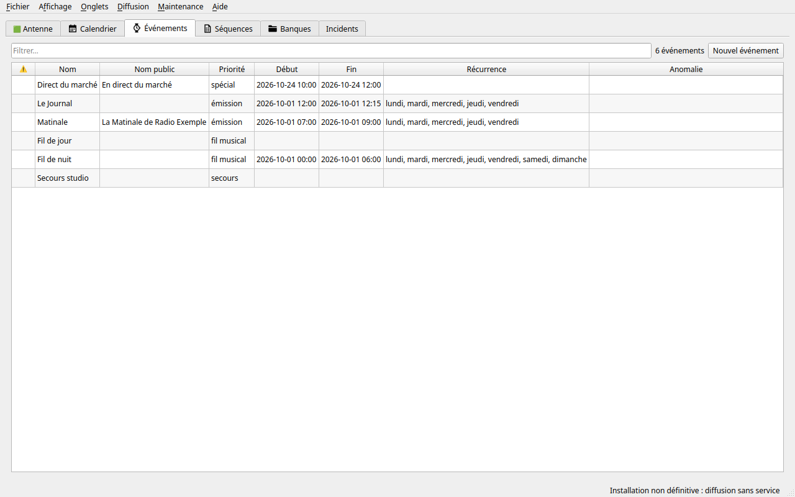
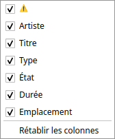
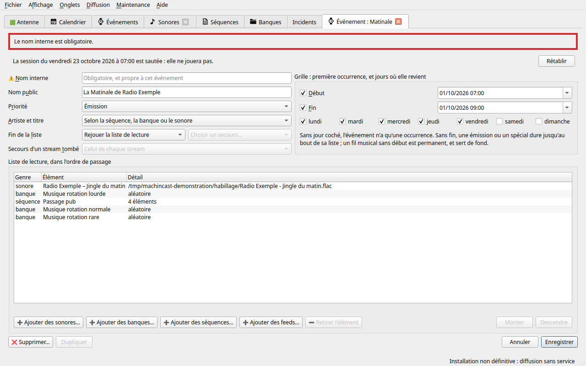

# Lists and actions

[On-air guide](README.md) › Lists and actions

- [Lists](#lists)
- [Table columns](#table-columns)
- [Save, cancel, close](#save-cancel-close)
- [Acting on several sounds or banks](#acting-on-several-sounds-or-banks)
- [Duplicating an element](#duplicating-an-element)
- [Deleting an element](#deleting-an-element)

## Lists

The **Events**, **Sequences**, **Banks**, **Sounds** and **Feeds** tabs each give the list of all the elements of that type.

| Tab | Columns | Order |
| --- | --- | --- |
| Events | ⚠️, name, public name, priority, start, end, days, anomaly (`empty event`, `fallback not local`: a fallback that calls on a stream, [#403](https://github.com/dascritch/machincast/issues/403)) | from the highest priority to the lowest, then by name |
| Sequences | ⚠️, name, public name, anomaly (`empty sequence`) | by name |
| Banks | ⚠️, name, public name, mode, « do not repeat », first directory | by name |
| Sounds | ⚠️, artist, title, type, state, duration, location | by artist, then by title |
| Feeds | name, address, number of streams that follow it | by name |

- **Filter**: the « Filter… » field keeps the rows where a column contains the typed text, regardless of case and accents: `cafe` finds « Café à minuit », `stream` all the streams. The count says how many rows remain, « 2 sounds out of 340 ».
- **Large list of sounds** ([#383](https://github.com/dascritch/machincast/issues/383)): the **Sounds** list first shows only its first 1,000 rows; the rest loads while scrolling down. The filter, the sorting and the count cover all the sounds, not only those already loaded, and **Export this table…** exports them all. This number is set in the [preferences](prise-en-main.md#preferences), **Interface** page.
- **Anomalies** ([#327](https://github.com/dascritch/machincast/issues/327)): in the lists of events, sequences, banks and sounds, the first column, **⚠️**, marks with a ⚠️ each row that has a problem, and the row's tooltip says which. A click on its title groups the rows with an anomaly. Are anomalies: an empty sequence or event, which plays nothing; a bank without an active sound, which provides nothing, or which contains a corrupt or unsupported sound; a corrupt sound (unreadable or damaged file) or an unsupported one (file that is not readable sound), which the broadcast does not play. A disabled, expired or preview sound is not: it is intended, or waiting for the indexing. Typing `vide` (empty) in the filter keeps only the empty sequences and events. A sound outside the durations of a bank is only pointed out in the [card of this bank](sonores.md#card-of-a-bank) and in the relations of the [card of the sound](sonores.md#card-of-a-sound).
- **Sorting**: a click on a column title sorts the list; a second one reverses the order. The **Priority** column of the events sorts by importance, not alphabetically: breaking ([#402](https://github.com/dascritch/machincast/issues/402)), special, show, background programming, fallback ([#272](https://github.com/dascritch/machincast/issues/272)). The time columns follow time ([#302](https://github.com/dascritch/machincast/issues/302)): the **Duration** of the sounds, from the shortest to the longest, then the files not measured yet, then the streams; the **Start** and the **End** of the events, from the earliest to the latest, then those without a date; the **Recurrence**, from Monday to Sunday, then the events that do not come back.
- **Update**: a list is read again each time its tab opens, and with <kbd>F5</kbd>.
- **Opening**: a double-click on a row, or <kbd>Enter</kbd>, opens the element's card.
- **Creating**: **New event**, **New sequence**, **New bank**, **New stream** and **New feed** open an empty card. The list of sounds also has **➕ Add files…** ([Adding a sound](sonores.md#adding-a-sound)).
- **Right-click**: **Duplicate**, in the Events, Sequences and Banks lists; actions on several elements, in the Sounds and Banks lists.

## Table columns

All the tables of the interface are set the same way: the lists, the search, the incidents, the airplay of the On air tab and its tab, the simulation, and the tables of the cards.

- **Width**: the columns fit their content at each reading of the table. To widen or narrow one, drag the right border of its title; from then on, the table keeps the chosen widths, and no longer fits by itself.
- **Order**: dragging the title of a column moves it.
- **Columns shown**: a right-click on the titles opens the menu of the columns. Each box shows or hides its column; the last column shown cannot be hidden.
- **Reset the columns**, at the bottom of this menu, goes back to the original order and columns, fitted to the content.
- **Export this table…** ([#329](https://github.com/dascritch/machincast/issues/329)): a right-click in the table, on a row or beside, offers last to save the table as CSV, for a spreadsheet. The file is chosen in the selector; it gets the `.csv` extension if it does not have it. It contains the table as shown: the columns shown, in their order, and the rows the filter keeps, in the sorting order. The status bar says where it is saved.
- **Kept from one session to the next**: each table keeps its layout for all the times it opens, for instance the table of sounds of all the bank cards. It is kept for your account: another account of the machine has its own.

## Save, cancel, close

All the cards, of an event, a sequence, a bank, a sound or a feed, behave the same way:

- **An emoji says what a button does** ([#294](https://github.com/dascritch/machincast/issues/294)), in the cards as in the menus and the questions: ➕ adds rows to a table, ➖ removes some, ❌ deletes the card.
- **One tab per element**: a card already open comes back to the front.
- **Save** writes all the changes at once; meanwhile, the card is greyed out ([#382](https://github.com/dascritch/machincast/issues/382)). Successful, it **closes the tab** of the card, without any other announcement: the card reopens from its list. Refused, the card is no longer greyed out, stays open, and says why. **Cancel** puts the card back as it is in the database. Both buttons only serve when the card is modified.
- **Refusal**: an empty internal name, or one already taken by an element of the same type, is not saved; the card says why, and keeps its changes. Likewise if the database does not answer: « Saving impossible: … ».
- **Errors in plain sight** ([#270](https://github.com/dascritch/machincast/issues/270)): the error is shown **at the top of the card**, framed by a red border, and each field at fault is preceded by ⚠️: the internal name for an empty or already taken name, the start and the end for an end that does not follow the start, the priority, the start and the end for an overlap. It stays until the next **Save**, **Cancel**, or the card is read again. An impossible deletion or restoration is shown the same way. The bottom of the card only keeps what informs: files ignored from a drop, element deleted.

- **Closing a modified card**, by its tab or by closing the window, asks what to do: **Save** (<kbd>Enter</kbd>), **Abandon**, or **Cancel** (<kbd>Escape</kbd>), which keeps it open.
- **During the modification**, what an indexing or the broadcast changes in the database (a sound attached to a bank, a sound that expires) is kept on saving.

## Acting on several sounds or banks

In the **Sounds** and **Banks** lists, several rows can be selected at once, with <kbd>Ctrl</kbd> (one by one) or <kbd>Shift</kbd> (from one row to another). The **right-click** offers actions on the whole selection; in the sounds, **Pre-listen…**, at the top, only applies to the clicked row ([Pre-listen](sonores.md#pre-listen)). Each asks for confirmation, « Disable 3 sounds? », then the status bar says what changed, « 2 sounds disabled. ».

| List | Action | Effect |
| --- | --- | --- |
| Sounds | **Enable**, **Disable** | The state of the chosen sounds. A sound in preview stays so, until it is checked. |
| Sounds | **➕ Add to banks…** | Each sound is added at the end of each chosen bank, if it is not already there. |
| Sounds | **➖ Remove from banks…** | The sounds are removed from the chosen banks. A sound whose file is in a directory of the bank will come back at the next indexing. |
| Sounds | **Request a full audit** | The next indexing, even a quick one, checks these files in full and measures their silences, except those already checked so and unchanged since. The State column says « active, audit requested » in the meantime. |
| Banks | **Request the full audit of their sounds** | The same request, for all the sounds of the chosen banks. |
| Banks | **Hide the artist and the title**, **Show the artist and the title**, **Artist and title inherited from the sound** | The « Artist and title » setting of each chosen bank. |

## Duplicating an element

To create a variant of an event, a sequence or a bank, **Duplicate** makes a copy of it: the button at the foot of its card, or the right-click on its row. The button is only active for a saved element, without changes under way.

The copy opens in a new tab, for instance « New sequence, copy of Passage pub ». **Nothing is saved until Save is clicked.** Its internal name is that of the original followed by « (copy) », then « (copy 2) »…; change it before saving.

| Copy of a | It keeps | It does not have |
| --- | --- | --- |
| Sequence | the public name, the hiding and all the elements | — |
| Event | the priority, the public name, the hiding and the list | dates or days: choose its slot before saving |
| Bank | the public name, the mode, the hiding, « do not repeat », the crossfades, the durations and the directories | sounds: the next indexing fills it from its directories |

The original is never modified.

## Deleting an element

Each card has a **❌ Delete…** button. It always asks for confirmation: **❌ Delete**, or **Cancel** (<kbd>Enter</kbd> and <kbd>Escape</kbd> cancel). The question says where the element appears, and what would have nothing left after its removal.

**Only the entry in the database changes.** The sound files and the directories of the banks stay in place, intact. The broadcast history keeps its plays.

**A deleted element can be restored** ([#267](https://github.com/dascritch/machincast/issues/267)). A deleted sound, bank, sequence or event stays in the database, marked « deleted »: it disappears from the lists, the search and the choices, and is no longer played. A double-click on its cell, in the airplay or the incidents, reopens its card, which says when it was deleted, and when it will be erased from the database; it cannot be modified, and its **Restore** button puts it back into service. Restored, it does not come back in the lists it had been removed from, nor as the fallback of the streams. If another element has taken its name in the meantime, or its file for a sound, the card says why it cannot restore it. Past the expiry duration, 60 days by default, set in the [preferences](prise-en-main.md#preferences), **Database** page, it is erased from the database for good ([#268](https://github.com/dascritch/machincast/issues/268)): it can no longer be restored; its file, for its part, stays in place.

| Element deleted | Removed from | What remains |
| --- | --- | --- |
| Sound | its banks, sequences and event lists | Its file. If it is in a bank directory, the next indexing records it again: the question reminds of it. |
| Bank | its sequences and event lists | Its directories and their files; its sounds. |
| Sequence | its event lists | Its sounds and its banks. |
| Event | — | Its list; its sounds, banks and sequences. It no longer plays, and the streams that had it as fallback no longer have one. |
| Feed | — | Nothing: it leaves the database, without being restorable. A feed that a stream follows cannot be deleted. |

The card closes after the deletion.
