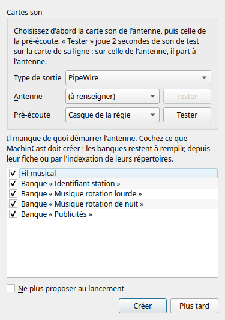
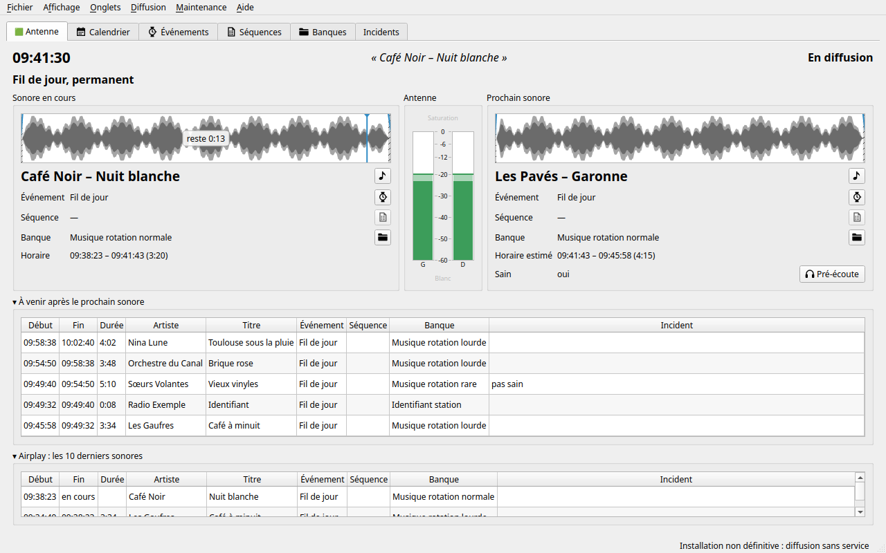
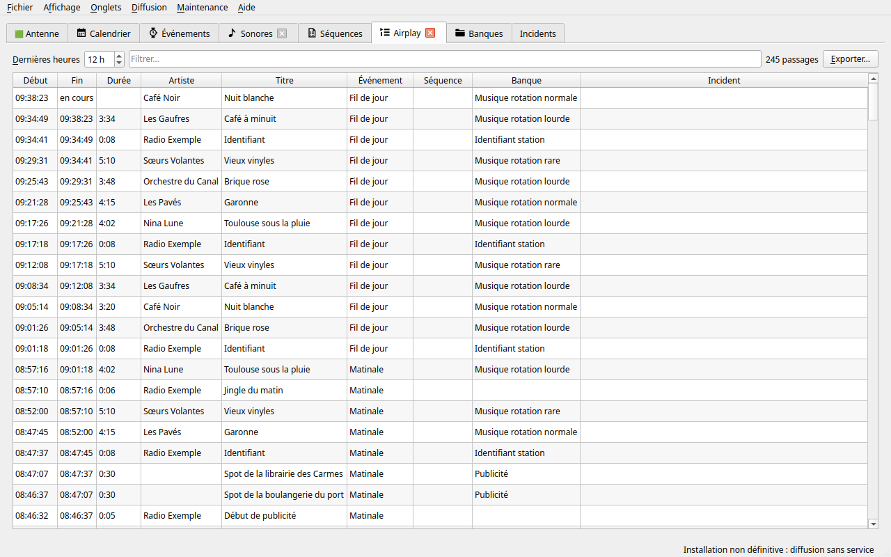
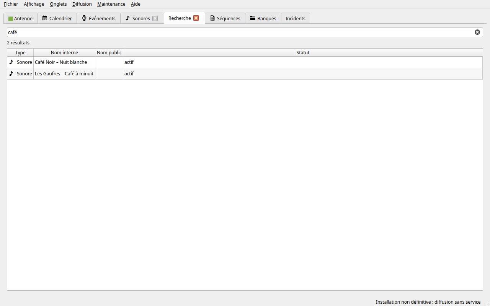
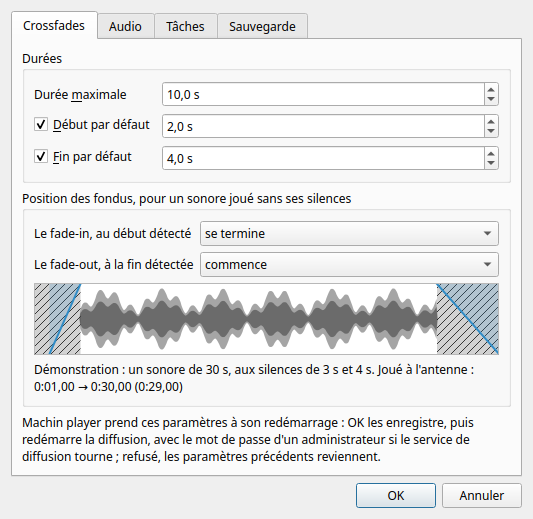
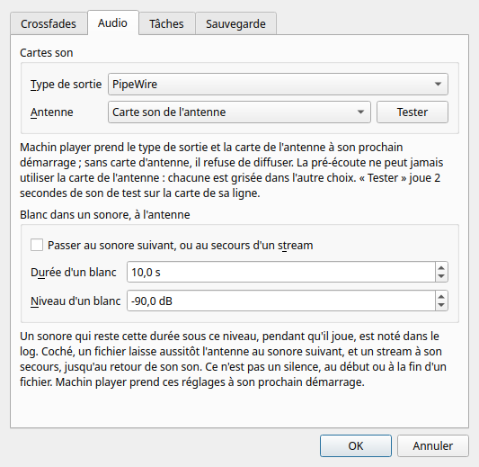
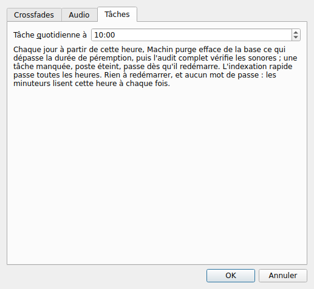

# Getting to know the interface

[On-air guide](README.md) › Getting to know the interface

- [The window](#the-window)
- [Getting started](#getting-started)
- [On air](#on-air)
- [Airplay tab](#airplay-tab)
- [Moving between tabs](#moving-between-tabs)
- [Menus](#menus)
- [Refreshing the tabs](#refreshing-the-tabs)
- [Searching](#searching)
- [Preferences](#preferences)
- [Typed texts](#typed-texts)

## The window

**To open it**, choose **MachinCast** in the applications menu, under Multimedia, or double-click its icon, the orange sign with the technical crews' headphones, on the desktop when the installation put it there. No terminal is needed.

**Machin interface** opens on a window with tabs, one per screen. At launch: **On air**, **Calendar** (the schedule, [#307](https://github.com/dascritch/machincast/issues/307)), **Events**, **Sequences**, **Banks** and **Incidents**. The **Sounds** and **Feeds** lists open on demand, from the **View** menu: « Open the Sounds tab » and « Open the Feeds tab »; « Open the Time grid tab » brings the calendar to the front. **A tab opens to the right of the current one** ([#405](https://github.com/dascritch/machincast/issues/405)): a card to the right of its list, the search or an on-demand list to the right of the open tab. As in Firefox, several cards opened from the same list follow each other in the order they were opened; a tab already open comes back to the front, without moving. **Tabs move with the mouse**, by dragging them in the bar, except the **On air** tab, which stays first; the <kbd>Shift</kbd>+<kbd>F1</kbd> to <kbd>Shift</kbd>+<kbd>F12</kbd> shortcuts and the **Tabs** menu follow the new order. On-demand tabs, and card tabs, close with their cross; a list closed then reopened keeps its filter and its sorting. **Open tabs are remembered** ([#321](https://github.com/dascritch/machincast/issues/321)): when the interface is launched again, the tabs left open come back, in their order, cards and moved tabs included, with the tab that was in front. The card of an element deleted since, or a new card never saved, does not come back. Each account of the machine gets its own.

**Back to the tab you were on** ([#632](https://github.com/dascritch/machincast/issues/632)): closing the open tab, or saving a card that closes, brings back the tab shown just before, the list or the calendar the card was opened from for instance.

**Alternating rows** ([#412](https://github.com/dascritch/machincast/issues/412)): in every table and list, every other row has a slightly darker background (slightly lighter in a dark theme), to follow a row from one end to the other. The difference stays discreet, and the text keeps on both the contrast required by the RGAA, the French accessibility standard.

**Icons**: the same icon means the same kind everywhere, in the tabs, the **View** menu, the search, the relations of a sound and the **Card…** buttons of the On air tab ([#215](https://github.com/dascritch/machincast/issues/215)). They take the colour of the text, in a light theme as in a dark theme.

| Icon | Kind |
| --- | --- |
| a quaver | Sound |
| a sheet and its bulleted list | Sequence |
| a folder | Bank |
| a watch | Event |
| a calendar | Time grid (« Calendar » tab) |
| a crystal ball | Simulation |

**Without a database**, the interface can show nothing: an error window, « MachinCast: database unreachable », says so, and its « Open INSTALL.md » button leads to the [When something goes wrong](../../../INSTALL.md#when-something-goes-wrong) section, for the machine's administrator.

## Getting started

At launch, the interface looks for what is missing for the air to run:

- a **background programming**, the event that holds the air when no other takes it;
- the banks **Identifiant station** (station ID), **Musique rotation lourde**, **Musique rotation normale**, **Musique rotation rare**, **Musique rotation de nuit** (heavy, normal, rare and night rotations), **Partenariats** (partnerships), **Publicités** (adverts) and **Bande-annonce émissions** (show trailers), recognised by their name, regardless of case;
- on a real audio output, the **on-air sound card**, without which the broadcast does not start.

If some are missing, the **Getting started** window offers them, each one checked:

- **Create** creates what is checked. The background programming is permanent. The banks are empty: they fill up from their [card](sonores.md#card-of-a-bank), or by the indexing of their directories. The station ID and the music rotations are random; the partnerships, the adverts and the trailers are sequential, in the order of their sounds. « Identifiant station » and « Bande-annonce émissions » are marked « do not repeat ». Each one has its [maximum duration of the sounds](sonores.md#card-of-a-bank): 15 minutes for the heavy, normal and rare rotations, 2 minutes for the station ID, the partnerships, the adverts and the trailers; these last three follow each other without crossfade, imposed at 0 second on their sounds; the night rotation has none. All this can be changed in their card. A background programming still empty receives a typical rotation: station ID, heavy rotation, normal, heavy, rare. The night rotation remains to be placed in a night event. The status bar says what was created.
- As long as the on-air sound card is missing, the window starts with the **sound cards**, as in the [preferences](#preferences), **Audio** page: the output type, then the on-air card and the pre-listen card, each with its **Test** button. The same card never serves both. If there is nothing else to create, the button is called **Save**. The broadcast takes the on-air card at its next start (**Broadcast → ⏹ Stop the broadcast**, then **⏵ Start the broadcast**).
- **Later** creates and saves nothing: the window comes back at the next launch.
- **Do not offer at launch again** turns the window off; it is turned back on in the [preferences](#preferences). Without it, the interface recreates at launch an empty background programming if none exists, and says so in the status bar.

After deleting or saving an event, the interface always recreates a background programming if none is left.

## On air

The **On air** tab shows at a glance what is playing and what will play ([#322](https://github.com/dascritch/machincast/issues/322)).

- **The indicator of its title** says whether the broadcast is installed for good: **🟩 On air** as long as the playout service is not installed (a [test machine](antenne.md#controlling-the-broadcast)), **🟥 On air** as soon as it is, whether the broadcast runs or not.
- **🔇 Broadcast stopped**, permanently on the right of the last line of the window, as long as the broadcast is not running: nothing goes on air. It disappears as soon as it resumes.

- **At the top**: the machine's time, to the second (the date is in its tooltip); the **public text** of the current sound, as shown by the station's public page (`—` without text, for instance for a hidden sound); and the state of the broadcast: `Broadcasting`, `Dead air on air` (nothing to broadcast) or `Stopped`.
- **Event on air**: its name and its hours, « from 20:00 to 22:00 », « since 19:00 » for an occurrence without end, or « permanent » for a background programming.
- **Current sound**, on the left: the artist and the title, the event that plays it (« Continue, in the name of « Matinale » » when the background programming plays in the name of a show, [End of the list](grille.md#card-of-an-event), [#399](https://github.com/dascritch/machincast/issues/399)), the sequence and the bank it comes from (`—` if none), the timing (start, planned end and duration, « 20:00:00 – 20:03:34 (3:34) »), and, for a stream, its address. For a file, its **timeline** ([#230](https://github.com/dascritch/machincast/issues/230)), at the top, above the title, at the height of that of the next sound: the waveform, its hatched silences and its fades, as the air plays them, rules of its bank included, and the playhead; in the middle, the remaining time, « reste 3:05 ». It is the timeline of the [pre-listen](sonores.md#file-timeline), which can only be watched here: a click moves nothing. A stream has instead a bar that gives the remaining time, if known.
- **Next sound**, on the right: the same information, with the planned timing and, for a file, its timeline without playhead, and **Healthy**: `yes` if its file is present, active, readable, and its last play went without incident; `no` otherwise. On the **Healthy** line, **Pre-listen** opens it in the [pre-listen](sonores.md#pre-listen), like a click on its timeline; for a stream, **Test the stream connection** says below whether sound arrives, of which type and at which bitrate ([#223](https://github.com/dascritch/machincast/issues/223)). The announced next sound is indeed the one that will play, even drawn at random: it only changes if an event cuts the broadcast, if its event has ended, or if it is disabled or has expired in the meantime. Right-clicking its frame offers its pre-listen, skipping to it at once, or advancing the next event ([From the next sound](antenne.md#from-the-next-sound)), then its location.
- **Announced cut**: when an event will start during the current sound, it will cut it short. The timing then ends at the cut and names the event, « 20:00:00 – 20:02:00 (cut by « Journal », out of 3:34) », the remaining time says « 1:30 left before « Journal » », and the next sound is the one this event will play.
- **Stream**: it plays until the end of its event; its timing is « 19:00:00 – 20:00:00 (end of the event) », with its remaining time, and the next sound is the one that will take back the air at that end ([#242](https://github.com/dascritch/machincast/issues/242)). Without an event end, its timing is « 20:00:00, unknown duration ». It is not tested in advance: `not tested`.
- **Location** ([#344](https://github.com/dascritch/machincast/issues/344)): that of a file is no longer shown. Right-clicking the current sound first offers **⏮ Back to the start of this sound** and **⏮ Restart this event** ([Interrupting the air](antenne.md#interrupting-the-air), [#366](https://github.com/dascritch/machincast/issues/366)). Right-clicking the current or the next sound offers **Copy the location**, the file's path, to paste elsewhere, and **Open the folder**, which shows it in the file manager. The address of a stream remains shown, since it matters when the stream drops: a long address does not overflow, its end stays visible, and its tooltip gives it in full; the right-click offers **Copy the URL of the feed**. Under the address of the stream of a feed on air, **Buffer** shows what it holds, « 1.2 s out of 2 s » ([#351](https://github.com/dascritch/machincast/issues/351)): a bar that empties announces a struggling stream. For the stream of an [audio input](sonores.md#feeds), on air or next, **Input** shows instead the VU meter of the input: a studio that sends sound shows at a glance; an input not found says so. **Test the stream** is not offered for it ([#625](https://github.com/dascritch/machincast/issues/625)).
- **Card… buttons**: on the right of the title, the event, the sequence and the bank, they open the element's card.
- **Sounds: the next 5, on air, and the last 10** ([#228](https://github.com/dascritch/machincast/issues/228), [#617](https://github.com/dascritch/machincast/issues/617)): a single table, in the order of time, the oldest at the bottom. From top to bottom: the next 5 sounds, the furthest at the top, down to the announced next sound; the sound on air, outlined in red, or both during a crossfade; then the last 10 played, from the most recent to the oldest. The table does not sort: the order of time is the only one. The columns: start and end (planned for a coming sound, `playing` for the one on air), duration, artist, title, event, sequence, bank, and in the « Incident » column, `yes` for a play that had one, `not healthy` for a coming sound whose file has caused a problem. Like the next sound, the coming sounds will play in this order, even drawn at random; the list moves one step at each sound, and is recomputed when something unforeseen happens: an [interruption](antenne.md#interrupting-the-air), an event added or changed in the schedule, a sound disabled. It stops before dead air, or after a stream whose end is not known. A double-click on a row opens the card of the clicked sound, event, sequence or bank; a right-click offers the [pre-listen](sonores.md#pre-listen) of the sound, then its location, as it was at the time of the play, even for a sound deleted since: **Copy the location** and **Open the folder** for a file, **Copy the URL of the feed** for a stream ([#344](https://github.com/dascritch/machincast/issues/344)). The interface is reserved for the team: the artist and the title are always shown, even when hidden on the public page. To go further back, the [Airplay tab](#airplay-tab).
- **Collapsible panel**: a click on the title « Sounds: the next 5, on air, and the last 10 » collapses the panel (« ▸ »), or expands it (« ▾ »). Collapsed, it stays so the next times the interface opens.

The On air tab follows the broadcast live. When it stops, it shows `Stopped`, and finds it again on its own as soon as it resumes. It must run on the playout machine: with the MachinCast account, or, when the playout service is installed, an account of the `machincast` group ([#381](https://github.com/dascritch/machincast/issues/381)); otherwise it does not see it.

### On-air VU meter

Between the two sounds, the **On air** column shows what really goes on air:

- **Clipping**, above: this light turns on, red, as soon as a peak reaches -1 dB, and stays on for 3 seconds. It is hidden in the [preferences](#preferences).
- **VU meter**: one bar per channel, « G » and « D » (left and right), from -60 dB at the bottom to 0 dB at the top, separated by the scale. The solid part is the average level; the lighter part above, the current peak; a line holds the highest peak for 2 seconds. Green, orange above -12 dB, red above -3 dB.
- **Dead air**, below: this light turns on, orange, when the sound stays at -50 dB or less for 5 seconds: dead air on air. It turns off as soon as the sound comes back.
- **Listening to the air**: a click on the VU meter opens the [pre-listen](sonores.md#pre-listen) on the air, without starting it. **Broadcast → On-air pre-listen**, or <kbd>Alt</kbd>+<kbd>P</kbd>, opens it likewise, and starts it at once ([#245](https://github.com/dascritch/machincast/issues/245)); while listening, the entry becomes **Stop the on-air pre-listen**, and <kbd>Alt</kbd>+<kbd>P</kbd> stops it too ([#256](https://github.com/dascritch/machincast/issues/256)). The title of the listening window is « playing: » followed by the public text of the sound on air, and follows it from one sound to the next.

The VU meter listens to the on-air device, whatever program plays on it. When it cannot, a message says so under the lights:

| Message | What to do |
| --- | --- |
| `Unavailable with the ALSA output, which has no monitoring port.` | Nothing: the machine uses an output that does not allow listening to the air. The administrator can switch to PipeWire or PulseAudio. |
| `Unavailable: on-air device to be set.` | Choose the on-air device in **File → Broadcast service settings…**, **Audio** page. |
| `Unavailable: the monitoring port has given nothing for 3 seconds.` | Nothing: the machine's sound no longer gives the air to the VU meter, often when coming back from a locked session or a turned-off screen ([#311](https://github.com/dascritch/machincast/issues/311)). The VU meter does not keep its last levels: it empties, then tries again every 5 seconds, and resumes on its own. |
| `Paused: session locked or screen saver active.` | Nothing: nobody watches the VU meter while the screen is locked or off, so it no longer measures anything ([#346](https://github.com/dascritch/machincast/issues/346)). It starts again on its own when unlocked. The broadcast itself goes on normally. |
| `Unavailable: the previous monitoring port has not closed yet.` | Nothing: the machine's sound is slow to answer, often when coming back from a locked session. The VU meter waits for it to answer, tries again every 5 seconds, and resumes on its own. |
| `Unavailable: the PipeWire of the broadcast service does not answer (…); …` | On the on-air computer, your account does not hear the playout service yet ([#381](https://github.com/dascritch/machincast/issues/381)): log out, then log in again, after the service is installed; otherwise, ask the administrator to add your account to the `machincast` group. |
| `Unavailable:` followed by an error | The device is unplugged, or the machine's sound does not answer. The VU meter tries again every 5 seconds. |

## Airplay tab

**View → Open the Airplay tab** opens the broadcast history in a separate tab ([#244](https://github.com/dascritch/machincast/issues/244)), closed at the interface's launch; its cross closes it.

- **Last hours**, at the top: how many hours to go back, 12 by default, up to a month. The setting is remembered for the next openings.
- **Today**, left of the last hours ([#629](https://github.com/dascritch/machincast/issues/629)): ticked at first. Unticked, it replaces the last hours with two moments of the past, **From** and **To**, to find and export what went on air, for instance to prove a broadcast. The start goes no further back than the retention period of the airplay (**Preferences**, **Retention**), the end goes from the start to now. The start and the end of each play are then shown in ISO 8601, date and time: `2026-10-16T18:00:00`.
- **The table** has the same columns as the airplay of the On air tab, and works the same way: double-click to the cards, right-click for the [pre-listen](sonores.md#pre-listen). It is updated at each new sound on air.
- **Filter…**, at the top ([#393](https://github.com/dascritch/machincast/issues/393)): keeps only the plays where a column contains the typed text, regardless of case and accents: « cafe » finds « Café à minuit ». The count, beside it, says how many plays are shown, out of how many. The field's cross empties it.
- **Sorting**: a click on a column title sorts the table by it, a second click reverses the order. The start and the end sort in time order, even from one day to the next, the duration in order of durations, the current play before the others. When opened, the table goes from the most recent to the oldest.
- **Export…** saves what the tab shows, in the format chosen in the save window: **CSV spreadsheet**, **HTML page** or **M3U playlist**. Each export gives both the artist, the title and the location of the file, and the **public text**, as shown by the station's public page, hiding included. The M3U list goes from the oldest to the most recent, and can be read in a player; the public text is a comment there. The name gets the extension of the format: an export never replaces a sound file. The status bar says where it is saved.

## Moving between tabs

The first 12 tabs open from the keyboard, with <kbd>Shift</kbd>+<kbd>F1</kbd> to <kbd>Shift</kbd>+<kbd>F12</kbd>, according to their rank: <kbd>Shift</kbd>+<kbd>F1</kbd> is always the On air tab; at launch, <kbd>Shift</kbd>+<kbd>F2</kbd> leads to the Calendar, <kbd>Shift</kbd>+<kbd>F3</kbd> to <kbd>Shift</kbd>+<kbd>F5</kbd> to the Events, Sequences and Banks, <kbd>Shift</kbd>+<kbd>F6</kbd> to the Incidents, then to the cards and the other tabs, in the order they are open. Opening or closing a tab shifts those that follow it. The tooltip of each tab gives its shortcut. A title of more than 40 characters is cut, and ends with « … »: its tooltip gives it in full ([#398](https://github.com/dascritch/machincast/issues/398)). The **Tabs** menu lists all the open tabs, with their full title and their shortcut; the open tab is checked there, and choosing an entry leads to it.

Step by step ([#318](https://github.com/dascritch/machincast/issues/318)), wherever the cursor is, in a table or a text field included:

| Shortcut | Tab |
| --- | --- |
| <kbd>Ctrl</kbd>+<kbd>PageUp</kbd> | The one on the left; on the On air tab, nothing. |
| <kbd>Ctrl</kbd>+<kbd>PageDown</kbd> | The one on the right; on the last one, nothing. |
| <kbd>Ctrl</kbd>+<kbd>Home</kbd> | The first, the On air tab. |
| <kbd>Ctrl</kbd>+<kbd>End</kbd> | The last. |

On the open tab ([#428](https://github.com/dascritch/machincast/issues/428)):

| Shortcut | Effect |
| --- | --- |
| <kbd>Ctrl</kbd>+<kbd>W</kbd> | Closes it, like its cross, if it closes: a card, the Sounds and Feeds lists, the search, the simulation, the airplay. A modified card first asks what to do with its changes. On a fixed tab, nothing. |
| <kbd>Ctrl</kbd>+<kbd>S</kbd> | Saves the card, which stays open. On a card without changes, or another tab, nothing. |
| <kbd>Ctrl</kbd>+<kbd>Enter</kbd> | Saves the card, then closes it, like its **Save** button; a card without changes simply closes. A card that MachinCast refuses to save stays open, and says why. Both Enter keys, that of the keyboard and that of the numeric keypad, will do. On another tab, nothing. |
| <kbd>Ctrl</kbd>+<kbd>Shift</kbd>+<kbd>T</kbd> | Reopens the last closed tab, then the one before, to the right of the open tab. |

## Menus

A function not written yet already has its entry, greyed out: its tooltip gives the ticket that will bring it.

| Menu | Entry | Role |
| --- | --- | --- |
| File | Interface preferences… | What applies at once, without touching the broadcast ([Preferences](#preferences)). |
| File | Broadcast service settings… | What Machin player takes at its restart: OK restarts the broadcast ([Preferences](#preferences)). |
| File | Quit | Closes the interface, also with <kbd>Alt</kbd>+<kbd>Q</kbd>. First asks what to do with the modified cards. The broadcast itself goes on. |
| View | Search… | Opens the search, also with <kbd>Ctrl</kbd>+<kbd>F</kbd> ([Searching](#searching)). |
| View | Open the Sounds tab, Open the Feeds tab | Open these lists, or bring them to the front ([Lists](listes.md#lists)). |
| View | Open the Time grid tab | Brings to the front the calendar, always open after the On air tab ([Calendar](grille.md#calendar)). |
| View | Open the Simulation tab | Opens the simulation ([Simulation](grille.md#simulation)). |
| View | Open the Airplay tab | Opens the broadcast history, adjustable and exportable ([Airplay tab](#airplay-tab)). |
| View | Pre-listen… | Opens the pre-listen window ([Pre-listen](sonores.md#pre-listen)). Like every pre-listen button and entry, it bears headphones. |
| View | Reopen the closed tab | Reopens the last closed tab, also with <kbd>Ctrl</kbd>+<kbd>Shift</kbd>+<kbd>T</kbd>; inactive as long as no tab has been closed ([#428](https://github.com/dascritch/machincast/issues/428)). |
| View | Recently closed tabs | The last 5 closed tabs, the most recent first: choosing one reopens it. The card of a deleted element, or one not saved yet, is not there. |
| View | Refresh the tabs, at the bottom of the menu | Reads again what other machines, the indexing or the broadcast have changed, also with <kbd>F5</kbd> ([Refreshing the tabs](#refreshing-the-tabs)). |
| Tabs | One open tab per entry | Leads to the tab; the open tab is checked, and each entry gives the full title and the shortcut ([#398](https://github.com/dascritch/machincast/issues/398)). |
| Tabs | Close all closable tabs, at the end | Closes the cards, the Sounds and Feeds lists, the search, the simulation and the airplay, never the fixed tabs; a modified card asks what to do with its changes, and **Cancel** leaves it and the tabs that follow it open ([#405](https://github.com/dascritch/machincast/issues/405)). |
| Broadcast | On-air pre-listen, Stop the on-air pre-listen | At the top of the menu: listens at once to the air on the pre-listen output ([Pre-listen](sonores.md#pre-listen), [#245](https://github.com/dascritch/machincast/issues/245)), then, while listening, stops it; also with <kbd>Alt</kbd>+<kbd>P</kbd> ([#256](https://github.com/dascritch/machincast/issues/256)). |
| Broadcast | ⏵ Start, ⏹ Stop the broadcast | Control the broadcast ([Controlling the broadcast](antenne.md#controlling-the-broadcast)). |
| Broadcast | ⏮ Back to the start of this sound, ⏮ Restart this event | Take back a failed start ([Interrupting the air](antenne.md#interrupting-the-air), [#366](https://github.com/dascritch/machincast/issues/366)). |
| Broadcast | ⏭ Skip to the next sound, ⏭ Skip after the sequence, ⏭ Cut the event by the background programming, ⏭ Cut by the fallback | Correct the air without waiting ([Interrupting the air](antenne.md#interrupting-the-air)). |
| Maintenance | Quick indexing, Full audit | Check the sounds ([Indexing from the interface](sonores.md#indexing-from-the-interface)). Both can run together; each is inactive while it runs. |
| Maintenance | Indexing status… | Where the indexings stand: directories scanned and to scan, sounds found, indexed quickly or fully, in numbers and in pie charts ([Indexing status](sonores.md#indexing-status)). |
| Maintenance | Database maintenance… | After confirmation, backs up, checks and optimises the database, in a terminal window, which stays open at the end: close it once the report is read. The question gives the directory where the backup will be saved, and « Choose the location… » offers another; Enter or Escape cancel it. Inactive during an indexing. See the [administration guide](../administration/commandes.md#database-maintenance-machin-maintenance-db). |
| Maintenance | Export the database… | Saves a backup of the database, without asking or changing anything, in the backup directory (**Backup** page of the broadcast service settings); the status bar says where, or why it could not. Inactive during the export. On a new computer, the installation offers to take this backup back ([#347](https://github.com/dascritch/machincast/issues/347), [administration guide](../administration/commandes.md#database-export-and-reimport-machin-backup-db-machin-restore-db)). |
| Maintenance | Let the broadcast service read the sound files… | Gives the service the reading of the sounds of all the banks, without changing anything else on the files ([Adding a sound](sonores.md#adding-a-sound), [#381](https://github.com/dascritch/machincast/issues/381)). Inactive as long as the playout service is not installed. |
| Maintenance | Output monitor… | To come ([#85](https://github.com/dascritch/machincast/issues/85)). |
| Help | Documentation | Opens this guide in the web browser. |
| Help | Your installation… | Opens your team's document, to fill in: whom to call in case of trouble with the computer, the air or the transmitter, the music programming, the partnerships, the adverts, the recorded shows and the outside broadcasts ([#451](https://github.com/dascritch/machincast/issues/451)). It is on the Desktop, unless it was placed elsewhere (**Interface** page of the preferences); if it has disappeared, it is recreated from the template, never over yours. It always opens in a text editor: Kate, KWrite, GNOME Text Editor, gedit, Mousepad, Xed, Pluma or FeatherPad, the first one present, otherwise the editor the desktop associates with text files, never a viewer such as Okular ([#491](https://github.com/dascritch/machincast/issues/491)); without any, the status bar says so, and gives the path of the document. |
| Help | Team link… | Opens in the browser your team's address: a cloud, a Gitlab, a Jira, a Drive… Greyed out as long as no address is given, **Interface** page of the preferences. |
| Help | Report a problem… | Opens the MachinCast tickets in the web browser. |
| Help | Version | Gives the version of MachinCast, its publication date or that of its last change, and what is new in the version ([#208](https://github.com/dascritch/machincast/issues/208)), with three links: **Code**, the MachinCast repository, **Author: DaScritch** and **For: &lt;FMR&gt;**, the radio station ([#332](https://github.com/dascritch/machincast/issues/332)). |

**What is new.** At the first launch of a new version of MachinCast, a window gives what is new ([#208](https://github.com/dascritch/machincast/issues/208)), in the language of the session: in French, or in English for another language ([#369](https://github.com/dascritch/machincast/issues/369)). It does not come back at the next launches; **Help → Version** gives it again whenever wanted.

## Refreshing the tabs

Each tab reads the database again when it is shown ([#241](https://github.com/dascritch/machincast/issues/241)): a list, the incidents, the calendar, the search, the airplay, the On air tab, and a card, unless it is being modified. A modified card stays as it is, without a question; a card whose element has been erased from another machine closes, and the status bar says so. While a tab stays shown, what another machine, the indexing or the broadcast change does not appear on its own. **View → Refresh the tabs**, or <kbd>F5</kbd>, reads everything again at once:

- the open tab: a list, the incidents, the calendar, the search or the airplay;
- the airplay of the On air tab;
- all the open cards. A modified card first asks what to do with its changes: **Save** writes them then reads the card again, **Abandon** loses them and reads the card again, **Cancel** leaves it as it is.
- The card of an element erased from another machine closes, without a question.

The status bar confirms it, « Tabs refreshed. », and names the cards left as they were or closed.

## Searching

**View → Search…**, or <kbd>Ctrl</kbd>+<kbd>F</kbd>, opens the **Search** tab, or comes back to it, with the cursor in the field.

From 2 characters, regardless of case and accents, the typed text is searched in the internal name and the public name of the **events**, **sequences** and **banks**, and in the artist and the title of the **sounds**. The table follows the typing: up to 500 results, with their type, internal name, public name and status (the state of a sound), in the order events, sequences, banks, then sounds. A double-click or <kbd>Enter</kbd> on a row opens its card. The count says how many results there are, or « first 500 results out of … » when there are more: then make the text more precise.

## Preferences

The **File** menu opens two windows ([#389](https://github.com/dascritch/machincast/issues/389)):

- **Interface preferences…**: what applies at once, without touching the broadcast. The granularity of the crossfades and the silence threshold (**Crossfades and silences** page), the pre-listen card (**Audio** page), the expiry duration (**Database** page) and the **Interface** page.
- **Broadcast service settings…**: what Machin player only takes at its restart. The durations of the crossfades and the position of the fades (**Crossfades** page), the output type, the on-air card and dead air in a sound (**Audio** page), and, without a restart, the hour of the daily task (**Tasks** page) and the backups (**Backup** page). **OK** saves them, then, if the crossfades, the output, the on-air card or the dead air have changed, restarts the broadcast: with the playout service running, the machine asks for an administrator's password. If it is refused, or if the restart fails, the previous settings come back, in the file as in the interface, and the status bar says so. With the service stopped, or without a service, they apply at the next start of Machin player.

On the **Audio** page of the **Broadcast service settings**, the **Audio inputs** block ([#622](https://github.com/dascritch/machincast/issues/622)) lists the sound card inputs that MachinCast can put on air, a production studio for instance. Choose an input of the machine, **Add this input**, then name it in the **Name** column; **Remove the input** removes it. Each input needs a name, different from the others: otherwise **OK** stays inactive and the block says why. An input the machine no longer sees stays in the list, marked « (not found) ». Each input has its VU meter, in the **Level** column, which shows whether the studio sends sound while the window is open, or says that it is not found; **🎧 Pre-listen** listens to the chosen input on the pre-listen output, never on air, until **⏹ Stop the pre-listen** ([#624](https://github.com/dascritch/machincast/issues/624)). With the playout service installed, **OK** reserves the inputs for the service at once, with an administrator's password: the sound settings of the session no longer show them, like the on-air card. The status bar says whether they are reserved.

**Crossfades** page ([#234](https://github.com/dascritch/machincast/issues/234)):

| Setting | Role |
| --- | --- |
| Granularity | `To the tenth of a second` (by default) or `To the second`: the step of the crossfades in the cards. |
| Maximum duration | The longest crossfade the cards offer, 10 seconds by default. |
| Default start, default end | The crossfade of a sound that has none, and that its bank does not set ([Transitions](antenne.md#transitions)). |
| The fade-in, at the detected start | For a sound played without its silences: the fade-in `starts`, `is under way` or `ends` (by default) at the detected start ([Silences at the start and the end](antenne.md#silences-at-the-start-and-the-end)). |
| The fade-out, at the detected end | Likewise, at the detected end: `starts` (by default), `is under way` or `ends`. |
| Silence threshold | From -100 to -0.1 dB, -40 dB by default: the level under which the start and the end of a sound are silence, measured by the full audit, and around which the fades are placed ([#324](https://github.com/dascritch/machincast/issues/324), [Silences at the start and the end](antenne.md#silences-at-the-start-and-the-end)). Changing it starts a **full audit** at once, in its own window, to measure the silences again; if a full audit is already running, the status bar asks to launch it again when it ends. |

Under these settings, a **demonstration timeline** shows an invented 30-second sound, with silences of 3 and 4 seconds: its fades are placed according to the default durations typed and the positions chosen, at each change.

**Interface** page:

| Setting | Role |
| --- | --- |
| Show the clipping light of the On air tab | Checked by default; unchecked, the « Clipping » light disappears from the [VU meter](#on-air-vu-meter). |
| Offer at launch what is missing to start | Checked by default: the [Getting started](#getting-started) window. |
| Application icon | The icon of the MachinCast windows, of its shortcut in the applications menu and on the desktop, and of the taskbar. **Choose an image…** takes another, SVG, PNG or JPEG, preferably square, the station's logo for instance; **MachinCast icon** goes back to the original. An unreadable image is not taken: `Unreadable image: …`. The new icon applies from **OK**. |
| Rows loaded at a time | 1,000 by default, 100 at least: the sounds that a bank card, the elements that a sequence or event card, or the rows that the Sounds list, show at first, and those it loads more each time the bottom of its list is reached ([#383](https://github.com/dascritch/machincast/issues/383)). A larger number can greatly slow down the interface for a bank that has a very large number of sounds. Applies to the cards opened afterwards. |

**Your installation**, on the same page ([#451](https://github.com/dascritch/machincast/issues/451)): the **document** that **Help → Your installation…** opens, the one on the Desktop when the field is empty, or another chosen with **Choose the document…**; and the **team link**, an address that starts with `http://` or `https://`, that **Help → Team link…** opens. **OK** stays greyed out as long as the link is not a web address.

**Audio** page:

| Setting | Role |
| --- | --- |
| Output type | The sound system of the computer: PipeWire, that of Ubuntu, unless the administrator says otherwise. Changing it redoes the list of sound cards: the on-air card must then be chosen again. |
| On air | The sound card of the broadcast. As long as it is not chosen, the status bar shows `On-air device to be set`, and the broadcast refuses to start. The new card applies at the next start of the broadcast. **Dummy output** plays no sound: to try MachinCast on a computer that is not yet the on-air one; it is greyed out on the on-air computer. While the on-air computer broadcasts, the on-air card cannot be changed: its choice is greyed out, and its tooltip says to stop the broadcast first, from the **Broadcast** menu. On the on-air computer, the list is that of the cards of the playout service, which plays under its own account: its card no longer appears in the sound settings of your session, nor in the pre-listen list ([#381](https://github.com/dascritch/machincast/issues/381)). After a change of card, the administrator runs `./install.sh --service` again. |
| **On-air level** and **Mute** | On the on-air computer only: the output level of the on-air card, from 0 to 100 %, and its mute, set in the PipeWire of the playout service, as if you were its account ([#381](https://github.com/dascritch/machincast/issues/381)); the sound settings of your session no longer see this card. They change at once, without waiting for **OK**, and are not written to `machincast.toml`. When unavailable, their tooltip says why, for instance when the service is stopped. |
| Pre-listen | The sound card of the [pre-listen](sonores.md#pre-listen), the control room headphones for instance. The air and the pre-listen never use the same: the card of one is greyed out in the other. **Dummy output** disables the pre-listen: its buttons and menus are then greyed out everywhere. |
| Test | Beside each card: 2 seconds of a continuous, high-pitched sound, on that card, to check it is the right one. **Warning**: on the on-air card, the test sound goes on air. Under the cards, a line says whether the sound was played. |
| Dead air in a sound, on air | A sound that stays for the **dead air duration** (from 1 to 300 s, 10 s by default) under the **dead air level** (from -100 to -0.1 dB, -90 dB by default), while it plays, is noted ([Dead air in a sound](antenne.md#dead-air-in-a-sound)). **Move on to the next sound, or to the fallback of a stream**, unchecked by default, replaces it at once. The broadcast takes these settings at its next start. |

**Database** page ([#268](https://github.com/dascritch/machincast/issues/268)):

| Setting | Role |
| --- | --- |
| Expiry duration | From 1 to 3650 days, 60 by default: older airplay and log entries are erased from the database, like the elements [deleted](listes.md#deleting-an-element) for longer, which can no longer be restored. Sound files are never touched. The erasing happens every day, at the hour of the daily task (**Tasks** page), on the on-air computer; the card of a deleted element gives the day it will be erased, and the [calendar](grille.md#calendar) does not go further back. |

**Tasks** page, in the **Broadcast service settings** only ([#455](https://github.com/dascritch/machincast/issues/455)):

| Setting | Role |
| --- | --- |
| Daily task at | 10:00 by default: every day from this hour, the database is purged of what is past the expiry duration, then all the sounds are checked in full, like **Maintenance → Full audit**. At 10 o'clock, someone is often at the studio to see a problem. A missed task, computer off, runs as soon as it restarts. The quick indexing, for its part, runs every hour. The new hour applies at once, without restarting the broadcast or a password. Greyed out when the computer does not have its timers: the page says how to install them. |

**Backup** page, in the **Broadcast service settings** only ([#347](https://github.com/dascritch/machincast/issues/347)):

| Setting | Role |
| --- | --- |
| Backup directory | Where **Maintenance → Export the database…** and the database maintenance save their backup, a file named after its date and time: the home folder, by default. **Choose…** designates another, such as a USB key or a backup disk. |
| Copy machincast.toml… | Copies the full settings of MachinCast into the chosen folder, under a dated name like the backups; the page says where, or why it could not. With a backup of the database, it is all that is needed to start again on a new computer, where the installation offers to take back the saved database. Greyed out when the interface has no settings file. |

**OK** saves them; the status bar says so. **Cancel** changes nothing.

## Typed texts

The names, the artist, the title and the metadata are cleaned when saved, so as not to disturb the public page, the streams and the displays: tabs, line breaks and special spaces become a simple space, extra spaces disappear, and invisible characters are removed. Accents, non-Latin scripts and emoji stay as they are. File paths and stream addresses are kept as they are.
