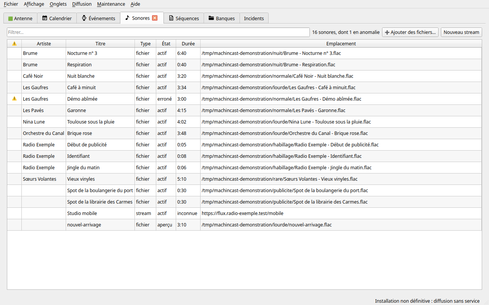
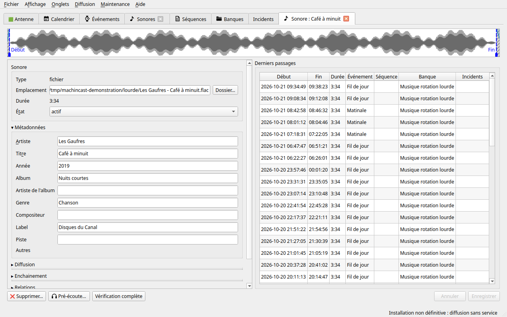
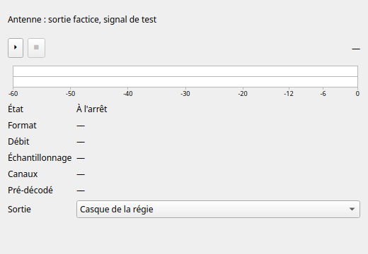
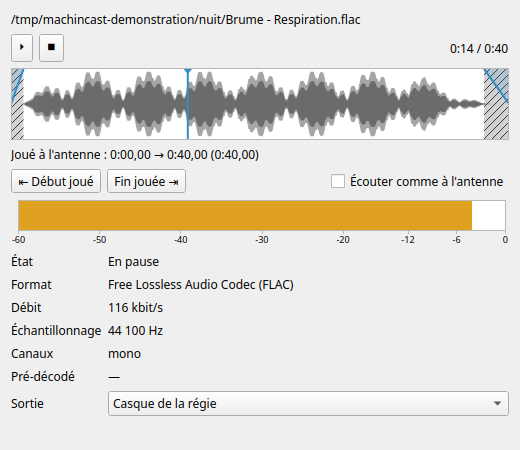
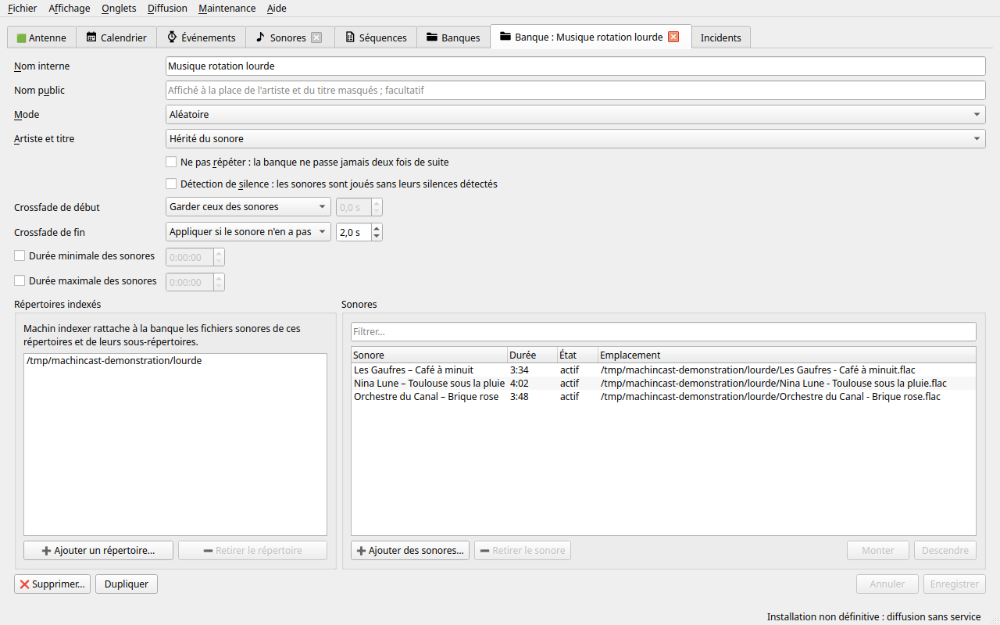

# Sounds, banks and feeds

[On-air guide](README.md) › Sounds, banks and feeds

- [Adding a sound](#adding-a-sound)
- [States of a sound](#states-of-a-sound)
- [Checking a file](#checking-a-file)
- [Tags and metadata](#tags-and-metadata)
- [Card of a sound](#card-of-a-sound)
- [Pre-listen](#pre-listen)
	- [File timeline](#file-timeline)
- [Card of a bank](#card-of-a-bank)
- [Feeding a bank from its directories](#feeding-a-bank-from-its-directories)
- [Indexing from the interface](#indexing-from-the-interface)
	- [Indexing status](#indexing-status)
- [Feeds](#feeds)

## Adding a sound

The list of **Sounds** (**View → Open the Sounds tab**) adds files and streams.

**Files**: **➕ Add files…** opens the machine's file selector, where several files can be chosen at once; files can also be **dropped** on the list, dragged from the file manager.

**On the on-air computer**, the playout service reads the sounds under its own account ([#381](https://github.com/dascritch/machincast/issues/381)). It never reads your home directory: your documents stay private there. Put the sounds in **/home/machincast**; a file or a directory of your home directory is refused, and the interface says so, unless it is already open to the service, such as a shared directory `/home/musiques` that the administrator opened to it. Elsewhere, when it cannot read what you add, the interface says so, and offers **Let it read them**: it receives the reading, without anything else changing on your files. Without this, these sounds would not go on air. **Maintenance → Let the broadcast service read the sound files…** does it for all the banks at once ([Commands](../administration/commandes.md#reading-by-the-playout-service-machin-grant-read)).

- A file is **referenced where it is, without a copy**, and is never modified. It can thus be synchronised from another computer, and change content under the same name: a pre-recorded show, the rerun of a live show. Even with <kbd>Shift</kbd> held down, a drop is never a move.
- It enters in the `preview` state, then it is **checked at once**, in the background: the interface stays usable. The status bar announces the addition, « 2 files added, being checked. », then the result, « Check finished: Les Gaufres – Café à minuit, active; faux.mp3, corrupt. ». The sound then takes its duration, its artist and its title, read from its tags.
- A file already in the database is not added a second time. Folders and files that are not sounds are ignored; the status bar says so. The recognised formats: `.mp3`, `.m4a`, `.aac`, `.ogg`, `.flac`, `.wav`. AIFF (`.aiff`, `.aif`) is not supported, because of a GStreamer defect that sometimes blocks its playback ([#284](https://github.com/dascritch/machincast/issues/284)): convert it to FLAC or WAV.

Only the files added from the list of sounds are checked at once: a file dropped on a bank, a sequence or an event waits for the next [indexing](#indexing-from-the-interface).

**Stream**: **New stream** opens an empty [card of a sound](#card-of-a-sound). The address of the stream, or a feed, is mandatory. The stream enters in the `active` state.

## States of a sound

| State | Meaning | Playable | How it leaves it |
| --- | --- | --- | --- |
| `preview` | File newly found, not checked yet. | no | At its first successful check, it becomes `active`. |
| `active` | Sound in service. | yes, within its broadcast period and under its maximum of plays | — |
| `disabled` | Taken off air by the team, in its card or the list. | no | Through the interface only. |
| `expired` | Maximum of plays reached, or broadcast period over ([Expiry of sounds](antenne.md#expiry-of-sounds)). | no | Through the interface only. |
| `corrupt` | File `damaged` or `unreadable`. | no | On its own, when a check finds the file healthy again. |
| `unsupported` | File that is not sound, whatever its extension. | no | On its own, when the file is replaced by real sound. The interface can also move it to `active` or `disabled`. |
| `missing` | File `not found`: erased or moved. | no | Through the interface only. A file moved into the directory of a bank comes back as a new sound. |

The check never changes a `disabled`, `expired` or `missing` sound: it only reports a problem with its file. It never deletes a sound.

## Checking a file

Each check of a file gives one of these verdicts:

| Verdict | Meaning |
| --- | --- |
| `healthy` | The file reads entirely. Its duration is recorded. |
| `damaged` | The file reads, but data is missing: sound cut, truncated file. |
| `unsupported` | The file is not sound, whatever its extension: a text or an image renamed `.mp3`, for instance. |
| `unreadable` | The file is empty, broken, or nothing could be read from it. |
| `not found` | No file at the recorded location: it was erased or moved. |

The sound follows the verdict: `healthy` makes it `active`, `damaged` or `unreadable` makes it `corrupt`, `unsupported` makes it `unsupported`, `not found` makes it `missing`.

## Tags and metadata

When a file is healthy, its tags fill its card:

| Field of the card | Technical name | Tag read |
| --- | --- | --- |
| Artist | `artist` | artist |
| Title | `title` | title |
| Year | `year` | release year |
| Album | `album` | album |
| Album artist | `album_artist` | album artist |
| Kind | `genre` | genre |
| Composer | `composer` | composer |
| Label | `label` | organisation or publisher |
| Track | `track` | track number |

The fields follow the tags of the file: a tag removed empties the field at the next check. **A field changed by hand in the card is never overwritten again** by the tags.

## Card of a sound

The card of a sound opens in a tab named « Sound: » followed by its title, the name of its file, or the address of a stream.

**Timeline** ([#223](https://github.com/dascritch/machincast/issues/223)): at the top of the card of a file, across its whole width, the [timeline](#file-timeline) shows the file as the air will play it. It follows at once what is changed in the card, even before saving: crossfades, detected silences and **Play without the detected silences**.

**Panels**: to keep the essentials in sight, **Metadata**, **Broadcast**, **Transition**, **Relations** and **File** open collapsed, their title preceded by « ▸ ». A click on the title expands them (« ▾ »). The expanded panels are remembered: the next sound card shows them expanded likewise, even after launching the interface again.

- **Sound**: the type, the location of the file and its duration, which cannot be changed, and the **state**: `active` or `disabled`; an `expired`, `corrupt` or `missing` sound can go back to `active`. The list shows all the states, those that cannot be chosen greyed out. A sound in `preview` waits for its check. The **Folder…** button opens the folder of the file in the machine's file manager.
- **Metadata**: artist, title and the other fields of the [tags](#tags-and-metadata).
- **Broadcast**:
  - **Artist and title**: `Hidden` or `Shown` on the public page, unless the event, the sequence or the bank decides ([Public page and hiding](antenne.md#public-page-and-hiding));
  - **Broadcast from**, **Broadcast until**: the broadcast period, each to be checked;
  - **Maximum of plays**: `unlimited` at 0 ([Expiry of sounds](antenne.md#expiry-of-sounds)).
- **Transition**:
  - for a file, **Play without the detected silences**, and the **detected start** and **end**, in seconds, measured by the full audit and correctable by hand ([Silences at the start and the end](antenne.md#silences-at-the-start-and-the-end)). Typed by hand, they are called **Start** and **End** ([#330](https://github.com/dascritch/machincast/issues/330)). Checked, they each have a cursor on the timeline, dotted: dragging it with the mouse sets its box, like typing. The start never goes after the end, neither when typing nor with the cursors; and saving refuses a start and an end that leave no sound;
  - **Start crossfade** and **End crossfade**, to be checked, each set with a slider from 0 to the maximum duration of the [preferences](prise-en-main.md#preferences), 10 seconds by default, its value written on the right: unchecked, they come from the bank or the preferences ([Transitions](antenne.md#transitions)); 0 second is a set crossfade.
- **Stream**: the **direct address** or a **feed**, and the **fallback event** ([Streams](antenne.md#streams)). **Test the stream** connects to the typed address and says, for instance, `The stream answers: sound arrives, in MPEG-1 Layer 3 (MP3) at 128 kbit/s.`: the type of the stream and its bitrate ([#223](https://github.com/dascritch/machincast/issues/223)), or why it does not answer. Nothing is played on air.
- **Relations**: the sequences, banks and events that cite the sound; a double-click opens their card. A bank whose durations the sound is outside of has the warning icon there, with a tooltip that says why. A **right-click** on a relation offers to remove the sound from this sequence, this bank or this event ([#331](https://github.com/dascritch/machincast/issues/331)): the relation disappears from the card, and **Save** removes the sound from their list, wherever it appears; **Cancel** reinstates it. The file stays where it is. If the bank indexes the directory of the file, the card first warns that the next indexing will put it back, as in the [card of the bank](#card-of-a-bank).
- **File**: the real type of the file, its average encoding, its size, its dates and its last full check.
- **Last plays**: the last 50 plays of the sound on air, with the warnings and incidents noted during each.

**Typed by hand**: each changed field is noted as typed by hand, and the card gives their list: the tags will no longer overwrite them.

**Buttons**: **Pre-listen…** plays the sound ([Pre-listen](#pre-listen)). **Full check** checks the file in full and measures its silences, without waiting for the next indexing, then offers to **Refresh** the card to see the result. A file already checked so, which has not changed since, is not read again: the status bar says `Already audited at the -40 dB threshold, file unchanged`. It can be launched even during an indexing. While it runs, the button becomes **Checking…**, the last full check says `under way…`, and the artist, the title, the duration, the detected start and end, which it will update, say so in their tooltip ([#388](https://github.com/dascritch/machincast/issues/388)).

**What the card offers**, above its buttons:

- a file **never checked in full** says so: its silences are not measured, and **Full check** does it right away;
- values read from the file, **typed by hand** (artist, title, metadata, duration, detected start and end), are named, with the **Back to the file values…** button: after confirmation, they are no longer marked as typed by hand, and the full check reads the file again to replace them, even if it had already been checked. The button waits for the card to be saved or cancelled.

## Pre-listen

The **pre-listen window** plays a sound, or the air, on the control room headphones, **never on air**. The **Pre-listen…** button of a sound card, or **View → Pre-listen…**, opens it. The **right-click** on the row of a sound also offers **Pre-listen…**, at the top of the menu ([#226](https://github.com/dascritch/machincast/issues/226)): in the airplay of the On air tab, the list of sounds, the elements of a sequence or an event, and the sounds of a bank. It pre-listens to the sound of the clicked row, even in the middle of a selection; a row that does not designate a saved sound (a bank, a dropped file not saved yet, a sound deleted since its play) does not offer it. A click on the [VU meter of the On air tab](prise-en-main.md#on-air-vu-meter) loads the air there; **Broadcast → On-air pre-listen** loads it and starts it at once ([#245](https://github.com/dascritch/machincast/issues/245)).

If the pre-listen sound card is **Dummy output**, in the [preferences](prise-en-main.md#preferences), **Audio** page, the pre-listen is disabled: its buttons and its menu entries are greyed out, and their tooltip reminds of it ([#339](https://github.com/dascritch/machincast/issues/339)).

- **Player**: **⏵** starts the playback, **⏸** pauses it, **⏹** stops it.
- **VU meter**: like that of the On air tab, lying down.
- **Information**: the format, the bitrate, the sampling rate, the channels, and for a stream the sound already received in advance: a stream that has little of it risks cutting out.
- **Output**: the pre-listen device; the on-air one is greyed out, and cannot be chosen.

There is only one pre-listen window: pre-listening to another sound puts it in place of the previous one. Closing it stops the pre-listen. It is a separate window ([#325](https://github.com/dascritch/machincast/issues/325)): it has its own entry in the desktop's taskbar, and does not stay above the interface when going back to it. It closes with the interface.

**Headphones that no longer answer.** When coming back from a locked or sleeping screen, the machine's sound can stop for a while: the pre-listen then stops, and says why (« Playback impossible: … »). The interface stays usable; start the playback again once the sound is back ([#259](https://github.com/dascritch/machincast/issues/259)). The screen saver and the session lock can nevertheless stay on: only a current pre-listen needs to be started again, and the broadcast is not affected ([#346](https://github.com/dascritch/machincast/issues/346), [Preparing the on-air machine](../../../INSTALL.md#preparing-the-on-air-machine)).

### File timeline

A file has a **timeline** ([#224](https://github.com/dascritch/machincast/issues/224)), which spans its whole duration. A stream, or the air, has none.

- **Waveform**: it is drawn from the opening, as the file is decoded, without making the window wait. In light, the **peaks** of the signal; on top, darker, its **average level** ([#223](https://github.com/dascritch/machincast/issues/223)): a loud but sparse passage has high peaks and a low average level.
- **Silences** at the start and the end, as the last full check measured them ([Silences at the start and the end](antenne.md#silences-at-the-start-and-the-end)): **dense hatching** if they are removed on air, **pale hatching** if they are played there. A file never checked says so, under the timeline: « silences never measured ».
- **Fades**: the start crossfade rises, the end one goes down, placed around the removed silences according to the [positions of the fades](antenne.md#silences-at-the-start-and-the-end) ([#234](https://github.com/dascritch/machincast/issues/234)); the tooltip says the position (« ends at the detected start »). A fade that overflows the file starts, or stops, part-way. A crossfade not set in the card is that of the preferences, marked « (default) » in the tooltip.
- **Playhead**: a click on the timeline places the playback there, like a drag once released. The keyboard arrows move it by one second. The tooltip names what is under the mouse.

Under the timeline:

- **Played on air**: where what will go on air starts and ends, and its duration;
- **⇤ Played start** starts the playback at the beginning of this part; **Played end ⇥**, 5 seconds before the fade-out, to hear the transition arrive;
- **Listen as on air** only plays this part, with its fades.

The timeline shows what is saved: save the card before pre-listening to a setting. It does not know the bank through which the sound will play: a bank that imposes its crossfades, or removes the silences, does not appear there. On the On air tab, the same timeline shows the current sound and the next one, as the air plays them, rules of their bank included ([On air](prise-en-main.md#on-air)).

## Card of a bank

The card of a bank opens in a tab named « Bank: » followed by its name; **New bank** opens an empty card.

| Field | Role |
| --- | --- |
| Internal name | Mandatory, and unique to the bank. |
| Public name | Optional. Shown on the public page instead of the hidden artist and title, if the event and the sequence have none. |
| Mode | `Sequential`: the sounds play in the order of the list. `A→Z of the file name` and `Z→A of the file name`: in the order of the file names, or in reverse order ([#454](https://github.com/dascritch/machincast/issues/454)). `Random`: at random ([Which sound a bank provides](antenne.md#which-sound-a-bank-provides)). |
| Artist and title | `Hidden by the bank's public name` or `Shown` on the public page, unless the event or the sequence decides; `Inherited from the sound` lets the sound decide. |
| Do not repeat | The bank never plays twice in a row. |
| Silence detection | Checked, the sounds played by the bank are played without their silences ([Silences at the start and the end](antenne.md#silences-at-the-start-and-the-end)). |
| Minimum duration, maximum duration of the sounds | Optional: not to mix up a mix, a song and an advert. A sound outside them is marked in this card only, with a tooltip (« 3:20: shorter than the minimum of the bank, 3:30. »), and the next indexing removes it, even added by hand. A new file outside them never enters. |
| Start crossfade, end crossfade | For the sounds played by the bank: `Keep the sounds' own`; `Apply if the sound has none`; `Impose on all sounds`. |

**Indexed directories**: the files of these directories, and of their subdirectories, join the bank at each indexing ([Feeding a bank from its directories](#feeding-a-bank-from-its-directories)). **➕ Add a directory…** opens the directory selector; folders can also be dropped there. **➖ Remove the directory** removes the chosen one. Nothing is indexed on saving: the files of a new directory arrive at the next indexing.

**Sounds**: each sound, with its duration, its state and its location. A large bank first shows only its first 1,000 sounds, in its order; reaching the bottom of the list loads the next ones ([#383](https://github.com/dascritch/machincast/issues/383)). As long as not all are shown, the title of the list says so: « Sounds: 1000 shown out of 30000, the rest loads when scrolling down ». This number is set in the [preferences](prise-en-main.md#preferences), **Interface** page. The warning at the top of the card also counts the sounds not shown yet; **➕ Add sounds…** and dropping files first load the whole bank, since they add at the end of the list. Saving a card whose sounds were not touched does not rewrite them.

**Bank without an active sound** ([#328](https://github.com/dascritch/machincast/issues/328)): the card says so at the top, on an orange border: the bank provides nothing, and the element that calls it moves on to its next element. Likewise for a bank that has corrupt or unsupported sounds, which the broadcast does not play. It is only a warning: the bank saves. The warning follows the sounds added, removed, enabled or disabled, even before saving.

- **Order**: in sequential mode, a sound moves by drag and drop, or with **Move up** and **Move down**. In random mode, the order does not count.
- **Filter…**, above the sounds ([#393](https://github.com/dascritch/machincast/issues/393)): shows only the sounds where a column contains the typed text, regardless of case and accents, location included; the title of the group then says « Sounds: 1 shown out of 4 ». The filter searches all the sounds of the bank, even those not loaded yet. As long as it is filled in, the order cannot be changed: **Move up**, **Move down** and drag and drop wait for it to be emptied.
- **Sorting**, in random mode only: a click on a column title sorts the sounds by it, to browse them; the duration sorts in order of durations. In sequential mode, where the order is that of the broadcast, the titles do not sort, and going from random to sequential mode gives the sounds back their order from before the sorting: a sorting is never saved as the order of the bank.
- **➕ Add sounds…** opens the list of the sounds in the database; **dropping files** adds them at the end of the list, as new `preview` sounds if they are not in the database yet.
- **➖ Remove the sound** removes the chosen sound from the bank. If its file is in one of the directories of the bank, a warning reminds that **the next indexing will put it back**: **➖ Remove anyway**, **Open the folder** of the file to move it out, or **Cancel**. The sound stays in the database.
- **Several sounds** are chosen with <kbd>Ctrl</kbd> or <kbd>Shift</kbd>; the right-click offers **Pre-listen…** of the clicked sound, then **Enable** and **Disable**, saved with the rest of the card.
- **Opening a sound**: a double-click opens its card in another tab.

## Feeding a bank from its directories

Feeding a bank comes down to putting files in one of its directories, then launching an [indexing](#indexing-from-the-interface):

- **Subdirectories**: they are all browsed. Hidden files, whose name starts with a dot, are ignored, like those that are not sounds (covers, texts…).
- **New file**: it becomes a `preview` sound, added **at the end of the list** of the bank, then checked in the same indexing.
- **File already known**: it is never recorded twice, even found by several banks; it joins each bank it is not a member of yet.
- **Sound removed by hand**: as long as its file stays in one of the directories of the bank, the next indexing **puts it back** there. To remove it for good, move the file out of its directories.
- **Durations of the bank**: a new file only enters the bank if it respects its minimum and maximum durations; otherwise, the indexing says nothing about it. Each indexing removes from the bank the sounds outside them, even added by hand. The sound stays in the database, in its other banks and lists.
- **Moved file**: at its new location, it is a new sound; the old one becomes `missing`.

## Indexing from the interface

The **indexing** records the files put in the directories of the banks, and checks the sounds. The **Maintenance** menu launches it:

- **Quick indexing**: the new files of the banks are recorded and checked, those that have changed are checked again, and the presence of the others is verified. To launch after putting files in; on the on-air computer, it also runs on its own every hour, and the full audit every day ([#455](https://github.com/dascritch/machincast/issues/455), [Tasks](prise-en-main.md#preferences)).
- **Full audit**: all the files are checked in full, and their silences measured. Longer, it also spots a damaged file whose date and size have not changed. To launch after the first indexing, then from time to time; changing the silence threshold in the preferences launches it on its own.

To check only a few sounds in full, without auditing everything, the right-click in the Sounds or Banks lists offers **Request a full audit**: the next indexing, even a quick one, takes care of it ([Acting on several sounds or banks](listes.md#acting-on-several-sounds-or-banks)).

The indexing runs in its own window, which shows line by line each sound checked, the anomalies, then the summary: « Quick indexing finished: 2 new sounds, 0 attachment, 0 removal; 2 sounds checked; 0 corrupt, 0 unsupported, 0 missing, 0 reinstated, 2 out of preview. ». The interface stays usable, and can even be closed. A quick indexing and a full audit can run at the same time, but not two of the same kind: the menu entry stays greyed out while its own runs. A sound whose check crashes or lasts more than 10 minutes is reported as an **incident** in the window, left as it is, and the indexing moves on to the next. Closing its window during the indexing offers to stop it after the current file: the work done is kept. At the end, **View → Refresh the tabs** (<kbd>F5</kbd>) shows its changes.

### Indexing status

**Maintenance → Indexing status…** opens a window that says where the indexings stand ([#392](https://github.com/dascritch/machincast/issues/392)):

| Line | What it counts |
| --- | --- |
| Directories to scan | The directories of the banks that the indexing has not browsed yet since its last start. A directory that feeds several banks counts once. |
| Directories scanned | Those it has browsed to the end since its last start. |
| Sounds found | All the file sounds that are not missing. |
| Sounds with a quick indexing | Those that have been checked (type and decoding), without a full audit. |
| Sounds with a full audit | Those that have had a full audit, silences measured. |

Under the numbers, two pie charts: the directories, scanned or to scan; the sounds, with a full audit, a quick indexing, or not indexed yet. The window updates every two seconds: left open during an indexing, it follows its progress. Its bottom says since which start of the indexing the directories count as scanned.

## Feeds

A **feed** is a reusable stream address, often online intermittently, such as the station's mobile studio: several streams can follow it. **View → Open the Feeds tab** gives their list; **New feed** opens an empty card.

- **Name** and **Address**: mandatory. A new address applies at once to all the streams that follow the feed.
- **Buffer**, from 2 to 10 seconds, 2 by default ([#351](https://github.com/dascritch/machincast/issues/351)): the stream waits for it to be full before playing. Short, it starts quickly, but it risks being insufficient if the network is irregular, and the stream cuts out; long, it holds better, but takes longer to start, and to restart after a cut. It applies at the next start of the streams of the feed. To take the air without dead air, the stream loads, muted, 30 seconds before its time: its buffer is already full when it starts. Only the first start of the broadcast and the resumption after a cut wait for it to fill. On air, the On air tab shows how full it is under the address of the stream.
- **Test the stream**: as in the card of a sound, says whether sound arrives at the typed address, of which type and at which bitrate.
- **Streams that follow it**: a double-click opens their card.
- **Right-click on a feed**, in the list: **Pre-listen…** of its stream, and cutting the air by it ([Interrupting the air](antenne.md#interrupting-the-air), [#323](https://github.com/dascritch/machincast/issues/323)).
- **❌ Delete…**: a feed that a stream follows cannot be deleted; the card names these streams, which must first choose another address.
