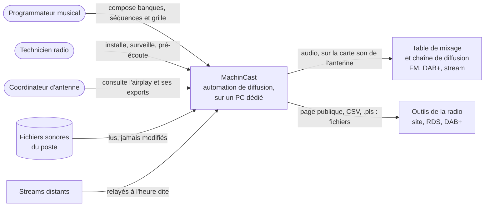
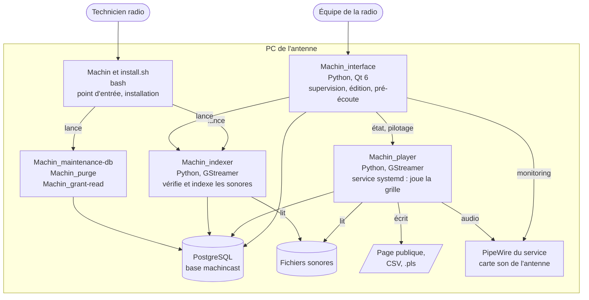
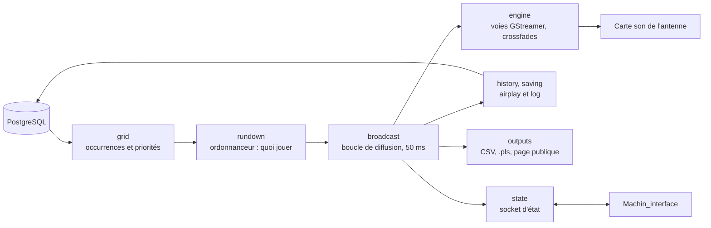
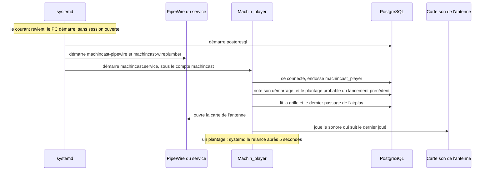
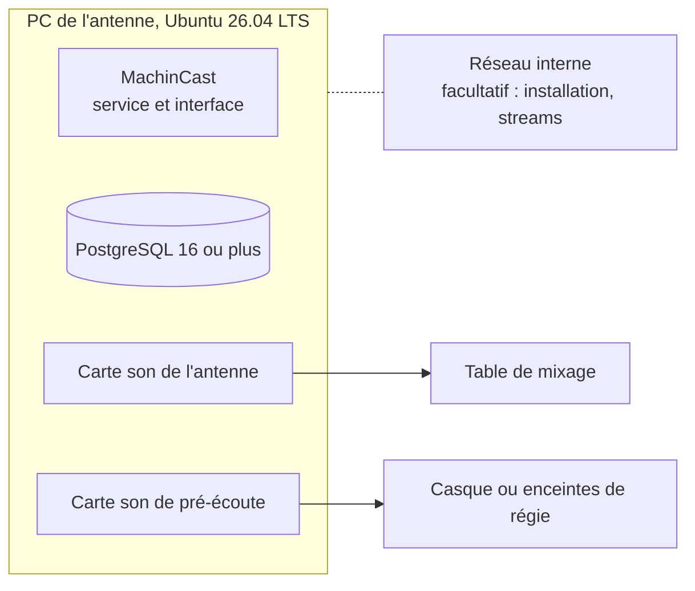

# Document d'architecture arc42

Ce document décrit l'architecture de MachinCast selon le gabarit [arc42](https://arc42.org/overview) ([#446](https://github.com/dascritch/machincast/issues/446)). Ses schémas suivent les niveaux du [modèle C4](https://c4model.com/) : contexte (§ 3), conteneurs (§ 5.1) et composants (§ 5.2). Le comportement détaillé, ticket par ticket, est dans la [spécification fonctionnelle](spec.md) ; ce document en donne la vue d'ensemble et les raisons.

Les passages marqués **À confirmer** sont des propositions à valider. Ceux marqués **Prévu** décrivent une intention qui n'est pas encore dans le code.

## 1. Introduction et but

Ce que fait MachinCast : produire une diffusion non-stop d'un flux musical 24/24 7/7 et de reprises de programmes pré-enregistrés, avec une préparation des métadonnées pour diffusion publique (FM RDS, DAB+, DVB Radio, stream).
Il produit un flux sonore continu sur une carte son, tout en permettant d'utiliser une autre carte son pour le monitoring.

Idéalement, ce logiciel doit être installé sur un PC physique dédié en mode kiosque.

Le logiciel a été conçu dans un scénario de radio associative avec un flux musical éditorialisé.

### 1.1 Vue d'ensemble des exigences

| Exigence | Ce que fait MachinCast | Détail |
| --- | --- | --- |
| Antenne continue | Un fil musical tourne tant qu'aucun événement de priorité supérieure n'est actif ; il est garanti par l'interface. | [spec § 4.1](spec.md#41-choix-de-lévénement-actif), [§ 8.10](spec.md#810-fil-musical-garanti) |
| Grille horaire | Des événements, récurrents ou non, à cinq priorités : secours, fil musical, émission, spécial, imprévu. Le plus prioritaire tient l'antenne. | [spec § 4](spec.md#4-règles-dordonnancement) |
| Programmation éditorialisée | Des banques, dont un seul sonore est tiré à chaque appel, et des séquences réutilisables, par exemple un passage publicitaire. | [spec § 1](spec.md#1-vocabulaire), [§ 4.4](spec.md#44-choix-dun-sonore-dans-une-banque) |
| Fichiers et streams | Un sonore est un fichier audio ou un stream ; un stream source qui tombe est tenté d'être récupéré tandis qu'il est remplacé par un programme de secours. | [spec § 4.7](spec.md#47-streams) |
| Enchaînements | Crossfades de début et de fin, silences de début et de fin détectés par analyse ou édition humaine, retirés à la diffusion. | [spec § 5.1](spec.md#51-lecture-audio) |
| Sonores vérifiés avant l'antenne | L'indexation vérifie chaque fichier, mesure sa durée et ses silences, et écarte ce qui n'est pas jouable. | [spec § 6](spec.md#6-binaire-indexation) |
| Métadonnées publiques | Page publique, exports de l'airplay, métadonnées RDS, masquage de l'artiste et du titre selon la configuration et le programme à l'antenne. | [spec § 4.8](spec.md#48-métadonnées-publiques-et-masquage), [§ 5.3](spec.md#53-modules-de-sortie) |
| Supervision et édition | Une interface graphique sur le poste : antenne en cours, grille, fiches, incidents, simulation, pré-écoute. | [spec § 8](spec.md#8-interface-graphique) |
| Reprise sans intervention | Le service redémarre seul au démarrage du poste ou après un plantage, et reprend la grille là où elle en est. | [spec § 10](spec.md#10-installation-et-déploiement) |

### 1.2 Objectifs de qualité

Par ordre de priorité. Chaque objectif a son scénario et sa solution au [§ 4](#4-stratégie-de-solution), et ses critères mesurables au [§ 10](#10-exigences-de-qualité).

1. **Fiabilité** : l'antenne ne s'arrête pas, et repart seule après une coupure.
2. **Conformité fonctionnelle** : ce qui passe à l'antenne est ce que dit la grille.
3. **Stabilité** : le poste reste frugal, restreint et prévisible sur la durée.
4. **Facilité de prise en main** : un technicien radio installe et exploite le poste sans être administrateur système.
5. **Maintenabilité** : le projet est ouvert, transmissible, et une radio peut faire étendre son code-source.

### 1.3 Parties prenantes

Équipe MachinCast :

- Développeurs : l'équipe de développement de MachinCast, alias Da Scritch en pilotage, Claude AI en co-développement.

Équipe radio intervenant sur MachinCast :

| Rôle | Qui | Ce qu'il attend de MachinCast |
| --- | --- | --- |
| Coordinateur d'antenne | Responsable juridique chargé de la relation entre l'équipe radio et les autorités légales, et directeur de la rédaction entre les différentes émissions. Il établit la grille et les partenariats et publicités diffusées à l'antenne. | Une antenne maîtrisée, un historique de diffusion fiable, des métadonnées publiques conformes, une grille facilement modifiable. |
| Programmateur musical | Personne chargée de la sélection musicale, de la configuration de la playlist et des relations avec les labels et ayants-droit. | Des banques et une grille simples à composer, une simulation de ce qui passera. |
| Technicien radio | Personne en charge du maintien en condition opérationnelle de l'équipement de production audio et de diffusion, souvent aussi réalisateur sur la régie, avec des connaissances informatiques utiles. | Une installation guidée, un service qui se relève seul, des logs lisibles. |

## 2. Contraintes d'architecture

| Contrainte | Détail |
| --- | --- |
| Matériel et système dédiés | Un PC autonome, dédié à l'antenne, avec au moins une carte son de qualité, 8 Go de mémoire au minimum et au moins 500 Go de disque disponible. Une seconde carte son sert au monitoring. |
| Système fiable, prévisible et standard | Ubuntu, versions LTS seulement ; cible actuelle : 26.04 LTS. |
| Langage ouvert et extensible | Python, interprété, pour qu'une radio puisse faire adapter le code sans chaîne de compilation. |
| Fonctionnement hors ligne | Aucune clé de licence, aucun service distant nécessaire à la diffusion. Le réseau ne sert qu'à l'installation et aux streams. |
| Sonores immuables | MachinCast n'écrit, ne déplace, ne renomme ni ne supprime jamais un fichier sonore ([#96](https://github.com/dascritch/machincast/issues/96)). |
| Droits du poste respectés | Les droits d'un répertoire personnel ou d'une arborescence du système ne changent jamais ([#381](https://github.com/dascritch/machincast/issues/381)). |
| Licence libre | GPL 3.0 ou ultérieure ; [code, documentation et tickets sur une forge ouverte.](https://github.com/dascritch/) |
| Méthode | TDD avec scénarios BDD en français, branches protégées, un commit par ticket, `mypy --strict`, `ruff` ([règles de développement](regles/developpement.md)). |

## 3. Contexte et périmètre

### 3.1 Contexte métier

Une radio qui émet 24/7 a besoin d'une automation pour garantir la diffusion d'un programme en dehors des heures d'activité et comme solution de replis disponible à tout instant.

D'autres cas d'usage ont été imaginés dans le ticket [#372](https://github.com/dascritch/machincast/issues/372) :

- sonorisation d'un espace ;
- syndication de radio ;
- modulation d'émetteur.

MachinCast occupe **une entrée de la table de mixage** : le mixage, le traitement de dynamique, l'encodage et l'émission sont en aval, hors de son périmètre. Ce qu'il n'est pas est détaillé au [§ 9.1](#91-ce-que-nest-pas-machincast).

### 3.2 Contexte technique

Plusieurs solutions ont été envisagées. Soit elles étaient trop complexes, soit elles sont devenues des solutions SaaS en ligne, comme AirTime.

Le système, pour des raisons d'obligation de maîtrise d'antenne et d'obligations comme celles des OIV (en Fance : Opérateur d'Importance Vitale), doit être sécurisé par défaut et doit pouvoir fonctionner hors ligne.
L'obligation de connectivité d'une clé de licence ou d'un service SaaS n'est absolument pas envisageable.

| Interface externe | Sens | Canal | Remarque |
| --- | --- | --- | --- |
| Carte son de l'antenne | sortie | PipeWire (préféré) ou ALSA, par GStreamer | Réservée au service de diffusion quand il est installé. |
| Carte son de pré-écoute | sortie | PipeWire (préféré) ou PulseAudio de la session | Pré-écoute d'un sonore, et monitoring de l'antenne. |
| Fichiers sonores | entrée | système de fichiers, lecture seule | Hors des répertoires personnels pour le service. |
| Streams | entrée | HTTP(S), par GStreamer | Seul besoin de réseau pendant la diffusion. |
| Page publique, CSV, .pls | sortie | fichiers écrits sur le poste | Aucun serveur : un autre outil les publie s'il le faut. |
| Administration | entrée | shell local, wrapper `Machin` et `install.sh` | Scriptable, par exemple par Ansible. |
| Journal | sortie | journal de systemd et `/var/log/machincast` | Lisible par les outils de supervision du poste. |

Il n'y a **aucune interface réseau entrante** : ni API, ni port ouvert.

## 4. Stratégie de solution

| Objectif de qualité | Scénario | Approche | Détail |
| --- | --- | --- | --- |
| Facilité d'administration | Le technicien radio est souvent l'unique personne capable de gérer l'informatique, et sa connaissance d'un PC est celle d'un utilisateur éclairé, pas d'un administrateur système. | Installateur unique et relançable, qui fait les mises à jour logicielles et la configuration du système, et suggère la configuration logicielle. Intégration dans l'environnement système et graphique. | [INSTALL](../../INSTALL.fr.md), [spec § 10](spec.md#10-installation-et-déploiement) |
| Sécurisation de la sortie audio | Une manipulation dans le bureau utilisateur ne peut pertuber l'antenne. | Le service lecture ne peut être arrêté sans vérification polkit. Il réserve une sortie audio exclusive sur un utilisateur applicatif. Le réglage son ne peut se faire que via l'interface graphique via polkit. | [§ 8.4](#84-audio), [spec § 5.1](spec.md#51-lecture-audio) |
| Stabilité | Le système hôte doit être frugal, à installation minimale, restreint par défaut, répandu, avec un support multilingue ; il ne doit pas exiger d'antivirus, ni être lié à des opérations effectuées à distance par une entreprise non-européenne. | Infrastructure POSIX. Environnement Linux. En LTS (Long Term Support). Distribution Ubuntu. Base de données PostgreSQL. Code en TDD, BDD et tests de bout en bout. | [§ 7](#7-vue-de-déploiement), [règles des tests](regles/tests.md) |
| Isolé | PC hôte non accessible de l'extérieur du réseau interne, voire pouvant fonctionner hors ligne. Réduction de la surface d'attaque. | Interface de contrôle en application native. Pas d'API dans le cœur du code. Toutes les communications passent par des sockets Unix, base de données comprise, ce qui exclut la couche IP. | [§ 5.1](#51-vue-densemble-du-système), [spec § 2](spec.md#communication-entre-composants) |
| Fail-safe | En cas de coupure de courant, le système doit redémarrer sans intervention humaine. | Chaque métier est un binaire indépendant des autres. Le lecteur est un service système, qui démarre seul au démarrage du PC. Reprise facile à partir d'une sauvegarde des paramètres. | [§ 6.1](#61-redémarrage-après-une-coupure-de-courant), [guide de la diffusion](administration/diffusion.md) |
| Ouvert | Une radio garde le contrôle, n'a ni licence à payer, ni dongle, ni numéro de série. Le projet doit être transmissible et maintenable par d'autres personnes. | Licence GPL. Code, documentation et suivi des tickets sur une forge logicielle ouverte. | <https://github.com/dascritch/machincast/> |
| Observabilité | Les installateurs et les services se commandent depuis un shell, par exemple par Ansible ; le service se surveille avec les outils du poste. | Commande shell unique, le wrapper `Machin`. Logs dans le journal de systemd et dans `/var/log/machincast`, rapports de crash. **Prévu** : une exposition pour Grafana et consorts ; aujourd'hui, seuls les logs et la socket d'état existent. | [commandes](administration/commandes.md), [spec § 2](spec.md#rapports-de-crash) |
| Extensible par l'utilisateur | Une radio peut avoir une infrastructure de diffusion spécifique, notamment pour les métadonnées, et commissionner un développeur pour que MachinCast s'y connecte. | Pile de développement minimale, donc langage interprété : Python. **Prévu** : une architecture à plug-ins, avec des points d'appel ; elle n'est pas encore dans le code. | [§ 11.2](#112-aide-à-la-prise-en-main-et-modularité), tickets [`plugin`](https://github.com/dascritch/machincast/issues?q=is%3Aissue+label%3Aplugin) |
| Immuabilité des sonores | Les sonores installés sur le PC ne doivent pas être modifiés. | Pas de pré-traitement audio de conformation des sources. Interdiction au logiciel d'écrire dans les sonores. Traitements audio après la source, avant ou après le mixage. | [§ 8.1](#81-immuabilité-des-sonores) |
| Moniteur du direct au plus exact | La pré-écoute du direct ne doit pas être une reconstitution du flux, mais une redirection/recopie directe du flux audio produit. | PipeWire comme moteur audio préférentiel : l'interface écoute le port de monitoring de la carte de l'antenne. Les crossfades, eux, sont faits par le moteur GStreamer de `Machin_player`. | [§ 8.4](#84-audio), [spec § 5.1](spec.md#51-lecture-audio) |
| Plasticité de la grille antenne | Une émission en direct est prévue pour bousculer les émissions normales de la grille sur une demi-journée. | Événements à priorités : un événement « spécial » a priorité sur un événement « émission » normal. | [spec § 4.1](spec.md#41-choix-de-lévénement-actif) |

## 5. Vue des briques

### 5.1 Vue d'ensemble du système

Niveau « conteneurs » du modèle C4 : ce qui s'exécute et ce qui garde les données, sur le seul PC de l'antenne.

Chaque binaire lit `machincast.toml` à son lancement et joint la base par socket Unix, avec son propre rôle. L'interface suit le lecteur par sa socket d'état et le pilote par systemd et polkit ; en ligne de commande, `Machin player` lance aussi le lecteur, pour un essai.

| Brique | Responsabilité | Interfaces |
| --- | --- | --- |
| `Machin_player` | Lire la grille et la jouer ; écrire l'airplay et le log ; produire les sorties. Il ne décide rien d'éditorial et ne modifie que l'information en base concernant un sonore. | Base (rôle `machincast_player`), socket d'état, carte son, fichiers de sortie. |
| `Machin_indexer` | Vérifier les sonores connus, parcourir les répertoires des banques, mesurer durées et silences. | Base (rôle `machincast_indexer`), fichiers sonores en lecture. |
| `Machin_interface` | Superviser l'antenne, éditer banques, séquences et événements, simuler, pré-écouter, piloter le service. | Base (rôle `machincast_interface`), socket d'état, systemd par polkit, PipeWire. |
| `Machin` | Point d'entrée unique en ligne de commande ; suivi des logs ; outils de développement. | Shell, journal de systemd. |
| `install.sh` | Installer, mettre à jour, installer ou retirer le service ; relançable. | `sudo` pour les seules étapes qui l'exigent. |
| Outils | `Machin_maintenance-db` : sauvegarde, schéma et rôles, optimisation. `Machin_purge` : péremption de l'airplay et du log, chaque jour à midi. `Machin_grant-read` : lecture des sonores par le service. | Base, ACL des répertoires de sonores. |
| PostgreSQL | Tout l'état durable : sonores, banques, séquences, événements, airplay, log. | Socket Unix, authentification peer. |
| `machincast.toml` | Configuration du poste : audio, sorties, masquage, seuils. Jamais versionné. | Lu par chaque binaire à son lancement ; écrit par les préférences de l'interface. |

Trois règles tiennent l'ensemble :

- **les binaires ne se parlent pas directement**, sauf l'interface au lecteur, par la socket d'état : tout le reste passe par la base ;
- **un rôle PostgreSQL par binaire**, aux droits minimaux ([spec § 3.2](spec.md#32-rôles-et-droits)) : le lecteur ne peut pas modifier la grille, l'indexation ne peut pas toucher aux événements ;
- **la playlist n'existe pas en base** : le lecteur la calcule à la volée, d'après la grille et l'airplay.

### 5.2 Niveau 2

#### Machin_player

| Module (`machincast.player`) | Rôle |
| --- | --- |
| `grid` | Les occurrences des événements, leurs priorités, les sessions sautées, le prochain changement de la grille. |
| `rundown` | L'ordonnanceur : à chaque instant, continuer, couper net, jouer un sonore ou se taire ; le tirage dans une banque, la position dans une séquence. |
| `broadcast` | La boucle de diffusion : un pas toutes les 50 ms environ, qui interroge l'ordonnanceur et pilote le moteur. |
| `engine`, `fades` | Les voies GStreamer : deux voies se superposent pendant un crossfade ; silences retirés ; blanc détecté. |
| `history`, `saving` | Les écritures : passages dans l'airplay, alertes et incidents dans le log. |
| `outputs` | Les modules de sortie, privés (stdout, CSV, .pls) et publics (page HTML, avec masquage). |
| `state` | La socket d'état : ce qui joue, ce qui vient, et les demandes d'interruption de l'interface. |
| `simulation` | La même grille et le même ordonnanceur, sur une horloge simulée et sans son, pour l'écran de simulation. |

#### Machin_indexer

| Module (`machincast.indexer`) | Rôle |
| --- | --- |
| `directories` | Parcourt les répertoires des banques, crée les sonores en aperçu, rattache et détache selon les durées de la banque. |
| `check` | Vérifie chaque sonore connu : présence, type, décodage, durée, tags ; fait passer son état. |
| `decoding` | Décode par GStreamer, dans un temps limité ; mesure les silences de début et de fin. |
| `audit` | Le document d'audit d'une indexation complète. |

Deux modes ([spec § 6.0](spec.md#60-modes-dindexation)) : l'indexation rapide, où seuls les sonores en aperçu sont décodés, et l'audit complet.

#### Machin_interface

| Famille (`machincast.interface`) | Modules | Rôle |
| --- | --- | --- |
| Fenêtre | `window`, `application` | Les onglets, les menus, le pilotage du service, les préférences. |
| Antenne | `default_screen`, `vu_meter`, `airplay_tab`, `incidents` | Ce qui joue, ce qui vient, les niveaux, l'historique, les incidents. |
| Grille | `calendar`, `event_card`, `sessions` | Le calendrier, la fiche d'un événement, ses sessions sautées. |
| Catalogue | `lists`, `sound_card`, `bank_card`, `sequence_card`, `feed_card`, `items`, `search` | Les listes, les fiches, les éléments d'une liste de lecture, la recherche. |
| Écoute | `preview`, `timeline` | La pré-écoute d'un sonore, sa forme d'onde, ses fondus. |
| Prévision | `simulation`, `suggestions` | Ce que la grille jouera ; les sonores à proposer. |
| Poste | `preferences`, `sound_cards`, `service_access`, `indexing_status`, `control` | Paramètres, cartes son, lecture des sonores par le service, indexations, pilotage du service. |

Les écrans sont décrits dans des fichiers `.ui`, compilés par `pyside6-uic` et jamais modifiés à la main.

L'interface réutilise des modules du lecteur (`grid`, `rundown`, `fades`, `simulation`) pour calculer comme lui : c'est une dépendance connue, à ranger dans un paquet commun ([#442](https://github.com/dascritch/machincast/issues/442)).

## 6. Vue d'exécution

### 6.1 Redémarrage après une coupure de courant

Rien n'est gardé en mémoire d'un lancement à l'autre : le lecteur retrouve sa place d'après la grille, l'heure et l'airplay.

### 6.2 Enchaînement de deux sonores

1. Pendant un sonore, à chaque pas, `broadcast` demande à `rundown` s'il faut couper net : un événement plus prioritaire a-t-il commencé ?
2. Au début du crossfade de fin du sonore en cours, `rundown` donne le suivant : l'élément suivant de la liste de lecture, et, pour une banque, un seul de ses sonores jouables.
3. `engine` lance le suivant sur la seconde voie ; les deux se superposent le temps du crossfade.
4. `history` termine le passage du premier dans l'airplay et commence celui du second ; `outputs` réécrit la page publique et le .pls ; `state` annonce le nouveau sonore à l'interface.

### 6.3 Un événement prioritaire prend l'antenne

1. `grid` annonce le prochain changement de la grille : le début d'une émission.
2. À l'heure dite, `rundown` répond « couper net » : le sonore en cours s'arrête, sans crossfade, et le premier élément de l'émission démarre.
3. Une émission sans rien de jouable ne coupe rien : l'événement en dessous garde l'antenne.
4. À la fin de l'émission, son dernier sonore va jusqu'au bout si rien ne suit, puis le fil musical reprend à l'élément qui suit son dernier joué.

L'interface peut aussi demander une interruption manuelle par la socket d'état ([spec § 4.9](spec.md#49-interruption-manuelle)).

### 6.4 Indexation d'un répertoire

1. Le programmateur ajoute un répertoire à une banque, dans sa fiche ; l'interface vérifie que le service pourra le lire.
2. L'indexation, lancée depuis l'interface ou par `Machin indexer`, parcourt le répertoire et crée un sonore en aperçu par fichier.
3. Chaque aperçu est décodé : durée, tags, silences. Sain, il devient actif ; sinon, il porte son anomalie, et ne passera pas à l'antenne.
4. Le lecteur ne tire dans la banque que des sonores jouables ([spec § 4.5](spec.md#45-sonore-jouable)).

### 6.5 Rien à diffuser

Sans sonore jouable, le lecteur se tait, et note une alerte `blanc` dans le log, une seule fois par blanc. Le blanc cesse dès qu'un sonore redevient jouable ou qu'un autre événement commence. L'interface garantit qu'un fil musical existe, pour que ce cas reste une anomalie.

## 7. Vue de déploiement

### 7.1 Infrastructure, niveau 1

Un seul nœud : le PC de l'antenne. Rien n'est réparti.

Deux façons d'utiliser le poste :

- **à l'essai** : sans service, `Machin player` se lance à la main ou depuis l'interface, sous le compte de l'utilisateur ;
- **en production** : `./install.sh --service` dédie le poste à l'antenne. C'est ce mode que décrit le niveau 2.

### 7.2 Infrastructure, niveau 2

| Élément | Où | Compte et droits |
| --- | --- | --- |
| Code et environnement Python | `/opt/machincast` (un lien, ou le répertoire lui-même s'il a été déplacé hors d'un répertoire personnel), avec son `.venv` isolé | Compte qui installe |
| Commande `Machin` | `/usr/local/bin/Machin`, autocomplétion bash | Lien |
| Configuration | `machincast.toml`, dans le répertoire de MachinCast | Compte qui installe ; lu par le service |
| Service de diffusion | `/etc/systemd/system/machincast.service` | Compte système `machincast`, sans mot de passe ni shell |
| PipeWire du service | `machincast-pipewire.service`, `machincast-wireplumber.service` | Compte `machincast`, groupe `audio` ; la carte de l'antenne est cachée aux sessions du poste |
| Sockets | `/run/machincast` : PipeWire, socket d'état | Groupe `machincast`, que rejoint le compte qui installe |
| Logs et rapports de crash | `/var/log/machincast`, rotation hebdomadaire | Groupe `machincast` |
| Sonores | `/home/machincast` par défaut, ou tout répertoire que le service lit déjà | Lecture pour le groupe `machincast` ; `Machin grant-read` pour l'ouvrir |
| Purge | `machincast-purge.timer`, chaque jour à midi | Compte qui installe, propriétaire de la base |
| Pilotage | règle polkit : démarrer, arrêter, redémarrer `machincast.service` | Le seul compte de MachinCast, avec l'authentification d'un administrateur ; jamais de `sudo` |
| Base de données | PostgreSQL local, socket Unix, authentification peer | Rôle `machincast` du service, qui n'endosse que `machincast_player` |

`./install.sh --remove-service` retire tout cela, sauf les logs et tout répertoire qui contient des sonores ([#430](https://github.com/dascritch/machincast/issues/430)). Le détail est dans la [spec § 10](spec.md#10-installation-et-déploiement) et le [guide de la diffusion](administration/diffusion.md).

## 8. Concepts transversaux

### 8.1 Immuabilité des sonores

Un fichier sonore n'est jamais supprimé, renommé, déplacé, remplacé ni écrit par MachinCast, quels que soient les changements de son entrée en base ([#96](https://github.com/dascritch/machincast/issues/96)). Supprimer un sonore ou une banque ne supprime que son entrée ([#33](https://github.com/dascritch/machincast/issues/33)). Seule exception : le déplacement hors d'un répertoire personnel, accepté explicitement à l'installation du service ([#381](https://github.com/dascritch/machincast/issues/381)). Dans le code, toute suppression de fichier porte un commentaire qui dit pourquoi elle ne vise pas un sonore, et un scénario le vérifie.

### 8.2 Sécurité et moindre privilège

- **Aucune surface réseau** : pas d'API, pas de port ; PostgreSQL par socket Unix seulement.
- **Un rôle par binaire**, endossé à la connexion, sans héritage : un binaire compromis ou fautif ne peut écrire que ce que son métier demande.
- **Un compte système pour le service**, distinct de celui de l'utilisateur, qui ne lit jamais un répertoire personnel.
- **Jamais de `sudo` au quotidien** : polkit autorise trois verbes sur une seule unité.
- **Droits du poste intouchés** : ni l'installation ni `Machin grant-read` ne changent les droits d'un répertoire personnel ou d'une arborescence du système (`machincast.access.sensitive_tree`).

### 8.3 Persistance

Tout l'état durable est dans PostgreSQL ; le schéma évolue par migrations yoyo. Une suppression depuis l'interface est différée : l'élément reste en base, marqué `deleted_at`, restaurable, jusqu'à ce que la purge l'efface après la durée de péremption. L'airplay n'est écrit que par le lecteur, et l'interface ne fait que lire l'airplay et le log ([règles de la base](regles/base-de-donnees.md)).

### 8.4 Audio

GStreamer décode, mixe et applique les fondus ; PipeWire transporte. En mode service, la carte de l'antenne appartient au PipeWire du service : l'interface le joint par sa socket pour le VU-mètre, le monitoring de l'antenne, le niveau et la sourdine. Avec la sortie ALSA, sans port de monitoring, le VU-mètre ne fonctionne pas : c'est accepté.

### 8.5 Temps

Le poste travaille en heure locale. La grille se calcule en heure murale : un événement garde son heure au changement d'heure. Tout le code lit l'heure par `machincast.clock`, ce qui permet aux scénarios et à la simulation de fixer l'horloge.

### 8.6 Journal, incidents et rapports de crash

Trois niveaux dans le log en base : information, alerte, incident ; l'interface les montre dans son onglet des incidents. Les messages vont aussi au journal de systemd et dans `/var/log/machincast`. Tout plantage d'un binaire laisse un rapport horodaté, avec la pile, les versions et le contexte métier ([spec § 2](spec.md#rapports-de-crash)).

### 8.7 Langue

Le code et ses messages sont écrits en anglais et traduits par un catalogue gettext unique, pour Python, les écrans Qt et bash. Chaque composant parle la langue de sa session : anglais ou français aujourd'hui. La base, la configuration et les exports gardent des termes fixes.

### 8.8 Configuration

Un seul fichier, `machincast.toml`, lu au lancement de chaque binaire. Les préférences de l'interface l'écrivent en gardant ses commentaires ; un changement des paramètres du service redémarre le service, et revient en arrière si le redémarrage échoue ([#389](https://github.com/dascritch/machincast/issues/389)).

### 8.9 Tests et style

Pas de fonctionnalité sans scénario : pytest-bdd en français pour Python et Qt, bats pour bash. Les scénarios tournent sur une base de test, jamais sur la base de production. Le style est vérifié par les tests eux-mêmes : tabulations, ni `elif`, ni expression conditionnelle, ni compréhension, conditions parenthésées ([règles de développement](regles/developpement.md), [règles des tests](regles/tests.md)).

### 8.10 Accessibilité de l'interface

Raccourcis clavier pour les onglets et les actions courantes, icônes monochromes à la couleur du texte du thème, thèmes clair et sombre, contrastes conformes au RGAA jusque dans les lignes alternées des tableaux ([#412](https://github.com/dascritch/machincast/issues/412)).

## 9. Décisions d'architecture

### 9.1 Ce que n'est pas MachinCast

**MachinCast n'est pas un cartouchier.** Il fournit en continu un flux musical qui ne doit pas s'arrêter, afin de garantir une source de secours en cas d'incident antenne.

**MachinCast n'est pas un serveur d'espace publicitaire à la demande.** Pour exactement les mêmes raisons.

**MachinCast n'est pas un outil de pige antenne ni un enregistreur légal.** Un enregistreur légal doit être sur un autre système, physiquement différent, afin d'en garantir l'indépendance et qui puisse être scellé ou saisi lors d'une procédure juridique.

**MachinCast n'est pas un outil de montage ou de DJing.** Audacity et Mixxx, par exemple, font très bien ce travail.

**MachinCast ne fait pas serveur de stream.** Il est idéalement isolé d'internet, afin de garantir la maîtrise d'antenne (en France, les radios conventionnées pour une diffusion hertzienne sont des OIV, opérateurs d'importance vitale).

**MachinCast n'est pas pilotable à distance**, justement pour des raisons de sécurité par conception. Il n'est pilotable que sur l'ordinateur où il a été installé, afin de réduire le nombre d'intervenants et le modèle de menaces. Nous réservons cette possibilité pour un plug-in à venir.

**MachinCast n'accepte pas de source audio analogique en entrée.** Le travail de mixage est celui d'une table de mixage, sur laquelle MachinCast occupe une entrée. Nous réservons la possibilité pour un plug-in à venir, mais cela fera perdre la facilité de se retourner vers un flux de secours en cas d'incident antenne.

**MachinCast n'est pas un fonds documentaire**, une discothèque et n'est pas prévu pour ingérer plus de 30 000 extraits sonores. Nous le faisons à titre de tests de montée en charge, afin de travailler sur les performances du service.

**MachinCast n'est pas prévu pour tourner sous Windows.** La fiabilité, la prévisibilité et la simplicité de maintenance priment.

### 9.2 Décisions prises

Les alternatives écartées et leurs raisons sont celles que le code et les tickets laissent lire : **à confirmer** et à compléter.

| Décision | Raison | Alternative écartée | Conséquence |
| --- | --- | --- | --- |
| Interface native Qt, sur le poste | Aucune surface réseau ; intégration au bureau. | Une interface web, qui demande un serveur et un port. | Pas de pilotage à distance ; il viendra par un plug-in s'il vient. |
| PostgreSQL par socket Unix, authentification peer | Rôles et droits par binaire, intégrité, pas de mot de passe à gérer. | MySQL/MariaDB sont trop instables et reconstruisent une logique filesystem redondants. | Un service de plus sur le poste ; PostgreSQL 16 au moins. |
| Un binaire par métier | Un plantage de l'interface ou de l'indexation n'arrête pas l'antenne ; chacun a ses droits. | Un seul programme. | Les binaires ne se parlent que par la base et la socket d'état. |
| La playlist n'existe pas en base | La grille reste la seule source ; un redémarrage retrouve sa place d'après l'airplay. | Une file d'attente enregistrée. | Le lecteur recalcule ; l'interface affiche une prévision, pas un engagement. |
| GStreamer pour l'audio et le mixage | Décodage de tous les formats, fondus, streams. | un moteur audio ad-hoc. | Dépendance aux versions de la distribution : GStreamer 1.28 vérifié. |
| PipeWire pour le transport audio | Monitoring par redirection directe du flux produit. | PulseAudio seul. | Dépendance aux versions de la distribution. |
| Service sous son propre compte, avec son PipeWire ([#381](https://github.com/dascritch/machincast/issues/381)) | L'antenne démarre sans session ouverte ; la carte de l'antenne est à l'abri des autres applications. | Un service de la session de l'utilisateur. | Le poste est dédié ; les sonores vivent hors des répertoires personnels. |
| Environnement Python isolé, jamais les paquets du système ([#51](https://github.com/dascritch/machincast/issues/51)) | Suivre les bibliothèques sans dépendre de la distribution, pouvoir monter ou figer leur version. | Les paquets apt de Python. | L'installation demande le réseau ; versions à figer à la release ([§ 11.4](#114-mise-à-jour-des-bibliothèques-externes)). |
| Pas de conformation des sonores | Immuabilité ; pas de copie de la discothèque. Économie d'espace disque utilisé. | Convertir chaque fichier à l'ingestion. | Les fichiers mal formés se découvrent à l'indexation ([§ 11.5](#115-immuabilité-des-sonores-non-réplication-des-fichiers-sources)). |
| Une seule migration, tant que le projet est en alpha | Repartir d'un schéma lisible. | Garder l'historique des migrations. | Pas de retour arrière vers l'ancien découpage. |
| Code et messages en anglais, traduits ; scénarios et documentation en français ([#368](https://github.com/dascritch/machincast/issues/368), [#360](https://github.com/dascritch/machincast/issues/360)) | Code transmissible ; métier décrit dans la langue de l'équipe. | Tout en français. | Un catalogue de traduction à tenir. |
| Style sans `elif`, expression conditionnelle ni compréhension ([#340](https://github.com/dascritch/machincast/issues/340)) ; tabulations | Lisibilité pour un relecteur occasionnel ; accessibilité. | Le style idiomatique de Python. | Des boucles plus longues, vérifiées par les tests et réutilisables. |

## 10. Exigences de qualité

### 10.1 Vue d'ensemble

Écriture du code en TDD et BDD. Ensemble de tests de bout en bout. Application en fail-safe, redémarrage immédiat du service de lecture. Stress tests sur une machine physique pendant une semaine avant chaque release.

Relecture critique du code lors de sprints orientés qualité et performance ([#437](https://github.com/dascritch/machincast/issues/437)).

### 10.2 Scénarios de qualité

| Objectif | Scénario | Mesure |
| --- | --- | --- |
| Fiabilité | Le courant est coupé puis rétabli, personne n'est là. | L'antenne reprend sans intervention, en moins de 30 secondes après le démarrage du système. |
| Fiabilité | `Machin_player` plante pendant un sonore. | systemd le relance après 5 secondes ; un rapport de crash est écrit ; le plantage est noté au log. |
| Fiabilité | Un fichier est illisible. | Le sonore est sauté, un incident est noté, l'antenne continue. |
| Fiabilité | Un stream tombe. | L'antenne bascule sur une programmation de secours, et tente une reconnexion avec le stream en arrière-plan, un incident est noté, l'antenne continue. |
| Fiabilité | Le poste diffuse une semaine sans intervention. | Aucun blanc non voulu, aucun redémarrage ; mémoire stable. |
| Conformité | Une émission commence à 20:00:00. | Elle prend l'antenne dans le pas de la boucle, environ 50 ms. |
| Conformité | Le programmateur veut savoir ce qui passera demain. | La simulation donne la même suite que le lecteur, par le même ordonnanceur. |
| Stabilité | Une discothèque de 30 000 sonores. | Listes et fiches restent utilisables ; l'enregistrement d'une banque de 30 000 sonores prend moins d'une seconde ([#383](https://github.com/dascritch/machincast/issues/383)). |
| Prise en main | Un technicien installe un poste neuf. | Une commande relançable, `./install.sh` ; une seconde, `./install.sh --service`, pour dédier le poste à l'antenne. |
| Maintenabilité | Un contributeur modifie le code. | `ruff`, `mypy --strict`, `shellcheck` et la suite complète passent : plus de 2 500 tests en moins de 10 minutes, 93 % de couverture (novembre 2026). |
| Sécurité | Un poste du réseau interne balaie le PC de l'antenne. | Aucun port ouvert par MachinCast. |

## 11. Risques et dette technique

### 11.1 Performance du code

Un code interprété n'est peut-être pas suffisamment rapide pour une machine légère de type Raspberry Pi 4.

Pour l'instant, sur un PC portable milieu de gamme sans marque, commercialisé il y a plus de 10 ans, la lecture se fait sans souci. Cette plateforme nous sert de test d'usage de longue durée (cycle d'une semaine). Un Raspberry Pi 4 a été réservé pour des expérimentations de terrain.

### 11.2 Aide à la prise en main et modularité

La construction en plug-ins ne va pas simplifier la prise en main, pour l'écriture du manuel comme pour l'exploitation de plusieurs machines.

C'est un choix, mais nous estimons qu'il permettra aussi d'alléger l'interface en fonction des usages.

### 11.3 Responsabilité du code

Le développement en *vibe-coding* peut ne pas être optimal.

Nous faisons en sorte de faire des relectures critiques et d'endurcir notre harnais. Ce projet a été lancé comme expérience technique et se montre plutôt satisfaisant, et tout aussi imparfait que s'il était entièrement codé par un humain. Des relectures et audits par des moteurs avec un plus grand effort et/ou venant d'autres fournisseurs IA sont régulièrement effectués.

### 11.4 Mise à jour des bibliothèques externes

Nous recourons à des bibliothèques Python de PyPI en rolling release.

Ce choix n'est destiné à exister que durant le développement. Les versions seront figées au moment de la release d'une version ([#438](https://github.com/dascritch/machincast/issues/438)).

### 11.5 Immuabilité des sonores, non réplication des fichiers sources

L'absence de conformation peut entraîner des soucis avec des sonores mal formés, ou dont le support n'a pas été fiabilisé (comme AIFF dans la version de GStreamer d'Ubuntu 26.04 LTS).

L'analyse des sonores avant diffusion est supposée limiter ce genre d'incidents à l'antenne.

### 11.6 Interface métier complexe

Trop de fonctionnalités encombrent l'interface, ou rendent l'application *overkill* pour certains cas d'usage imaginés.

Nous essayons de réduire cet encombrement en réfléchissant à passer des fonctions en plug-ins.

### 11.7 Projet porté par une seule personne

Le pilotage, la relecture et les fusions reposent sur un seul mainteneur. 

Effectivement, notre indice bus factor est de `1`. Le projet a été lancé sur une initiative personnelle. La documentation par public, les règles écrites, les scénarios en français et ce document visent à rendre le projet transmissible. 

### 11.8 Pas d'intégration continue

La suite de test complète n'est lancée qu'occasionnellement. Les vérifications se lancent à la main, par `bin/Machin dev-test`, ciblées par ticket ; la suite complète ne tourne que tous les dix tickets. Une régression peut donc atteindre `main`, comme en novembre 2026 ([#436](https://github.com/dascritch/machincast/pull/436)). 

Nous sommes au début du projet et pas encore réellement en production, l'intégration continue viendra avec la branche `preprod`, à sa fusion vers `main`.

### 11.9 Points de concentration du code

L'analyse de novembre 2026 ([#437](https://github.com/dascritch/machincast/issues/437)) relève quelques classes et fonctions trop grosses (`MainWindow`, `Broadcast`, `_check_sound`, `plan`), du SQL écrit dans les classes de l'interface, et une dépendance de l'interface vers les modules du lecteur. Aucun cycle d'imports, peu de duplication, 93 % de couverture.

Des tickets sont ouverts en ce sens, les instructions projets sont en amélioration continue.

### 11.10 Dépendance au système audio de la distribution

Le comportement dépend des versions de GStreamer, PipeWire et WirePlumber d'Ubuntu : seule la 26.04 LTS est vérifiée. 

Pour l'instant, pour le démarrage, nous avons simplifié le domaine et établi une configuration cible. Une montée de version de la distribution demande une campagne de tests sur machine physique.

### 11.11 Poste unique, sans redondance

Un seul PC porte la diffusion, la base et les sonores. La panne matérielle n'est couverte que par la sauvegarde (`Machin maintenance-db`) et par la source de secours de la régie.

La politique et procédure de reprise sur un second poste est à l'appréciation de l'utilisateur, en fonction de son budget (double PC source pilotée en régie, double PC branchés sur une commutation audio à monitoring auto, ou service de secours au niveau émetteur).

## 12. Glossaire

Le vocabulaire du métier est défini dans la [spécification, § 1](spec.md#1-vocabulaire). L'essentiel :

| Terme | Sens |
| --- | --- |
| Sonore | Un fichier audio ou un stream ; l'unité de base de la diffusion. |
| Banque | Un ensemble de sonores, dont un seul est tiré quand la banque est jouée. |
| Séquence | Une suite de sonores et de banques, jouée en entier comme un seul sonore. |
| Événement | Une plage horaire, éventuellement récurrente, avec une priorité et une liste de lecture. |
| Fil musical | L'événement de fond, qui tourne quand rien de plus prioritaire n'est actif. |
| Grille | L'ensemble des événements, dans le temps. |
| Airplay | L'historique de ce qui a effectivement été diffusé. |
| Feed | Une adresse de stream enregistrée, réutilisable pour plusieurs événements. |
| Blanc | L'absence de tout son à l'antenne. |
| Silence | Un passage sous le seuil, au début ou à la fin d'un fichier sonore, que la diffusion peut retirer. |
| Antenne | La sortie diffusée ; par extension, la carte son qui la porte. |
| Pré-écoute | L'écoute d'un sonore, ou de l'antenne, sur une autre carte son. |
| OIV | Opérateur d'importance vitale. |
