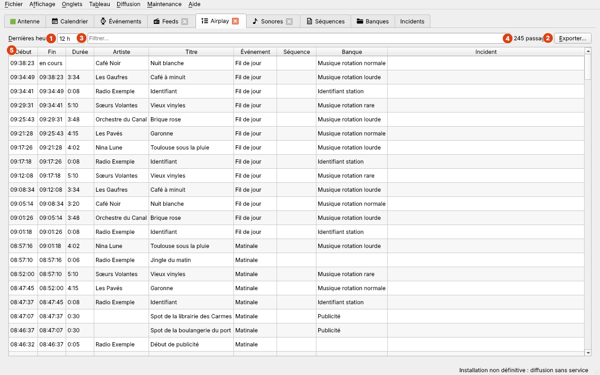

# Aide sur l'onglet Airplay

L'onglet Airplay donne l'historique de diffusion des dernières heures, à filtrer, trier et exporter.
Les numéros renvoient à l'image ; **Aide → Aide contextuelle**, ou <kbd>F1</kbd>, donne chacune de ces aides en infobulle, sur l'élément lui-même.

1. **Dernières heures** (`hours`) : combien d'heures remonter, 12 par défaut, jusqu'à un mois ; le réglage est retenu.
2. **Exporter…** (`export`) : enregistre ce que montre l'onglet en tableur CSV, en page HTML ou en liste de lecture M3U, texte public compris.
3. **Filtrer…** (`filter_`) : ne garde que les passages qui contiennent le texte tapé, sans tenir compte des majuscules ni des accents.
4. **Compte** (`count`) : combien de passages sont montrés, sur combien.
5. **Passages** (`table`) : un clic sur le titre d'une colonne trie ; double-clic vers les fiches, clic droit pour la pré-écoute et l'emplacement.

Pour aller plus loin : [Onglet Airplay](../prise-en-main.md#onglet-airplay).
