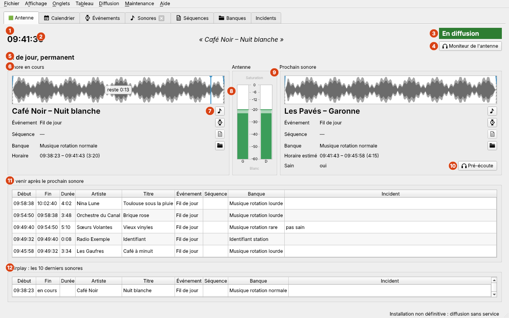

# Aide sur l'onglet Antenne

L'onglet Antenne montre ce qui passe et ce qui va passer, en direct.
Les numéros renvoient à l'image ; **Aide → Aide contextuelle**, ou <kbd>F1</kbd>, donne chacune de ces aides en infobulle, sur l'élément lui-même.

1. **Heure** (`hour`) : l'heure du poste, à la seconde ; son infobulle donne la date.
2. **Texte public** (`public_text`) : le texte du sonore en cours, tel que l'affiche la page publique de la radio ; `—` sans texte, par exemple pour un sonore masqué.
3. **État de la diffusion** (`playback_state`) : `En diffusion`, `Blanc à l'antenne` ou `À l'arrêt` ; son liseré est rouge quand le service de diffusion est installé, vert sur un poste d'essai.
4. **Moniteur de l'antenne** (`monitor`) : le casque, dans le cartouche de l'état de la diffusion, seulement quand elle tourne ; écoute ce qui sort à l'antenne, dans la fenêtre du moniteur ; pendant l'écoute, il devient **Arrêter le moniteur de l'antenne**.
5. **Événement à l'antenne** (`on_air_event`) : son nom et ses heures, ou « permanent » pour un fil musical.
6. **Sonore en cours** (`ongoing_frame`) : l'artiste, le titre, l'événement, la séquence et la banque d'où il vient, son horaire et sa frise ; le clic droit propose de revenir à son début, de recommencer la séquence ou l'événement, et de copier son emplacement.
7. **Fiche du sonore en cours** (`open_ongoing_sound`) : ouvre sa fiche ; les boutons voisins ouvrent celles de son événement, de sa séquence et de sa banque.
8. **VU-mètre** (`vu_meter`) : le niveau réel de l'antenne, canal par canal, avec ses voyants **Saturation** et **Blanc** ; un clic ouvre le moniteur de l'antenne.
9. **Prochain sonore** (`next_frame`) : celui qui passera ensuite, même tiré au hasard, et **Sain** s'il est prêt ; le clic droit propose sa pré-écoute, d'y sauter aussitôt, ou d'avancer l'événement suivant.
10. **Pré-écoute du prochain sonore** (`preview_next`) : l'écoute au casque, sans toucher à l'antenne.
11. **Sonores** (`sounds_frame`) : un seul tableau, dans l'ordre du temps, le plus vieux en bas : les 5 prochains sonores, le plus lointain en haut, ceux à l'antenne, entourés de rouge, puis les 10 derniers passés ; double-clic vers les fiches, clic droit pour la pré-écoute et l'emplacement ; un clic sur le titre replie l'encart.

Pour aller plus loin : [Antenne](../prise-en-main.md#antenne), [Piloter la diffusion](../antenne.md#piloter-la-diffusion) et [Interrompre l'antenne](../antenne.md#interrompre-lantenne).
