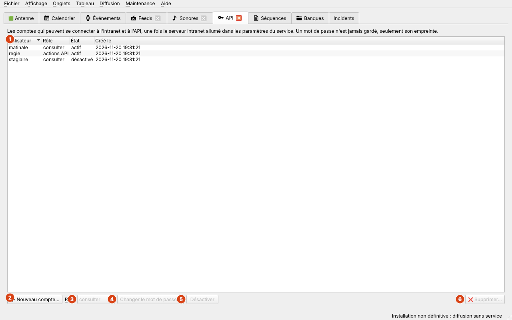

# Aide sur l'onglet API

L'onglet API gère les comptes qui peuvent se connecter à l'intranet et à l'API ([#537](https://github.com/dascritch/machincast/issues/537)).
Les numéros renvoient à l'image ; **Aide → Aide contextuelle**, ou <kbd>F1</kbd>, donne chacune de ces aides en infobulle, sur l'élément lui-même.

1. **Comptes** (`users`) : chaque compte, son rôle, son état, `actif` ou `désactivé`, et sa date de création ; les actions qui suivent agissent sur le compte choisi.
2. **➕ Nouveau compte…** (`new_user`) : demande un nom, un mot de passe d'au moins 12 caractères, sa confirmation et un rôle ; le nom ne prend que des lettres sans accent, des chiffres, le point, le tiret et le souligné.
3. **Rôle** (`role`) : `consulter` donne l'intranet et l'API en lecture ; `actions API` de même, et les actions à venir ; le changement vaut aussitôt.
4. **Changer le mot de passe…** (`change_password`) : un nouveau mot de passe, confirmé ; l'ancien n'est pas demandé, et il n'y a pas d'autre récupération.
5. **Désactiver** (`disable`) : le compte ne se connecte plus ; le bouton devient **Réactiver**.
6. **❌ Supprimer…** (`delete`) : supprime le compte, après confirmation.

Pour aller plus loin : [Comptes de l'intranet](../../administration/configuration.md#comptes-de-lintranet).
