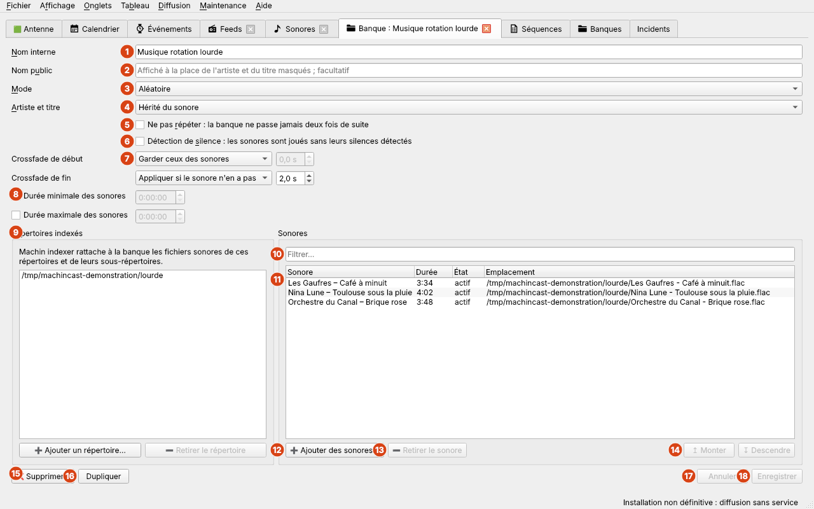

# Aide sur la fiche d'une banque

Une banque fournit un sonore à chaque appel, selon son mode, parmi ses sonores actifs.
Les numéros renvoient à l'image ; **Aide → Aide contextuelle**, ou <kbd>F1</kbd>, donne chacune de ces aides en infobulle, sur l'élément lui-même.

1. **Nom interne** (`internal_name`) : obligatoire, et propre à la banque.
2. **Nom public** (`public_name`) : facultatif ; affiché sur la page publique à la place de l'artiste et du titre masqués.
3. **Mode** (`mode`) : l'ordre dans lequel la banque fournit ses sonores : en descendant ou en remontant le tableau des sonores, dans l'ordre du nom des fichiers, ou au hasard.
4. **Artiste et titre** (`hiding`) : masqués par le nom public de la banque, affichés, ou laissés au choix du sonore.
5. **Ne pas répéter** (`no_repeat`) : la banque ne passe jamais deux fois de suite.
6. **Détection de silence** (`detection_silences`) : les sonores joués par la banque le sont sans leurs silences du début et de la fin.
7. **Crossfade de début** (`start_crossfade_rule`) : garder ceux des sonores, les appliquer à ceux qui n'en ont pas, ou les imposer à tous ; de même pour le crossfade de fin.
8. **Durée minimale** (`has_min_duration`) : facultative, comme la durée maximale ; un sonore qui en sort est marqué, et la prochaine indexation le retire de la banque.
9. **Répertoires indexés** (`directory_group`) : les fichiers de ces répertoires, et de leurs sous-répertoires, rejoignent la banque à chaque indexation.
10. **Filtrer…** (`sound_filter`) : ne montre que les sonores qui contiennent le texte tapé.
11. **Sonores** (`sounds`) : chaque sonore, avec sa durée, son état et son emplacement ; double-clic pour sa fiche, clic droit pour la pré-écoute, activer, désactiver, couper, copier, coller et tout sélectionner.
12. **➕ Ajouter des sonores…** (`add_sounds`) : choisit des sonores en base ; on peut aussi déposer des fichiers sur la liste.
13. **➖ Retirer le sonore** (`remove_sound`) : retire les sonores choisis de la banque, sans toucher à leur fichier.
14. **↥ Monter** (`raise_`) : monte les sonores choisis d'un rang ; **↧ Descendre** les descend.
15. **❌ Supprimer…** (`delete`) : supprime l'élément, après confirmation ; il reste restaurable jusqu'à son effacement de la base.
16. **Dupliquer** (`duplicate`) : ouvre la copie de l'élément dans une nouvelle fiche, à enregistrer.
17. **Annuler** (`cancel`) : revient à ce qui est en base ; <kbd>Ctrl</kbd>+<kbd>Échap</kbd> annule et ferme l'onglet.
18. **Enregistrer** (`save`) : enregistre la fiche en base, <kbd>Ctrl</kbd>+<kbd>S</kbd> ; <kbd>Ctrl</kbd>+<kbd>Entrée</kbd> enregistre et ferme l'onglet. Un liseré vert le signale tant que la fiche a des modifications à enregistrer.

Pour aller plus loin : [Fiche d'une banque](../sonores.md#fiche-dune-banque) et [Alimenter une banque par ses répertoires](../sonores.md#alimenter-une-banque-par-ses-répertoires).
