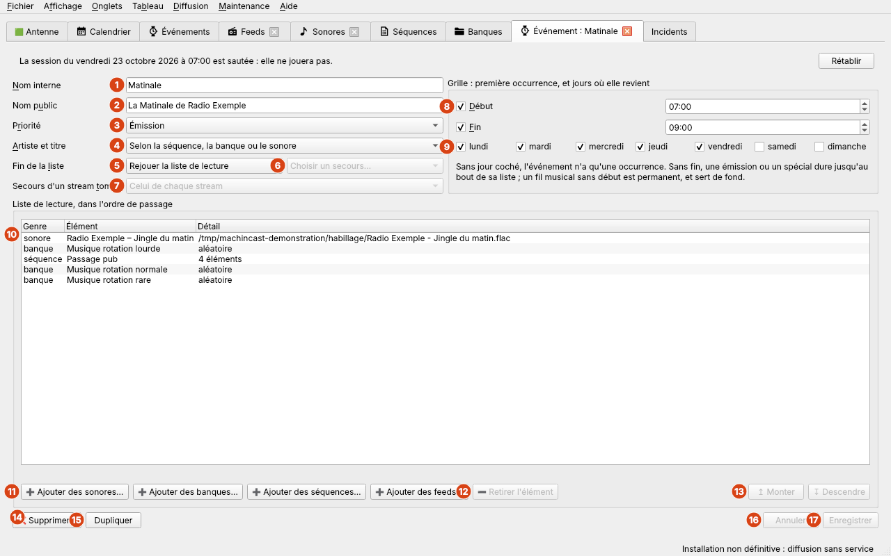

# Aide sur la fiche d'un événement

Un événement place une liste de lecture dans la grille : un spécial, une émission, un fil musical, ou un secours.
Les numéros renvoient à l'image ; **Aide → Aide contextuelle**, ou <kbd>F1</kbd>, donne chacune de ces aides en infobulle, sur l'élément lui-même.

1. **Nom interne** (`internal_name`) : obligatoire, et propre à l'événement.
2. **Nom public** (`public_name`) : facultatif ; affiché sur la page publique à la place de l'artiste et du titre masqués.
3. **Priorité** (`priority`) : imprévu, spécial, émission, fil musical ou secours ; la plus haute prend l'antenne.
4. **Artiste et titre** (`hiding`) : masqués par le nom public de l'événement, affichés, ou laissés au choix des éléments.
5. **Fin de la liste** (`end_of_list`) : ce que fait une émission ou un spécial qui a une fin quand sa liste se termine avant elle : rejouer la liste, passer au fil musical, passer à un secours, ou prêter son nom au fil musical.
6. **Secours** (`end_fallback`) : le secours qui prend la suite, quand la fin de la liste passe à un secours.
7. **Secours d'un stream tombé** (`stream_fallback`) : le secours qui joue quand un stream de la liste tombe ; **Celui de chaque stream** garde le secours de chaque stream.
8. **Début** (`has_start`) : à cocher, le moment où l'événement commence ; de même pour **Fin**.
9. **Jours** (`monday`) : les jours de la semaine où l'événement revient, du lundi au dimanche. Cocher un jour avance la première occurrence à ce jour, si elle n'y est pas déjà ([#606](https://github.com/dascritch/machincast/issues/606)).
10. **Éléments** (`items`) : les sonores, banques, séquences et feeds joués, dans l'ordre ; glisser-déposer, couper, copier et coller les réordonnent.
11. **➕ Ajouter des sonores…** (`add_sounds`) : ajoute des sonores ; les boutons voisins ajoutent des banques, des séquences et des feeds.
12. **➖ Retirer l'élément** (`remove_item`) : retire les éléments choisis.
13. **↥ Monter** (`raise_`) : monte les éléments choisis d'un rang ; **↧ Descendre** les descend.
14. **❌ Supprimer…** (`delete`) : supprime l'élément, après confirmation ; il reste restaurable jusqu'à son effacement de la base.
15. **Dupliquer** (`duplicate`) : ouvre la copie de l'élément dans une nouvelle fiche, à enregistrer.
16. **Annuler** (`cancel`) : revient à ce qui est en base ; <kbd>Ctrl</kbd>+<kbd>Échap</kbd> annule et ferme l'onglet.
17. **Enregistrer** (`save`) : enregistre la fiche en base, <kbd>Ctrl</kbd>+<kbd>S</kbd> ; <kbd>Ctrl</kbd>+<kbd>Entrée</kbd> enregistre et ferme l'onglet. Un liseré vert le signale tant que la fiche a des modifications à enregistrer.

Pour aller plus loin : [Fiche d'un événement](../grille.md#fiche-dun-événement) et [Quel événement est à l'antenne](../antenne.md#quel-événement-est-à-lantenne).
