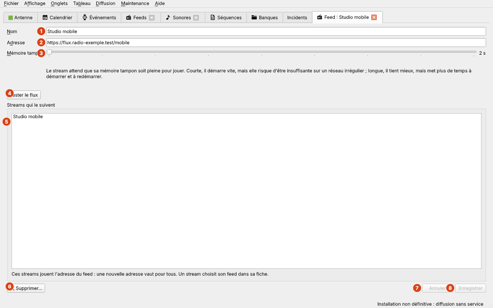

# Aide sur la fiche d'un feed

Un feed est une adresse de flux réutilisable, que plusieurs streams peuvent suivre.
Les numéros renvoient à l'image ; **Aide → Aide contextuelle**, ou <kbd>F1</kbd>, donne chacune de ces aides en infobulle, sur l'élément lui-même.

1. **Nom** (`name`) : obligatoire.
2. **Adresse** (`url`) : obligatoire ; une nouvelle adresse vaut aussitôt pour tous les streams qui suivent le feed.
3. **Mémoire tampon** (`buffer`) : de 2 à 10 secondes ; courte, le stream démarre vite, longue, il tient mieux un réseau irrégulier.
4. **Tester le flux** (`test`) : dit si du son arrive à l'adresse saisie, de quel type et à quel débit, sans rien jouer à l'antenne.
5. **Streams qui le suivent** (`streams`) : un double-clic ouvre leur fiche.
6. **❌ Supprimer…** (`delete`) : un feed qu'un stream suit ne se supprime pas ; la fiche nomme ces streams.
7. **Annuler** (`cancel`) : revient à ce qui est en base ; <kbd>Ctrl</kbd>+<kbd>Échap</kbd> annule et ferme l'onglet.
8. **Enregistrer** (`save`) : enregistre la fiche en base, <kbd>Ctrl</kbd>+<kbd>S</kbd> ; <kbd>Ctrl</kbd>+<kbd>Entrée</kbd> enregistre et ferme l'onglet. Un liseré vert le signale tant que la fiche a des modifications à enregistrer.

Le feed d'une **entrée audio** des Paramètres du service ([#623](https://github.com/dascritch/machincast/issues/623)) montre l'entrée à la place de l'adresse, sans mémoire tampon ni test : son nom se change dans **Fichier → Paramètres du service…**, page **Audio**. Une entrée retirée de ces paramètres garde son feed, et la fiche le signale en haut.

Pour aller plus loin : [Feeds](../sonores.md#feeds) et [Streams](../antenne.md#streams).
