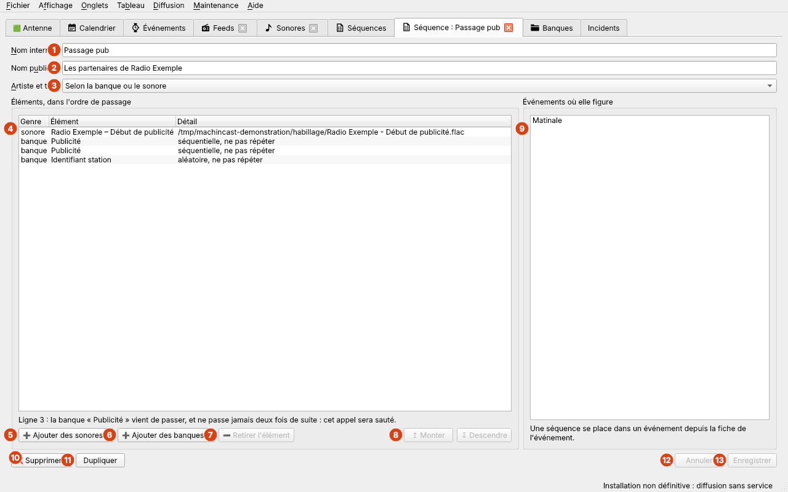

# Aide sur la fiche d'une séquence

Une séquence est une suite d'éléments joués d'un bloc, comme un écran de publicité, qu'un événement appelle.
Les numéros renvoient à l'image ; **Aide → Aide contextuelle**, ou <kbd>F1</kbd>, donne chacune de ces aides en infobulle, sur l'élément lui-même.

1. **Nom interne** (`internal_name`) : obligatoire, et propre à la séquence.
2. **Nom public** (`public_name`) : facultatif ; affiché sur la page publique à la place de l'artiste et du titre masqués.
3. **Artiste et titre** (`hiding`) : masqués par le nom public de la séquence, affichés, ou laissés au choix de la banque ou du sonore.
4. **Éléments** (`items`) : les sonores et banques joués, dans l'ordre ; glisser-déposer, couper, copier et coller les réordonnent.
5. **➕ Ajouter des sonores…** (`add_sounds`) : ajoute des sonores à la fin de la liste.
6. **➕ Ajouter des banques…** (`add_banks`) : ajoute des banques, dont chacune fournira un sonore.
7. **➖ Retirer l'élément** (`remove_item`) : retire les éléments choisis.
8. **↥ Monter** (`raise_`) : monte les éléments choisis d'un rang ; **↧ Descendre** les descend.
9. **Événements** (`events`) : les événements qui appellent la séquence ; un double-clic ouvre leur fiche.
10. **❌ Supprimer…** (`delete`) : supprime l'élément, après confirmation ; il reste restaurable jusqu'à son effacement de la base.
11. **Dupliquer** (`duplicate`) : ouvre la copie de l'élément dans une nouvelle fiche, à enregistrer.
12. **Annuler** (`cancel`) : revient à ce qui est en base ; <kbd>Ctrl</kbd>+<kbd>Échap</kbd> annule et ferme l'onglet.
13. **Enregistrer** (`save`) : enregistre la fiche en base, <kbd>Ctrl</kbd>+<kbd>S</kbd> ; <kbd>Ctrl</kbd>+<kbd>Entrée</kbd> enregistre et ferme l'onglet. Un liseré vert le signale tant que la fiche a des modifications à enregistrer.

Pour aller plus loin : [Fiche d'une séquence](../grille.md#fiche-dune-séquence) et [Séquences](../antenne.md#séquences).
