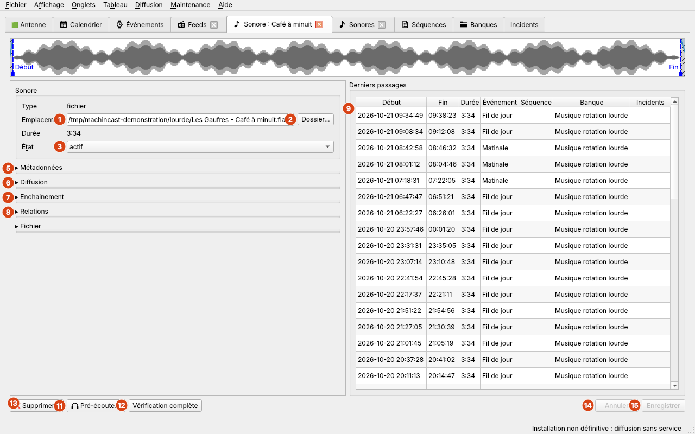

# Aide sur la fiche d'un sonore

La fiche d'un sonore montre un fichier ou un stream, ses métadonnées, sa diffusion et ses derniers passages ; un clic sur le titre d'un encart le déplie.
Les numéros renvoient à l'image ; **Aide → Aide contextuelle**, ou <kbd>F1</kbd>, donne chacune de ces aides en infobulle, sur l'élément lui-même.

1. **Emplacement** (`location`) : le fichier, ou l'adresse du stream, qui ne se modifie pas ici.
2. **Dossier…** (`open_folder`) : ouvre le dossier du fichier dans le navigateur de fichiers du poste.
3. **État** (`state`) : `actif` ou `désactivé` ; un sonore `expiré`, `erroné` ou `supprimé` peut revenir à `actif`.
4. **Stream** (`stream_group`) : l'adresse directe ou un feed, l'événement de secours, et **Tester le flux**.
5. **Métadonnées** (`metadata_group`) : artiste, titre et autres tags ; un champ modifié est noté saisi à la main, et les tags ne l'écrasent plus.
6. **Diffusion** (`broadcast_group`) : masquage de l'artiste et du titre, période de diffusion et maximum de lectures.
7. **Enchainement** (`silence_group`) : jouer sans les silences détectés, le début et la fin, et les crossfades du sonore.
8. **Relations** (`relation_group`) : les séquences, banques et événements qui le citent ; double-clic pour leur fiche, clic droit pour en retirer le sonore.
9. **Derniers passages** (`plays`) : ses 50 derniers passages à l'antenne, avec leurs alertes et incidents.
10. **Revenir aux valeurs du fichier…** (`back_to_file`) : rend aux valeurs saisies à la main celles du fichier, après confirmation.
11. **Pré-écoute…** (`preview`) : l'écoute au casque, avec sa frise, sans toucher à l'antenne.
12. **Vérification complète** (`check`) : vérifie le fichier en entier et mesure ses silences, sans attendre la prochaine indexation.
13. **❌ Supprimer…** (`delete`) : supprime l'élément, après confirmation ; il reste restaurable jusqu'à son effacement de la base.
14. **Annuler** (`cancel`) : revient à ce qui est en base ; <kbd>Ctrl</kbd>+<kbd>Échap</kbd> annule et ferme l'onglet.
15. **Enregistrer** (`save`) : enregistre la fiche en base, <kbd>Ctrl</kbd>+<kbd>S</kbd> ; <kbd>Ctrl</kbd>+<kbd>Entrée</kbd> enregistre et ferme l'onglet. Un liseré vert le signale tant que la fiche a des modifications à enregistrer.

Pour aller plus loin : [Fiche d'un sonore](../sonores.md#fiche-dun-sonore), [Pré-écoute](../sonores.md#pré-écoute) et [Tags et métadonnées](../sonores.md#tags-et-métadonnées).
