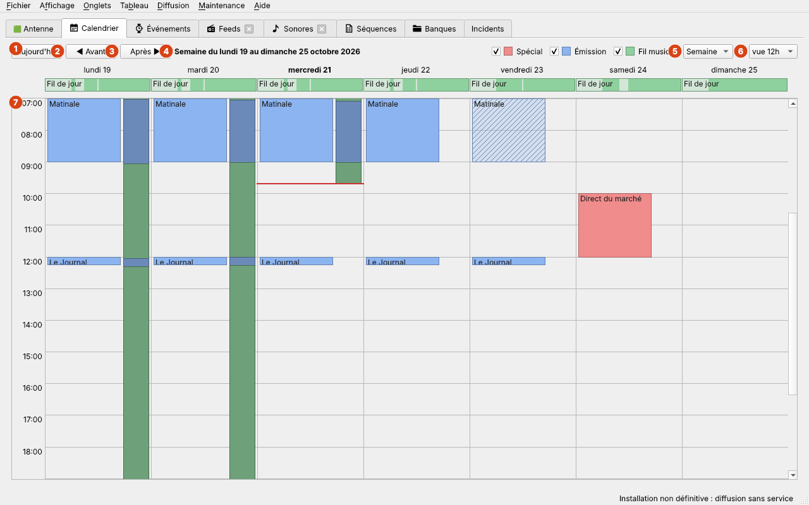

# Aide sur la grille horaire

Le calendrier montre ce qui est prévu, et, à droite de chaque jour passé, ce qui a été diffusé.
Les numéros renvoient à l'image ; **Aide → Aide contextuelle**, ou <kbd>F1</kbd>, donne chacune de ces aides en infobulle, sur l'élément lui-même.

1. **Aujourd'hui** (`today`) : revient à la semaine, ou au jour, d'aujourd'hui.
2. **◀ Avant** (`previous`) : la semaine, ou le jour, d'avant, jusqu'à la durée de péremption.
3. **Après ▶** (`following`) : la semaine, ou le jour, d'après, jusqu'à 28 jours après aujourd'hui.
4. **Période** (`title`) : la semaine ou le jour montré ; les cases qui suivent montrent ou cachent les spéciaux, les émissions et les fils musicaux.
5. **Vue** (`view`) : un seul jour, ou la semaine.
6. **Zoom** (`zoom`) : 4, 8, 12 ou 24 heures dans la hauteur de la grille ; <kbd>Maj</kbd> et la molette passent au zoom voisin.
7. **Grille** (`scrolling`) : un bloc par occurrence d'un événement, à la couleur de sa priorité ; double-clic pour sa fiche, clic sur une heure libre pour créer un événement, clic droit pour sauter une session.

Pour aller plus loin : [Calendrier](../grille.md#calendrier) et [Sauter une session](../grille.md#sauter-une-session).
