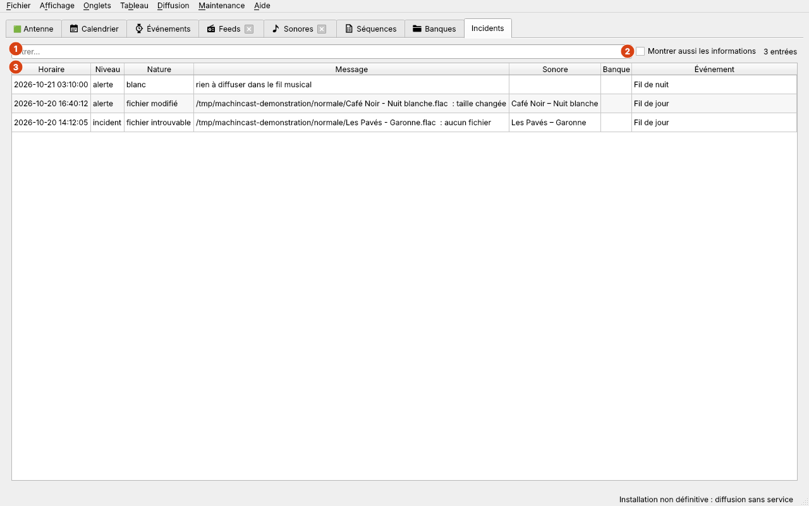

# Aide sur l'onglet Incidents

L'onglet Incidents montre les alertes et les incidents notés par la diffusion, l'indexation et la maintenance, du plus récent au plus ancien.
Les numéros renvoient à l'image ; **Aide → Aide contextuelle**, ou <kbd>F1</kbd>, donne chacune de ces aides en infobulle, sur l'élément lui-même.

1. **Filtrer…** (`filter_`) : ne garde que les lignes qui contiennent le texte tapé, sans tenir compte des majuscules ni des accents.
2. **Montrer aussi les informations** (`information`) : ajoute les opérations normales, comme les démarrages, les débuts et fins d'événements, et les interruptions manuelles.
3. **Journal** (`table`) : horaire, niveau, nature, message, et le sonore, la banque et l'événement concernés ; un double-clic sur l'un d'eux ouvre sa fiche.

Pour aller plus loin : [Historique et incidents](../antenne.md#historique-et-incidents).
