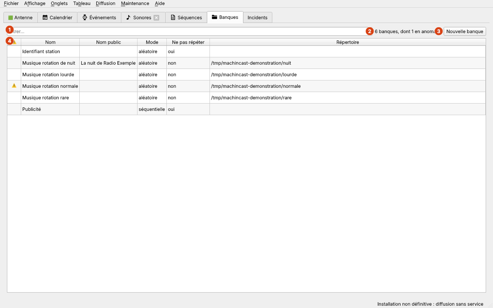

# Aide sur la liste des banques

L'onglet Banques donne toutes les banques, par nom.
Les numéros renvoient à l'image ; **Aide → Aide contextuelle**, ou <kbd>F1</kbd>, donne chacune de ces aides en infobulle, sur l'élément lui-même.

1. **Filtrer…** (`filter_`) : ne garde que les lignes dont une colonne contient le texte tapé, sans tenir compte des majuscules ni des accents.
2. **Compte** (`count`) : combien de lignes restent, sur combien.
3. **Nouvelle banque** (`new`) : ouvre une fiche vide ; rien n'est en base avant **Enregistrer**.
4. **Liste** (`table`) : ⚠️, nom, nom public, mode, « ne pas répéter » et premier répertoire. Le clic droit propose **Dupliquer**, et des actions sur les banques choisies. Un clic sur le titre d'une colonne trie, un double-clic ou <kbd>Entrée</kbd> ouvre la fiche, le clic droit sur les titres choisit les colonnes.

Pour aller plus loin : [Listes et actions](../listes.md#listes) et [Colonnes des tableaux](../listes.md#colonnes-des-tableaux).
