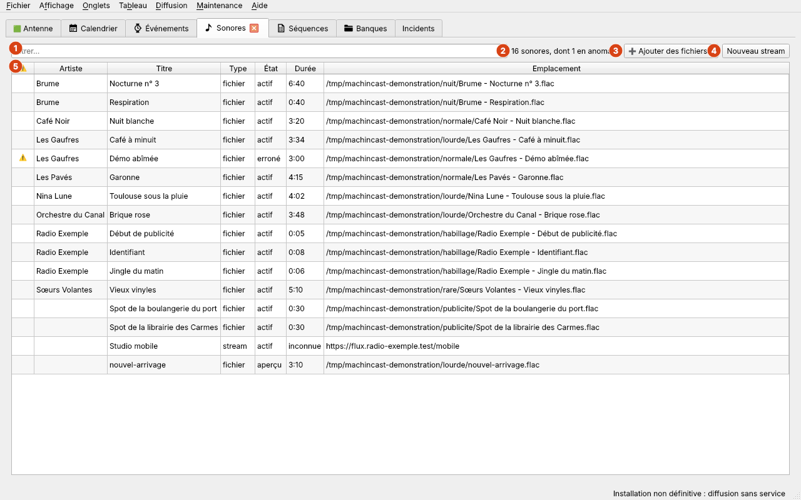

# Aide sur la liste des sonores

L'onglet Sonores donne tous les sonores en base, fichiers et streams, par artiste puis par titre.
Les numéros renvoient à l'image ; **Aide → Aide contextuelle**, ou <kbd>F1</kbd>, donne chacune de ces aides en infobulle, sur l'élément lui-même.

1. **Filtrer…** (`filter_`) : ne garde que les lignes dont une colonne contient le texte tapé, sans tenir compte des majuscules ni des accents.
2. **Compte** (`count`) : combien de lignes restent, sur combien.
3. **➕ Ajouter des fichiers…** (`add_files`) : ajoute des fichiers sonores comme nouveaux sonores en `aperçu`, vérifiés à la prochaine indexation ; on peut aussi les déposer sur la liste.
4. **Nouveau stream** (`new`) : ouvre une fiche vide ; rien n'est en base avant **Enregistrer**.
5. **Liste** (`table`) : ⚠️, artiste, titre, type, état, durée et emplacement ; une grande liste charge la suite en descendant. Le clic droit propose la pré-écoute, et des actions sur les sonores choisis. Un clic sur le titre d'une colonne trie, un double-clic ou <kbd>Entrée</kbd> ouvre la fiche, le clic droit sur les titres choisit les colonnes.

Pour aller plus loin : [Listes et actions](../listes.md#listes) et [Colonnes des tableaux](../listes.md#colonnes-des-tableaux).
