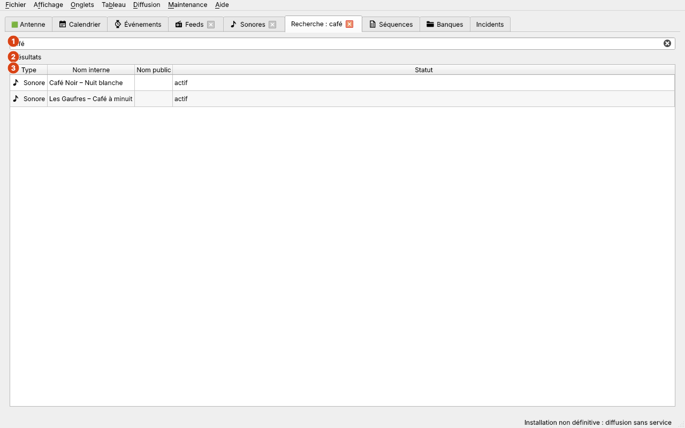

# Aide sur la recherche

La recherche trouve les événements, séquences, banques et sonores dont le nom, l'artiste ou le titre contient le texte tapé.
Les numéros renvoient à l'image ; **Aide → Aide contextuelle**, ou <kbd>F1</kbd>, donne chacune de ces aides en infobulle, sur l'élément lui-même.

1. **Champ de recherche** (`field`) : dès 2 caractères, sans tenir compte des majuscules ni des accents ; le texte devient le titre de l'onglet.
2. **Compte** (`count`) : combien il y a de résultats, ou les 500 premiers seulement, quand il y en a davantage.
3. **Résultats** (`table`) : leur type, nom interne, nom public et statut ; un double-clic ou <kbd>Entrée</kbd> ouvre la fiche, <kbd>Ctrl</kbd>+<kbd>C</kbd> copie les résultats choisis, à coller dans une banque, un événement ou une séquence.

Pour aller plus loin : [Rechercher](../prise-en-main.md#rechercher).
