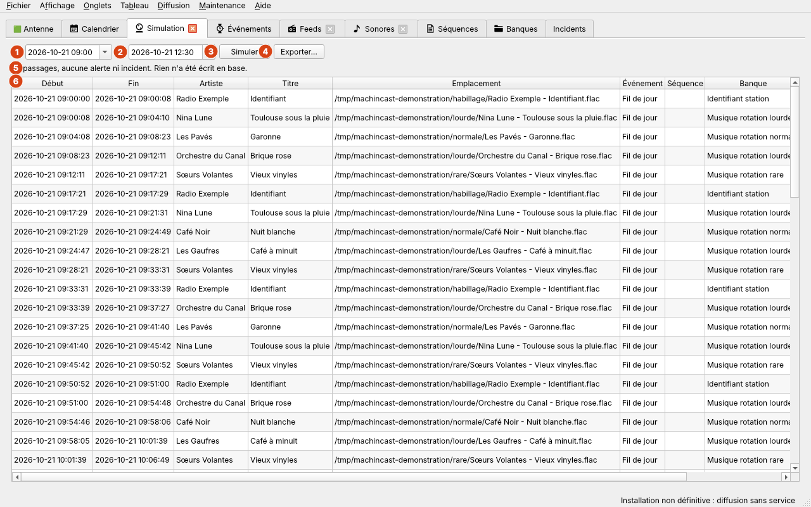

# Aide sur la simulation

La simulation montre ce que la diffusion jouerait sur une période, sans rien jouer et sans rien écrire en base.
Les numéros renvoient à l'image ; **Aide → Aide contextuelle**, ou <kbd>F1</kbd>, donne chacune de ces aides en infobulle, sur l'élément lui-même.

1. **Début** (`start`) : le début de la période, à la minute.
2. **Fin** (`end`) : la fin de la période, après son début.
3. **Simuler** (`simulate`) : rejoue la période selon les règles de la diffusion, à partir de l'historique réel ; chaque simulation tire au hasard.
4. **Exporter…** (`export`) : enregistre le résultat en tableur CSV, en playlist PLS ou en page HTML.
5. **Bilan** (`count`) : le nombre de passages, et celui des alertes et incidents simulés.
6. **Passages simulés** (`table`) : chacun avec son début, sa fin, son artiste, son titre, son fichier, son événement, sa séquence et sa banque.
7. **Alertes et incidents** (`anomalies`) : ce que la diffusion aurait noté, comme un blanc.

Pour aller plus loin : [Simulation](../grille.md#simulation).
