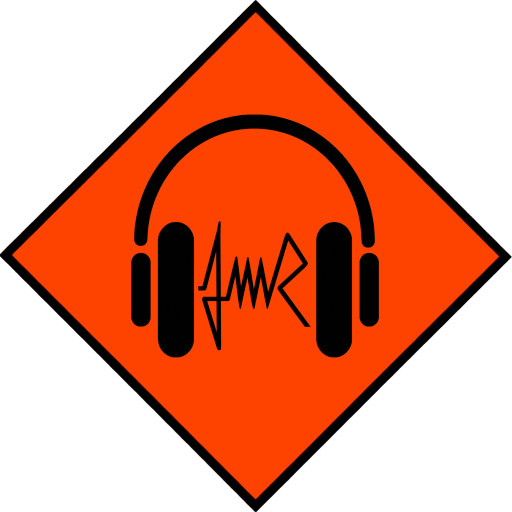
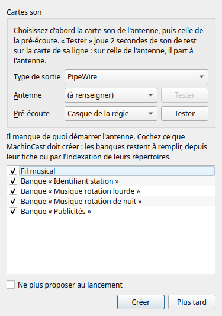
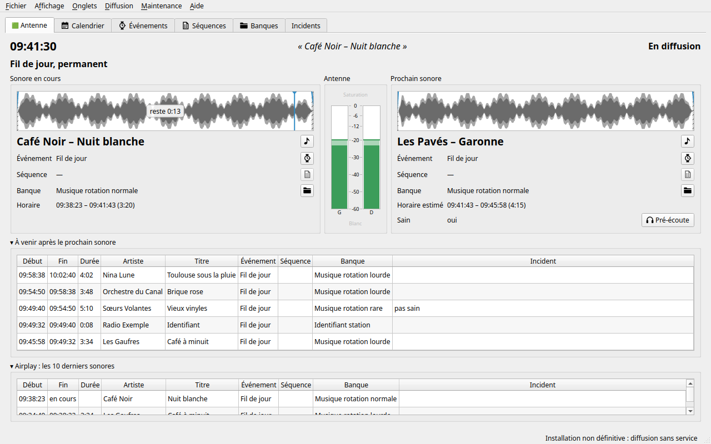
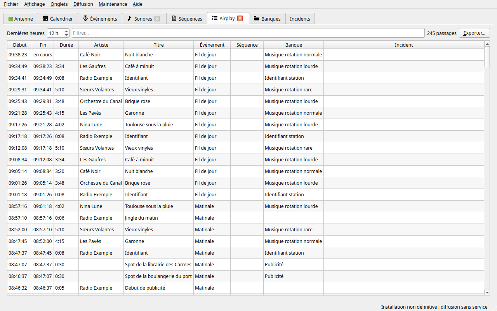
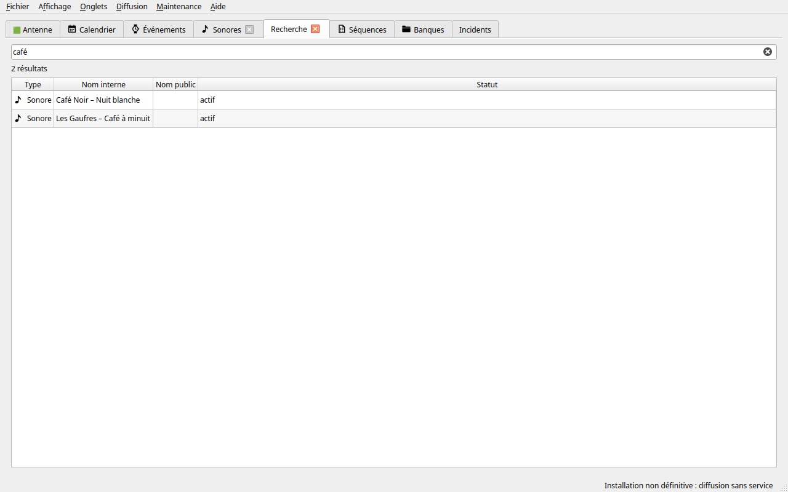
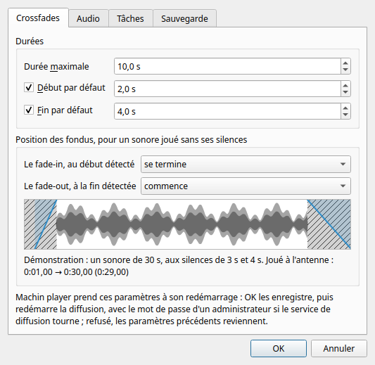
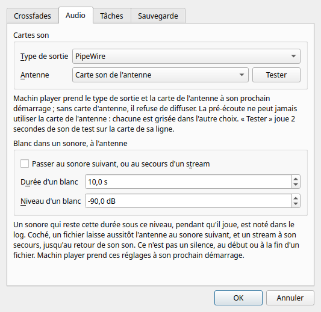
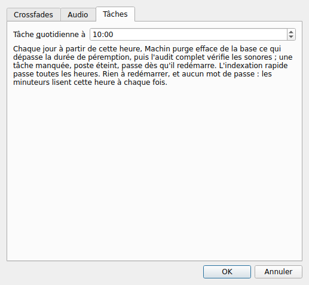

# Prendre en main l'interface

[Guide de l'antenne](README.md) › Prendre en main l'interface

- [La fenêtre](#la-fenêtre)
- [Pour bien démarrer](#pour-bien-démarrer)
- [Antenne](#antenne)
- [Onglet Airplay](#onglet-airplay)
- [Passer d'un onglet à l'autre](#passer-dun-onglet-à-lautre)
- [Menus](#menus)
- [Rafraîchir les onglets](#rafraîchir-les-onglets)
- [Rechercher](#rechercher)
- [Préférences](#préférences)
- [Textes saisis](#textes-saisis)

## La fenêtre

**Pour l'ouvrir**, choisir **MachinCast** dans le menu des applications, rubrique Multimédia, ou double-cliquer sur son icône, le panneau orange au casque des équipes techniques, sur le bureau quand l'installation l'y a déposée. Aucun terminal n'est nécessaire.

**Machin interface** s'ouvre sur une fenêtre à onglets, un par écran. Au lancement : **Antenne**, **Calendrier** (la grille d'antenne, [#307](https://github.com/dascritch/machincast/issues/307)), **Événements**, **Séquences**, **Banques** et **Incidents**. Les listes des **Sonores** et des **Feeds** s'ouvrent à la demande, par le menu **Affichage** : « Ouvrir l'onglet Sonores » et « Ouvrir l'onglet Feeds » ; « Ouvrir l'onglet Grille horaire » ramène le calendrier au premier plan. **Un onglet s'ouvre à droite de celui où l'on est** ([#405](https://github.com/dascritch/machincast/issues/405)) : une fiche à droite de sa liste, la recherche ou une liste à la demande à droite de l'onglet ouvert. Comme dans Firefox, plusieurs fiches ouvertes depuis une même liste se suivent dans l'ordre où on les a ouvertes ; un onglet déjà ouvert revient au premier plan, sans changer de place. **Les onglets se déplacent à la souris**, en les faisant glisser dans la barre, sauf l'onglet **Antenne**, qui reste le premier ; les raccourcis <kbd>Maj</kbd>+<kbd>F1</kbd> à <kbd>Maj</kbd>+<kbd>F12</kbd> et le menu **Onglets** suivent le nouvel ordre. Les onglets ouverts à la demande, et ceux des fiches, se ferment par leur croix ; une liste fermée puis rouverte retrouve son filtre et son tri. **Les onglets ouverts sont retenus** ([#321](https://github.com/dascritch/machincast/issues/321)) : en relançant l'interface, on retrouve ceux qu'on avait laissés, dans leur ordre, fiches et onglets déplacés compris, et l'onglet qui était devant. La fiche d'un élément supprimé depuis, ou une nouvelle fiche jamais enregistrée, ne revient pas. Chaque compte du poste retrouve les siens.

**Lignes alternées** ([#412](https://github.com/dascritch/machincast/issues/412)) : dans chaque tableau et chaque liste, une ligne sur deux a un fond un peu plus foncé (un peu plus clair en thème sombre), pour suivre une ligne d'un bout à l'autre. L'écart entre les deux fonds reste discret, et le texte garde sur l'un comme sur l'autre le contraste demandé par le RGAA.

**Icônes** : une même icône désigne partout un même genre, dans les onglets, le menu **Affichage**, la recherche, les relations d'un sonore et les boutons **Fiche…** de l'onglet Antenne ([#215](https://github.com/dascritch/machincast/issues/215)). Elles prennent la couleur du texte, en thème clair comme en thème sombre.

| Icône | Genre |
| --- | --- |
| une croche | Sonore |
| une feuille et sa liste à puces | Séquence |
| un dossier | Banque |
| une montre | Événement |
| un calendrier | Grille horaire (onglet « Calendrier ») |
| une boule de divination | Simulation |

**Sans base de données**, l'interface ne peut rien montrer : une fenêtre d'erreur, « MachinCast : base de données injoignable », l'explique, et son bouton « Ouvrir INSTALL.md » mène à la section [En cas de problème](../../../INSTALL.fr.md#en-cas-de-problème), pour l'administrateur du poste.

## Pour bien démarrer

Au lancement, l'interface cherche ce qui manque pour que l'antenne puisse tourner :

- un **fil musical**, l'événement qui tient l'antenne quand aucun autre ne la prend ;
- les banques **Identifiant station**, **Musique rotation lourde**, **Musique rotation normale**, **Musique rotation rare**, **Musique rotation de nuit**, **Partenariats**, **Publicités** et **Bande-annonce émissions**, reconnues à leur nom, sans tenir compte des majuscules ;
- sur une vraie sortie audio, la **carte son de l'antenne**, sans laquelle la diffusion ne démarre pas.

S'il en manque, la fenêtre **Pour bien démarrer** les propose, chacun coché :

- **Créer** crée ce qui est coché. Le fil musical est permanent. Les banques sont vides : elles se remplissent depuis leur [fiche](sonores.md#fiche-dune-banque), ou par l'indexation de leurs répertoires. L'identifiant station et les rotations musicales sont aléatoires ; les partenariats, les publicités et les bandes-annonces sont séquentiels, dans l'ordre de leurs sonores. « Identifiant station » et « Bande-annonce émissions » sont marquées « ne pas répéter ». Chacune a sa [durée maximale des sonores](sonores.md#fiche-dune-banque) : 15 minutes pour les rotations lourde, normale et rare, 2 minutes pour l'identifiant station, les partenariats, les publicités et les bandes-annonces ; ces trois dernières s'enchaînent sans crossfade, imposé à 0 seconde à leurs sonores ; la rotation de nuit n'en a pas. Tout cela se change dans leur fiche. Un fil musical encore vide reçoit une rotation type : Identifiant station, rotation lourde, normale, lourde, rare. La rotation de nuit reste à placer dans un événement de nuit. La barre d'état dit ce qui a été créé.
- Tant que la carte son de l'antenne manque, la fenêtre commence par les **cartes son**, comme dans les [préférences](#préférences), page **Audio** : le type de sortie, puis la carte de l'antenne et celle de la pré-écoute, chacune avec son bouton **Tester**. Une même carte ne sert jamais aux deux. S'il n'y a rien d'autre à créer, le bouton s'appelle **Enregistrer**. La diffusion prend la carte de l'antenne à son prochain démarrage (**Diffusion → Arrêter la diffusion**, puis **Démarrer la diffusion**).
- **Plus tard** ne crée et n'enregistre rien : la fenêtre revient au lancement suivant.
- **Ne plus proposer au lancement** éteint la fenêtre ; elle se rallume dans les [préférences](#préférences). Sans elle, l'interface recrée au lancement un fil musical vide s'il n'en existe aucun, et le dit dans la barre d'état.

Après la suppression ou l'enregistrement d'un événement, l'interface recrée toujours un fil musical s'il n'en reste aucun.

## Connexions à distance

Quand l'intranet est allumé ([#524](https://github.com/dascritch/machincast/issues/524)), quelqu'un qui s'y connecte d'un autre poste doit être validé au studio ([#539](https://github.com/dascritch/machincast/issues/539)) : un **bandeau orange** s'affiche au-dessus des onglets, avec son nom de compte, l'adresse et le navigateur de son poste, et l'heure limite. Si vous attendiez cette connexion, **Accepter** montre un **code à 6 chiffres** : donnez-le-lui, par téléphone par exemple, il le saisit sur son poste ([#547](https://github.com/dascritch/machincast/issues/547)). Si la première connexion est réglée sur **Validation au pupitre**, sans code, **Accepter** suffit : son navigateur entre de lui-même dans les secondes qui suivent ([#600](https://github.com/dascritch/machincast/issues/600)). Un navigateur validé est retenu : ses connexions suivantes ne passent plus par le studio, sauf si le second facteur est la **Validation au pupitre** ([#601](https://github.com/dascritch/machincast/issues/601)). Sinon, **Refuser** la ferme. Le bandeau disparaît dès que la connexion est validée, refusée ou trop vieille.

## Antenne

L'onglet **Antenne** montre en un coup d'œil ce qui passe et ce qui va passer ([#322](https://github.com/dascritch/machincast/issues/322)).

- **Le témoin de son titre** dit si la diffusion est installée pour de bon : **🟩 Antenne** tant que le service de diffusion n'est pas installé (un [poste d'essai](antenne.md#piloter-la-diffusion)), **🟥 Antenne** dès qu'il l'est, que la diffusion tourne ou non.
- **La couleur de l'état de la diffusion** dit, d'un coup d'œil, si l'on est à l'antenne pour de bon ou en essai ([#495](https://github.com/dascritch/machincast/issues/495)) : un liseré permanent **rouge** quand le service de diffusion est installé, **vert** sur un poste d'essai. `En diffusion` prend aussi ce fond, avec un texte blanc ou noir, le plus lisible des deux.
- **Le titre de la fenêtre**, dans la barre des tâches du bureau, dit « MachinCast », puis 🟥 ou 🟩 tant que la diffusion tourne, même pendant un blanc à l'antenne, ou ⛶ quand elle est à l'arrêt, et enfin le nom de la radio, le texte public de la configuration ; par exemple « MachinCast 🟥 Radio FMR ».
- **🔇 Diffusion arrêtée**, en permanence à droite de la dernière ligne de la fenêtre, tant que la diffusion ne tourne pas : rien ne part à l'antenne. Il disparaît dès qu'elle reprend.

- **En haut** : l'heure du poste, à la seconde (la date est dans son infobulle) ; le **texte public** du sonore en cours, tel que l'affiche la page publique de la radio (`—` sans texte, par exemple pour un sonore masqué) ; et l'état de la diffusion : `En diffusion`, `Blanc à l'antenne` (rien à diffuser) ou `À l'arrêt`.
- **Événement à l'antenne** : son nom et ses heures, « de 20:00 à 22:00 », « depuis 19:00 » pour une occurrence sans fin, ou « permanent » pour un fil musical.
- **Sonore en cours**, à gauche : l'artiste et le titre, l'événement qui le joue (« Continue, au nom de « Matinale » » quand le fil musical joue au nom d'une émission, [Fin de la liste](grille.md#fiche-dun-événement), [#399](https://github.com/dascritch/machincast/issues/399)), la séquence et la banque d'où il vient (`—` s'il n'en vient pas), l'horaire (début, fin prévue et durée, « 20:00:00 – 20:03:34 (3:34) »), et, pour un stream, son adresse. Pour un fichier, sa **frise** ([#230](https://github.com/dascritch/machincast/issues/230)), en tête, au-dessus du titre, à la hauteur de celle du prochain sonore : la forme d'onde, ses silences hachurés et ses fondus, tels que l'antenne les joue, règles de sa banque comprises, et la tête de lecture ; au milieu, le temps qui reste, « reste 3:05 ». C'est la frise de la [pré-écoute](sonores.md#frise-dun-fichier), qui ne fait ici que se regarder : un clic n'y déplace rien. Un stream a, à la place, une barre qui dit le temps qui reste, s'il est connu.
- **Prochain sonore**, à droite : les mêmes informations, avec l'horaire prévu et, pour un fichier, sa frise sans tête de lecture, et **Sain** : `oui` si son fichier est présent, actif, lisible, et que sa dernière lecture s'est passée sans incident ; `non` sinon. Sur la ligne **Sain**, **Pré-écoute** l'ouvre dans la [pré-écoute](sonores.md#pré-écoute), comme un clic sur sa frise ; pour un stream, **Tester la connexion du flux** dit dessous si du son arrive, de quel type et à quel débit ([#223](https://github.com/dascritch/machincast/issues/223)). Le prochain sonore annoncé est bien celui qui passera, même tiré au hasard : il ne change que si un événement coupe la diffusion, si son événement est fini, ou s'il est désactivé ou expiré entre-temps. Le clic droit sur son cadre propose sa pré-écoute, d'y sauter aussitôt, ou d'avancer l'événement suivant ([Depuis le prochain sonore](antenne.md#depuis-le-prochain-sonore)), puis son emplacement.
- **Coupure annoncée** : quand un événement commencera pendant le sonore en cours, il le coupera net. L'horaire finit alors à la coupure et nomme l'événement, « 20:00:00 – 20:02:00 (coupé par « Journal », sur 3:34) », le temps qui reste dit « reste 1:30 avant « Journal » », et le prochain sonore est celui que jouera cet événement.
- **Stream** : il passe jusqu'à la fin de son événement ; son horaire est « 19:00:00 – 20:00:00 (fin de l'événement) », avec le temps qui lui reste, et le prochain sonore est celui qui reprendra l'antenne à cette fin ([#242](https://github.com/dascritch/machincast/issues/242)). Sans fin d'événement, son horaire est « 20:00:00, durée inconnue ». Il n'est pas testé à l'avance : `non testé`.
- **Emplacement** ([#344](https://github.com/dascritch/machincast/issues/344)) : celui d'un fichier n'est plus montré. Le clic droit sur le sonore en cours propose d'abord **⏮ Revenir au début de ce sonore** et **⏮ Recommencer cet événement** ([Interrompre l'antenne](antenne.md#interrompre-lantenne), [#366](https://github.com/dascritch/machincast/issues/366)). Le clic droit sur le sonore en cours ou le prochain propose **Copier l'emplacement**, le chemin du fichier, à coller ailleurs, et **Ouvrir le dossier**, qui le montre dans le navigateur de fichiers. L'adresse d'un stream reste montrée, puisqu'elle compte quand le flux tombe : une longue adresse ne déborde pas, sa fin reste visible, et son infobulle la donne en entier ; le clic droit propose **Copier l'URL du feed**. Sous l'adresse du stream d'un feed en cours, **Mémoire tampon** montre ce qu'elle contient, « 1,2 s sur 2 s » ([#351](https://github.com/dascritch/machincast/issues/351)) : une barre qui se vide annonce un flux qui peine.
- **Boutons Fiche…** : à droite du titre, de l'événement, de la séquence et de la banque, ils ouvrent la fiche de l'élément.
- **Sonores : les 5 prochains, à l'antenne, et les 10 derniers** ([#228](https://github.com/dascritch/machincast/issues/228), [#617](https://github.com/dascritch/machincast/issues/617)) : un seul tableau, dans l'ordre du temps, le plus vieux en bas. De haut en bas : les 5 prochains sonores, le plus lointain en haut, jusqu'au prochain sonore annoncé ; le sonore à l'antenne, entouré d'un liseré rouge, ou les deux pendant un fondu ; puis les 10 derniers passés, du plus récent au plus ancien. Le tableau ne se trie pas : l'ordre du temps est le seul. Les colonnes : début et fin (prévus pour un sonore à venir, `en cours` pour celui à l'antenne), durée, artiste, titre, événement, séquence, banque, et dans la colonne « Incident », `oui` pour un passage qui en a eu un, `pas sain` pour un sonore à venir dont le fichier a posé problème. Comme le prochain, les sonores à venir passeront dans cet ordre, même tirés au hasard ; la liste avance d'un cran à chaque sonore, et elle est recalculée quand quelque chose d'imprévu arrive : une [interruption](antenne.md#interrompre-lantenne), un événement ajouté ou modifié dans la grille, un sonore désactivé. Elle s'arrête avant un blanc, ou après un stream dont la fin n'est pas connue. Un double-clic sur une ligne ouvre la fiche du sonore, de l'événement, de la séquence ou de la banque cliqué ; un clic droit propose la [pré-écoute](sonores.md#pré-écoute) du sonore, puis son emplacement, tel qu'il était au passage, même pour un sonore supprimé depuis : **Copier l'emplacement** et **Ouvrir le dossier** pour un fichier, **Copier l'URL du feed** pour un stream ([#344](https://github.com/dascritch/machincast/issues/344)). L'interface est réservée à l'équipe : l'artiste et le titre y sont toujours affichés, même masqués sur la page publique. Pour remonter plus loin, l'[onglet Airplay](#onglet-airplay).
- **Encart repliable** : un clic sur le titre « Sonores : les 5 prochains, à l'antenne, et les 10 derniers » replie l'encart (« ▸ »), ou le déplie (« ▾ »). Replié, il le reste aux prochaines ouvertures de l'interface.

L'onglet Antenne suit la diffusion en direct. Quand elle s'arrête, il affiche `À l'arrêt`, et la retrouve tout seul dès qu'elle reprend. Il doit tourner sur le poste de la diffusion : avec le compte de MachinCast, ou, quand le service de diffusion est installé, un compte du groupe `machincast` ([#381](https://github.com/dascritch/machincast/issues/381)) ; sinon il ne la voit pas.

### VU-mètre de l'antenne

Entre les deux sonores, la colonne **Antenne** montre ce qui sort réellement à l'antenne :

- **Saturation**, au-dessus : ce voyant s'allume, rouge, dès qu'une crête atteint -1 dB, et le reste 3 secondes. Il se cache dans les [préférences](#préférences).
- **VU-mètre** : une barre par canal, « G » et « D », de -60 dB en bas à 0 dB en haut, séparées par l'échelle. La partie pleine est le niveau moyen ; la partie plus claire au-dessus, la crête du moment ; un trait garde la plus haute crête pendant 2 secondes. Vert, orange au-delà de -12 dB, rouge au-delà de -3 dB.
- **Blanc**, en dessous : ce voyant s'allume, orange, quand le son reste à -50 dB ou moins pendant 5 secondes : un blanc à l'antenne. Il s'éteint dès que le son revient.
- **Écouter l'antenne** : un clic sur le VU-mètre, le bouton du casque, dans le cartouche **En diffusion**, absent quand la diffusion est à l'arrêt ([#531](https://github.com/dascritch/machincast/issues/531), [#604](https://github.com/dascritch/machincast/issues/604)), **Diffusion → Moniteur de l'antenne**, ou <kbd>Alt</kbd>+<kbd>P</kbd>, ouvrent le **moniteur de l'antenne** et l'écoutent aussitôt ([#245](https://github.com/dascritch/machincast/issues/245)) ; pendant l'écoute, l'entrée et le bouton deviennent **Arrêter le moniteur de l'antenne**, et <kbd>Alt</kbd>+<kbd>P</kbd> l'arrête aussi ([#256](https://github.com/dascritch/machincast/issues/256)). Le titre de la fenêtre, et sa ligne **Antenne**, donnent le texte public du sonore à l'antenne, et le suivent d'un sonore à l'autre. Le moniteur n'a ni lecture, ni pause, ni temps, ni **Début joué**, **Fin joué** et **Écouter comme à l'antenne** ([#604](https://github.com/dascritch/machincast/issues/604)) : à la place de la frise d'un sonore, il dessine à la volée la forme d'onde du direct, sur les trente dernières secondes.

Le VU-mètre écoute le périphérique de l'antenne, quel que soit le programme qui y joue. Quand il ne peut pas, toute sa zone, voyants compris, se grise ([#497](https://github.com/dascritch/machincast/issues/497)) : sa raison s'affiche en infobulle, en passant la souris sur le VU-mètre. Quand elle demande d'agir (sortie ALSA, périphérique de l'antenne à renseigner, compte hors du groupe `machincast`), la barre d'état l'annonce aussi, une fois. La zone se dégrise d'elle-même dès que l'écoute revient.

| Infobulle | Ce qu'il faut faire |
| --- | --- |
| `Indisponible avec la sortie ALSA, qui n'a pas de port de monitoring.` | Rien : le poste utilise une sortie qui ne permet pas d'écouter l'antenne. L'administrateur peut passer à PipeWire ou PulseAudio. |
| `Indisponible : périphérique de l'antenne à renseigner.` | Choisir le périphérique de l'antenne dans **Fichier → Paramètres du service…**, page **Audio**. |
| `Indisponible : le port de monitoring ne donne plus rien depuis 3 secondes.` | Rien : le son du poste ne donne plus l'antenne au VU-mètre, souvent au retour d'une session verrouillée ou d'un écran éteint ([#311](https://github.com/dascritch/machincast/issues/311)). Le VU-mètre ne garde pas ses derniers niveaux : il se vide, puis réessaie toutes les 5 secondes, et reprend tout seul. |
| `En pause : session verrouillée ou économiseur d'écran actif.` | Rien : personne ne regarde le VU-mètre pendant que l'écran est verrouillé ou éteint, alors il ne mesure plus rien ([#346](https://github.com/dascritch/machincast/issues/346)). Il repart tout seul au déverrouillage. La diffusion, elle, continue normalement. |
| `Indisponible : le port de monitoring précédent ne s'est pas encore fermé.` | Rien : le son du poste tarde à répondre, souvent au retour d'une session verrouillée. Le VU-mètre attend qu'il réponde, réessaie toutes les 5 secondes, et reprend tout seul. |
| `Indisponible : le PipeWire du service de diffusion ne répond pas (…) ; …` | Sur l'ordinateur de l'antenne, votre compte n'entend pas encore le service de diffusion ([#381](https://github.com/dascritch/machincast/issues/381)) : fermer la session, puis la rouvrir, après l'installation du service ; sinon, demander à l'administrateur d'ajouter votre compte au groupe `machincast`. |
| `Indisponible :` suivi d'une erreur | Le périphérique est débranché, ou le son du poste ne répond pas. Le VU-mètre réessaie toutes les 5 secondes. |

## Onglet Airplay

**Affichage → Ouvrir l'onglet Airplay** ouvre l'historique de diffusion dans un onglet à part ([#244](https://github.com/dascritch/machincast/issues/244)), fermé au lancement de l'interface ; sa croix le ferme.

- **Dernières heures**, en haut : combien d'heures remonter, 12 par défaut, jusqu'à un mois. Le réglage est retenu pour les prochaines ouvertures.
- **La table** a les mêmes colonnes que l'airplay de l'onglet Antenne, et s'utilise de même : double-clic vers les fiches, clic droit pour la [pré-écoute](sonores.md#pré-écoute). Elle se met à jour à chaque nouveau sonore à l'antenne.
- **Filtrer…**, en haut ([#393](https://github.com/dascritch/machincast/issues/393)) : ne garde que les passages dont une colonne contient le texte tapé, sans tenir compte des majuscules ni des accents : « cafe » trouve « Café à minuit ». Le compte, à côté, dit combien de passages sont montrés, sur combien. La croix du champ le vide.
- **Trier** : un clic sur le titre d'une colonne trie la table selon elle, un second clic inverse l'ordre. Le début et la fin se trient dans l'ordre du temps, même d'un jour à l'autre, la durée dans l'ordre des durées, le passage en cours avant les autres. À l'ouverture, la table va du plus récent au plus ancien.
- **Exporter…** enregistre ce que montre l'onglet, au format choisi dans la fenêtre d'enregistrement : **Tableur CSV**, **Page HTML** ou **Liste de lecture M3U**. Chaque export donne à la fois l'artiste, le titre et l'emplacement du fichier, et le **texte public**, tel que la page publique de la radio l'affiche, masquage compris. La liste M3U va du plus ancien au plus récent, et se lit dans un lecteur ; le texte public y est en commentaire. Le nom reçoit l'extension du format : un export ne remplace jamais un fichier sonore. La barre d'état dit où il est enregistré.

## Passer d'un onglet à l'autre

Les 12 premiers onglets s'ouvrent au clavier, par <kbd>Maj</kbd>+<kbd>F1</kbd> à <kbd>Maj</kbd>+<kbd>F12</kbd>, selon leur rang : <kbd>Maj</kbd>+<kbd>F1</kbd> est toujours l'onglet Antenne ; au lancement, <kbd>Maj</kbd>+<kbd>F2</kbd> mène au Calendrier, <kbd>Maj</kbd>+<kbd>F3</kbd> à <kbd>Maj</kbd>+<kbd>F5</kbd> aux Événements, Séquences et Banques, <kbd>Maj</kbd>+<kbd>F6</kbd> aux Incidents, puis aux fiches et aux autres onglets, dans l'ordre où ils sont ouverts. Ouvrir ou fermer un onglet décale ceux qui le suivent. L'infobulle de chaque onglet donne son raccourci. Un titre de plus de 40 caractères est coupé, et finit par « … » : son infobulle le donne en entier ([#398](https://github.com/dascritch/machincast/issues/398)). Le menu **Onglets** liste tous les onglets ouverts, avec leur titre entier et leur raccourci ; l'onglet ouvert y est coché, et choisir une entrée y mène.

De proche en proche ([#318](https://github.com/dascritch/machincast/issues/318)), où que soit le curseur, dans un tableau ou un champ de texte compris :

| Raccourci | Onglet |
| --- | --- |
| <kbd>Ctrl</kbd>+<kbd>PageUp</kbd> | Celui de gauche ; sur l'onglet Antenne, rien. |
| <kbd>Ctrl</kbd>+<kbd>PageDown</kbd> | Celui de droite ; sur le dernier, rien. |
| <kbd>Ctrl</kbd>+<kbd>Home</kbd> | Le premier, l'onglet Antenne. |
| <kbd>Ctrl</kbd>+<kbd>End</kbd> | Le dernier. |

Sur l'onglet ouvert ([#428](https://github.com/dascritch/machincast/issues/428)) :

| Raccourci | Effet |
| --- | --- |
| <kbd>Ctrl</kbd>+<kbd>W</kbd> | Le ferme, comme sa croix, s'il se ferme : une fiche, les listes Sonores et Feeds, la recherche, la simulation, l'airplay. Une fiche modifiée demande d'abord quoi faire de ses modifications. Sur un onglet fixe, rien. |
| <kbd>Ctrl</kbd>+<kbd>S</kbd> | Enregistre la fiche, qui reste ouverte. Sur une fiche sans modification, ou un autre onglet, rien. |
| <kbd>Ctrl</kbd>+<kbd>Entrée</kbd> | Enregistre la fiche, puis la ferme, comme son bouton **Enregistrer** ; une fiche sans modification se ferme simplement. Une fiche que MachinCast refuse d'enregistrer reste ouverte, et dit pourquoi. Les deux touches Entrée, celle du clavier et celle du pavé numérique, conviennent. Sur un autre onglet, rien. |
| <kbd>Ctrl</kbd>+<kbd>Échap</kbd> | Ferme la fiche sans rien enregistrer ni rien demander : ses modifications sont perdues ([#529](https://github.com/dascritch/machincast/issues/529)). Sur un autre onglet, rien. Sous KDE Plasma, ce raccourci ouvre d'ordinaire l'activité du système : il faut alors le libérer dans les raccourcis de Plasma. |
| <kbd>Ctrl</kbd>+<kbd>Maj</kbd>+<kbd>T</kbd> | Rouvre le dernier onglet fermé, puis celui d'avant, à droite de l'onglet ouvert. |

**Retrouver un raccourci** ([#529](https://github.com/dascritch/machincast/issues/529)) : maintenez <kbd>Ctrl</kbd>, ou <kbd>Alt</kbd>, une seconde. Les raccourcis qui commencent par cette touche s'affichent par-dessus la fenêtre : sur les boutons, comme <kbd>Ctrl</kbd>+<kbd>S</kbd> et <kbd>Ctrl</kbd>+<kbd>Entrée</kbd> sur **Enregistrer** d'une fiche, et ceux des menus dans un encart, en bas à droite. Ils disparaissent dès qu'on relâche la touche ou qu'on en presse une autre.

## Menus

Une fonction pas encore écrite a déjà son entrée, grisée : son infobulle donne le ticket qui l'apportera.

| Menu | Entrée | Rôle |
| --- | --- | --- |
| Fichier | Préférences de l'interface… | Ce qui vaut aussitôt, sans toucher la diffusion ([Préférences](#préférences)). |
| Fichier | Paramètres du service… | Ce que Machin player prend à son redémarrage : OK redémarre la diffusion ([Préférences](#préférences)). |
| Fichier | Quitter | Ferme l'interface, aussi par <kbd>Alt</kbd>+<kbd>Q</kbd>. Demande d'abord quoi faire des fiches modifiées. La diffusion, elle, continue. |
| Affichage | Rechercher… | Ouvre une nouvelle recherche, aussi par <kbd>Ctrl</kbd>+<kbd>F</kbd> ([Rechercher](#rechercher)). |
| Affichage | Ouvrir l'onglet Sonores, Ouvrir l'onglet Feeds | Ouvrent ces listes, ou les ramènent au premier plan ([Listes](listes.md#listes)). |
| Affichage | Ouvrir l'onglet Grille horaire | Ramène au premier plan le calendrier, toujours ouvert après l'onglet Antenne ([Calendrier](grille.md#calendrier)). |
| Affichage | Ouvrir l'onglet Simulation | Ouvre la simulation ([Simulation](grille.md#simulation)). |
| Affichage | Ouvrir l'onglet Airplay | Ouvre l'historique de diffusion, réglable et exportable ([Onglet Airplay](#onglet-airplay)). |
| Affichage | Ouvrir l'onglet API | Ouvre les comptes de l'intranet et de l'API ([#537](https://github.com/dascritch/machincast/issues/537)) : les créer, changer leur rôle et leur mot de passe, les désactiver, les supprimer, voir et couper leurs sessions ([Comptes de l'intranet](../administration/configuration.md#comptes-de-lintranet)). |
| Affichage | Pré-écoute… | Ouvre la fenêtre de pré-écoute ([Pré-écoute](sonores.md#pré-écoute)). Comme chaque bouton et chaque entrée de pré-écoute, elle porte un casque. |
| Affichage | Rouvrir l'onglet fermé | Rouvre le dernier onglet fermé, aussi par <kbd>Ctrl</kbd>+<kbd>Maj</kbd>+<kbd>T</kbd> ; inactive tant qu'aucun onglet n'a été fermé ([#428](https://github.com/dascritch/machincast/issues/428)). |
| Affichage | Onglets fermés récemment | Les 5 derniers onglets fermés, le plus récent en tête : choisir l'un d'eux le rouvre. La fiche d'un élément supprimé, ou pas encore enregistrée, n'y est pas. |
| Onglets | Un onglet ouvert par entrée | Mène à l'onglet ; l'onglet ouvert est coché, et chaque entrée donne le titre entier et le raccourci ([#398](https://github.com/dascritch/machincast/issues/398)). |
| Onglets | Fermer tous les onglets fermables, à la fin | Ferme les fiches, les listes Sonores et Feeds, la recherche, la simulation et l'airplay, jamais les onglets fixes ; une fiche modifiée demande quoi faire de ses modifications, et **Annuler** laisse ouverts elle et les onglets qui la suivent ([#405](https://github.com/dascritch/machincast/issues/405)). |
| Tableau | Copier des lignes, Couper des lignes, Coller des lignes | Agissent sur le tableau de l'onglet affiché, comme <kbd>Ctrl</kbd>+<kbd>C</kbd>, <kbd>Ctrl</kbd>+<kbd>X</kbd> et <kbd>Ctrl</kbd>+<kbd>V</kbd> dans ce tableau ([#528](https://github.com/dascritch/machincast/issues/528)). Couper et coller ne servent qu'aux listes qui se modifient : les éléments d'un événement ou d'une séquence, les sonores d'une banque. Un onglet sans tableau, comme le calendrier, ne propose rien. |
| Tableau | Exporter des lignes…, Rétablir les colonnes | Exporte le tableau de l'onglet affiché, ou lui rend ses colonnes d'origine, comme le clic droit sur le tableau et sur ses titres. |
| Diffusion | Moniteur de l'antenne, Arrêter le moniteur de l'antenne | En tête du menu : écoute aussitôt l'antenne sur la sortie de pré-écoute ([Pré-écoute](sonores.md#pré-écoute), [#245](https://github.com/dascritch/machincast/issues/245)), puis, pendant l'écoute, l'arrête ; aussi par <kbd>Alt</kbd>+<kbd>P</kbd> ([#256](https://github.com/dascritch/machincast/issues/256)). |
| Diffusion | Démarrer la diffusion, ou Arrêter la diffusion | Pilotent la diffusion ([Piloter la diffusion](antenne.md#piloter-la-diffusion)) ; seule l'entrée qui sert est montrée ([#530](https://github.com/dascritch/machincast/issues/530)). |
| Diffusion | Recommencer › ce sonore, cette séquence, cet événement | Reprennent un début raté ([Interrompre l'antenne](antenne.md#interrompre-lantenne), [#366](https://github.com/dascritch/machincast/issues/366), [#530](https://github.com/dascritch/machincast/issues/530)). |
| Diffusion | Sauter › au sonore suivant, après cette séquence | Corrigent l'antenne sans attendre ([Interrompre l'antenne](antenne.md#interrompre-lantenne)). |
| Diffusion | Insérer après ce sonore › une séquence, un sonore d'une banque | Font passer, après le sonore en cours, une séquence ou un sonore d'une banque ([#530](https://github.com/dascritch/machincast/issues/530)). |
| Diffusion | Couper › cet événement par un fil musical, par un secours | Rendent l'antenne au fil musical ou à un secours ([Interrompre l'antenne](antenne.md#interrompre-lantenne)). |
| Maintenance | Indexation rapide, Audit complet | Vérifient les sonores ([Indexation depuis l'interface](sonores.md#indexation-depuis-linterface)). Les deux peuvent tourner ensemble ; chacune est inactive tant qu'elle tourne. |
| Maintenance | Statut des indexations… | Où en sont les indexations : répertoires scannés et à scanner, sonores détectés, indexés sommairement ou complètement, en nombres et en camemberts ([Statut des indexations](sonores.md#statut-des-indexations)). |
| Maintenance | Maintenance de la base de données… | Après confirmation, sauvegarde, vérifie et optimise la base, dans une fenêtre de terminal, qui reste ouverte à la fin : la fermer une fois le compte rendu lu. La question donne le répertoire où la sauvegarde sera enregistrée, et « Choisir l'emplacement… » en propose un autre ; Entrée ou Échap l'annulent. Inactive pendant une indexation. Voir le [guide d'administration](../administration/commandes.md#maintenance-de-la-base--machin-maintenance-db). |
| Maintenance | Exporter la base… | Enregistre une sauvegarde de la base, sans rien demander ni rien changer, dans le répertoire des sauvegardes (page **Sauvegarde** des paramètres du service) ; la barre d'état dit où, ou pourquoi elle n'a pas pu. Inactive le temps de l'export. Sur un ordinateur neuf, l'installation propose de reprendre cette sauvegarde ([#347](https://github.com/dascritch/machincast/issues/347), [guide d'administration](../administration/commandes.md#export-et-réimportation-de-la-base--machin-backup-db-machin-restore-db)). |
| Maintenance | Donner les droits de lecture des fichiers sonores au service de diffusion… | Donne au service la lecture des sonores de toutes les banques, sans rien changer d'autre sur les fichiers ([Ajouter un sonore](sonores.md#ajouter-un-sonore), [#381](https://github.com/dascritch/machincast/issues/381)). Inactive tant que le service de diffusion n'est pas installé. |
| Maintenance | Espace disque… | Ouvre une fenêtre qui dit où il reste de la place pour déposer des sonores ([#533](https://github.com/dascritch/machincast/issues/533)) : les disques où la diffusion peut lire un sonore, avec leur espace libre et leur taille, puis chaque répertoire indexé par une banque, avec sa banque, ce qu'il occupe, compté pendant que la fenêtre est ouverte, et l'espace libre de son disque. Un double-clic sur un répertoire l'ouvre dans le gestionnaire de fichiers. |
| Maintenance | Moniteur de la sortie… | À venir ([#85](https://github.com/dascritch/machincast/issues/85)). |
| Aide | Aide sur … | Nommée d'après l'onglet affiché, comme **Aide sur la liste des banques** : ouvre la page d'aide de cet onglet dans le navigateur web, avec son image annotée, dont les numéros renvoient à chaque élément de l'écran ([#534](https://github.com/dascritch/machincast/issues/534)). Les [pages d'aide](aide/antenne.md) sont aussi dans ce guide. |
| Aide | Aide contextuelle | <kbd>F1</kbd> : survoler un élément de l'onglet affiché montre son aide en infobulle, et cliquer dessus la garde ouverte, sans agir. L'entrée devient alors **Désactiver l'aide contextuelle**, et <kbd>F1</kbd> la désactive. |
| Aide | Documentation | Ouvre ce guide dans le navigateur web. |
| Aide | Votre installation… | Ouvre le document de votre équipe, à compléter : qui appeler en cas de souci sur l'ordinateur, l'antenne ou l'émetteur, la programmation musicale, les partenariats, les publicités, les émissions enregistrées et les directs extérieurs ([#451](https://github.com/dascritch/machincast/issues/451)). Il est sur le Bureau, sauf s'il a été placé ailleurs (page **Interface** des préférences) ; s'il a disparu, il est recréé depuis le modèle, jamais par-dessus le vôtre. Il s'ouvre toujours dans un éditeur de texte : Kate, KWrite, l'Éditeur de texte de GNOME, gedit, Mousepad, Xed, Pluma ou FeatherPad, le premier présent, sinon l'éditeur que le bureau associe aux fichiers texte, jamais une visionneuse comme Okular ([#491](https://github.com/dascritch/machincast/issues/491)) ; sans aucun, la barre d'état le dit, et donne le chemin du document. |
| Aide | Lien de l'équipe… | Ouvre dans le navigateur l'adresse de votre équipe : un cloud, un Gitlab, un Jira, un Drive… Grisée tant qu'aucune adresse n'est donnée, page **Interface** des préférences. |
| Aide | Signaler un problème… | Ouvre les tickets de MachinCast dans le navigateur web. |
| Aide | Version | Donne la version de MachinCast, sa date de publication ou de sa dernière modification, et les nouveautés de la version ([#208](https://github.com/dascritch/machincast/issues/208)), avec trois liens : **Code**, le dépôt de MachinCast, **Auteur : DaScritch** et **Pour : &lt;FMR&gt;**, la radio ([#332](https://github.com/dascritch/machincast/issues/332)). |

**Nouveautés.** Au premier lancement d'une nouvelle version de MachinCast, une fenêtre en donne les nouveautés ([#208](https://github.com/dascritch/machincast/issues/208)), dans la langue de la session : en français, ou en anglais pour une autre langue ([#369](https://github.com/dascritch/machincast/issues/369)). Elle ne revient pas aux lancements suivants ; **Aide → Version** les redonne quand on veut.

## Rafraîchir les onglets

Chaque onglet relit la base quand on y passe ([#241](https://github.com/dascritch/machincast/issues/241)) : une liste, les incidents, le calendrier, la recherche, l'airplay, l'onglet Antenne, et une fiche, sauf si on est en train de la modifier. Une fiche modifiée reste telle quelle, sans question ; une fiche dont l'élément a été effacé depuis un autre poste se ferme, et la barre d'état le dit. Pendant qu'un onglet reste affiché, ce qu'un autre poste, l'indexation ou la diffusion changent n'apparaît pas tout seul. <kbd>F5</kbd> relit tout d'un coup, sans entrée de menu ([#532](https://github.com/dascritch/machincast/issues/532)) :

- l'onglet ouvert : une liste, les incidents, le calendrier, la recherche ou l'airplay ;
- l'airplay de l'onglet Antenne ;
- toutes les fiches ouvertes. Une fiche modifiée demande d'abord quoi faire de ses modifications : **Enregistrer** les écrit puis relit la fiche, **Abandonner** les perd et relit la fiche, **Annuler** la laisse telle quelle.
- La fiche d'un élément effacé depuis un autre poste se ferme, sans question.

La barre d'état le confirme, « Onglets rafraîchis. », et nomme les fiches laissées telles quelles ou fermées.

## Rechercher

**Affichage → Rechercher…**, ou <kbd>Ctrl</kbd>+<kbd>F</kbd>, ouvre un nouvel onglet **Recherche**, le curseur dans le champ. Plusieurs recherches peuvent être ouvertes à la fois ([#502](https://github.com/dascritch/machincast/issues/502)), pour remplir une banque à partir de plusieurs termes par exemple. Chaque onglet prend le texte cherché pour titre, comme **Recherche : jingle**. Sur une recherche encore vide, <kbd>Ctrl</kbd>+<kbd>F</kbd> n'en ouvre pas d'autre : le curseur y va seulement.

Une recherche fermée par erreur se rouvre avec son texte et ses résultats, par <kbd>Ctrl</kbd>+<kbd>Maj</kbd>+<kbd>T</kbd> ou **Affichage → Onglets fermés récemment**. Les recherches ouvertes à la fermeture de l'interface se rouvrent de même au lancement suivant.

Dès 2 caractères, sans tenir compte des majuscules ni des accents, le texte tapé est cherché dans le nom interne et le nom public des **événements**, des **séquences** et des **banques**, et dans l'artiste et le titre des **sonores**. La table suit la frappe : jusqu'à 500 résultats, avec leur type, nom interne, nom public et statut (l'état d'un sonore), dans l'ordre événements, séquences, banques, puis sonores. Un double-clic ou <kbd>Entrée</kbd> sur une ligne ouvre sa fiche. Le compte dit combien il y a de résultats, ou « 500 premiers résultats sur … » quand il y en a davantage : préciser alors le texte.

**Copier des résultats** ([#129](https://github.com/dascritch/machincast/issues/129)) : plusieurs résultats se choisissent avec <kbd>Ctrl</kbd> ou <kbd>Maj</kbd> ; <kbd>Ctrl</kbd>+<kbd>C</kbd>, ou **Copier** au clic droit, les copie, puis <kbd>Ctrl</kbd>+<kbd>V</kbd> les colle dans une [banque](sonores.md#fiche-dune-banque), un [événement](grille.md#fiche-dun-événement) ou une [séquence](grille.md#fiche-dune-séquence). Chacune ne prend que ce qu'elle peut contenir parmi les résultats choisis : une banque, seulement les sonores ; un événement, les sonores, banques et séquences. Ce qui est laissé de côté, un événement par exemple, est dit en haut de la fiche.

## Préférences

Le menu **Fichier** ouvre deux fenêtres ([#389](https://github.com/dascritch/machincast/issues/389)) :

- **Préférences de l'interface…** : ce qui vaut aussitôt, sans toucher la diffusion. La granularité des crossfades et le seuil de silence (page **Crossfades et silences**), la carte de pré-écoute (page **Audio**), la durée de péremption (page **Base**) et la page **Interface**.
- **Paramètres du service…** : ce que Machin player ne prend qu'à son redémarrage. Avec le service de diffusion installé, la fenêtre demande d'abord le mot de passe d'un administrateur, le vôtre si vous l'êtes ; sans lui, elle s'ouvre en consultation : tout s'y lit, rien ne s'y règle, et seul **Fermer** reste ([#603](https://github.com/dascritch/machincast/issues/603)). Les durées des crossfades et la position des fondus (page **Crossfades**), le type de sortie, la carte de l'antenne et le blanc dans un sonore (page **Audio**), et, sans redémarrage, l'heure de la tâche quotidienne (page **Tâches**) et les sauvegardes (page **Sauvegarde**). Page **Audio**, sous les cartes, la case **Cartes son toujours éveillées** ([#532](https://github.com/dascritch/machincast/issues/532)) agit aussitôt, sans attendre **OK** : cochée, les cartes son du poste ne passent plus en économie d'énergie, qui coupe ou fait claquer l'antenne à leur réveil ([#499](https://github.com/dascritch/machincast/issues/499)), les cartes intégrées comme les cartes USB. Sur un poste d'essai, la cocher les règle, ou la décocher défait ces réglages, avec le mot de passe d'un administrateur ; l'économie d'énergie revient au prochain redémarrage. Ce qui est fait s'écrit sous la case. Avec le service de diffusion, `install.sh --service` les règle : la case est alors inactive. **OK** les enregistre, puis, si les crossfades, la sortie, la carte de l'antenne ou le blanc ont changé, redémarre la diffusion : avec le service de diffusion en marche, le poste demande le mot de passe d'un administrateur. S'il est refusé, ou si le redémarrage échoue, les paramètres précédents reviennent, dans le fichier comme dans l'interface, et la barre d'état le dit. Service arrêté, ou sans service, ils valent au prochain démarrage de Machin player.

Page **Audio** des **Paramètres du service**, le bloc **Entrées audio** ([#622](https://github.com/dascritch/machincast/issues/622)) liste les entrées de carte son que MachinCast peut passer à l'antenne, un studio de production par exemple. Choisir une entrée du poste, **Ajouter cette entrée**, puis la nommer dans la colonne **Nom** ; **Retirer l'entrée** la retire. Chaque entrée demande un nom, différent des autres : sinon, **OK** reste inactif et le bloc dit pourquoi. Une entrée que le poste ne voit plus reste dans la liste, marquée « (introuvable) ». Avec le service de diffusion installé, **OK** réserve aussitôt les entrées au service, avec le mot de passe d'un administrateur : le réglage du son de la session ne les montre plus, comme la carte de l'antenne. La barre d'état dit si elles sont réservées.

Page **Crossfades** ([#234](https://github.com/dascritch/machincast/issues/234)) :

| Réglage | Rôle |
| --- | --- |
| Granularité | `Au dixième de seconde` (par défaut) ou `À la seconde` : le pas des crossfades dans les fiches. |
| Durée maximale | Le crossfade le plus long que proposent les fiches, 10 secondes par défaut. |
| Début par défaut, fin par défaut | Le crossfade d'un sonore qui n'en a pas, et que sa banque ne règle pas ([Enchaînements](antenne.md#enchaînements)). |
| Le fade-in, au début détecté | Pour un sonore joué sans ses silences : le fade-in `commence`, `est en cours` ou `se termine` (par défaut) au début détecté ([Silences au début et à la fin](antenne.md#silences-au-début-et-à-la-fin)). |
| Le fade-out, à la fin détectée | De même, à la fin détectée : `commence` (par défaut), `est en cours` ou `se termine`. |
| Seuil de silence | De -100 à -0,1 dB, -40 dB par défaut : le niveau sous lequel le début et la fin d'un sonore sont un silence, mesuré par l'audit complet, et autour duquel se placent les fondus ([#324](https://github.com/dascritch/machincast/issues/324), [Silences au début et à la fin](antenne.md#silences-au-début-et-à-la-fin)). Le changer lance aussitôt un **audit complet**, dans sa propre fenêtre, pour remesurer les silences ; si un audit complet tourne déjà, la barre d'état demande de le relancer à sa fin. |

Sous ces réglages, une **frise de démonstration** montre un sonore inventé de 30 secondes, aux silences de 3 et 4 secondes : ses fondus s'y placent selon les durées par défaut saisies et les positions choisies, à chaque changement.

Page **Interface** :

| Réglage | Rôle |
| --- | --- |
| Afficher le voyant de saturation de l'onglet Antenne | Cochée par défaut ; décochée, le voyant « Saturation » disparaît du [VU-mètre](#vu-mètre-de-lantenne). |
| Proposer au lancement ce qui manque pour démarrer | Cochée par défaut : la fenêtre [Pour bien démarrer](#pour-bien-démarrer). |
| Icône de l'application | L'icône des fenêtres de MachinCast, de son raccourci dans le menu des applications et sur le bureau, et de la barre des tâches. **Choisir une image…** en prend une autre, SVG, PNG ou JPEG, de préférence carrée, le logo de la radio par exemple ; **Icône de MachinCast** revient à celle d'origine. Une image illisible n'est pas prise : `Image illisible : …`. La nouvelle icône vaut dès **OK**. |
| Lignes chargées à la fois | 1 000 par défaut, 100 au moins : les sonores qu'une fiche de banque, les éléments qu'une fiche de séquence ou d'événement, ou les lignes que la liste des Sonores, montre d'abord, et ceux qu'elle charge de plus chaque fois qu'on arrive au bas de sa liste ([#383](https://github.com/dascritch/machincast/issues/383)). Un nombre plus grand peut fortement ralentir l'interface pour une banque qui a un très grand nombre de sonores. Vaut pour les fiches ouvertes ensuite. |

**Votre installation**, sur la même page ([#451](https://github.com/dascritch/machincast/issues/451)) : le **document** que **Aide → Votre installation…** ouvre, celui du Bureau quand le champ est vide, ou un autre choisi par **Choisir le document…** ; et le **lien de l'équipe**, une adresse qui commence par `http://` ou `https://`, que **Aide → Lien de l'équipe…** ouvre. **OK** reste grisé tant que le lien n'est pas une adresse web.

Page **Audio** :

| Réglage | Rôle |
| --- | --- |
| Type de sortie | Le système de son de l'ordinateur : PipeWire, celui d'Ubuntu, sauf avis contraire de l'administrateur. En changer refait la liste des cartes son : la carte de l'antenne est alors à choisir de nouveau. |
| Antenne | La carte son de la diffusion. Tant qu'elle n'est pas choisie, la barre d'état affiche `Périphérique de l'antenne à renseigner`, et la diffusion refuse de démarrer. La nouvelle carte vaut au prochain démarrage de la diffusion. **Sortie factice** ne joue aucun son : pour essayer MachinCast sur un ordinateur qui n'est pas encore celui de l'antenne ; elle est grisée sur l'ordinateur de l'antenne. Pendant la diffusion de l'ordinateur de l'antenne, la carte de l'antenne ne se change pas : son choix est grisé, et son infobulle dit d'arrêter d'abord la diffusion, par le menu **Diffusion**. Sur l'ordinateur de l'antenne, la liste est celle des cartes du service de diffusion, qui joue sous son propre compte : sa carte n'apparaît plus dans le réglage du son de votre session, ni dans la liste de la pré-écoute ([#381](https://github.com/dascritch/machincast/issues/381)). Après un changement de carte, l'administrateur relance `./install.sh --service`. |
| **Niveau de l'antenne** et **Muet** | Sur l'ordinateur de l'antenne seulement : le niveau de sortie de la carte de l'antenne, de 0 à 100 %, et sa sourdine, réglés dans le PipeWire du service de diffusion, comme si vous étiez son compte ([#381](https://github.com/dascritch/machincast/issues/381)) ; le réglage du son de votre session ne voit plus cette carte. Ils changent aussitôt, sans attendre **OK**, et ne s'écrivent pas dans `machincast.toml`. Indisponibles, leur infobulle dit pourquoi, par exemple quand le service est arrêté. |
| Pré-écoute | La carte son de la [pré-écoute](sonores.md#pré-écoute), le casque de la régie par exemple. L'antenne et la pré-écoute n'utilisent jamais la même : celle de l'une est grisée dans l'autre. **Sortie factice** désactive la pré-écoute : ses boutons et ses menus sont alors grisés partout. |
| Tester | À côté de chaque carte : 2 secondes d'un son continu, aigu, sur cette carte, pour vérifier qu'elle est la bonne. **Attention** : sur la carte de l'antenne, le son de test part à l'antenne. Sous les cartes, une ligne dit si le son a été joué. |
| Blanc dans un sonore, à l'antenne | Un sonore qui reste la **durée d'un blanc** (de 1 à 300 s, 10 s par défaut) sous le **niveau d'un blanc** (de -100 à -0,1 dB, -90 dB par défaut), pendant qu'il joue, est noté ([Blanc dans un sonore](antenne.md#blanc-dans-un-sonore)). **Passer au sonore suivant, ou au secours d'un stream**, décochée par défaut, le remplace aussitôt. La diffusion prend ces réglages à son prochain démarrage. |

Page **Base** ([#268](https://github.com/dascritch/machincast/issues/268)) :

| Réglage | Rôle |
| --- | --- |
| Durée de péremption | De 1 à 3650 jours, 60 par défaut : l'airplay et le journal plus anciens s'effacent de la base, comme les éléments [supprimés](listes.md#supprimer-un-élément) depuis plus longtemps, qui ne se restaurent plus. Les fichiers sonores ne sont jamais touchés. L'effacement se fait chaque jour, à l'heure de la tâche quotidienne (page **Tâches**), sur l'ordinateur de l'antenne ; la fiche d'un élément supprimé donne le jour où il sera effacé, et le [calendrier](grille.md#calendrier) ne remonte pas plus loin. |

Page **Tâches**, dans les **Paramètres du service** seulement ([#455](https://github.com/dascritch/machincast/issues/455)) :

| Réglage | Rôle |
| --- | --- |
| Tâche quotidienne à | 10:00 par défaut : chaque jour à partir de cette heure, la base est purgée de ce qui dépasse la durée de péremption, puis tous les sonores sont vérifiés en entier, comme **Maintenance → Audit complet**. À 10 heures, il y a souvent quelqu'un au studio pour voir un souci. Une tâche manquée, ordinateur éteint, passe dès qu'il redémarre. L'indexation rapide, elle, passe toutes les heures. La nouvelle heure vaut aussitôt, sans redémarrer la diffusion ni mot de passe. Grisé quand l'ordinateur n'a pas ses minuteurs : la page dit comment les installer. |

Page **Sauvegarde**, dans les **Paramètres du service** seulement ([#347](https://github.com/dascritch/machincast/issues/347)) :

| Réglage | Rôle |
| --- | --- |
| Répertoire des sauvegardes | Où **Maintenance → Exporter la base…** et la maintenance de la base enregistrent leur sauvegarde, un fichier nommé d'après sa date et son heure : le dossier personnel, par défaut. **Choisir…** en désigne un autre, comme une clé USB ou un disque de sauvegarde. |
| Copier machincast.toml… | Copie le réglage complet de MachinCast dans le dossier choisi, sous un nom daté comme les sauvegardes ; la page dit où, ou pourquoi elle n'a pas pu. Avec une sauvegarde de la base, c'est tout ce qu'il faut pour repartir sur un ordinateur neuf, où l'installation propose de reprendre la base sauvegardée. Grisé quand l'interface n'a pas de fichier de réglages. |

**OK** les enregistre ; la barre d'état le dit. **Annuler** ne change rien.

## Fiches

Dans une fiche, le bouton **Enregistrer** prend un liseré vert dès qu'il y a une modification à enregistrer ([#527](https://github.com/dascritch/machincast/issues/527)).

## Textes saisis

Les noms, l'artiste, le titre et les métadonnées sont nettoyés à l'enregistrement, pour ne pas gêner la page publique, les flux et les afficheurs : les tabulations, retours à la ligne et espaces spéciales deviennent une espace simple, les espaces en trop disparaissent, et les caractères invisibles sont retirés. Les accents, les écritures non latines et les emoji restent tels quels. Les chemins de fichiers et les adresses de streams sont gardés tels quels.
