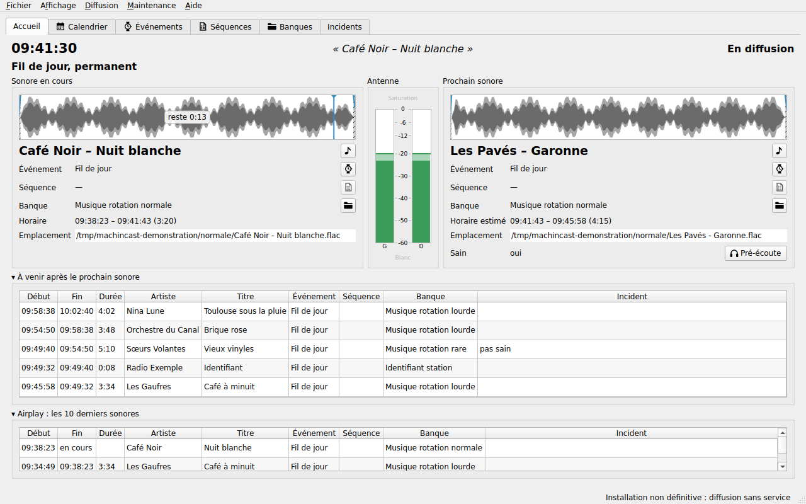

# Guide de l'antenne

Ce guide s'adresse à l'équipe de l'antenne : programmateurs, animateurs, responsables d'antenne. Il explique ce que MachinCast fait passer à l'antenne, et comment s'en servir depuis son interface graphique, **Machin interface**. Il ne demande ni terminal ni connaissance technique.

L'installation du poste, les commandes et la configuration sont dans le [guide d'administration](../administration/README.md).

## L'antenne en quelques mots

MachinCast fait tourner l'antenne tout seul, en dehors des émissions en direct, à partir de quatre sortes d'éléments :

- un **sonore** est un fichier son (un titre, un jingle, un spot) ou un **stream**, un flux audio reçu par Internet, comme un direct extérieur ;
- une **banque** est une réserve de sonores, par exemple « Musique rotation lourde » : chaque fois qu'on l'appelle, elle en fournit **un seul**, dans l'ordre ou au hasard ;
- une **séquence** est une suite de sonores et de banques jouée d'un bloc, comme un passage publicitaire ;
- un **événement** est un créneau de la grille, avec sa liste de lecture : un **fil musical**, qui tient l'antenne quand rien d'autre n'est prévu, une **émission** ou un **spécial**, qui prennent la main à leur heure.

À tout instant, un seul événement est à l'antenne ; il joue sa liste, élément après élément. Le détail est dans [Ce qui passe à l'antenne](antenne.md).

## Sommaire

1. [Prendre en main l'interface](prise-en-main.md) : la fenêtre, l'accueil, les onglets, les menus, les préférences, la recherche.
2. [Ce qui passe à l'antenne](antenne.md) : quel événement, quel sonore, les enchaînements, les streams, piloter et interrompre la diffusion, l'historique et les incidents.
3. [Programmer la grille](grille.md) : les événements, les séquences, le calendrier et la simulation.
4. [Sonores, banques et feeds](sonores.md) : ajouter des sonores, leurs états, leurs fiches, la pré-écoute, les banques et leur indexation.
5. [Listes et actions](listes.md) : les listes, agir sur plusieurs éléments, dupliquer, supprimer.

## Une règle à retenir : les fichiers ne sont jamais touchés

MachinCast ne fait que **lire** les fichiers sonores. Il ne les supprime, ne les renomme, ne les déplace, ne les remplace et n'y écrit jamais, quoi qu'on fasse dans l'interface :

- désactiver un sonore, le supprimer de la base, le retirer d'une banque laisse son fichier à sa place, intact ;
- supprimer une banque laisse ses répertoires et leurs fichiers ;
- un fichier déposé dans l'interface est seulement référencé, là où il se trouve, sans copie.

Supprimer ou déplacer un fichier reste une décision humaine, prise hors de MachinCast, par exemple dans le navigateur de fichiers du poste.

## Ce qui n'existe pas encore

Ce guide est celui de MachinCast 0.9.0, sa première version publiée, avant la 1.0 ; **Aide → Version** en donne les nouveautés. Ce qui manque encore pour l'antenne :

| Manque | Ticket |
| --- | --- |
| Prolonger un stream dont le direct déborde | [#47](https://github.com/dascritch/machincast/issues/47) |
| Écran d'analyse de la sortie audio, « Moniteur de la sortie… » du menu Maintenance | [#85](https://github.com/dascritch/machincast/issues/85) |

Une idée, un problème ? **Aide → Signaler un problème…** ouvre les tickets de MachinCast.
