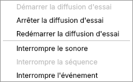
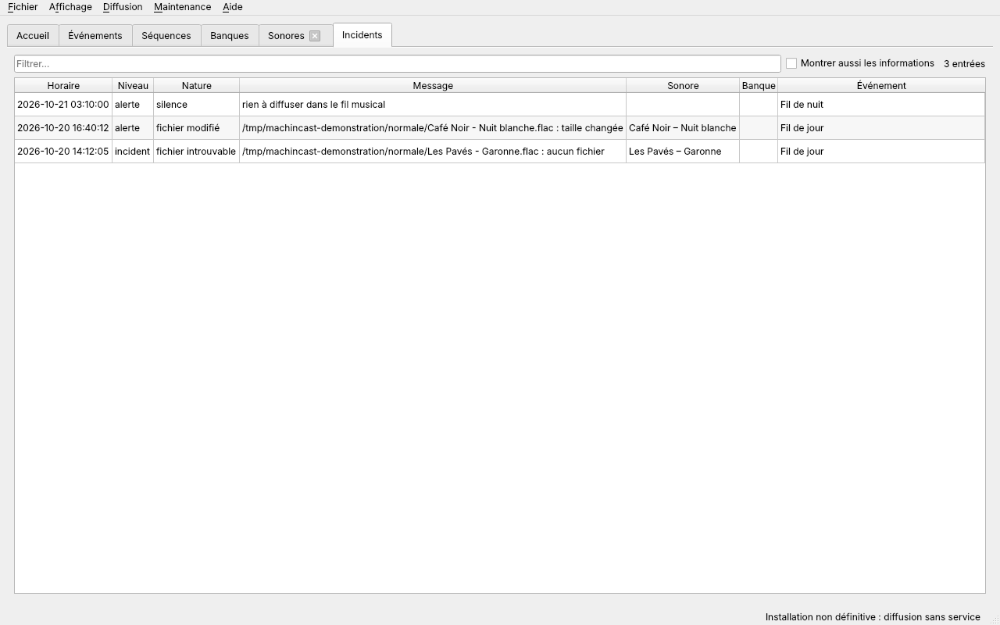

# Ce qui passe à l'antenne

[Guide de l'antenne](README.md) › Ce qui passe à l'antenne

- [Quel événement est à l'antenne](#quel-événement-est-à-lantenne)
- [Comment une liste de lecture se déroule](#comment-une-liste-de-lecture-se-déroule)
- [Séquences](#séquences)
- [Quel sonore une banque fournit](#quel-sonore-une-banque-fournit)
- [Expiration des sonores](#expiration-des-sonores)
- [Enchaînements](#enchaînements)
- [Blancs au début et à la fin](#blancs-au-début-et-à-la-fin)
- [Streams](#streams)
- [Page publique et masquage](#page-publique-et-masquage)
- [Piloter la diffusion](#piloter-la-diffusion)
- [Interrompre l'antenne](#interrompre-lantenne)
- [Historique et incidents](#historique-et-incidents)

## Quel événement est à l'antenne

À tout instant, l'antenne suit **un seul événement**, choisi ainsi :

- **Priorité** : un `spécial` l'emporte sur une `émission`, qui l'emporte sur un `fil musical`. Quand l'événement prioritaire se termine, celui qui est en dessous reprend.
- **Fil musical permanent** : un fil musical sans date de début ni de fin sert de fond ; il couvre tout le temps où rien d'autre n'est programmé, pas même un autre fil musical.
- **Fils musicaux selon l'heure** : plusieurs fils musicaux peuvent se relayer, par exemple un fil de nuit de 00:00 à 06:00, tous les jours, sur un fil de jour permanent.
- **Toujours un fil musical** : s'il n'en existe aucun, l'interface en crée un, « Fil musical », permanent et vide ([Pour bien démarrer](prise-en-main.md#pour-bien-démarrer)). Vide, il laisse l'antenne en silence, avec une alerte.
- **Heures** : un événement est à l'antenne de son début, inclus, à sa fin, exclue : une émission de 20:00 à 22:00 laisse la place à 22:00 pile. Toutes les heures sont celles de Paris, l'heure locale du poste.
- **Récurrence** : un événement qui se répète revient chacun des jours cochés, à la même heure, à partir de sa première diffusion, sans date de fin ni exception pour les jours fériés.
- **Passage de minuit** : un événement peut finir le lendemain, par exemple de 23:00 à 01:00 ; pour un événement récurrent, c'est le jour du début qui compte.
- **Émission ou spécial sans fin** : il reste à l'antenne jusqu'au bout de sa liste, qui ne boucle pas ; l'événement en dessous reprend alors. Un événement de même priorité qui commence après lui prend l'antenne ; il reprend ensuite là où il en était, si sa liste n'est pas épuisée.
- **Chevauchement** : deux événements de même priorité ne se chevauchent pas : la [fiche d'un événement](grille.md#fiche-dun-événement) le refuse.
- **Changement d'heure** : un événement garde son heure. Une émission de 21:00 reste à 21:00 après le passage à l'heure d'été ou d'hiver ; l'heure sautée ou répétée, la nuit du changement, tombe dans le fil musical de nuit.

Le [calendrier](grille.md#calendrier) montre la grille qui en résulte, semaine par semaine.

## Comment une liste de lecture se déroule

- **Ordre** : les éléments passent dans l'ordre de la liste. Un même élément peut y revenir, par exemple un jingle entre chaque titre. Une banque fait jouer un seul de ses sonores ; une [séquence](#séquences), tous ses éléments.
- **Éléments sautés** : une banque dont aucun sonore n'est jouable, ou un sonore qui ne l'est pas, est sauté : la liste passe à l'élément suivant.
- **Boucle** : arrivée au bout avant la fin de l'événement, la liste reprend au début. Une émission ou un spécial **sans fin** ne boucle pas : une fois sa liste jouée, l'événement en dessous reprend.
- **Début d'un événement** : il coupe **net** le sonore en cours, quel qu'il soit. Une émission de 20:00 démarre à 20:00 pile.
- **Fin d'un événement** : si aucun autre ne commence, le dernier sonore est joué jusqu'au bout, puis le fil musical reprend. Si un autre commence juste après, il coupe ce dernier sonore.
- **Retour au fil musical** : il reprend à l'élément qui suit le dernier qu'il a joué, pas au début de sa liste.
- **Chaque occurrence** d'une émission récurrente reprend sa liste au début.
- **Rien à diffuser** : silence à l'antenne, et une alerte `silence`. Le silence cesse dès qu'un sonore redevient jouable ou qu'une émission commence.

La diffusion lit sa position dans son historique : après un redémarrage, elle reprend là où elle en était.

## Séquences

Une **séquence** est une suite de sonores et de banques, jouée dans l'ordre, qu'on place comme un seul élément dans la liste d'un ou de plusieurs événements. Par exemple, « Passage pub » joue le sonore « Début de publicité », deux fois la banque « Publicité », puis la banque « Identifiant station ».

- **Ordre** : les éléments passent dans l'ordre de la séquence ; chaque banque fait jouer un seul sonore. Une séquence ne contient jamais une autre séquence.
- **Éléments sautés** : un élément non jouable est ignoré. Une séquence dont rien n'est jouable est sautée, comme une banque vide.
- **Comme un seul sonore** : à la fin de son événement, la séquence va jusqu'au bout. Un événement qui commence la coupe net, avec son sonore en cours : ses éléments restants ne sont pas joués.
- **Ensuite** : la liste de l'événement reprend à l'élément qui suit la séquence.

Les séquences se créent dans leur [fiche](grille.md#fiche-dune-séquence).

## Quel sonore une banque fournit

Une banque appelée par une liste fait jouer **un seul** de ses sonores, selon son mode :

- **Séquentielle** : le sonore qui suit, dans l'ordre de la banque, le dernier qu'elle a fait jouer ; après le dernier, elle reprend au début.
- **Aléatoire** : un sonore tiré au hasard parmi ceux qu'elle n'a pas encore joués dans son cycle. Tant que tous ne sont pas passés, aucun ne revient, et un nouveau cycle ne commence jamais par le dernier joué. Un sonore ajouté entre dans le cycle en cours.
- **Banque par banque** : seuls comptent les passages fournis par la banque elle-même. Un sonore présent dans deux banques suit le cycle de chacune séparément.
- **Sonores jouables** : seul un sonore à l'état `actif` est choisi, dans sa période de diffusion quand elle est renseignée, et sous son maximum de lectures ([États d'un sonore](sonores.md#états-dun-sonore)).
- **Rien de jouable** : la banque ne fournit rien, et la liste passe à l'élément suivant.

**Banque « ne pas répéter ».** Une banque marquée « ne pas répéter », comme une banque de jingles, ne passe jamais deux fois de suite :

- si le dernier sonore diffusé vient d'elle, l'élément suivant qui l'appelle est sauté : une liste « jingle, jingle, titre » donne un jingle puis le titre ;
- la règle tient d'un événement à l'autre, après une coupure nette et après un redémarrage ;
- si, la banque sautée, une émission ou un spécial n'a plus rien de jouable, il se termine (alerte `événement terminé plus tôt`) et l'événement en dessous reprend ; un fil musical, lui, se tait (alerte `silence`) ;
- les fiches d'une [séquence](grille.md#fiche-dune-séquence) et d'un [événement](grille.md#fiche-dun-événement) préviennent quand une banque marquée est appelée juste après elle-même : ce deuxième appel sera toujours sauté.

## Expiration des sonores

La diffusion passe un sonore `actif` à l'état `expiré` :

- **Maximum de lectures** : dès le passage qui l'atteint, compté sur toute la diffusion. Le sonore finit de jouer ce passage.
- **Période de diffusion** : dès que sa date de fin est atteinte.

Un sonore expiré garde son fichier, ses banques et ses listes ; seul son état change. Pour le remettre à l'antenne, sa [fiche](sonores.md#fiche-dun-sonore) le repasse à `actif`, après avoir relevé son maximum ou repoussé sa période ; sinon il expire de nouveau.

## Enchaînements

Les sonores s'enchaînent selon leurs **crossfades** :

- le **crossfade de début** d'un sonore : il monte, de silencieux à plein volume, pendant ce temps ;
- le **crossfade de fin** : le sonore suivant démarre autant avant la fin, et celui-ci s'éteint pendant ce temps. Les deux se superposent ;
- **les deux sont nécessaires** : deux sonores ne se superposent que si le premier a un crossfade de fin **et** le second un crossfade de début. Sinon, le premier joue jusqu'au bout, puis le second démarre aussitôt, à plein volume ;
- **d'où viennent les crossfades** : ceux qu'impose la banque qui a fourni le sonore ; sinon ceux de la fiche du sonore, s'ils y sont paramétrés (0 seconde en est un) ; sinon ceux que la banque applique à défaut ; sinon ceux des [préférences](prise-en-main.md#préférences) ; sinon aucun ;
- **coupure nette** : au début d'un événement, le sonore en cours s'arrête aussitôt, sans fondu.

Un fichier disparu au moment de le jouer n'est pas joué : l'incident `fichier introuvable` est noté, la diffusion passe au sonore suivant, et ne le repropose pas pendant une heure.

## Blancs au début et à la fin

Un fichier peut commencer ou finir par un blanc : un silence, un souffle, une fin de réverbération. Pour ne pas les entendre, la diffusion peut jouer un sonore **sans ses blancs**. Le fichier n'est pas modifié : seule la durée de ses blancs est notée.

- **Mesure** : l'**audit complet** mesure les blancs de chaque fichier ([Indexation depuis l'interface](sonores.md#indexation-depuis-linterface)), sous le seuil des [préférences](prise-en-main.md#préférences), -40 dB par défaut. L'indexation rapide ne les mesure pas.
- **Quand** : jamais par défaut. Un sonore est joué sans ses blancs si sa [fiche](sonores.md#fiche-dun-sonore) le demande, ou si la [banque](sonores.md#fiche-dune-banque) qui l'a fourni le demande.
- **Jeu** : le sonore commence à son début détecté et s'arrête à sa fin détectée ; les crossfades se comptent depuis ces bornes.
- **Jamais audité** : un sonore dont les blancs n'ont pas été mesurés est joué en entier. Après avoir ajouté des sonores ou activé la détection, demander un audit complet.
- **Correction** : le début et la fin détectés se corrigent à la main dans la fiche du sonore ; l'audit ne les modifie plus ensuite.

## Streams

Un **stream** relaie un flux audio par Internet, un direct extérieur par exemple, à son adresse ou à celle d'un [marque-page](sonores.md#marques-pages) :

- **Début d'un événement** de priorité égale ou supérieure : il coupe le stream net, comme un fichier.
- **Fin de son événement** : le stream s'éteint pendant son crossfade de fin, et le sonore suivant enchaîne.
- **Flux tombé** : un flux qui ne répond pas, ou qui s'arrête avant la fin de son événement, est tombé. L'incident `flux tombé` est noté, et l'**événement de secours** du stream joue sa liste à sa place, en boucle. Sans événement de secours, l'événement en dessous reprend, le plus souvent le fil musical.
- **Reconnexion** : tant que son événement est à l'antenne, la diffusion retente la connexion toutes les 5 secondes, sans rien faire entendre. Dès que le flux revient, le stream reprend l'antenne, et l'incident `reprise du flux` donne la durée de la panne.
- **Fin de l'événement pendant la panne** : la reconnexion est abandonnée, et la diffusion continue normalement.
- **Métadonnées** : l'historique note l'artiste et le titre du stream en base, jamais ceux qu'annonce le flux.

Un **événement de secours** est un événement de priorité `secours` : il n'a ni début, ni fin, ni jours, et ne passe à l'antenne qu'à la place d'un stream tombé. Chaque stream désigne le sien dans [sa fiche](sonores.md#fiche-dun-sonore).

## Page publique et masquage

La diffusion publie une **page publique**, pour le site de la radio : le sonore à l'antenne et les 20 précédents, avec l'heure. L'artiste et le titre d'un passage peuvent y être **masqués**, par exemple pour une publicité ou un habillage :

- le choix se fait à cinq niveaux, dans cet ordre : l'événement, la séquence, la banque, le sonore, puis le réglage général de la radio. C'est le premier niveau renseigné qui décide : un événement qui dit « afficher » l'emporte sur un sonore qui dit « masquer » ;
- masqués, l'artiste et le titre laissent la place au premier **nom public** renseigné : celui de l'événement, puis de la séquence, puis de la banque ; s'il n'y en a aucun, au texte public de la radio ;
- l'interface, réservée à l'équipe, affiche toujours tout.

L'accueil montre le texte public du sonore en cours, tel que la page publique l'affiche.

## Piloter la diffusion

Le menu **Diffusion** démarre, arrête et redémarre la diffusion, sans terminal. Ses entrées suivent l'état de la diffusion, relu à chaque ouverture du menu.

**Sur un poste installé pour l'antenne**, la diffusion tourne comme un service du poste :

| État de la diffusion | Entrées actives |
| --- | --- |
| Arrêtée | Démarrer la diffusion |
| En marche | Arrêter la diffusion, Redémarrer la diffusion |
| En échec (elle a planté trop souvent) | Démarrer la diffusion, Redémarrer la diffusion |

Chaque entrée demande le mot de passe d'un administrateur du poste. La barre d'état dit ensuite ce qu'il en est : `Diffusion démarrée.`, `Diffusion arrêtée.`, `Diffusion redémarrée.`, ou l'échec et sa raison, par exemple quand le mot de passe est refusé.

**Sur un poste d'essai**, sans ce service, la barre d'état affiche en permanence `Installation non définitive : diffusion sans service`, et le menu pilote une **diffusion d'essai**, qui joue bel et bien à l'antenne :

| Entrée | Ce qu'elle fait |
| --- | --- |
| Démarrer la diffusion d'essai | Ouvre la diffusion dans une fenêtre de terminal, qui en montre le journal. Fermer l'interface ne l'arrête pas. |
| Arrêter la diffusion d'essai | L'arrête proprement : le passage en cours se termine. La barre d'état annonce `Diffusion d'essai arrêtée.` |
| Redémarrer la diffusion d'essai | L'arrête, puis la relance dans une nouvelle fenêtre de terminal. |

## Interrompre l'antenne

Le menu **Diffusion** propose aussi, après un trait, d'interrompre ce qui passe pour passer au suivant :

| Entrée | Effet |
| --- | --- |
| Interrompre le sonore | Le sonore en cours s'arrête, et le suivant de la liste, ou de la séquence, enchaîne. |
| Interrompre la séquence | Le sonore en cours s'arrête, et le reste de sa séquence n'est pas joué : la liste reprend à l'élément qui suit la séquence. |
| Interrompre l'événement | L'événement en cours rend l'antenne : celui qui est en dessous, en général le fil musical, la reprend jusqu'à la fin prévue de l'événement interrompu. Interrompre le fil musical lui-même arrête son élément et le fait reprendre au **début** de sa liste. |

- Chaque entrée n'est active que si son élément est à l'antenne ; son infobulle le nomme, ou dit pourquoi elle est inactive (« Rien à l'antenne », « Aucune séquence à l'antenne »).
- La demande part **aussitôt, sans question** : l'antenne n'attend pas. La barre d'état l'annonce, par exemple `Interruption du sonore demandée.`
- Le sonore interrompu s'éteint pendant son crossfade de fin, ou s'arrête net s'il n'en a pas. Son passage se termine sans incident, et le journal note `interruption manuelle`.
- Un événement interrompu ne revient pas avant sa prochaine diffusion, sauf si la diffusion redémarre entre-temps.

## Historique et incidents

Chaque passage à l'antenne est noté dans l'**historique**, l'airplay : son début, sa fin, la durée diffusée, l'artiste et le titre **tels qu'ils étaient au moment du passage**, l'événement, la séquence et la banque, et s'il s'est déroulé sans incident. Un sonore coupé net par un événement, ou interrompu à la main, n'est pas un incident. L'accueil en montre les 12 dernières heures, et la fiche d'un sonore ses 50 derniers passages.

La diffusion tient aussi un **journal** de ce qu'elle fait. L'onglet **Incidents** en montre les alertes et les incidents, du plus récent au plus ancien : horaire, niveau, nature, message, et le sonore, la banque et l'événement concernés.

- **Montrer aussi les informations** ajoute les opérations normales : démarrages, débuts et fins d'événements, interruptions manuelles…
- **Filtre** : comme dans les listes, sans tenir compte des majuscules ni des accents.
- **Double-clic** sur le sonore, la banque ou l'événement d'une ligne : sa fiche.
- L'écran se relit à l'ouverture de son onglet ; seules les 500 entrées les plus récentes sont lues.

| Nature | Niveau | Quand |
| --- | --- | --- |
| `démarrage`, `arrêt` | info | La diffusion démarre, ou s'arrête. |
| `début d'événement`, `fin d'événement` | info | Un événement prend l'antenne, ou la laisse : « « Journal », émission, de 20:00 à 20:30 ». |
| `début de séquence`, `fin de séquence` | info | De même pour une séquence : « « Pub », dans « Continue » ». |
| `coupure nette` | info | Un événement commence et coupe le sonore en cours. |
| `interruption manuelle` | info | Le sonore, la séquence ou l'événement a été interrompu depuis l'interface. |
| `élément sauté` | info | Un élément rappelle la banque « ne pas répéter » qui vient de passer. |
| `sonore expiré` | info | Un sonore a atteint son maximum de lectures ou la fin de sa période. |
| `analyse du prochain sonore` | info | Le prochain sonore n'a jamais été vérifié en entier : il l'est en arrière-plan, avant de passer. |
| `reconnexion abandonnée` | info | L'événement d'un stream tombé n'est plus à l'antenne. |
| `silence` | alerte | Rien à diffuser. |
| `événement terminé plus tôt` | alerte | Une émission n'a plus rien de jouable une fois la banque « ne pas répéter » sautée. |
| `fichier modifié` | alerte | Le fichier a changé depuis sa dernière vérification ; il est quand même joué, et sera revérifié. |
| `analyse impossible` | alerte | La vérification du prochain sonore n'a pas pu être lancée ; il est joué quand même. |
| `sortie inaccessible` | alerte | La page publique, la playlist ou le fichier de l'historique ne peut pas être écrit. |
| `socket d'état indisponible` | alerte | L'accueil ne peut pas suivre la diffusion, qui continue sans lui. |
| `fichier introuvable` | incident | Le fichier a disparu ; il n'est pas joué. |
| `lecture interrompue` | incident | La lecture d'un fichier s'est arrêtée sur une erreur. |
| `flux tombé` | incident | Le flux d'un stream ne répond plus. |
| `reprise du flux` | incident | Le flux est revenu ; le message donne la durée de la panne. |

L'historique et le journal ne sont jamais modifiés ni effacés : la diffusion ne peut qu'y ajouter des lignes.
