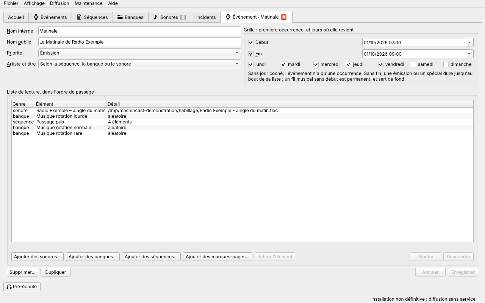
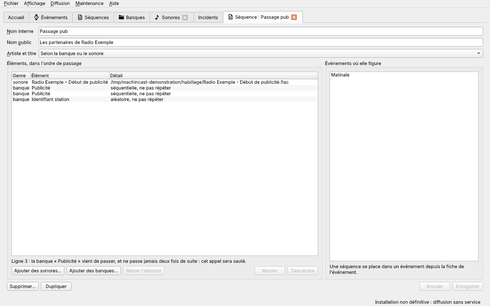
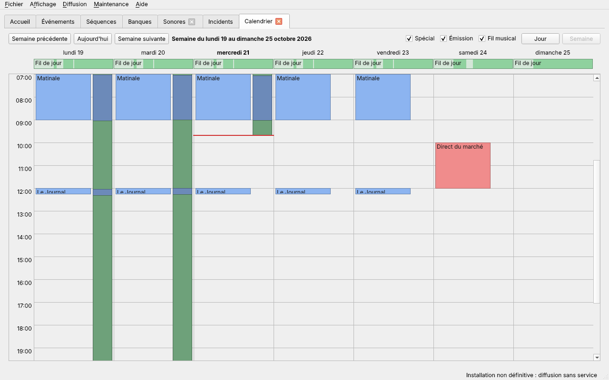
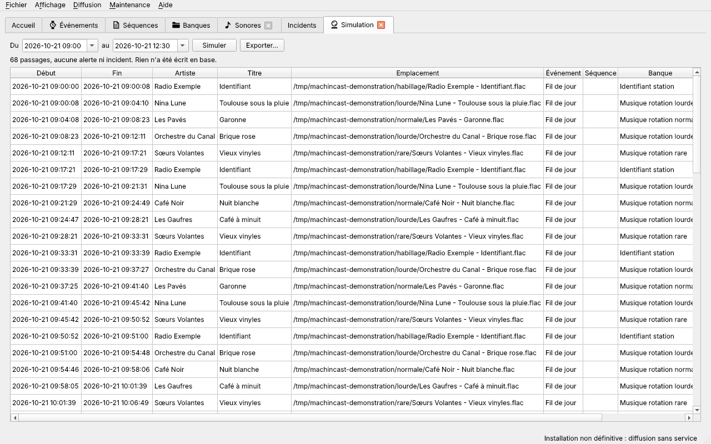

# Programmer la grille

[Guide de l'antenne](README.md) › Programmer la grille

- [Fiche d'un événement](#fiche-dun-événement)
- [Fiche d'une séquence](#fiche-dune-séquence)
- [Calendrier](#calendrier)
	- [Sauter une session](#sauter-une-session)
- [Simulation](#simulation)

Les fiches s'ouvrent dans leur onglet, depuis les listes ([Listes et actions](listes.md)), l'accueil, le calendrier ou la recherche. Elles se comportent toutes de la même façon : voir [Enregistrer, annuler, fermer](listes.md#enregistrer-annuler-fermer).

## Fiche d'un événement

La fiche d'un événement s'ouvre dans un onglet nommé « Événement : » suivi de son nom ; **Nouvel événement**, dans la liste des événements, ouvre une fiche vide, de priorité `Émission`.

| Champ | Rôle |
| --- | --- |
| Nom interne | Obligatoire, et propre à l'événement : son nom dans les listes, l'historique et le journal. |
| Nom public | Facultatif. Affiché sur la page publique à la place de l'artiste et du titre masqués ([Page publique et masquage](antenne.md#page-publique-et-masquage)). |
| Priorité | De la plus basse à la plus haute : `Secours`, qui ne joue qu'à la place d'un stream tombé ([Streams](antenne.md#streams)), puis `Fil musical`, `Émission` et `Spécial` ([Quel événement est à l'antenne](antenne.md#quel-événement-est-à-lantenne)). |
| Artiste et titre | `Masqués` ou `Affichés` sur la page publique, pour tout ce que l'événement fait jouer ; `Selon la séquence, la banque ou le sonore` laisse décider ceux-ci. |

**Grille** : le **Début** et la **Fin** de la première occurrence, chacun à cocher, puis les **jours** où elle revient chaque semaine, à la même heure. Aucun jour coché : une seule occurrence.

- Un début coché part de l'heure du moment, à la minute ; une fin cochée, d'une heure après le début.
- Un fil musical sans début est permanent, et sert de fond. Décocher le début décoche aussi la fin et les jours.
- Un événement de secours n'a ni début, ni fin, ni jours : choisir `Secours` les décoche.
- Une émission ou un spécial a un début ; sans fin, il dure jusqu'au bout de sa liste.

**Rien n'est enregistré**, et la fiche dit pourquoi, pour :

- un nom interne vide, ou celui d'un autre événement ;
- une émission ou un spécial sans début, ou une fin qui ne suit pas le début ;
- un **chevauchement** avec un autre événement de même priorité, occurrences récurrentes comprises : « Chevauche l'événement « Journal », de même priorité, le 21/10/2026 à 09:00. ». Seul compte ce qui chevauche à partir de maintenant : ce que la grille a déjà diffusé ne bloque rien, et un chevauchement en cours est daté de l'instant présent ;
- une priorité changée pour un événement de secours qu'un stream désigne.

**Événement vide** : un événement sans élément s'enregistre, pour être complété plus tard. La fiche avertit de ce qu'en fera la diffusion : une émission vide laisse l'événement en dessous prendre le relais, sans couper le sonore en cours, et l'accueil n'annonce aucune coupure à son heure ; un fil musical vide laisse l'antenne en silence, avec une alerte. La liste des événements le montre en anomalie.

**À l'antenne, aussitôt** ([#266](https://github.com/dascritch/machincast/issues/266)) : un événement enregistré, supprimé ou restauré vaut tout de suite, si la diffusion tourne. Une émission avancée coupe le sonore en cours à sa nouvelle heure ; une émission déplacée, raccourcie ou retirée change les sonores à venir de l'accueil. Un nom, un nom public ou un masquage changés ne retirent pas les sonores déjà annoncés : ils passeront comme prévu.

**Liste de lecture** : les sonores, les banques et les séquences que l'événement joue, dans l'ordre.

- **Ordre** : un élément se déplace par glisser-déposer, ou avec **Monter** et **Descendre**. Un même élément peut revenir.
- **Ajouter des sonores…**, **Ajouter des banques…**, **Ajouter des séquences…** ouvrent la liste de ceux déjà en base, avec son filtre ; plusieurs se choisissent avec <kbd>Ctrl</kbd> ou <kbd>Maj</kbd>, puis **Ajouter**.
- **Ajouter des feeds…** ajoute un stream depuis un [feed](sonores.md#feeds), pour retransmettre une émission en extérieur : le stream qui suit déjà ce feed, sinon un nouveau stream, créé à l'enregistrement (la ligne le dit : « nouveau stream »).
- **Déposer des fichiers** glissés depuis le navigateur de fichiers les ajoute en fin de liste ([Ajouter un sonore](sonores.md#ajouter-un-sonore)).
- **Retirer l'élément** retire la ligne choisie, sans rien demander : le sonore, la banque ou la séquence reste en base.
- **Banque « ne pas répéter »** : la fiche signale chaque appel d'une banque marquée juste après elle-même, qui sera toujours sauté. Ce n'est qu'un avertissement.
- **Ouvrir un élément** : un double-clic, ou <kbd>Entrée</kbd>, ouvre sa fiche dans un autre onglet.

## Fiche d'une séquence

La fiche d'une [séquence](antenne.md#séquences) s'ouvre dans un onglet nommé « Séquence : » suivi de son nom ; **Nouvelle séquence** ouvre une fiche vide.

| Champ | Rôle |
| --- | --- |
| Nom interne | Obligatoire, et propre à la séquence. |
| Nom public | Facultatif. Affiché sur la page publique à la place de l'artiste et du titre masqués, si l'événement n'en a pas. |
| Artiste et titre | `Masqués` ou `Affichés` sur la page publique, pour les sonores que joue la séquence, sauf si l'événement en décide ; `Selon la banque ou le sonore` laisse décider ceux-ci. |

**Éléments** : la liste ordonnée des sonores et des banques que joue la séquence, avec un détail : l'emplacement d'un sonore, le mode d'une banque et « ne pas répéter » si elle l'est. Elle se gère comme la liste de lecture d'un événement : glisser-déposer, **Monter** et **Descendre**, **Ajouter des sonores…**, **Ajouter des banques…**, dépôt de fichiers, **Retirer l'élément**. Un même sonore ou une même banque peut revenir ; une séquence ne contient jamais une autre séquence. La fiche signale les appels qui seront sautés à cause d'une banque « ne pas répéter ».

**Séquence vide** : elle s'enregistre, pour être complétée plus tard ; la fiche avertit qu'elle ne joue rien, et la diffusion la saute.

**Événements** : la liste des événements où figure la séquence ; un double-clic ouvre leur fiche.

## Calendrier

**Affichage → Ouvrir l'onglet Grille horaire** ouvre le **Calendrier** : ce qui est prévu, et ce qui a été diffusé. Il s'ouvre sur la semaine du jour, du lundi au dimanche ; une ligne rouge marque l'heure qu'il est.

- **Naviguer** : « Semaine précédente », « Aujourd'hui », « Semaine suivante », jusqu'à 28 jours après aujourd'hui. Vers le passé, le calendrier s'arrête à la durée de péremption, 60 jours par défaut, réglable dans les [préférences](prise-en-main.md#préférences), page **Base** : la base n'a plus rien d'avant ([#269](https://github.com/dascritch/machincast/issues/269)). Dans la semaine de cette limite, les jours d'avant sont grisés et vides. « Jour » montre un seul jour ; « Semaine » revient à la semaine.
- **Ce qui est prévu** : chaque occurrence d'un événement est un bloc, à la couleur de sa priorité. Le bloc est **plein** là où l'événement passerait à l'antenne, **estompé** là où un autre, plus prioritaire, le masque. Les fils musicaux permanents et les occurrences de 24 heures ou plus sont dans la **bande de la journée entière**, sous le nom du jour. Une émission sans fin se dessine jusqu'au prochain événement de même priorité, au plus tard jusqu'à minuit. Les événements de secours n'y sont pas. Un événement [supprimé](listes.md#supprimer-un-élément) garde ses blocs d'avant sa suppression, jusqu'à ce qu'il soit effacé de la base ; son infobulle dit quand il a été supprimé.
- **Ce qui a été diffusé** : à droite de chaque jour passé, une bande étroite par événement réellement joué. Un écart entre le bloc et la bande montre un écart entre la grille et l'antenne.
- **Spécial, Émission, Fil musical** : chaque case montre ou cache les blocs de sa priorité.
- **Survoler** un bloc donne l'événement, ses heures, sa récurrence et ce qui en joue ; une bande, ses heures et son nombre de passages.
- **Double-cliquer** sur un bloc ou une bande ouvre la fiche de l'événement.
- **Cliquer sur une heure libre**, pas encore passée, propose de créer un événement sur l'heure entière : « Créer un événement le dimanche 25 octobre 2026 de 13:00 à 14:00 ? ». **Créer** ouvre la fiche d'un nouvel événement réglé sur cette heure ; rien n'est en base avant **Enregistrer**.

### Sauter une session

Pour des vacances, un jour férié ou une émission exceptionnelle, une session d'un événement récurrent se saute, sans toucher à l'événement ([#273](https://github.com/dascritch/machincast/issues/273)). **Clic droit** sur le bloc d'une session à venir :

- **Sauter cette session** : elle ne passe pas à l'antenne ;
- **Sauter les sessions jusqu'au…** : un calendrier fait choisir le dernier jour, et toutes les sessions de l'événement jusqu'à ce jour, compris, sont sautées. **OK** ou <kbd>Entrée</kbd> valide, **Annuler** ou <kbd>Échap</kbd> ne saute rien.

Une session sautée reste dans le calendrier, **hachurée** : à sa place, l'antenne joue ce qui jouerait sans elle, en général le fil musical. Pour la remplacer par une autre émission, **cliquer** sur son créneau, comme sur une heure libre : la nouvelle émission peut l'occuper. La diffusion en tient compte aussitôt, et l'accueil montre les nouveaux sonores à venir. La barre d'état dit ce qui a été sauté.

**Clic droit** sur une session sautée, tant qu'elle est à venir : **Rétablir cette session**. Si une émission a pris sa place entre-temps, elle n'est pas rétablie, et la barre d'état dit laquelle la chevaucherait. Seules les sessions à venir d'un événement qui revient chaque semaine se sautent ; un événement unique se supprime, ou se déplace dans sa fiche.

## Simulation

**Affichage → Ouvrir l'onglet Simulation** vérifie une grille avant sa mise à l'antenne : il montre ce qui serait diffusé sur une période, sans rien jouer et sans rien changer.

- **Période** : du début à la fin, à la minute. À l'ouverture, de l'heure qu'il est à la même heure le lendemain.
- **Simuler** : la diffusion rejoue la période selon ses règles, à partir de l'historique réel : position dans chaque liste, cycle de chaque banque, nombre de lectures de chaque sonore. Rien n'est écrit en base, aucun son n'est joué, et l'interface reste utilisable pendant ce temps. Chaque simulation tire au hasard.
- **Résultat** : chaque passage simulé, avec son début, sa fin, son artiste, son titre, l'emplacement de son fichier, son événement, sa séquence et sa banque ; l'artiste et le titre y sont masqués comme sur la page publique. Au-dessus, le bilan, par exemple « 68 passages, aucune alerte ni incident. Rien n'a été écrit en base. » ; en dessous, les alertes et incidents simulés, comme un silence.
- **Exporter…** enregistre le résultat au format choisi dans le sélecteur de fichier : **Tableur CSV**, **Playlist PLS** ou **Page HTML**. Le fichier reçoit l'extension du format s'il ne l'a pas déjà : un export ne remplace jamais un fichier sonore.
- **Échec** : une base injoignable s'affiche à la place du bilan, après « Simulation impossible : ».
- Une nouvelle simulation remplace la précédente. Fermer l'onglet pendant une simulation l'arrête.
