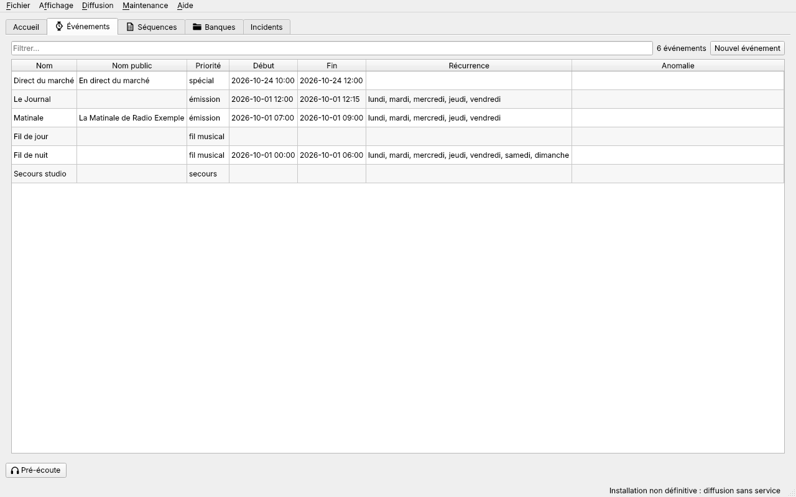
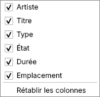
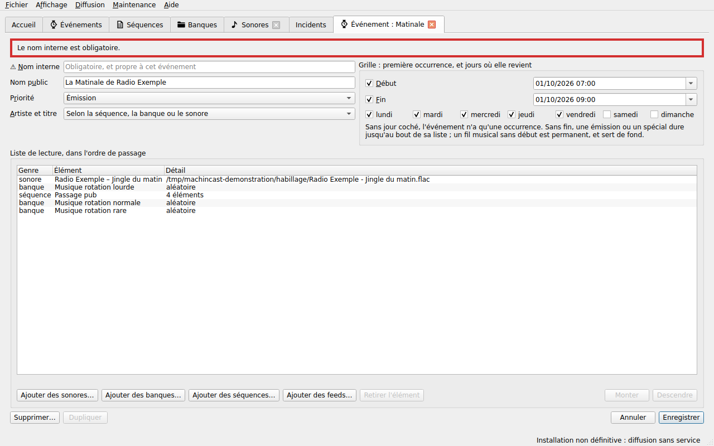

# Listes et actions

[Guide de l'antenne](README.md) › Listes et actions

- [Listes](#listes)
- [Colonnes des tableaux](#colonnes-des-tableaux)
- [Enregistrer, annuler, fermer](#enregistrer-annuler-fermer)
- [Agir sur plusieurs sonores ou banques](#agir-sur-plusieurs-sonores-ou-banques)
- [Dupliquer un élément](#dupliquer-un-élément)
- [Supprimer un élément](#supprimer-un-élément)

## Listes

Les onglets **Événements**, **Séquences**, **Banques**, **Sonores** et **Feeds** donnent chacun la liste de tous les éléments de ce type.

| Onglet | Colonnes | Ordre |
| --- | --- | --- |
| Événements | nom, nom public, priorité, début, fin, jours, anomalie (`événement vide`) | du plus prioritaire au moins prioritaire, puis par nom |
| Séquences | nom, nom public, anomalie (`séquence vide`) | par nom |
| Banques | nom, nom public, mode, « ne pas répéter », premier répertoire | par nom |
| Sonores | artiste, titre, type, état, durée, emplacement | par artiste, puis par titre |
| Feeds | nom, adresse, nombre de streams qui le suivent | par nom |

- **Filtre** : le champ « Filtrer… » garde les lignes dont une colonne contient le texte tapé, sans tenir compte des majuscules ni des accents : `cafe` trouve « Café à minuit », `stream` tous les streams. Le compte dit combien de lignes restent, « 2 sonores sur 340 ».
- **Anomalies** : une séquence ou un événement vide a l'icône d'avertissement, et son infobulle dit pourquoi. Taper `vide` dans le filtre ne garde que les éléments vides. Un sonore hors des durées d'une banque n'est signalé que dans la [fiche de cette banque](sonores.md#fiche-dune-banque) et dans les relations de la [fiche du sonore](sonores.md#fiche-dun-sonore).
- **Tri** : un clic sur le titre d'une colonne trie la liste ; un second inverse l'ordre.
- **Mise à jour** : une liste se relit chaque fois que son onglet s'ouvre, et par <kbd>F5</kbd>.
- **Ouvrir** : un double-clic sur une ligne, ou <kbd>Entrée</kbd>, ouvre la fiche de l'élément.
- **Créer** : **Nouvel événement**, **Nouvelle séquence**, **Nouvelle banque**, **Nouveau stream** et **Nouveau feed** ouvrent une fiche vide. La liste des sonores a aussi **➕ Ajouter des fichiers…** ([Ajouter un sonore](sonores.md#ajouter-un-sonore)).
- **Clic droit** : **Dupliquer**, dans les listes Événements, Séquences et Banques ; des actions sur plusieurs éléments, dans les listes Sonores et Banques.

## Colonnes des tableaux

Tous les tableaux de l'interface se règlent de la même façon : les listes, la recherche, les incidents, l'airplay de l'accueil et son onglet, la simulation, et les tableaux des fiches.

- **Largeur** : les colonnes s'ajustent à leur contenu à chaque lecture du tableau. Pour en élargir ou en rétrécir une, glisser la bordure droite de son titre ; dès lors, le tableau garde les largeurs choisies, et ne s'ajuste plus de lui-même.
- **Ordre** : glisser le titre d'une colonne la déplace.
- **Colonnes montrées** : un clic droit sur les titres ouvre le menu des colonnes. Chaque case montre ou cache sa colonne ; la dernière colonne montrée ne se cache pas.
- **Rétablir les colonnes**, en bas de ce menu, revient à l'ordre et aux colonnes d'origine, ajustées au contenu.
- **Gardé d'une session à l'autre** : chaque tableau garde sa disposition pour toutes les fois où il s'ouvre, par exemple le tableau des sonores de toutes les fiches de banque. Elle est gardée pour votre compte : un autre compte du poste a la sienne.

## Enregistrer, annuler, fermer

Toutes les fiches, d'un événement, d'une séquence, d'une banque, d'un sonore ou d'un feed, se comportent de la même façon :

- **Un emoji dit ce que fait un bouton** ([#294](https://github.com/dascritch/machincast/issues/294)), dans les fiches comme dans les menus et les questions : ➕ ajoute des lignes à un tableau, ➖ en retire, ❌ supprime la fiche.

- **Un onglet par élément** : une fiche déjà ouverte revient au premier plan.
- **Enregistrer** écrit toutes les modifications à la fois ; **Annuler** remet la fiche telle qu'elle est en base. Les deux boutons ne servent que quand la fiche est modifiée.
- **Refus** : un nom interne vide, ou déjà pris par un élément du même type, n'est pas enregistré ; la fiche dit pourquoi, et garde ses modifications. De même si la base ne répond pas : « Enregistrement impossible : … ».
- **Erreurs en évidence** ([#270](https://github.com/dascritch/machincast/issues/270)) : l'erreur s'affiche **en haut de la fiche**, encadrée d'un liseret rouge, et chaque champ en cause est précédé de ⚠️ : le nom interne pour un nom vide ou déjà pris, le début et la fin pour une fin qui ne suit pas le début, la priorité, le début et la fin pour un chevauchement. Elle reste jusqu'au prochain **Enregistrer**, à **Annuler**, ou à la relecture de la fiche. Une suppression ou une restauration impossible s'y affiche de même. Le bas de la fiche ne garde que ce qui informe : fichiers ignorés d'un dépôt, élément supprimé.

- **Fermer une fiche modifiée**, par son onglet ou en fermant la fenêtre, demande quoi faire : **Enregistrer** (<kbd>Entrée</kbd>), **Abandonner**, ou **Annuler** (<kbd>Échap</kbd>), qui la garde ouverte.
- **Pendant la modification**, ce qu'une indexation ou la diffusion change en base (un sonore rattaché à une banque, un sonore qui expire) est gardé à l'enregistrement.

## Agir sur plusieurs sonores ou banques

Dans les listes **Sonores** et **Banques**, plusieurs lignes se sélectionnent à la fois, avec <kbd>Ctrl</kbd> (une par une) ou <kbd>Maj</kbd> (d'une ligne à une autre). Le **clic droit** propose des actions sur toute la sélection ; dans les sonores, **Pré-écoute…**, en tête, ne vaut que pour la ligne cliquée ([Pré-écoute](sonores.md#pré-écoute)). Chacune demande confirmation, « Désactiver 3 sonores ? », puis la barre d'état dit ce qui a changé, « 2 sonores désactivés. ».

| Liste | Action | Effet |
| --- | --- | --- |
| Sonores | **Activer**, **Désactiver** | L'état des sonores choisis. Un sonore en aperçu le reste, jusqu'à sa vérification. |
| Sonores | **➕ Ajouter à des banques…** | Chaque sonore s'ajoute à la fin de chaque banque choisie, s'il n'y est pas déjà. |
| Sonores | **➖ Retirer de banques…** | Les sonores sont retirés des banques choisies. Un sonore dont le fichier est dans un répertoire de la banque y reviendra à la prochaine indexation. |
| Sonores | **Demander un audit complet** | La prochaine indexation, même rapide, vérifie ces fichiers en entier et mesure leurs silences, sauf ceux déjà vérifiés ainsi et inchangés depuis. La colonne État dit « actif, audit demandé » en attendant. |
| Banques | **Demander l'audit complet de leurs sonores** | La même demande, pour tous les sonores des banques choisies. |
| Banques | **Masquer l'artiste et le titre**, **Afficher l'artiste et le titre**, **Artiste et titre hérités du sonore** | Le réglage « Artiste et titre » de chaque banque choisie. |

## Dupliquer un élément

Pour créer une variante d'un événement, d'une séquence ou d'une banque, **Dupliquer** en fait une copie : le bouton au pied de sa fiche, ou le clic droit sur sa ligne. Le bouton n'est actif que pour un élément enregistré, sans modification en cours.

La copie s'ouvre dans un nouvel onglet, par exemple « Nouvelle séquence, copie de Passage pub ». **Rien n'est enregistré tant qu'on n'a pas cliqué sur Enregistrer.** Son nom interne est celui de l'original suivi de « (copie) », puis « (copie 2) »… ; on le change avant d'enregistrer.

| Copie d'une | Elle garde | Elle n'a pas |
| --- | --- | --- |
| Séquence | le nom public, le masquage et tous les éléments | — |
| Événement | la priorité, le nom public, le masquage et la liste de lecture | de dates ni de jours : choisir son créneau avant d'enregistrer |
| Banque | le nom public, le mode, le masquage, « ne pas répéter », les crossfades, les durées et les répertoires | de sonores : la prochaine indexation la remplit depuis ses répertoires |

L'original n'est jamais modifié.

## Supprimer un élément

Chaque fiche a un bouton **❌ Supprimer…**. Il demande toujours confirmation : **❌ Supprimer**, ou **Annuler** (<kbd>Entrée</kbd> et <kbd>Échap</kbd> annulent). La question dit où l'élément figure, et ce qui n'aurait plus rien après son retrait.

**Seule l'entrée en base change.** Les fichiers sonores et les répertoires des banques restent à leur place, intacts. L'historique de diffusion garde ses passages.

**Un élément supprimé se restaure** ([#267](https://github.com/dascritch/machincast/issues/267)). Un sonore, une banque, une séquence ou un événement supprimé reste en base, marqué « supprimé » : il disparaît des listes, de la recherche et des choix, et n'est plus joué. Un double-clic sur sa cellule, dans l'airplay ou les incidents, rouvre sa fiche, qui dit quand il a été supprimé, et quand il sera effacé de la base ; elle ne se modifie pas, et son bouton **Restaurer** le remet en service. Restauré, il ne revient pas dans les listes d'où il avait été retiré, ni comme secours des streams. Si un autre élément a pris son nom entre-temps, ou son fichier pour un sonore, la fiche dit pourquoi elle ne peut pas le restaurer. Passé la durée de péremption, 60 jours par défaut, réglable dans les [préférences](prise-en-main.md#préférences), page **Base**, il est effacé de la base pour de bon ([#268](https://github.com/dascritch/machincast/issues/268)) : il ne se restaure plus ; son fichier, lui, reste à sa place.

| Élément supprimé | Retiré de | Ce qui reste |
| --- | --- | --- |
| Sonore | ses banques, séquences et listes d'événements | Son fichier. S'il est dans un répertoire de banque, la prochaine indexation l'enregistre de nouveau : la question le rappelle. |
| Banque | ses séquences et listes d'événements | Ses répertoires et leurs fichiers ; ses sonores. |
| Séquence | ses listes d'événements | Ses sonores et ses banques. |
| Événement | — | Sa liste de lecture ; ses sonores, banques et séquences. Il ne joue plus, et les streams qui l'avaient pour secours n'en ont plus. |
| Feed | — | Rien : il quitte la base, sans se restaurer. Un feed qu'un stream suit ne se supprime pas. |

La fiche se ferme après la suppression.
