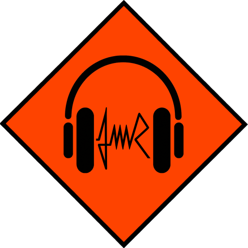
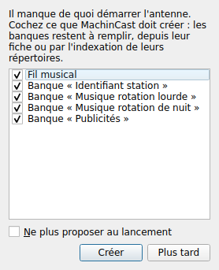
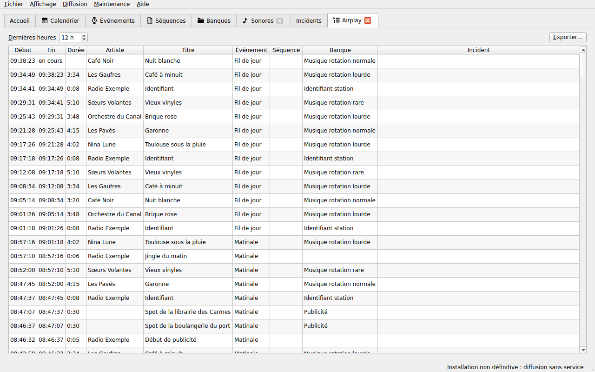
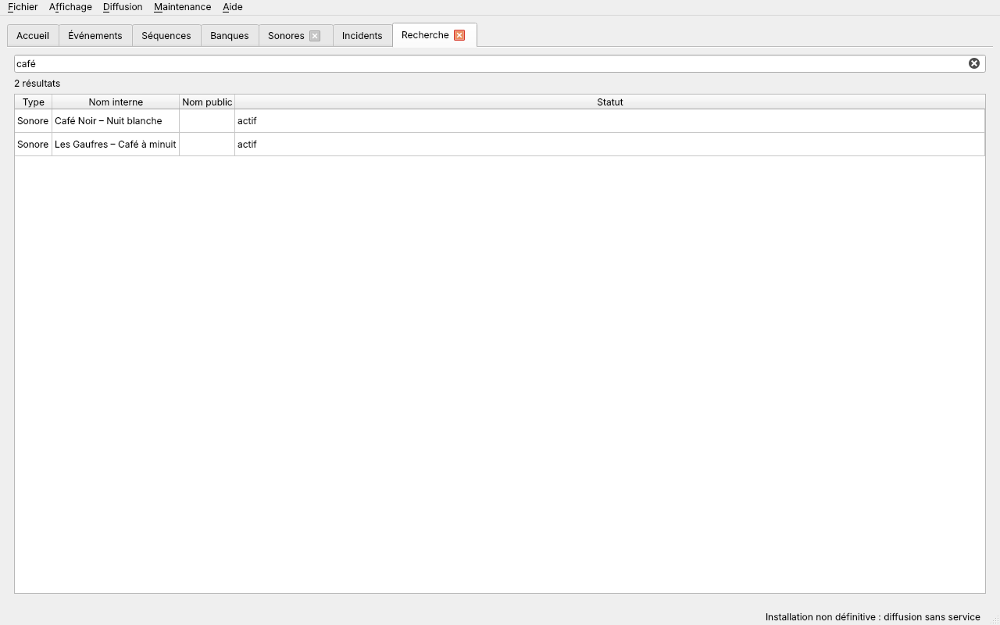
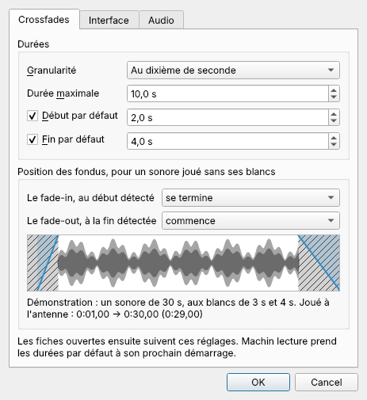

# Prendre en main l'interface

[Guide de l'antenne](README.md) › Prendre en main l'interface

- [La fenêtre](#la-fenêtre)
- [Pour bien démarrer](#pour-bien-démarrer)
- [Accueil](#accueil)
- [Onglet Airplay](#onglet-airplay)
- [Passer d'un onglet à l'autre](#passer-dun-onglet-à-lautre)
- [Menus](#menus)
- [Rafraîchir les onglets](#rafraîchir-les-onglets)
- [Rechercher](#rechercher)
- [Préférences](#préférences)
- [Textes saisis](#textes-saisis)

## La fenêtre

**Pour l'ouvrir**, choisir **MachinCast** dans le menu des applications, rubrique Multimédia, ou double-cliquer sur son icône, le panneau orange au casque des équipes techniques, sur le bureau quand l'installation l'y a déposée. Aucun terminal n'est nécessaire.

**Machin interface** s'ouvre sur une fenêtre à onglets, un par écran. Au lancement : **Accueil**, **Événements**, **Séquences**, **Banques** et **Incidents**. Les listes des **Sonores** et des **Feeds**, et le **Calendrier**, s'ouvrent à la demande, par le menu **Affichage** : « Ouvrir l'onglet Sonores », « Ouvrir l'onglet Feeds » et « Ouvrir l'onglet Grille horaire ». Les Sonores et les Feeds se placent après les Banques ; un onglet déjà ouvert revient au premier plan. Les onglets ouverts à la demande, et ceux des fiches, se ferment par leur croix ; une liste fermée puis rouverte retrouve son filtre et son tri.

**Icônes** : une même icône désigne partout un même genre, dans les onglets, le menu **Affichage**, la recherche, les relations d'un sonore et les boutons **Fiche…** de l'accueil ([#215](https://github.com/dascritch/machincast/issues/215)). Elles prennent la couleur du texte, en thème clair comme en thème sombre.

| Icône | Genre |
| --- | --- |
| une croche | Sonore |
| une feuille et sa liste à puces | Séquence |
| un dossier | Banque |
| une montre | Événement |
| un calendrier | Grille horaire (onglet « Calendrier ») |
| une boule de divination | Simulation |

**Sans base de données**, l'interface ne peut rien montrer : une fenêtre d'erreur, « MachinCast : base de données injoignable », l'explique, et son bouton « Ouvrir INSTALL.md » mène à la section [En cas de problème](../../INSTALL.md#en-cas-de-problème), pour l'administrateur du poste.

## Pour bien démarrer

Au lancement, l'interface cherche ce qui manque pour que l'antenne puisse tourner :

- un **fil musical**, l'événement qui tient l'antenne quand aucun autre ne la prend ;
- les banques **Identifiant station**, **Musique rotation lourde**, **Musique rotation normale**, **Musique rotation rare**, **Musique rotation de nuit**, **Partenariats**, **Publicités** et **Bande-annonce émissions**, reconnues à leur nom, sans tenir compte des majuscules ;
- sur une vraie sortie audio, le **périphérique de l'antenne**, sans lequel la diffusion ne démarre pas.

S'il en manque, la fenêtre **Pour bien démarrer** les propose, chacun coché :

- **Créer** crée ce qui est coché. Le fil musical est permanent. Les banques sont vides : elles se remplissent depuis leur [fiche](sonores.md#fiche-dune-banque), ou par l'indexation de leurs répertoires. L'identifiant station et les rotations musicales sont aléatoires ; les partenariats, les publicités et les bandes-annonces sont séquentiels, dans l'ordre de leurs sonores. « Identifiant station » et « Bande-annonce émissions » sont marquées « ne pas répéter ». Chacune a sa [durée maximale des sonores](sonores.md#fiche-dune-banque) : 15 minutes pour les rotations lourde, normale et rare, 2 minutes pour l'identifiant station, les partenariats, les publicités et les bandes-annonces ; ces trois dernières s'enchaînent sans crossfade, imposé à 0 seconde à leurs sonores ; la rotation de nuit n'en a pas. Tout cela se change dans leur fiche. Un fil musical encore vide reçoit une rotation type : Identifiant station, rotation lourde, normale, lourde, rare. La rotation de nuit reste à placer dans un événement de nuit. La barre d'état dit ce qui a été créé.
- Le **périphérique de l'antenne** se choisit parmi ceux du poste, sauf celui de la pré-écoute. La diffusion le prend à son prochain démarrage (**Diffusion → Arrêter la diffusion**, puis **Démarrer la diffusion**).
- **Plus tard** ne crée rien : la fenêtre revient au lancement suivant.
- **Ne plus proposer au lancement** éteint la fenêtre ; elle se rallume dans les [préférences](#préférences). Sans elle, l'interface recrée au lancement un fil musical vide s'il n'en existe aucun, et le dit dans la barre d'état.

Après la suppression ou l'enregistrement d'un événement, l'interface recrée toujours un fil musical s'il n'en reste aucun.

## Accueil

L'onglet **Accueil** montre en un coup d'œil ce qui passe et ce qui va passer.

- **En haut** : l'heure du poste, à la seconde (la date est dans son infobulle) ; le **texte public** du sonore en cours, tel que l'affiche la page publique de la radio (`—` sans texte, par exemple pour un sonore masqué) ; et l'état de la diffusion : `En diffusion`, `En silence` (rien à diffuser) ou `À l'arrêt`.
- **Événement à l'antenne** : son nom et ses heures, « de 20:00 à 22:00 », « depuis 19:00 » pour une occurrence sans fin, ou « permanent » pour un fil musical.
- **Sonore en cours**, à gauche : l'artiste et le titre, l'événement qui le joue, la séquence et la banque d'où il vient (`—` s'il n'en vient pas), l'horaire (début, fin prévue et durée, « 20:00:00 – 20:03:34 (3:34) »), l'emplacement du fichier ou l'adresse du stream. Pour un fichier, sa **frise** ([#230](https://github.com/dascritch/machincast/issues/230)), en tête, au-dessus du titre, à la hauteur de celle du prochain sonore : la forme d'onde, ses blancs hachurés et ses fondus, tels que l'antenne les joue, règles de sa banque comprises, et la tête de lecture ; au milieu, le temps qui reste, « reste 3:05 ». C'est la frise de la [pré-écoute](sonores.md#frise-dun-fichier), qui ne fait ici que se regarder : un clic n'y déplace rien. Un stream a, à la place, une barre qui dit le temps qui reste, s'il est connu.
- **Prochain sonore**, à droite : les mêmes informations, avec l'horaire prévu et, pour un fichier, sa frise sans tête de lecture, et **Sain** : `oui` si son fichier est présent, actif, lisible, et que sa dernière lecture s'est passée sans incident ; `non` sinon. Sur la ligne **Sain**, **Pré-écoute** l'ouvre dans la [pré-écoute](sonores.md#pré-écoute), comme un clic sur sa frise ; pour un stream, **Tester la connexion du flux** dit dessous si du son arrive, de quel type et à quel débit ([#223](https://github.com/dascritch/machincast/issues/223)). Le prochain sonore annoncé est bien celui qui passera, même tiré au hasard : il ne change que si un événement coupe la diffusion, si son événement est fini, ou s'il est désactivé ou expiré entre-temps.
- **À venir après le prochain sonore** ([#228](https://github.com/dascritch/machincast/issues/228)) : juste au-dessus de l'airplay, les 5 sonores qui passeront ensuite, avec les colonnes de l'airplay, dans le même ordre : début et fin prévus, durée, artiste, titre, événement, séquence, banque, et `pas sain` dans la colonne « Incident » pour un fichier qui a posé problème. Le plus lointain est en haut, le plus proche juste au-dessus de l'airplay : de bas en haut, l'antenne descend la liste. Comme le prochain, ils passeront dans cet ordre, même tirés au hasard ; la liste avance d'un cran à chaque sonore, et elle est recalculée quand quelque chose d'imprévu arrive : une [interruption](antenne.md#interrompre-lantenne), un événement ajouté ou modifié dans la grille, un sonore désactivé. Elle s'arrête avant un silence, ou après un stream dont la fin n'est pas connue. Double-clic et clic droit y font la même chose que dans l'airplay.
- **Coupure annoncée** : quand un événement commencera pendant le sonore en cours, il le coupera net. L'horaire finit alors à la coupure et nomme l'événement, « 20:00:00 – 20:02:00 (coupé par « Journal », sur 3:34) », le temps qui reste dit « reste 1:30 avant « Journal » », et le prochain sonore est celui que jouera cet événement.
- **Stream** : il passe jusqu'à la fin de son événement ; son horaire est « 19:00:00 – 20:00:00 (fin de l'événement) », avec le temps qui lui reste, et le prochain sonore est celui qui reprendra l'antenne à cette fin ([#242](https://github.com/dascritch/machincast/issues/242)). Sans fin d'événement, son horaire est « 20:00:00, durée inconnue ». Il n'est pas testé à l'avance : `non testé`.
- **Emplacement** : un long chemin ne déborde pas ; sa fin reste visible, il se sélectionne et se copie, et son infobulle le donne en entier.
- **Boutons Fiche…** : à droite du titre, de l'événement, de la séquence et de la banque, ils ouvrent la fiche de l'élément.
- **Airplay : les 10 derniers sonores** ([#244](https://github.com/dascritch/machincast/issues/244)) : les 10 derniers passages, du plus récent au plus ancien, avec le début, la fin (`en cours` pour le sonore à l'antenne), la durée, l'artiste, le titre, l'événement, la séquence, la banque, et `oui` dans la colonne « Incident » pour un passage qui en a eu un. Un double-clic sur une ligne ouvre la fiche du sonore, de l'événement, de la séquence ou de la banque cliqué ; un clic droit propose la [pré-écoute](sonores.md#pré-écoute) du sonore. L'interface est réservée à l'équipe : l'artiste et le titre y sont toujours affichés, même masqués sur la page publique. Pour remonter plus loin, l'[onglet Airplay](#onglet-airplay).
- **Encarts repliables** : un clic sur le titre « À venir après le prochain sonore » ou « Airplay : les 10 derniers sonores » replie l'encart (« ▸ »), ou le déplie (« ▾ »). Un encart replié le reste aux prochaines ouvertures de l'interface.

L'accueil suit la diffusion en direct. Quand elle s'arrête, il affiche `À l'arrêt`, et la retrouve tout seul dès qu'elle reprend. Il doit tourner sur le poste de la diffusion, avec le même compte : sinon il ne la voit pas.

### VU-mètre de l'antenne

Entre les deux sonores, la colonne **Antenne** montre ce qui sort réellement à l'antenne :

- **Saturation**, au-dessus : ce voyant s'allume, rouge, dès qu'une crête atteint -1 dB, et le reste 3 secondes. Il se cache dans les [préférences](#préférences).
- **VU-mètre** : une barre par canal, « G » et « D », de -60 dB en bas à 0 dB en haut, séparées par l'échelle. La partie pleine est le niveau moyen ; la partie plus claire au-dessus, la crête du moment ; un trait garde la plus haute crête pendant 2 secondes. Vert, orange au-delà de -12 dB, rouge au-delà de -3 dB.
- **Silence**, en dessous : ce voyant s'allume, orange, quand le son reste à -50 dB ou moins pendant 5 secondes : un blanc d'antenne. Il s'éteint dès que le son revient.
- **Écouter l'antenne** : un clic sur le VU-mètre ouvre la [pré-écoute](sonores.md#pré-écoute) sur l'antenne, sans la lancer. **Diffusion → Pré-écoute de l'antenne**, ou <kbd>Alt</kbd>+<kbd>P</kbd>, l'ouvre de même, et la lance aussitôt ([#245](https://github.com/dascritch/machincast/issues/245)) ; pendant l'écoute, l'entrée devient **Arrêter la pré-écoute de l'antenne**, et <kbd>Alt</kbd>+<kbd>P</kbd> l'arrête aussi ([#256](https://github.com/dascritch/machincast/issues/256)). Le titre de la fenêtre d'écoute est « en cours : » suivi du texte public du sonore à l'antenne, et le suit d'un sonore à l'autre.

Le VU-mètre écoute le périphérique de l'antenne, quel que soit le programme qui y joue. Quand il ne peut pas, un message le dit sous les voyants :

| Message | Ce qu'il faut faire |
| --- | --- |
| `Indisponible avec la sortie ALSA, qui n'a pas de port de monitoring.` | Rien : le poste utilise une sortie qui ne permet pas d'écouter l'antenne. L'administrateur peut passer à PipeWire ou PulseAudio. |
| `Indisponible : périphérique de l'antenne à renseigner.` | Choisir le périphérique de l'antenne dans **Fichier → Préférences…**, page **Audio**. |
| `Indisponible :` suivi d'une erreur | Le périphérique est débranché, ou le son du poste ne répond pas. Le VU-mètre réessaie toutes les 5 secondes. |

## Onglet Airplay

**Affichage → Ouvrir l'onglet Airplay** ouvre l'historique de diffusion dans un onglet à part ([#244](https://github.com/dascritch/machincast/issues/244)), fermé au lancement de l'interface ; sa croix le ferme.

- **Dernières heures**, en haut : combien d'heures remonter, 12 par défaut, jusqu'à un mois. Le réglage est retenu pour les prochaines ouvertures.
- **La table** a les mêmes colonnes que l'airplay de l'accueil, et s'utilise de même : double-clic vers les fiches, clic droit pour la [pré-écoute](sonores.md#pré-écoute). Elle se met à jour à chaque nouveau sonore à l'antenne.
- **Exporter…** enregistre ce que montre l'onglet, au format choisi dans la fenêtre d'enregistrement : **Tableur CSV**, **Page HTML** ou **Liste de lecture M3U**. Chaque export donne à la fois l'artiste, le titre et l'emplacement du fichier, et le **texte public**, tel que la page publique de la radio l'affiche, masquage compris. La liste M3U va du plus ancien au plus récent, et se lit dans un lecteur ; le texte public y est en commentaire. Le nom reçoit l'extension du format : un export ne remplace jamais un fichier sonore. La barre d'état dit où il est enregistré.

## Passer d'un onglet à l'autre

Les 12 premiers onglets s'ouvrent au clavier, par <kbd>Maj</kbd>+<kbd>F1</kbd> à <kbd>Maj</kbd>+<kbd>F12</kbd>, selon leur rang : <kbd>Maj</kbd>+<kbd>F1</kbd> est toujours l'Accueil ; au lancement, <kbd>Maj</kbd>+<kbd>F2</kbd> à <kbd>Maj</kbd>+<kbd>F4</kbd> mènent aux Événements, Séquences et Banques, <kbd>Maj</kbd>+<kbd>F5</kbd> aux Incidents, puis aux fiches et aux autres onglets, dans l'ordre où ils sont ouverts. Ouvrir ou fermer un onglet décale ceux qui le suivent. L'infobulle de chaque onglet donne son raccourci.

## Menus

Une fonction pas encore écrite a déjà son entrée, grisée : son infobulle donne le ticket qui l'apportera.

| Menu | Entrée | Rôle |
| --- | --- | --- |
| Fichier | Préférences… | Les réglages de l'interface et de l'audio ([Préférences](#préférences)). |
| Fichier | Quitter | Ferme l'interface, aussi par <kbd>Alt</kbd>+<kbd>Q</kbd>. Demande d'abord quoi faire des fiches modifiées. La diffusion, elle, continue. |
| Affichage | Rafraîchir les onglets | Relit ce que d'autres postes, l'indexation ou la diffusion ont changé, aussi par <kbd>F5</kbd> ([Rafraîchir les onglets](#rafraîchir-les-onglets)). |
| Affichage | Rechercher… | Ouvre la recherche, aussi par <kbd>Ctrl</kbd>+<kbd>F</kbd> ([Rechercher](#rechercher)). |
| Affichage | Ouvrir l'onglet Sonores, Ouvrir l'onglet Feeds | Ouvrent ces listes, ou les ramènent au premier plan ([Listes](listes.md#listes)). |
| Affichage | Ouvrir l'onglet Grille horaire | Ouvre le calendrier ([Calendrier](grille.md#calendrier)). |
| Affichage | Ouvrir l'onglet Simulation | Ouvre la simulation ([Simulation](grille.md#simulation)). |
| Affichage | Ouvrir l'onglet Airplay | Ouvre l'historique de diffusion, réglable et exportable ([Onglet Airplay](#onglet-airplay)). |
| Affichage | Pré-écoute… | Ouvre la fenêtre de pré-écoute ([Pré-écoute](sonores.md#pré-écoute)). Comme chaque bouton et chaque entrée de pré-écoute, elle porte un casque. |
| Diffusion | Pré-écoute de l'antenne, Arrêter la pré-écoute de l'antenne | En tête du menu : écoute aussitôt l'antenne sur la sortie de pré-écoute ([Pré-écoute](sonores.md#pré-écoute), [#245](https://github.com/dascritch/machincast/issues/245)), puis, pendant l'écoute, l'arrête ; aussi par <kbd>Alt</kbd>+<kbd>P</kbd> ([#256](https://github.com/dascritch/machincast/issues/256)). |
| Diffusion | Démarrer, Arrêter la diffusion | Pilotent la diffusion ([Piloter la diffusion](antenne.md#piloter-la-diffusion)). |
| Diffusion | Sauter au sonore suivant, Sauter après la séquence, Couper l'événement par le fil musical | Corrigent l'antenne sans attendre ([Interrompre l'antenne](antenne.md#interrompre-lantenne)). |
| Maintenance | Indexation rapide, Audit complet | Vérifient les sonores ([Indexation depuis l'interface](sonores.md#indexation-depuis-linterface)). |
| Maintenance | Maintenance de la base de données… | Après confirmation, sauvegarde, vérifie et optimise la base, dans une fenêtre de terminal, qui reste ouverte à la fin : la fermer une fois le compte rendu lu. La question donne le répertoire où la sauvegarde sera enregistrée, et « Choisir l'emplacement… » en propose un autre ; Entrée ou Échap l'annulent. Inactive pendant une indexation. Voir le [guide d'administration](../administration/commandes.md#maintenance-de-la-base--machin-maintenance-db). |
| Maintenance | Moniteur de la sortie… | À venir ([#85](https://github.com/dascritch/machincast/issues/85)). |
| Aide | Documentation | Ouvre ce guide dans le navigateur web. |
| Aide | Signaler un problème… | Ouvre les tickets de MachinCast dans le navigateur web. |
| Aide | Version | Donne la version de MachinCast, et la date de sa dernière modification. |

## Rafraîchir les onglets

Chaque onglet relit la base quand on y passe ([#241](https://github.com/dascritch/machincast/issues/241)) : une liste, les incidents, le calendrier, la recherche, l'airplay, l'accueil, et une fiche, sauf si on est en train de la modifier. Une fiche modifiée reste telle quelle, sans question ; une fiche dont l'élément a été effacé depuis un autre poste se ferme, et la barre d'état le dit. Pendant qu'un onglet reste affiché, ce qu'un autre poste, l'indexation ou la diffusion changent n'apparaît pas tout seul. **Affichage → Rafraîchir les onglets**, ou <kbd>F5</kbd>, relit tout d'un coup :

- l'onglet ouvert : une liste, les incidents, le calendrier, la recherche ou l'airplay ;
- l'airplay de l'accueil ;
- toutes les fiches ouvertes. Une fiche modifiée demande d'abord quoi faire de ses modifications : **Enregistrer** les écrit puis relit la fiche, **Abandonner** les perd et relit la fiche, **Annuler** la laisse telle quelle.
- La fiche d'un élément effacé depuis un autre poste se ferme, sans question.

La barre d'état le confirme, « Onglets rafraîchis. », et nomme les fiches laissées telles quelles ou fermées.

## Rechercher

**Affichage → Rechercher…**, ou <kbd>Ctrl</kbd>+<kbd>F</kbd>, ouvre l'onglet **Recherche**, ou y revient, le curseur dans le champ.

Dès 2 caractères, sans tenir compte des majuscules ni des accents, le texte tapé est cherché dans le nom interne et le nom public des **événements**, des **séquences** et des **banques**, et dans l'artiste et le titre des **sonores**. La table suit la frappe : jusqu'à 500 résultats, avec leur type, nom interne, nom public et statut (l'état d'un sonore), dans l'ordre événements, séquences, banques, puis sonores. Un double-clic ou <kbd>Entrée</kbd> sur une ligne ouvre sa fiche. Le compte dit combien il y a de résultats, ou « 500 premiers résultats sur … » quand il y en a davantage : préciser alors le texte.

## Préférences

**Fichier → Préférences…** ouvre la fenêtre des préférences.

Page **Crossfades** ([#234](https://github.com/dascritch/machincast/issues/234)) :

| Réglage | Rôle |
| --- | --- |
| Granularité | `Au dixième de seconde` (par défaut) ou `À la seconde` : le pas des crossfades dans les fiches. |
| Durée maximale | Le crossfade le plus long que proposent les fiches, 10 secondes par défaut. |
| Début par défaut, fin par défaut | Le crossfade d'un sonore qui n'en a pas, et que sa banque ne règle pas ([Enchaînements](antenne.md#enchaînements)). |
| Le fade-in, au début détecté | Pour un sonore joué sans ses blancs : le fade-in `commence`, `est en cours` ou `se termine` (par défaut) au début détecté ([Blancs au début et à la fin](antenne.md#blancs-au-début-et-à-la-fin)). |
| Le fade-out, à la fin détectée | De même, à la fin détectée : `commence` (par défaut), `est en cours` ou `se termine`. |

Sous ces réglages, une **frise de démonstration** montre un sonore inventé de 30 secondes, aux blancs de 3 et 4 secondes : ses fondus s'y placent selon les durées par défaut saisies et les positions choisies, à chaque changement.

Page **Interface** :

| Réglage | Rôle |
| --- | --- |
| Afficher le voyant de saturation de l'accueil | Cochée par défaut ; décochée, le voyant « Saturation » disparaît du [VU-mètre](#vu-mètre-de-lantenne). |
| Proposer au lancement ce qui manque pour démarrer | Cochée par défaut : la fenêtre [Pour bien démarrer](#pour-bien-démarrer). |
| Icône de l'application | L'icône des fenêtres de MachinCast, de son raccourci dans le menu des applications et sur le bureau, et de la barre des tâches. **Choisir une image…** en prend une autre, SVG, PNG ou JPEG, de préférence carrée, le logo de la radio par exemple ; **Icône de MachinCast** revient à celle d'origine. Une image illisible n'est pas prise : `Image illisible : …`. La nouvelle icône vaut dès **OK**. |

Page **Audio** :

| Réglage | Rôle |
| --- | --- |
| Antenne | Le périphérique de la diffusion. Tant qu'il n'est pas choisi, la barre d'état affiche `Périphérique de l'antenne à renseigner`, et la diffusion refuse de démarrer. Le nouveau périphérique vaut au prochain démarrage de la diffusion. |
| Pré-écoute | Le périphérique de la [pré-écoute](sonores.md#pré-écoute), le casque de la régie par exemple. L'antenne et la pré-écoute n'utilisent jamais le même : celui de l'une est grisé dans l'autre. |
| Seuil de blanc | De -100 à -0,1 dB, -40 dB par défaut : le niveau sous lequel le début et la fin d'un sonore sont un blanc ([Blancs au début et à la fin](antenne.md#blancs-au-début-et-à-la-fin)). |

**OK** les enregistre ; la barre d'état le dit. **Annuler** ne change rien.

## Textes saisis

Les noms, l'artiste, le titre et les métadonnées sont nettoyés à l'enregistrement, pour ne pas gêner la page publique, les flux et les afficheurs : les tabulations, retours à la ligne et espaces spéciales deviennent une espace simple, les espaces en trop disparaissent, et les caractères invisibles sont retirés. Les accents, les écritures non latines et les emoji restent tels quels. Les chemins de fichiers et les adresses de streams sont gardés tels quels.
