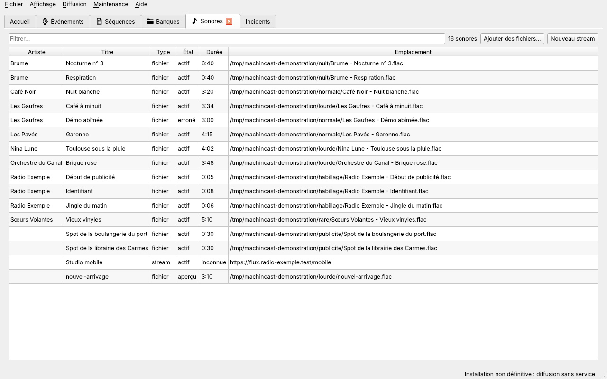
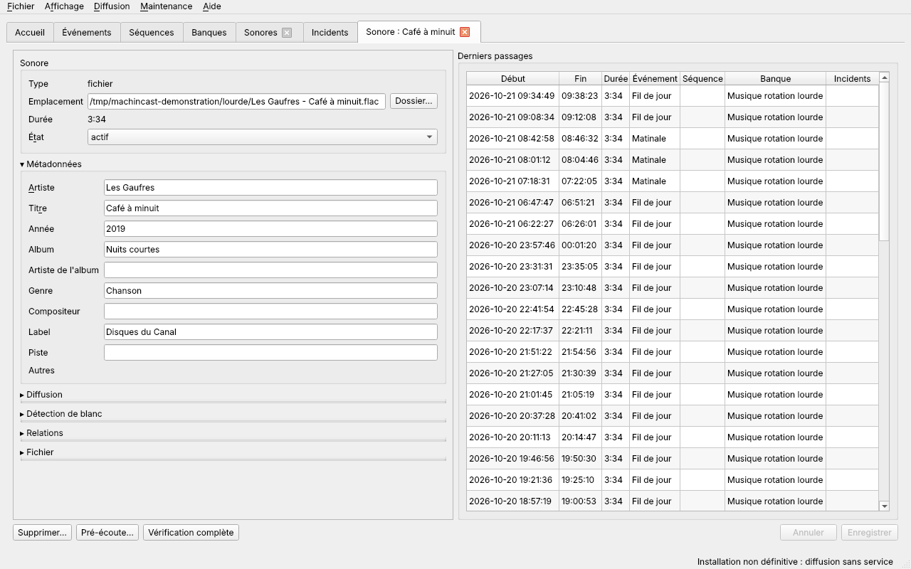
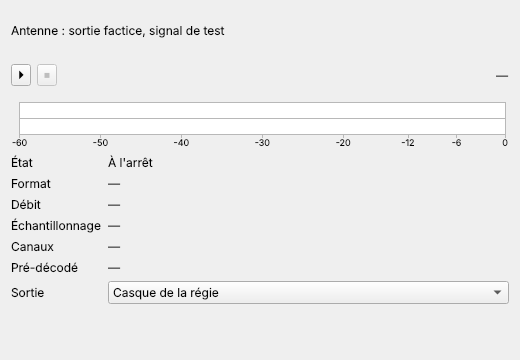
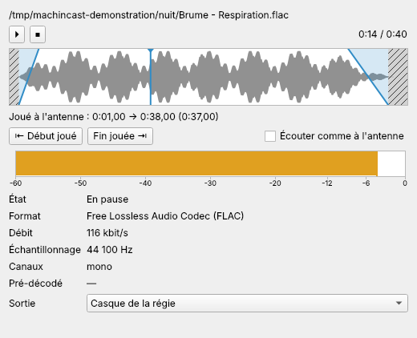
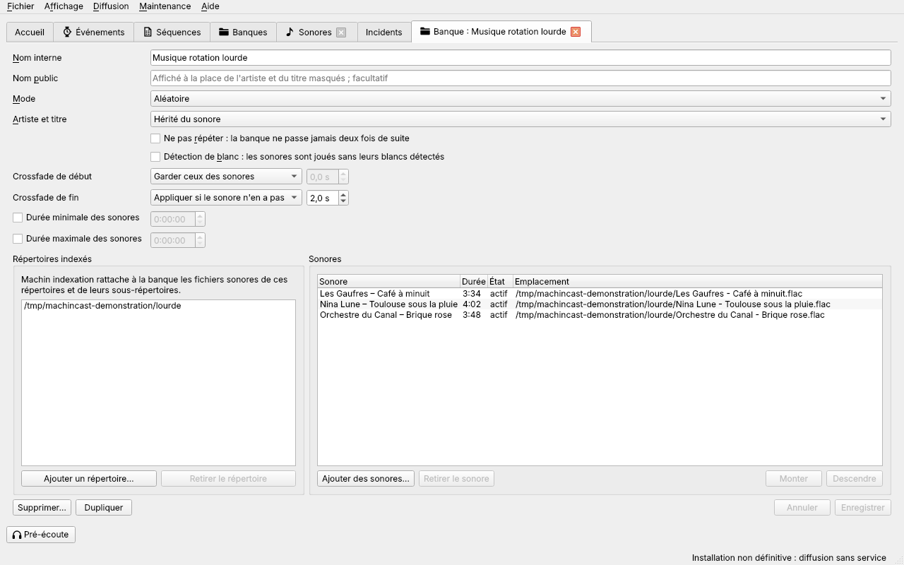

# Sonores, banques et marques-pages

[Guide de l'antenne](README.md) › Sonores, banques et marques-pages

- [Ajouter un sonore](#ajouter-un-sonore)
- [États d'un sonore](#états-dun-sonore)
- [Vérification d'un fichier](#vérification-dun-fichier)
- [Tags et métadonnées](#tags-et-métadonnées)
- [Fiche d'un sonore](#fiche-dun-sonore)
- [Pré-écoute](#pré-écoute)
	- [Frise d'un fichier](#frise-dun-fichier)
- [Fiche d'une banque](#fiche-dune-banque)
- [Alimenter une banque par ses répertoires](#alimenter-une-banque-par-ses-répertoires)
- [Indexation depuis l'interface](#indexation-depuis-linterface)
- [Marques-pages](#marques-pages)

## Ajouter un sonore

La liste des **Sonores** (**Affichage → Ouvrir l'onglet Sonores**) ajoute des fichiers et des streams.

**Fichiers** : **Ajouter des fichiers…** ouvre le sélecteur de fichiers du poste, où plusieurs fichiers se choisissent à la fois ; on peut aussi **déposer des fichiers** sur la liste, glissés depuis le navigateur de fichiers.

- Un fichier est **référencé là où il se trouve, sans copie**, et n'est jamais modifié. Il peut donc être synchronisé depuis un autre ordinateur, et changer de contenu sous le même nom : une émission pré-enregistrée, la rediffusion d'un direct. Même avec <kbd>Maj</kbd> enfoncée, un dépôt n'est jamais un déplacement.
- Il entre à l'état `aperçu`, puis il est **vérifié aussitôt**, en arrière-plan : l'interface reste utilisable. La barre d'état annonce l'ajout, « 2 fichiers ajoutés, en cours de vérification. », puis le résultat, « Vérification terminée : Les Gaufres – Café à minuit, actif ; faux.mp3, erroné. ». Le sonore prend alors sa durée, son artiste et son titre, lus dans ses tags.
- Un fichier déjà en base n'est pas ajouté une seconde fois. Les dossiers et les fichiers qui ne sont pas sonores sont ignorés ; la barre d'état le dit. Les formats reconnus : `.mp3`, `.m4a`, `.aac`, `.ogg`, `.flac`, `.wav`, `.aiff` et `.aif`.

Seuls les fichiers ajoutés depuis la liste des sonores sont vérifiés aussitôt : un fichier déposé sur une banque, une séquence ou un événement attend la prochaine [indexation](#indexation-depuis-linterface).

**Stream** : **Nouveau stream** ouvre une [fiche de sonore](#fiche-dun-sonore) vide. L'adresse du flux, ou un marque-page, est obligatoire. Le stream entre à l'état `actif`.

## États d'un sonore

| État | Sens | Jouable | Comment il en sort |
| --- | --- | --- | --- |
| `aperçu` | Fichier nouvellement trouvé, pas encore vérifié. | non | À sa première vérification réussie, il devient `actif`. |
| `actif` | Sonore en service. | oui, dans sa période de diffusion et sous son maximum de lectures | — |
| `désactivé` | Retiré de l'antenne par l'équipe, dans sa fiche ou la liste. | non | Par l'interface seulement. |
| `expiré` | Maximum de lectures atteint, ou période de diffusion terminée ([Expiration des sonores](antenne.md#expiration-des-sonores)). | non | Par l'interface seulement. |
| `erroné` | Fichier `endommagé` ou `illisible`. | non | Tout seul, quand une vérification trouve le fichier redevenu sain. |
| `non supporté` | Fichier qui n'est pas du son, quelle que soit son extension. | non | Tout seul, quand le fichier est remplacé par un vrai son. L'interface peut aussi le passer `actif` ou `désactivé`. |
| `supprimé` | Fichier `introuvable` : effacé ou déplacé. | non | Par l'interface seulement. Un fichier déplacé dans le répertoire d'une banque revient comme un nouveau sonore. |

La vérification ne change jamais un sonore `désactivé`, `expiré` ou `supprimé` : elle signale seulement un problème de son fichier. Elle ne supprime jamais un sonore.

## Vérification d'un fichier

Chaque vérification d'un fichier donne l'un de ces verdicts :

| Verdict | Signification |
| --- | --- |
| `sain` | Le fichier se lit entièrement. Sa durée est enregistrée. |
| `endommagé` | Le fichier se lit, mais des données manquent : son coupé, fichier tronqué. |
| `non supporté` | Le fichier n'est pas du son, quelle que soit son extension : un texte ou une image renommés en `.mp3`, par exemple. |
| `illisible` | Le fichier est vide, cassé, ou rien n'a pu en être lu. |
| `introuvable` | Aucun fichier à l'emplacement enregistré : il a été effacé ou déplacé. |

Le sonore suit le verdict : `sain` le rend `actif`, `endommagé` ou `illisible` le rend `erroné`, `non supporté` le rend `non supporté`, `introuvable` le rend `supprimé`.

## Tags et métadonnées

Quand un fichier est sain, ses tags remplissent sa fiche :

| Champ de la fiche | Nom technique | Tag lu |
| --- | --- | --- |
| Artiste | `artiste` | artiste |
| Titre | `titre` | titre |
| Année | `annee` | année de sortie |
| Album | `album` | album |
| Artiste de l'album | `artiste_album` | artiste de l'album |
| Genre | `genre` | genre |
| Compositeur | `compositeur` | compositeur |
| Label | `label` | organisation ou éditeur |
| Piste | `piste` | numéro de piste |

Les champs suivent les tags du fichier : un tag retiré vide le champ à la vérification suivante. **Un champ modifié à la main dans la fiche n'est plus jamais écrasé** par les tags.

## Fiche d'un sonore

La fiche d'un sonore s'ouvre dans un onglet nommé « Sonore : » suivi de son titre, du nom de son fichier, ou de l'adresse d'un stream.

**Encarts** : pour garder l'essentiel en vue, **Métadonnées**, **Diffusion**, **Détection de blanc**, **Relations** et **Fichier** s'ouvrent repliés, leur titre précédé de « ▸ ». Un clic sur le titre les déplie (« ▾ »).

- **Sonore** : le type, l'emplacement du fichier et sa durée, qui ne se modifient pas, et l'**état** : `actif` ou `désactivé` ; un sonore `expiré`, `erroné` ou `supprimé` peut revenir à `actif`. Un sonore en `aperçu` attend sa vérification. Le bouton **Dossier…** ouvre le dossier du fichier dans le navigateur de fichiers du poste.
- **Métadonnées** : artiste, titre et les autres champs des [tags](#tags-et-métadonnées).
- **Diffusion** :
  - **Crossfade de début et de fin**, à cocher : décochés, ils viennent de la banque ou des préférences ([Enchaînements](antenne.md#enchaînements)) ; 0 seconde est un crossfade paramétré ;
  - **Maximum de lectures** : `illimité` à 0 ([Expiration des sonores](antenne.md#expiration-des-sonores)) ;
  - **Artiste et titre** : `Masqués` ou `Affichés` sur la page publique, sauf si l'événement, la séquence ou la banque en décide ([Page publique et masquage](antenne.md#page-publique-et-masquage)) ;
  - **Diffusion à partir du**, **Diffusion jusqu'au** : la période de diffusion, chacune à cocher.
- **Détection de blanc**, pour un fichier : **Jouer sans les blancs détectés**, et le **début** et la **fin détectés**, en secondes, mesurés par l'audit complet et corrigibles à la main ([Blancs au début et à la fin](antenne.md#blancs-au-début-et-à-la-fin)).
- **Stream** : l'**adresse directe** ou un **marque-page**, et l'**événement de secours** ([Streams](antenne.md#streams)). **Tester le flux** se connecte à l'adresse saisie et dit `Le flux répond : du son arrive.`, ou pourquoi il ne répond pas. Rien n'est joué à l'antenne.
- **Relations** : les séquences, banques et événements qui citent le sonore ; un double-clic ouvre leur fiche. Une banque dont le sonore sort des durées y a l'icône d'avertissement, avec une infobulle qui dit pourquoi.
- **Fichier** : le type réel du fichier, son encodage moyen, sa taille, ses dates et sa dernière vérification complète.
- **Derniers passages** : les 50 derniers passages du sonore à l'antenne, avec les alertes et incidents notés pendant chacun.

**Saisi à la main** : chaque champ modifié est noté comme saisi à la main, et la fiche en donne la liste : les tags ne l'écraseront plus.

**Boutons** : **Pré-écoute…** fait écouter le sonore ([Pré-écoute](#pré-écoute)). **Vérification complète** vérifie le fichier en entier et mesure ses blancs, sans attendre la prochaine indexation, puis propose de **Rafraîchir** la fiche pour voir le résultat. Un fichier déjà vérifié ainsi, qui n'a pas changé depuis, n'est pas relu : la barre d'état dit `Déjà audité au seuil de -40 dB, fichier inchangé`.

## Pré-écoute

La **fenêtre de pré-écoute** fait écouter un sonore, ou l'antenne, sur le casque de la régie, **jamais sur l'antenne**. Le bouton **Pré-écoute…** d'une fiche de sonore, ou **Affichage → Pré-écoute…**, l'ouvre. Le **clic droit** sur la ligne d'un sonore propose aussi **Pré-écoute…**, en tête du menu ([#226](https://github.com/dascritch/machincast/issues/226)) : dans l'airplay de l'accueil, la liste des sonores, les éléments d'une séquence ou d'un événement, et les sonores d'une banque. Il pré-écoute le sonore de la ligne cliquée, même au milieu d'une sélection ; une ligne qui ne désigne pas de sonore enregistré (une banque, un fichier déposé pas encore enregistré, un sonore supprimé depuis son passage) ne le propose pas. un clic sur le [VU-mètre de l'accueil](prise-en-main.md#vu-mètre-de-lantenne) y charge l'antenne.

- **Lecteur** : **⏵** lance la lecture, **⏸** la met en pause, **⏹** l'arrête.
- **VU-mètre** : comme celui de l'accueil, couché.
- **Informations** : le format, le débit, l'échantillonnage, les canaux, et pour un stream le son déjà reçu d'avance : un flux qui en a peu risque de couper.
- **Sortie** : le périphérique de pré-écoute ; celui de l'antenne est grisé, et ne peut pas être choisi.

Il n'y a qu'une fenêtre de pré-écoute : pré-écouter un autre sonore le met à la place du précédent. La fermer arrête la pré-écoute.

### Frise d'un fichier

Un fichier a une **frise** ([#224](https://github.com/dascritch/machincast/issues/224)), qui s'étend sur toute sa durée. Un stream, ou l'antenne, n'en a pas.

- **Forme d'onde** : elle se dessine dès l'ouverture, au fil du décodage du fichier, sans faire attendre la fenêtre.
- **Blancs** au début et à la fin, tels que la dernière vérification complète les a mesurés ([Blancs au début et à la fin](antenne.md#blancs-au-début-et-à-la-fin)) : **hachures serrées** s'ils sont retirés à l'antenne, **hachures pâles** s'ils y sont joués. Un fichier jamais vérifié le dit, sous la frise : « blancs jamais mesurés ».
- **Fondus** : le crossfade de début monte, celui de fin descend, posés sur la partie jouée. Un crossfade non renseigné dans la fiche est celui des préférences, marqué « (défaut) » dans l'infobulle.
- **Tête de lecture** : un clic sur la frise y place la lecture, comme un glissement une fois relâché. Les flèches du clavier la déplacent d'une seconde. L'infobulle nomme ce qui est sous la souris.

Sous la frise :

- **Joué à l'antenne** : où commence et où finit ce qui passera à l'antenne, et sa durée ;
- **Début joué** lance la lecture au début de cette partie ; **Fin jouée**, 5 secondes avant le fondu de sortie, pour entendre arriver l'enchaînement ;
- **Écouter comme à l'antenne** ne joue que cette partie, avec ses fondus.

La frise montre ce qui est enregistré : enregistrer la fiche avant de pré-écouter un réglage. Elle ne connaît pas la banque par laquelle passera le sonore : une banque qui impose ses crossfades, ou retire les blancs, n'y apparaît pas. Sur l'accueil, la même frise montre le sonore en cours et le prochain, tels que l'antenne les joue, règles de leur banque comprises ([Accueil](prise-en-main.md#accueil)).

## Fiche d'une banque

La fiche d'une banque s'ouvre dans un onglet nommé « Banque : » suivi de son nom ; **Nouvelle banque** ouvre une fiche vide.

| Champ | Rôle |
| --- | --- |
| Nom interne | Obligatoire, et propre à la banque. |
| Nom public | Facultatif. Affiché sur la page publique à la place de l'artiste et du titre masqués, si l'événement et la séquence n'en ont pas. |
| Mode | `Séquentielle` : les sonores passent dans l'ordre de la liste. `Aléatoire` : au hasard ([Quel sonore une banque fournit](antenne.md#quel-sonore-une-banque-fournit)). |
| Artiste et titre | `Masqués` ou `Affichés` sur la page publique, sauf si l'événement ou la séquence en décide ; `Hérité du sonore` laisse décider le sonore. |
| Ne pas répéter | La banque ne passe jamais deux fois de suite. |
| Détection de blanc | Cochée, les sonores joués par la banque le sont sans leurs blancs ([Blancs au début et à la fin](antenne.md#blancs-au-début-et-à-la-fin)). |
| Durée minimale, durée maximale des sonores | Facultatives : pour ne pas confondre un mix, une chanson et une publicité. Un sonore qui en sort est marqué dans cette fiche seulement, avec une infobulle (« 3:20 : plus court que le minimum de la banque, 3:30. »), et la prochaine indexation l'en retire, même ajouté à la main. Un nouveau fichier qui en sort n'y entre jamais. |
| Crossfade de début, crossfade de fin | Pour les sonores joués par la banque : `Garder ceux des sonores` ; `Appliquer si le sonore n'en a pas` ; `Imposer à tous les sonores`. |

**Répertoires indexés** : les fichiers de ces répertoires, et de leurs sous-répertoires, rejoignent la banque à chaque indexation ([Alimenter une banque par ses répertoires](#alimenter-une-banque-par-ses-répertoires)). **Ajouter un répertoire…** ouvre le sélecteur de répertoires ; on peut aussi y déposer des dossiers. **Retirer le répertoire** retire celui qui est choisi. Rien n'est indexé à l'enregistrement : les fichiers d'un nouveau répertoire arrivent à la prochaine indexation.

**Sonores** : chaque sonore, avec sa durée, son état et son emplacement.

- **Ordre** : en mode séquentiel, un sonore se déplace par glisser-déposer, ou avec **Monter** et **Descendre**. En mode aléatoire, l'ordre ne compte pas.
- **Ajouter des sonores…** ouvre la liste des sonores en base ; **déposer des fichiers** les ajoute en fin de liste, comme nouveaux sonores `aperçu` s'ils ne sont pas encore en base.
- **Retirer le sonore** retire le sonore choisi de la banque. Si son fichier est dans l'un des répertoires de la banque, un avertissement rappelle que **la prochaine indexation l'y remettra** : **Retirer quand même**, **Ouvrir le dossier** du fichier pour l'en déplacer, ou **Annuler**. Le sonore reste en base.
- **Plusieurs sonores** se choisissent avec <kbd>Ctrl</kbd> ou <kbd>Maj</kbd> ; le clic droit propose **Pré-écoute…** du sonore cliqué, puis **Activer** et **Désactiver**, enregistrés avec le reste de la fiche.
- **Ouvrir un sonore** : un double-clic ouvre sa fiche dans un autre onglet.

## Alimenter une banque par ses répertoires

Alimenter une banque se limite à déposer des fichiers dans l'un de ses répertoires, puis à lancer une [indexation](#indexation-depuis-linterface) :

- **Sous-répertoires** : ils sont tous parcourus. Les fichiers cachés, dont le nom commence par un point, sont ignorés, comme ceux qui ne sont pas sonores (pochettes, textes…).
- **Nouveau fichier** : il devient un sonore `aperçu`, ajouté **en fin de liste** de la banque, puis vérifié dans la même indexation.
- **Fichier déjà connu** : il n'est jamais enregistré deux fois, même trouvé par plusieurs banques ; il rejoint chaque banque dont il n'est pas encore membre.
- **Sonore retiré à la main** : tant que son fichier reste dans l'un des répertoires de la banque, l'indexation suivante l'y **remet**. Pour l'en retirer durablement, déplacer le fichier hors de ses répertoires.
- **Durées de la banque** : un nouveau fichier n'entre dans la banque que s'il respecte sa durée minimale et sa durée maximale ; sinon, l'indexation n'en dit rien. Chaque indexation retire de la banque les sonores qui en sortent, même ajoutés à la main. Le sonore reste en base, dans ses autres banques et listes.
- **Fichier déplacé** : à son nouvel emplacement, c'est un nouveau sonore ; l'ancien passe `supprimé`.

## Indexation depuis l'interface

L'**indexation** enregistre les fichiers déposés dans les répertoires des banques, et vérifie les sonores. Le menu **Maintenance** la lance :

- **Indexation rapide** : les nouveaux fichiers des banques sont enregistrés et vérifiés, ceux qui ont changé sont revérifiés, et la présence des autres est contrôlée. À lancer après avoir déposé des fichiers.
- **Audit complet** : tous les fichiers sont vérifiés en entier, et leurs blancs mesurés. Plus long, il repère aussi un fichier abîmé sans que sa date ni sa taille aient changé. À lancer après la première indexation, après avoir changé le seuil de blanc, puis de temps en temps.

Pour ne vérifier que quelques sonores en entier, sans tout auditer, le clic droit dans les listes Sonores ou Banques propose **Demander un audit complet** : la prochaine indexation, même rapide, s'en charge ([Agir sur plusieurs sonores ou banques](listes.md#agir-sur-plusieurs-sonores-ou-banques)).

L'indexation tourne dans sa propre fenêtre, qui montre ligne par ligne chaque sonore vérifié, les anomalies, puis le bilan : « Indexation rapide terminée : 2 nouveaux sonores, 0 rattachement, 0 retrait ; 2 sonores vérifiés ; 0 erroné, 0 non supporté, 0 supprimé, 0 rétabli, 2 sortis d'aperçu. ». L'interface reste utilisable, et peut même être fermée. Une seule indexation tourne à la fois. Fermer sa fenêtre pendant l'indexation propose de l'arrêter après le fichier en cours : le travail fait est gardé. À la fin, **Affichage → Rafraîchir les onglets** (<kbd>F5</kbd>) montre ses changements.

## Marques-pages

Un **marque-page** est une adresse de flux réutilisable, souvent en ligne par intermittence, comme le studio mobile de la radio : plusieurs streams peuvent le suivre. **Affichage → Ouvrir l'onglet Marques-pages** en donne la liste ; **Nouveau marque-page** ouvre une fiche vide.

- **Nom** et **Adresse** : obligatoires. Une nouvelle adresse vaut aussitôt pour tous les streams qui suivent le marque-page.
- **Tester le flux** : comme dans la fiche d'un sonore, dit si du son arrive à l'adresse saisie.
- **Streams qui le suivent** : un double-clic ouvre leur fiche.
- **Supprimer…** : un marque-page qu'un stream suit ne se supprime pas ; la fiche nomme ces streams, qui doivent d'abord choisir une autre adresse.
